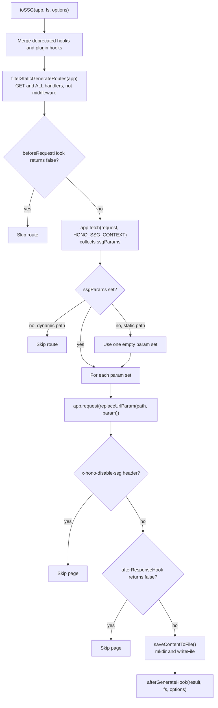

## Overview

The SSG helper, imported from `hono/ssg`, renders a Hono app to files at build time. `toSSG` collects the app's GET routes, requests each one through `app.fetch` exactly as a runtime would, and writes every successful response to an output directory, choosing the file extension from the response's `Content-Type`. The same app can therefore be served dynamically and exported as a static site. The whole API is marked experimental.

Sources: [src/helper/ssg/index.ts:1-14](repo://src/helper/ssg/index.ts#L1-L14), [src/helper/ssg/ssg.ts:363-470](repo://src/helper/ssg/ssg.ts#L363-L470)

`toSSG` does no file I/O itself: it takes a `FileSystemModule` with `writeFile` and `mkdir`, so it runs anywhere that object can be provided. Node users pass `fs/promises`; the Bun and Deno adapters export a `toSSG` that supplies one for their runtime (see [[Runtime Adapters]]).

Sources: [src/helper/ssg/ssg.ts:29-37](repo://src/helper/ssg/ssg.ts#L29-L37), [src/adapter/bun/ssg.ts:1-27](repo://src/adapter/bun/ssg.ts#L1-L27), [src/adapter/deno/ssg.ts:1-27](repo://src/adapter/deno/ssg.ts#L1-L27)

## Usage

```ts
// build.ts (Node)
import fs from 'node:fs/promises'
import { Hono } from 'hono'
import { toSSG, ssgParams, disableSSG, onlySSG } from 'hono/ssg'

const app = new Hono()

app.get('/', (c) => c.html('<h1>Home</h1>'))
app.get('/feed.xml', (c) => c.body('<rss/>', 200, { 'Content-Type': 'application/rss+xml' }))
app.get(
  '/posts/:id',
  ssgParams(async () => (await getPosts()).map((p) => ({ id: p.id }))),
  (c) => c.html(`<h1>Post ${c.req.param('id')}</h1>`)
)
app.get('/api/now', disableSSG(), (c) => c.json({ now: Date.now() }))
app.get('/sitemap.xml', onlySSG(), (c) => c.text(buildSitemap()))

const result = await toSSG(app, fs, { dir: './dist', concurrency: 4 })
if (!result.success) throw result.error
console.log(result.files)
```

Sources: [src/helper/ssg/ssg.ts:368-368](repo://src/helper/ssg/ssg.ts#L368-L368), [src/helper/ssg/middleware.ts:40-83](repo://src/helper/ssg/middleware.ts#L40-L83)

With Bun or Deno, import `toSSG` from `hono/bun` or `hono/deno` and omit the file system argument: `await toSSG(app, { dir: './dist' })`.

Sources: [src/adapter/bun/index.ts:7-7](repo://src/adapter/bun/index.ts#L7-L7), [src/adapter/deno/index.ts:7-7](repo://src/adapter/deno/index.ts#L7-L7)

## Generation flow

### From routes to files



Sources: [src/helper/ssg/ssg.ts:205-302](repo://src/helper/ssg/ssg.ts#L205-L302), [src/helper/ssg/ssg.ts:368-470](repo://src/helper/ssg/ssg.ts#L368-L470)

### Collecting routes

`filterStaticGenerateRoutes` walks `app.routes` and keeps every route registered with `GET` or `ALL` whose handler is not middleware. It unwraps composed handlers with `findTargetHandler` and treats a handler as middleware when it declares more than one parameter (`(c, next)`), so `app.use()` entries are excluded while `app.get()` handlers are kept.

Sources: [src/helper/ssg/utils.ts:61-71](repo://src/helper/ssg/utils.ts#L61-L71), [src/utils/handler.ts:8-15](repo://src/utils/handler.ts#L8-L15)

### Discovering parameters

`fetchRoutesContent` is a generator that yields one promise per route. For each route it builds a request to `http://localhost<path>` (the raw path, including any `:id` placeholder), passes it through the combined `beforeRequestHook`, and runs `app.fetch` with the env `{ HONO_SSG_CONTEXT: true }`. This first request exists only so that an `ssgParams` middleware on the route can attach its parameter list to the request object.

Sources: [src/helper/ssg/ssg.ts:205-251](repo://src/helper/ssg/ssg.ts#L205-L251), [src/helper/ssg/middleware.ts:5-5](repo://src/helper/ssg/middleware.ts#L5-L5)

`isDynamicRoute` marks a path as dynamic when any segment starts with `:` or contains `*`. A dynamic route that set no params is skipped, since there is no URL to request. A static route gets a single empty param set.

Sources: [src/helper/ssg/utils.ts:73-75](repo://src/helper/ssg/utils.ts#L73-L75), [src/helper/ssg/ssg.ts:245-251](repo://src/helper/ssg/ssg.ts#L245-L251)

### Rendering each page

The resolved value is a second generator, yielding one promise per param set. Each one substitutes the params into the route with `replaceUrlParam` from the RPC client utilities and calls `app.request` with the same method and headers and the SSG env. A response carrying the `x-hono-disable-ssg` header is dropped; otherwise the combined `afterResponseHook` may replace it or return `false` to drop it. The MIME type is the `Content-Type` before any `;`, defaulting to `text/plain` because Bun omits `Content-Type` on text responses. Bodies whose type contains `text` or `json` are read as strings; everything else as an `ArrayBuffer`.

Sources: [src/helper/ssg/ssg.ts:253-300](repo://src/helper/ssg/ssg.ts#L253-L300), [src/helper/ssg/ssg.ts:17-25](repo://src/helper/ssg/ssg.ts#L17-L25), [src/helper/ssg/ssg.ts:74-88](repo://src/helper/ssg/ssg.ts#L74-L88), [src/client/utils.ts:18-24](repo://src/client/utils.ts#L18-L24)

Both the parameter request and the page requests go through a pool from `createPool`, limiting how many `app.fetch` calls run at once to `concurrency` (default `2`). When the pool is full, a call is retried on a `setTimeout` until a slot frees.

Sources: [src/helper/ssg/ssg.ts:222-224](repo://src/helper/ssg/ssg.ts#L222-L224), [src/utils/concurrent.ts:12-55](repo://src/utils/concurrent.ts#L12-L55)

### Saving files

`toSSG` iterates both generators, pushing a `saveContentToFile` promise for every page. `saveContentToFile` computes the path with `generateFilePath`, creates its directory once (a module-level `createdDirs` set remembers directories already made) and writes strings directly and `ArrayBuffer` content as a `Uint8Array`. It returns the written path.

Sources: [src/helper/ssg/ssg.ts:309-334](repo://src/helper/ssg/ssg.ts#L309-L334), [src/helper/ssg/ssg.ts:436-449](repo://src/helper/ssg/ssg.ts#L436-L449)

| Route path | MIME type | Output file (`dir: './static'`) |
| --- | --- | --- |
| `/` | `text/html` | `static/index.html` |
| `/about` | `text/html` | `static/about.html` |
| `/docs/` | `text/html` | `static/docs/index.html` |
| `/feed.xml` | `application/rss+xml` | `static/feed.xml` |
| `/api/data` | `application/json` | `static/api/data.json` |

Sources: [src/helper/ssg/ssg.ts:50-72](repo://src/helper/ssg/ssg.ts#L50-L72), [src/helper/ssg/ssg.ts:90-108](repo://src/helper/ssg/ssg.ts#L90-L108)

The extension comes from `extensionMap` (default `defaultExtensionMap`, which maps HTML, the XML family and YAML), then from the general MIME table via `getExtension`, then falls back to `html`. A path that already ends with that extension is kept as is. Every path is checked by `ensureWithinOutDir`, which normalizes both paths and throws `Path traversal detected` if the file would land outside the output directory, for example from a parameter value containing `..`.

Sources: [src/helper/ssg/ssg.ts:90-108](repo://src/helper/ssg/ssg.ts#L90-L108), [src/helper/ssg/utils.ts:77-87](repo://src/helper/ssg/utils.ts#L77-L87), [src/helper/ssg/utils.ts:50-55](repo://src/helper/ssg/utils.ts#L50-L55)

### Result and errors

After all routes resolve, `toSSG` awaits the save promises in order. Save errors were caught into values, so the first one found is rethrown. Any error in the run produces `{ success: false, files: [], error }` instead of a rejected promise; on success the result is `{ success: true, files }`. The combined `afterGenerateHook` then runs with the result, the file system module and the options, whichever way the run ended.

Sources: [src/helper/ssg/ssg.ts:39-48](repo://src/helper/ssg/ssg.ts#L39-L48), [src/helper/ssg/ssg.ts:450-470](repo://src/helper/ssg/ssg.ts#L450-L470)

## Options

| Option | Type | Default | Description |
| --- | --- | --- | --- |
| `dir` | `string` | `'./static'` | Output directory. |
| `concurrency` | `number` | `2` | Maximum concurrent `app.fetch` calls. |
| `extensionMap` | `Record<string, string>` | `defaultExtensionMap` | MIME type to extension map; replaces the default map rather than extending it. |
| `plugins` | `SSGPlugin[]` | `[defaultPlugin()]` | Hook bundles applied in order. |
| `beforeRequestHook` | `BeforeRequestHook \| BeforeRequestHook[]` | none | Deprecated; use a plugin. |
| `afterResponseHook` | `AfterResponseHook \| AfterResponseHook[]` | none | Deprecated; use a plugin. |
| `afterGenerateHook` | `AfterGenerateHook \| AfterGenerateHook[]` | none | Deprecated; use a plugin. |

Sources: [src/helper/ssg/ssg.ts:181-198](repo://src/helper/ssg/ssg.ts#L181-L198), [src/helper/ssg/ssg.ts:420-422](repo://src/helper/ssg/ssg.ts#L420-L422)

## Route middleware

### ssgParams

`ssgParams(params)` accepts an array of param objects or a function of the context returning one (sync or async). It only acts when `c.req.path` is dynamic, which is true only for the parameter-discovery request, since rendered pages have concrete paths. There it stores the params on the raw request as `ssgParams` and returns `c.notFound()` so the real handler does not run. On every other request it calls `next()`.

Sources: [src/helper/ssg/middleware.ts:24-49](repo://src/helper/ssg/middleware.ts#L24-L49)

### isSSGContext, disableSSG and onlySSG

`isSSGContext(c)` is true when `c.env` has the `HONO_SSG_CONTEXT` key, which `toSSG` sets on every request it makes. `disableSSG()` returns 404 with the `x-hono-disable-ssg: true` header during generation, which makes `toSSG` skip the page, and passes through at runtime. `onlySSG()` does the opposite: it returns 404 at runtime and lets the request through during generation. The `SSG_DISABLED_RESPONSE` constant is deprecated in favour of `X_HONO_DISABLE_SSG_HEADER_KEY`.

Sources: [src/helper/ssg/middleware.ts:5-22](repo://src/helper/ssg/middleware.ts#L5-L22), [src/helper/ssg/middleware.ts:51-83](repo://src/helper/ssg/middleware.ts#L51-L83), [src/helper/ssg/ssg.ts:270-273](repo://src/helper/ssg/ssg.ts#L270-L273)

## Plugins and hooks

### Hook types

An `SSGPlugin` may define any of three hooks, each a function or an array. `toSSG` first collects the deprecated top-level hooks, then each plugin's hooks in plugin order, and combines each kind into one function.

Sources: [src/helper/ssg/ssg.ts:110-116](repo://src/helper/ssg/ssg.ts#L110-L116), [src/helper/ssg/ssg.ts:175-179](repo://src/helper/ssg/ssg.ts#L175-L179), [src/helper/ssg/ssg.ts:368-419](repo://src/helper/ssg/ssg.ts#L368-L419)

| Hook | Signature | Combination rule |
| --- | --- | --- |
| `beforeRequestHook` | `(req) => Request \| false` | Runs in order; a `Request` replaces the current one, `false` skips the route. |
| `afterResponseHook` | `(res) => Response \| false` | Runs in order; a `Response` replaces the current one, `false` skips the page. |
| `afterGenerateHook` | `(result, fsModule, options) => void` | Runs every hook in order after generation. |

Sources: [src/helper/ssg/ssg.ts:118-173](repo://src/helper/ssg/ssg.ts#L118-L173)

### Built-in plugins

`defaultPlugin()` drops every response whose status is not 200, so 404s from `disableSSG`, redirects and errors produce no files. It is used only when `plugins` is omitted: passing your own list removes it unless you include it.

Sources: [src/helper/ssg/plugins.ts:4-20](repo://src/helper/ssg/plugins.ts#L4-L20), [src/helper/ssg/ssg.ts:372-372](repo://src/helper/ssg/ssg.ts#L372-L372)

`redirectPlugin()` turns a 301, 302, 303, 307 or 308 response into a 200 HTML page with a `meta refresh`, a canonical link and a fallback anchor to the `Location` (escaped by the `html` helper). A redirect without `Location` is dropped. Place it before `defaultPlugin()`, since hooks run in order and `defaultPlugin` would discard the redirect first.

Sources: [src/helper/ssg/plugins.ts:22-72](repo://src/helper/ssg/plugins.ts#L22-L72)

```ts
import { toSSG, redirectPlugin, defaultPlugin } from 'hono/ssg'

await toSSG(app, fs, {
  plugins: [
    redirectPlugin(),
    defaultPlugin(),
    { afterGenerateHook: (result) => console.log(`${result.files.length} files`) },
  ],
})
```

Sources: [src/helper/ssg/plugins.ts:38-55](repo://src/helper/ssg/plugins.ts#L38-L55)

## Runtime wrappers

### Bun

`bunFileSystemModule.writeFile` calls `Bun.write`, which creates parent directories itself, so `mkdir` is a no-op. The exported `toSSG(app, options)` calls the core `toSSG` with that module.

Sources: [src/adapter/bun/ssg.ts:1-27](repo://src/adapter/bun/ssg.ts#L1-L27)

### Deno

`denoFileSystemModule.writeFile` encodes strings with `TextEncoder` and calls `Deno.writeFile`; `mkdir` calls `Deno.mkdir` with the `recursive` flag. Running it needs Deno's write permission for the output directory.

Sources: [src/adapter/deno/ssg.ts:1-27](repo://src/adapter/deno/ssg.ts#L1-L27)
