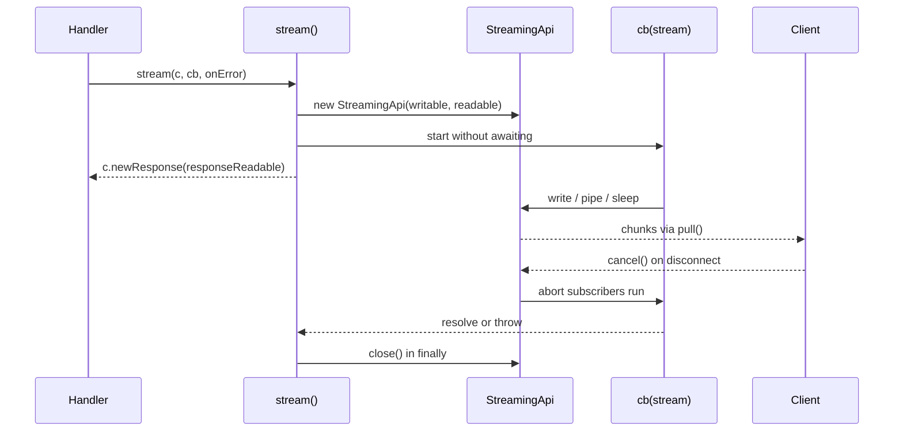

## Overview

The streaming helper, imported from `hono/streaming`, lets a handler return a `Response` immediately and keep writing to its body afterwards. It exports three entry points: `stream` for raw bytes or text, `streamText` for plain text with the right headers, and `streamSSE` for Server-Sent Events, plus the `SSEStreamingApi` class and the `SSEMessage` type.

Sources: [src/helper/streaming/index.ts:1-9](repo://src/helper/streaming/index.ts#L1-L9)

All three helpers are built on `StreamingApi` from `src/utils/stream.ts`, a small wrapper around a `TransformStream` that adds text encoding, piping, sleeping and abort notification. The helper starts the user callback without awaiting it and hands the readable side to `c.newResponse`, so the runtime can start sending headers while the callback is still producing data. See [[Context]] for `c.newResponse` and `c.header`.

Sources: [src/utils/stream.ts:6-46](repo://src/utils/stream.ts#L6-L46), [src/helper/streaming/stream.ts:7-45](repo://src/helper/streaming/stream.ts#L7-L45)

## Usage

A handler passes the context and an async callback. The callback receives the stream object and writes to it; the response is returned synchronously.

Sources: [src/helper/streaming/stream.ts:7-11](repo://src/helper/streaming/stream.ts#L7-L11)

```ts
import { Hono } from 'hono'
import { stream, streamText, streamSSE } from 'hono/streaming'

const app = new Hono()

app.get('/bytes', (c) =>
  stream(c, async (stream) => {
    stream.onAbort(() => console.log('client disconnected'))
    await stream.write(new Uint8Array([0x48, 0x6f]))
    await stream.pipe(someReadableStream)
  })
)

app.get('/text', (c) =>
  streamText(c, async (stream) => {
    await stream.writeln('Hello')
    await stream.sleep(1000)
    await stream.write('Hono!')
  })
)

let id = 0
app.get('/sse', (c) =>
  streamSSE(c, async (stream) => {
    while (!stream.aborted) {
      await stream.writeSSE({ event: 'time', data: new Date().toISOString(), id: String(id++) })
      await stream.sleep(1000)
    }
  })
)
```

Sources: [src/helper/streaming/stream.ts:7-11](repo://src/helper/streaming/stream.ts#L7-L11), [src/helper/streaming/text.ts:6-15](repo://src/helper/streaming/text.ts#L6-L15), [src/helper/streaming/sse.ts:72-76](repo://src/helper/streaming/sse.ts#L72-L76), [src/utils/stream.ts:48-97](repo://src/utils/stream.ts#L48-L97)

## The StreamingApi class

### Construction and the response body

`StreamingApi` takes the writable and readable halves of a `TransformStream`. It grabs a writer on the writable side and a reader on the readable side, and exposes a new `ReadableStream` named `responseReadable` whose `pull` reads one chunk from that reader and enqueues it, closing when the reader is done. This extra stream exists so that a `cancel` from the consumer (the client went away) can be observed: its `cancel` hook calls `this.abort()` unless the stream was already closed normally.

Sources: [src/utils/stream.ts:6-46](repo://src/utils/stream.ts#L6-L46)

The constructor also registers a first abort subscriber that cancels the internal reader. Without it, a pending `write` could block forever once nobody reads the response; cancelling the reader makes later writes fail fast instead.

Sources: [src/utils/stream.ts:26-33](repo://src/utils/stream.ts#L26-L33)

### Methods and properties

| Member | Type | Description |
| --- | --- | --- |
| `write(input)` | `(Uint8Array \| string) => Promise<StreamingApi>` | Encodes strings with `TextEncoder` and writes the chunk. Write errors are swallowed. |
| `writeln(input)` | `(string) => Promise<StreamingApi>` | Writes `input + '\n'`. |
| `sleep(ms)` | `(number) => Promise<unknown>` | Resolves after `ms` milliseconds via `setTimeout`. |
| `pipe(body)` | `(ReadableStream) => Promise<void>` | Releases the writer lock, pipes `body` into the writable with `preventClose: true`, then takes a new writer. |
| `close()` | `() => Promise<void>` | Sets `closed = true` and closes the writer, ignoring errors. |
| `onAbort(listener)` | `(() => void \| Promise<void>) => void` | Adds a listener run when the stream is aborted. |
| `abort()` | `() => void` | Runs every abort subscriber once and sets `aborted = true`. Call it when an external event ends the stream. |
| `aborted` | `boolean` | Whether the stream has been aborted. |
| `closed` | `boolean` | Whether the stream has been closed normally. |
| `responseReadable` | `ReadableStream` | The body handed to the `Response`. |

Sources: [src/utils/stream.ts:10-97](repo://src/utils/stream.ts#L10-L97)

> [!NOTE]
> `write` and `close` catch and discard every error, so writing to a stream whose client disconnected never throws. Check `stream.aborted` or register `onAbort` to stop producing data. The source comment says to create a stream yourself if you need to handle write errors.

Sources: [src/utils/stream.ts:48-76](repo://src/utils/stream.ts#L48-L76)

## The stream flow

`stream(c, cb, onError?)` wires the pieces together and runs the callback in a detached async block.

Sources: [src/helper/streaming/stream.ts:7-45](repo://src/helper/streaming/stream.ts#L7-L45)



Sources: [src/helper/streaming/stream.ts:7-45](repo://src/helper/streaming/stream.ts#L7-L45), [src/utils/stream.ts:35-97](repo://src/utils/stream.ts#L35-L97)

1. A `TransformStream` is created and wrapped in a `StreamingApi`.
2. On old Bun versions, a listener on `c.req.raw.signal` calls `stream.abort()` on request abort, because those versions never called `cancel()` on a response body.
3. The context is stored in a module-level `WeakMap` keyed by `responseReadable`. Bun destroys `c` once the handler returns, so this keeps it alive for as long as the body stream exists.
4. The callback runs inside `try/catch/finally`; `finally` always calls `stream.close()`.
5. The handler gets `c.newResponse(stream.responseReadable)` right away.

Sources: [src/helper/streaming/stream.ts:12-44](repo://src/helper/streaming/stream.ts#L12-L44)

`isOldBunVersion` checks `Bun.version` for a `1.1`, `1.0` or `0.` prefix, matching the comment that Bun fixed `cancel()` in v1.1.27. After the first call it replaces itself with a function that returns the cached result. Outside Bun it returns `false` and the signal listener is never added.

Sources: [src/helper/streaming/utils.ts:1-11](repo://src/helper/streaming/utils.ts#L1-L11), [src/helper/streaming/stream.ts:15-22](repo://src/helper/streaming/stream.ts#L15-L22)

## Error handling

When the callback throws, `stream` distinguishes three cases. A rejection with `undefined` is ignored: that is what `pipeTo()` produces when the reader was cancelled without a reason by `StreamingApi`, and the stream is already closed. An `Error` with an `onError` callback calls `onError(e, stream)`, which may still write a last message before the stream closes. Anything else is logged with `console.error`. The stream is closed in every case.

Sources: [src/helper/streaming/stream.ts:26-42](repo://src/helper/streaming/stream.ts#L26-L42)

Errors thrown inside the callback never reach `app.onError` or the [[Error Handling and HTTPException]] machinery: by the time the callback fails, the handler has already returned its `Response` with a 200 status and headers sent.

Sources: [src/helper/streaming/stream.ts:26-44](repo://src/helper/streaming/stream.ts#L26-L44)

## streamText

`streamText` sets three headers and delegates to `stream`: `Content-Type` to `TEXT_PLAIN` (`text/plain; charset=UTF-8`), `X-Content-Type-Options: nosniff`, and `Transfer-Encoding: chunked`. The `nosniff` header stops browsers from guessing a different content type from the first bytes, which matters when the body arrives in fragments.

Sources: [src/helper/streaming/text.ts:1-15](repo://src/helper/streaming/text.ts#L1-L15), [src/context.ts:279-279](repo://src/context.ts#L279-L279)

## Server-Sent Events

### streamSSE

`streamSSE(c, cb, onError?)` follows the same steps as `stream` (old-Bun abort listener, context stash, detached run) but builds an `SSEStreamingApi` and sets the event-stream headers before returning the response.

Sources: [src/helper/streaming/sse.ts:70-100](repo://src/helper/streaming/sse.ts#L70-L100)

| Header | Value |
| --- | --- |
| `Transfer-Encoding` | `chunked` |
| `Content-Type` | `text/event-stream` |
| `Cache-Control` | `no-cache` |
| `Connection` | `keep-alive` |

Sources: [src/helper/streaming/sse.ts:92-95](repo://src/helper/streaming/sse.ts#L92-L95)

Its internal `run` function handles errors differently from `stream`: when the callback throws an `Error` and `onError` is given, it awaits `onError(e, stream)` and then writes an SSE message with `event: 'error'` and the error message as `data`, so the browser's `EventSource` sees an `error` event. Without `onError`, or for a non-`Error` value, it only logs the value. `finally` closes the stream.

Sources: [src/helper/streaming/sse.ts:47-68](repo://src/helper/streaming/sse.ts#L47-L68)

### SSEMessage and writeSSE

| Field | Type | Required | Description |
| --- | --- | --- | --- |
| `data` | `string \| Promise<string>` | yes | Payload. Multi-line data becomes several `data:` lines. |
| `event` | `string` | no | Event name, emitted as `event: <name>`. |
| `id` | `string` | no | Event id, emitted as `id: <id>`. |
| `retry` | `number` | no | Reconnection delay in milliseconds, emitted as `retry: <n>`. |

Sources: [src/helper/streaming/sse.ts:6-11](repo://src/helper/streaming/sse.ts#L6-L11)

`writeSSE` first resolves `data` through `resolveCallback` with the `Stringify` phase, so `data` may be a promise or an `HtmlEscapedString` produced by the `html` helper or JSX, whose callbacks run before the text is sent (see [[HTML and CSS Helpers]]). The resolved text is split on `\r\n`, `\r` or `\n` and each line is prefixed with `data: `. It then rejects an `event`, `id` or `retry` value containing a carriage return or newline by throwing, because such a value would inject extra SSE fields. Finally it joins the present fields as `event`, `data` lines, `id`, `retry`, adds a blank line terminator and writes the result.

Sources: [src/helper/streaming/sse.ts:18-44](repo://src/helper/streaming/sse.ts#L18-L44), [src/utils/html.ts:142-182](repo://src/utils/html.ts#L142-L182)

```ts
await stream.writeSSE({ event: 'update', id: '1', data: 'line one\nline two' })
// event: update
// data: line one
// data: line two
// id: 1
//
```

Sources: [src/helper/streaming/sse.ts:20-43](repo://src/helper/streaming/sse.ts#L20-L43)

> [!WARNING]
> Fields are included only when truthy, so `retry: 0` and an empty `id` are dropped from the message.

Sources: [src/helper/streaming/sse.ts:33-41](repo://src/helper/streaming/sse.ts#L33-L41)
