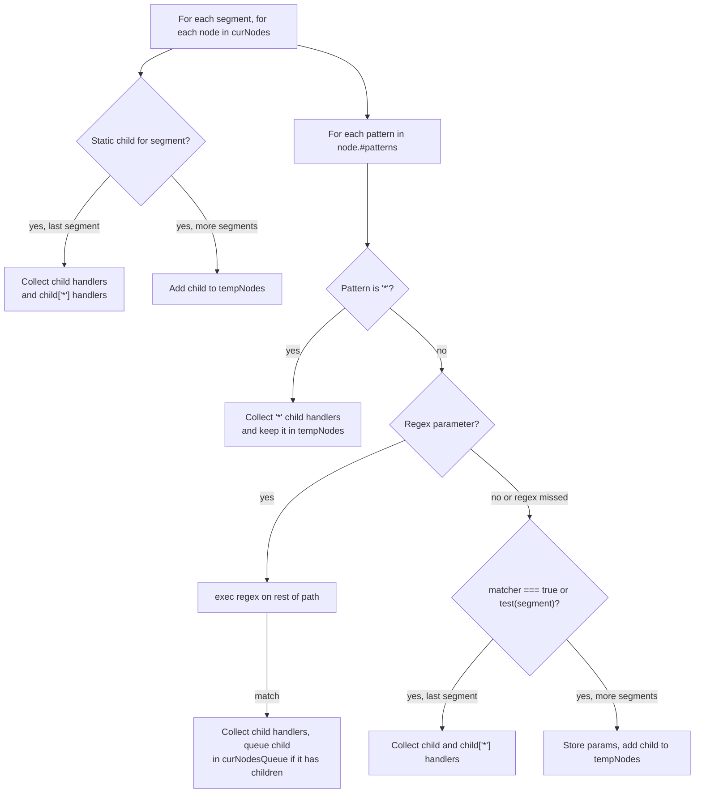

## Overview

`TrieRouter` stores routes in a tree keyed by path segment and walks it for every request. It supports every route pattern Hono accepts, including combinations that [[RegExpRouter]] refuses, which is why the default `Hono` app places it second in its `SmartRouter`: when `RegExpRouter` throws `UnsupportedPathError`, routing continues with `TrieRouter` (see [[Routers and SmartRouter]]). `hono/quick` uses it as the fallback behind `LinearRouter` as well.

Sources: [src/hono.ts:26-33](repo://src/hono.ts#L26-L33), [src/preset/quick.ts:18-23](repo://src/preset/quick.ts#L18-L23)

The router class is a thin wrapper around a root `Node`. `add` expands optional parameters with `checkOptionalParameter` and inserts each variant; `match` delegates to `Node.search`. Unlike the regex routers it keeps accepting routes after the first match, because nothing is compiled.

Sources: [src/router/trie-router/router.ts:1-28](repo://src/router/trie-router/router.ts#L1-L28)

## Node structure

Each `Node` has five pieces of state that drive insertion and search.

Sources: [src/router/trie-router/node.ts:25-42](repo://src/router/trie-router/node.ts#L25-L42)

| Field | Type | Role |
| --- | --- | --- |
| `#children` | `Record<string, Node<T>>` | Child nodes keyed by the literal segment, by `'*'`, or by a pattern's key such as `:id` or `:id{[0-9]+}`. |
| `#patterns` | `Pattern[]` | The dynamic children of this node, in insertion order, as returned by `getPattern`. |
| `#methods` | `Record<string, HandlerSet<T>>[]` | One entry per route ending at this node, each mapping one method to its handler set. |
| `#order` | `number` | On the root, a counter incremented on every insert; it becomes each route's `score`. |
| `#params` | `Record<string, string>` | Scratch space used during `search` to carry parameters down a branch. |

Sources: [src/router/trie-router/node.ts:6-42](repo://src/router/trie-router/node.ts#L6-L42)

A `HandlerSet` holds the `handler`, the `possibleKeys` (parameter names collected along the route's path) and the `score`. At match time it is extended with `params`, the values for this request.

Sources: [src/router/trie-router/node.ts:6-14](repo://src/router/trie-router/node.ts#L6-L14)

## Insertion

### Splitting the route path

`insert` increments `#order` and splits the path with `splitRoutingPath`, which keeps a `{...}` regex body inside one segment even when the regex contains `/`. For each segment it calls `getPattern(segment, nextSegment)`.

Sources: [src/router/trie-router/node.ts:44-56](repo://src/router/trie-router/node.ts#L44-L56), [src/utils/url.ts:16-48](repo://src/utils/url.ts#L16-L48)

`getPattern` classifies a segment: `'*'` is a wildcard, `:name` becomes `[':name', 'name', true]`, and `:name{re}` becomes a tuple whose third element is a `RegExp`. When a regex parameter is followed by a literal segment, the regex is anchored with a `(?=/next)` lookahead and its key includes `#next`, so the same regex parameter followed by different literals produces different children.

Sources: [src/utils/url.ts:50-78](repo://src/utils/url.ts#L50-L78)

### Building the path of nodes

The node key is the pattern's first element for parameters and the raw segment otherwise. If a child with that key exists, insertion descends into it; otherwise it creates the child and, for a dynamic segment, appends the pattern to the parent's `#patterns`. Parameter names go into `possibleKeys` either way. At the last segment the route is recorded by pushing `{ [method]: { handler, possibleKeys, score } }` onto the node's `#methods`, with duplicate keys removed.

Sources: [src/router/trie-router/node.ts:57-85](repo://src/router/trie-router/node.ts#L57-L85)

> [!NOTE]
> Registering the same method and path twice pushes two entries onto the same node, so both handlers match, in registration order.

Sources: [src/router/trie-router/node.ts:76-82](repo://src/router/trie-router/node.ts#L76-L82)

## Search

### Breadth-first walk

`search` splits the request path with `splitPath` and keeps a list `curNodes` of nodes reachable so far, starting with the root. For each request segment it builds `tempNodes`, the frontier for the next segment, by trying every node in `curNodes`. All matching routes are collected, not just the best one, because Hono needs every middleware and handler that applies.

Sources: [src/router/trie-router/node.ts:114-135](repo://src/router/trie-router/node.ts#L114-L135), [src/utils/url.ts:8-14](repo://src/utils/url.ts#L8-L14)



Sources: [src/router/trie-router/node.ts:127-235](repo://src/router/trie-router/node.ts#L127-L235)

### Static children and trailing wildcards

A static child whose key equals the segment is followed. On the last segment its handlers are collected, and so are the handlers of its `'*'` child, which is how `/hello/*` matches `/hello`. The child inherits the parent's `#params` so parameters captured earlier stay available.

Sources: [src/router/trie-router/node.ts:132-147](repo://src/router/trie-router/node.ts#L132-L147)

### Wildcard patterns

For a `'*'` pattern the `'*'` child's handlers are collected immediately, so a trailing wildcard matches whatever remains, and the child is also kept in `tempNodes` so an inner wildcard such as `/hello/*/foo` can continue to the next segment.

Sources: [src/router/trie-router/node.ts:149-163](repo://src/router/trie-router/node.ts#L149-L163)

### Named parameters

A plain `:name` (matcher `true`) accepts any non-empty segment; an empty segment, from a trailing slash, skips parameters that have no regex. The value is stored in a copy of the parent's params, then either collected (last segment, together with any `'*'` child) or carried into `tempNodes` on the child's `#params`.

Sources: [src/router/trie-router/node.ts:165-171](repo://src/router/trie-router/node.ts#L165-L171), [src/router/trie-router/node.ts:212-229](repo://src/router/trie-router/node.ts#L212-L229)

### Regex parameters that span segments

A regex parameter is executed against the rest of the path from the current segment, not just the segment, so `/js/:filename{[a-z0-9/]+.js}` matches `/js/chunk/123.js` with `filename` set to `chunk/123.js`. `partOffsets` records each segment's start position and is computed lazily the first time a regex parameter is tried. On a match the child's handlers are collected at once; if the match consumed the whole remainder, a `'*'` child is collected too. When the child has further children, it is queued in `curNodesQueue` at a slot chosen by whether the match contained a `/`, and the queue is shifted into `curNodes` at the end of each segment so the walk resumes after the consumed text.

Sources: [src/router/trie-router/node.ts:173-210](repo://src/router/trie-router/node.ts#L173-L210), [src/router/trie-router/node.ts:233-235](repo://src/router/trie-router/node.ts#L233-L235)

```ts
const node = new Node()
node.insert('get', '/js/:filename{[a-z0-9/]+.js}', 'any file')
node.insert('get', '/js/main.js', 'main.js')

node.search('get', '/js/chunk/123.js')
// [[['any file', { filename: 'chunk/123.js' }]]]
```

Sources: [src/router/trie-router/node.test.ts:458-482](repo://src/router/trie-router/node.test.ts#L458-L482)

## Ordering by score

The breadth-first walk discovers handlers by tree position, not by registration order: a wildcard child can be found before or after a parameter child depending on where it sits. Hono composes handlers in the order the router returns them, so `search` sorts the collected handler sets by `score`, the insertion counter, whenever more than one matched. The result is the direct `Result` form, `[[handler, params][]]`.

Sources: [src/router/trie-router/node.ts:237-244](repo://src/router/trie-router/node.ts#L237-L244), [src/router/trie-router/node.ts:44-45](repo://src/router/trie-router/node.ts#L44-L45)

```ts
const node = new Node()
node.insert('get', '/api/*', '1st')
node.insert('get', '/api/*', '2nd')
node.insert('get', '/api/posts/:id', '3rd')
node.insert('get', '/api/*', '4th')

node.search('get', '/api/posts/123')
// handlers in order: '1st', '2nd', '3rd', '4th'
```

Sources: [src/router/trie-router/node.test.ts:597-612](repo://src/router/trie-router/node.test.ts#L597-L612)

## Parameter extraction

`#pushHandlerSets` runs for each node whose routes match. For every entry in `#methods` it picks the handler set for the request method, falling back to `ALL`, resets its `params`, and fills one value per name in `possibleKeys`. Values come from two maps: the parameters inherited along the current branch (`nodeParams`) and the ones captured at this step (`params`). A `processedSet` keyed by the set's `score` lets the second map take precedence only for the first key filled; later keys prefer the branch value and fall back to the second map.

Sources: [src/router/trie-router/node.ts:87-112](repo://src/router/trie-router/node.ts#L87-L112)

Because each handler set carries its own `params`, two routes matched by the same request can see different values for the same name.

Sources: [src/router/trie-router/node.test.ts:799-813](repo://src/router/trie-router/node.test.ts#L799-L813)

```ts
node.insert('get', '/:id/:id2/comments', 'a')
node.insert('get', '/posts/:id/comments', 'b')

node.search('get', '/posts/123/comments')
// [['a', { id: 'posts', id2: '123' }], ['b', { id: '123' }]]
```

Sources: [src/router/trie-router/node.test.ts:799-813](repo://src/router/trie-router/node.test.ts#L799-L813)

## Trade-offs

| Aspect | Behaviour |
| --- | --- |
| Pattern support | Every pattern in the shared router test suite, with no skipped cases. |
| Match cost | Proportional to segments times live branches; no compilation step. |
| Adding routes after the first match | Allowed: `add` always inserts into the tree. |
| Result format | Direct params per handler (`[[T, Params][]]`), so no stash is shared. |

Sources: [src/router/trie-router/router.test.ts:1-8](repo://src/router/trie-router/router.test.ts#L1-L8), [src/router/trie-router/router.ts:13-27](repo://src/router/trie-router/router.ts#L13-L27)
