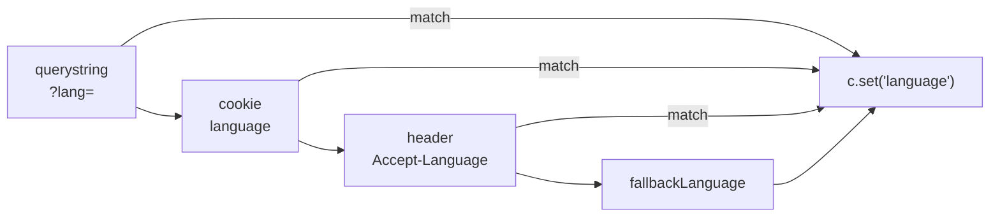

## Overview

Hono ships a set of small, single-purpose middleware under `src/middleware`, each published as its own entry point (`hono/logger`, `hono/timing`, `hono/request-id`, and so on). They share one shape: a factory takes options and returns a `MiddlewareHandler` that runs code before `await next()`, after it, or both. Code before `next()` sees the request; code after it sees `c.res` and may change or replace it. [[Request Lifecycle and Middleware Composition]] explains that onion order, and [[Context]] covers `c.set`, `c.get` and `c.res`, which most of these middleware rely on.

Sources: [src/middleware/logger/index.ts:81-95](repo://src/middleware/logger/index.ts#L81-L95), [src/middleware/powered-by/index.ts:30-35](repo://src/middleware/powered-by/index.ts#L30-L35)

| Middleware | Import | Runs | Purpose |
| --- | --- | --- | --- |
| `logger` | `hono/logger` | before and after | Prints one line per request and per response. |
| `timing` | `hono/timing` | before and after | Builds a `Server-Timing` header from timers and metrics. |
| `requestId` | `hono/request-id` | before | Accepts or generates a request ID and echoes it in a header. |
| `timeout` | `hono/timeout` | around | Rejects with an `HTTPException` when the downstream chain is too slow. |
| `prettyJSON` | `hono/pretty-json` | after | Re-serializes JSON responses with indentation on demand. |
| `poweredBy` | `hono/powered-by` | after | Sets `X-Powered-By`. |
| `methodOverride` | `hono/method-override` | before | Re-dispatches a POST as another method taken from a form field, header or query. |
| `trimTrailingSlash`, `appendTrailingSlash` | `hono/trailing-slash` | before or after | Redirects to the canonical slash form of a path. |
| `some`, `every`, `except` | `hono/combine` | around | Compose middleware with OR, AND and exclusion logic. |
| `contextStorage` | `hono/context-storage` | around | Makes the current `Context` reachable through `AsyncLocalStorage`. |
| `languageDetector` | `hono/language` | before | Resolves the request language and stores it as `c.get('language')`. |

Sources: [src/middleware/timing/index.ts:1-8](repo://src/middleware/timing/index.ts#L1-L8), [src/middleware/request-id/index.ts:1-7](repo://src/middleware/request-id/index.ts#L1-L7), [src/middleware/language/index.ts:1-12](repo://src/middleware/language/index.ts#L1-L12), [src/middleware/combine/index.ts:38-38](repo://src/middleware/combine/index.ts#L38-L38)

## Logging

### logger

`logger(fn = console.log)` prints an incoming line before `next()` and an outgoing line after it. The path is everything in `c.req.url` from the first `/` after the scheme, so the query string is included. The outgoing line adds the status and the elapsed time from `Date.now()`, written as `ms` below one second and as rounded seconds above, with thousands separators.

Sources: [src/middleware/logger/index.ts:9-26](repo://src/middleware/logger/index.ts#L9-L26), [src/middleware/logger/index.ts:50-95](repo://src/middleware/logger/index.ts#L50-L95)

```text
<-- GET /posts?page=2
--> GET /posts?page=2 200 12ms
```

Sources: [src/middleware/logger/index.ts:50-63](repo://src/middleware/logger/index.ts#L50-L63)

The status is coloured by class (5xx red, 4xx yellow, 3xx cyan, 2xx green) unless colour is disabled; other statuses such as 101 print plain. `getColorEnabledAsync` honours `NO_COLOR` from `process.env`, `Deno.noColor`, or, on Cloudflare Workers, the `env` exported by `cloudflare:workers`. Pass a custom `fn` to send the lines to another sink; it receives the finished string.

Sources: [src/middleware/logger/index.ts:28-46](repo://src/middleware/logger/index.ts#L28-L46), [src/utils/color.ts:14-56](repo://src/utils/color.ts#L14-L56)

> [!NOTE]
> The `LogPrefix` enum also defines `xxx` for errors, but the middleware only emits `<--` and `-->`. A thrown error is turned into a response by the error handler, and the outgoing line then shows that response's status.

Sources: [src/middleware/logger/index.ts:9-13](repo://src/middleware/logger/index.ts#L9-L13), [src/middleware/logger/index.ts:87-93](repo://src/middleware/logger/index.ts#L87-L93)

## Server-Timing

### timing middleware

`timing()` stores a `metric` object (`headers: string[]` and a `timers` map) in the context, starts a `total` timer, runs the chain, and then writes `Server-Timing` with every collected entry joined by commas. If a `metric` variable already exists, for example because `timing()` was registered twice, the inner instance just calls `next()`. Times come from `performance.now()` when available and `Date.now()` otherwise.

Sources: [src/middleware/timing/timing.ts:10-35](repo://src/middleware/timing/timing.ts#L10-L35), [src/middleware/timing/timing.ts:76-126](repo://src/middleware/timing/timing.ts#L76-L126)

| Option | Type | Default | Description |
| --- | --- | --- | --- |
| `total` | `boolean` | `true` | Add a `total` metric covering the whole downstream chain. |
| `enabled` | `boolean \| (c) => boolean` | `true` | Whether to write the headers; evaluated after the handler runs. |
| `totalDescription` | `string` | `'Total Response Time'` | `desc` of the total metric. |
| `autoEnd` | `boolean` | `true` | End every timer still running when the chain returns. |
| `crossOrigin` | `boolean \| string \| (c) => boolean \| string` | `false` | Also set `Timing-Allow-Origin`: `*` for `true`, or the given origin. |

Sources: [src/middleware/timing/timing.ts:22-28](repo://src/middleware/timing/timing.ts#L22-L28), [src/middleware/timing/timing.ts:76-85](repo://src/middleware/timing/timing.ts#L76-L85), [src/middleware/timing/timing.ts:110-124](repo://src/middleware/timing/timing.ts#L110-L124)

### Recording metrics

Handlers add entries with four helpers. Each warns on the console and does nothing if `timing()` is not installed for the route.

Sources: [src/middleware/timing/timing.ts:149-257](repo://src/middleware/timing/timing.ts#L149-L257)

- `setMetric(c, name, value, description?, precision?)` pushes `name;dur=<value>;desc="<description>"`, with the value formatted by `toFixed(precision || 1)`. `setMetric(c, name, description?)` pushes a value-less entry.
- `startTime(c, name, description?)` records a start time in `timers`.
- `endTime(c, name, precision?)` computes the duration, records it through `setMetric` and deletes the timer; an unknown name only warns.
- `wrapTime(c, name, promise, description?, precision?)` starts a timer, awaits the promise, and ends the timer in a `finally`, so failures are timed too.

Sources: [src/middleware/timing/timing.ts:149-173](repo://src/middleware/timing/timing.ts#L149-L173), [src/middleware/timing/timing.ts:187-257](repo://src/middleware/timing/timing.ts#L187-L257)

```ts
import { timing, setMetric, startTime, endTime, wrapTime } from 'hono/timing'

app.use(timing({ crossOrigin: 'https://dashboard.example.com' }))

app.get('/posts', async (c) => {
  setMetric(c, 'region', 'europe-west3')
  startTime(c, 'db')
  const posts = await db.findMany()
  endTime(c, 'db')
  const extra = await wrapTime(c, 'cache', cache.get('extra'))
  return c.json({ posts, extra })
})
```

Sources: [src/middleware/timing/index.ts:1-8](repo://src/middleware/timing/index.ts#L1-L8), [src/middleware/timing/timing.ts:149-257](repo://src/middleware/timing/timing.ts#L149-L257)

## Request IDs

`requestId()` reads the incoming header named by `headerName` (default `X-Request-Id`). It keeps that value only if it is non-empty, at most `limitLength` characters (default 255) and made of word characters, `-` and `=`; otherwise it calls `generator(c)`, which defaults to `crypto.randomUUID()`. The ID is stored as `c.get('requestId')` and set on the response header. An empty `headerName` disables both reading and writing the header.

Sources: [src/middleware/request-id/request-id.ts:9-59](repo://src/middleware/request-id/request-id.ts#L9-L59)

The entry point augments `ContextVariableMap` with `RequestIdVariables`, and `hono/timing` does the same with `TimingVariables`, so `c.get('requestId')` and `c.get('metric')` are typed once the module is imported.

Sources: [src/middleware/request-id/index.ts:1-7](repo://src/middleware/request-id/index.ts#L1-L7), [src/middleware/timing/index.ts:1-8](repo://src/middleware/timing/index.ts#L1-L8)

## Timeouts

`timeout(duration, exception?)` races `next()` against a promise that rejects after `duration` milliseconds and clears the timer in a `finally`. The rejection is the `exception` argument: an `HTTPException`, or a function `(c) => HTTPException` for a per-request message. The default is a shared `HTTPException(504)` with the message `Gateway Timeout`, which the app's error handler turns into the response (see [[Error Handling and HTTPException]]).

Sources: [src/middleware/timeout/index.ts:10-58](repo://src/middleware/timeout/index.ts#L10-L58)

> [!WARNING]
> The race does not cancel the downstream handler: it keeps running after the timeout fires, and its result is ignored.

Sources: [src/middleware/timeout/index.ts:42-57](repo://src/middleware/timeout/index.ts#L42-L57)

## Response decoration

### prettyJSON

`prettyJSON({ space = 2, query = 'pretty', force = false })` decides before `next()` whether to pretty-print: `force` is set, or the query parameter is present (even as `?pretty` with no value). After `next()`, if the response `Content-Type` starts with `application/json`, it parses `c.res.json()` and replaces `c.res` with the result of `JSON.stringify(obj, null, space)`, copying status and headers from the original response.

Sources: [src/middleware/pretty-json/index.ts:8-56](repo://src/middleware/pretty-json/index.ts#L8-L56)

### poweredBy

`poweredBy({ serverName = 'Hono' })` sets `X-Powered-By` on the response after the handler has run, overwriting any value the handler set.

Sources: [src/middleware/powered-by/index.ts:7-35](repo://src/middleware/powered-by/index.ts#L7-L35)

## Method override

`methodOverride({ app, form | header | query })` lets HTML forms reach `PUT`, `PATCH` or `DELETE` routes. It ignores `GET`. For any other method it builds a new `Request` with the overriding method and dispatches it through `app.fetch(request, c.env, executionCtx)`, returning that response instead of calling `next()`. The `app` option is required for this reason. Exactly one source is used, chosen by which option is set.

Sources: [src/middleware/method-override/index.ts:11-33](repo://src/middleware/method-override/index.ts#L11-L33), [src/middleware/method-override/index.ts:60-66](repo://src/middleware/method-override/index.ts#L60-L66)

| Source | Option | Behaviour |
| --- | --- | --- |
| Form field (default) | `form`, default `_method` | Reads a cloned body. For `multipart/form-data` it rebuilds the form without the field and drops `content-type` and `content-length` so they are recomputed; for `application/x-www-form-urlencoded` it re-encodes the remaining params. |
| Header | `header` | Copies the request with the header removed and the method replaced. |
| Query | `query` | Removes the parameter from the URL and streams the original body into the new request (`duplex: 'half'`). |

Sources: [src/middleware/method-override/index.ts:67-136](repo://src/middleware/method-override/index.ts#L67-L136)

When no override value is found, the request continues with `next()`. `getExecutionCtx` reads `c.executionCtx` inside a `try`, because the getter throws on runtimes that have none.

Sources: [src/middleware/method-override/index.ts:137-148](repo://src/middleware/method-override/index.ts#L137-L148)

```ts
import { methodOverride } from 'hono/method-override'

const app = new Hono()
app.use('/posts', methodOverride({ app }))
app.delete('/posts', (c) => c.text('deleted'))
// <form method="POST" action="/posts"><input type="hidden" name="_method" value="DELETE" /></form>
```

Sources: [src/middleware/method-override/index.ts:47-60](repo://src/middleware/method-override/index.ts#L47-L60)

## Trailing slashes

`trimTrailingSlash()` and `appendTrailingSlash()` only act on `GET` and `HEAD` and answer with a `301` redirect to the same URL with the slash removed or added. By default they run after `next()` and redirect only when the route answered 404, so an existing route under either spelling still works. With `alwaysRedirect: true` they redirect before any handler runs, which is needed when a wildcard route would otherwise match both spellings. `trimTrailingSlash` never touches `/`; `appendTrailingSlash` accepts a `skip(path)` predicate, for example to leave paths with file extensions alone.

Sources: [src/middleware/trailing-slash/index.ts:8-74](repo://src/middleware/trailing-slash/index.ts#L8-L74), [src/middleware/trailing-slash/index.ts:76-158](repo://src/middleware/trailing-slash/index.ts#L76-L158)

## Combining middleware

### some

`some(...items)` tries each item in order and stops at the first that succeeds. An item is either a middleware or a condition `(c) => boolean`. A condition returning `true` calls `next()` (unless the response is already finalized) and stops; one returning `false` records a failure and moves on. A middleware that returns without throwing stops the loop; one that throws is remembered and the next item is tried, unless it had already called `next()`, in which case the error is rethrown at once so the downstream chain never runs twice. If nothing succeeds, the last error is thrown.

Sources: [src/middleware/combine/index.ts:38-69](repo://src/middleware/combine/index.ts#L38-L69)

### every

`every(...items)` runs all items as one nested chain through `compose`, so each item's `next()` calls the following item and the last one calls the outer `next`. A condition returning `false` throws `Unmet condition`. It saves `c.req.routeIndex` and restores it inside each step, so param lookups in nested middleware still read the route that matched the outer `every`.

Sources: [src/middleware/combine/index.ts:99-117](repo://src/middleware/combine/index.ts#L99-L117)

### except

`except(condition, ...middleware)` runs the middleware unless a condition matches. String conditions are path patterns added to a private `TrieRouter` and matched against `c.req.path`; functions are called with the context. It is built as `some(anyConditionMatches, every(...middleware))`: a match calls `next()` directly and skips the middleware.

Sources: [src/middleware/combine/index.ts:141-165](repo://src/middleware/combine/index.ts#L141-L165)

```ts
import { some, every, except } from 'hono/combine'
import { bearerAuth } from 'hono/bearer-auth'

app.use('/api/*', except('/api/public/*', bearerAuth({ token })))
app.use('/admin/*', some(isLocalNetwork, every(bearerAuth({ token }), rateLimit())))
```

Sources: [src/middleware/combine/index.ts:24-36](repo://src/middleware/combine/index.ts#L24-L36), [src/middleware/combine/index.ts:128-140](repo://src/middleware/combine/index.ts#L128-L140)

## Context storage

`contextStorage()` runs the rest of the chain inside `asyncLocalStorage.run(c, next)`, using `AsyncLocalStorage` from `node:async_hooks`. Code that has no `c` parameter, such as a data-access helper, can then call `getContext<Env>()` to read variables or bindings; it throws `Context is not available` outside a request, while `tryGetContext()` returns `undefined`. The runtime must provide `node:async_hooks` (Node.js, Bun, Deno, or Workers with Node.js compatibility).

Sources: [src/middleware/context-storage/index.ts:6-59](repo://src/middleware/context-storage/index.ts#L6-L59)

## Language detection

### Detection order

`languageDetector(options)` merges the options over `DEFAULT_OPTIONS` (the cookie options are merged separately, so overriding one cookie field keeps the others), validates them at construction, and on each request sets `c.get('language')`. `validateOptions` throws if `fallbackLanguage` is not in `supportedLanguages`, if `lookupFromPathIndex` is negative, or if `order` names an unknown detector.

Sources: [src/middleware/language/language.ts:195-207](repo://src/middleware/language/language.ts#L195-L207), [src/middleware/language/language.ts:283-300](repo://src/middleware/language/language.ts#L283-L300)

`detectLanguage` walks `order` and stops at the first detector that yields a supported language; detector errors are skipped and logged only with `debug`. If nothing matches it uses `fallbackLanguage`. Only a detected language is cached: with `caches: ['cookie']` it is written back with `setCookie` under `lookupCookie`.

Sources: [src/middleware/language/language.ts:177-182](repo://src/middleware/language/language.ts#L177-L182), [src/middleware/language/language.ts:212-258](repo://src/middleware/language/language.ts#L212-L258)



Sources: [src/middleware/language/language.ts:51-68](repo://src/middleware/language/language.ts#L51-L68), [src/middleware/language/language.ts:229-258](repo://src/middleware/language/language.ts#L229-L258)

### Options

| Option | Type | Default | Description |
| --- | --- | --- | --- |
| `order` | `DetectorType[]` | `['querystring', 'cookie', 'header']` | Detectors to try; `path` is also available. |
| `lookupQueryString` | `string` | `'lang'` | Query parameter read by `detectFromQuery`. |
| `lookupCookie` | `string` | `'language'` | Cookie read by `detectFromCookie` and written by the cache. |
| `lookupFromHeaderKey` | `string` | `'accept-language'` | Header read by `detectFromHeader`. |
| `lookupFromPathIndex` | `number` | `0` | Path segment read by `detectFromPath`. |
| `caches` | `CacheType[] \| false` | `['cookie']` | Where to persist a detected language. |
| `cookieOptions` | object | `Strict`, `secure`, `httpOnly`, one year | Options passed to `setCookie`. |
| `ignoreCase` | `boolean` | `true` | Compare codes case-insensitively. |
| `fallbackLanguage` | `string` | `'en'` | Used when nothing matches; must be supported. |
| `supportedLanguages` | `string[]` | `['en']` | Allowed codes; the returned value uses this list's spelling. |
| `convertDetectedLanguage` | `(lang) => string` | none | Transforms a raw code before matching. |
| `debug` | `boolean` | `false` | Log detection steps and errors. |

Sources: [src/middleware/language/language.ts:13-68](repo://src/middleware/language/language.ts#L13-L68)

### Matching rules

`normalizeLanguage` trims the raw value, applies `convertDetectedLanguage`, and looks for an exact match in `supportedLanguages`. Failing that, it drops subtags from the right, following RFC 4647 lookup, so `en-GB` matches a supported `en`. `detectFromHeader` parses `Accept-Language` with `parseAccept`, which orders entries by `q`, and returns the first entry that normalizes to a supported language.

Sources: [src/middleware/language/language.ts:74-123](repo://src/middleware/language/language.ts#L74-L123), [src/middleware/language/language.ts:144-162](repo://src/middleware/language/language.ts#L144-L162), [src/utils/accept.ts:211-238](repo://src/utils/accept.ts#L211-L238)
