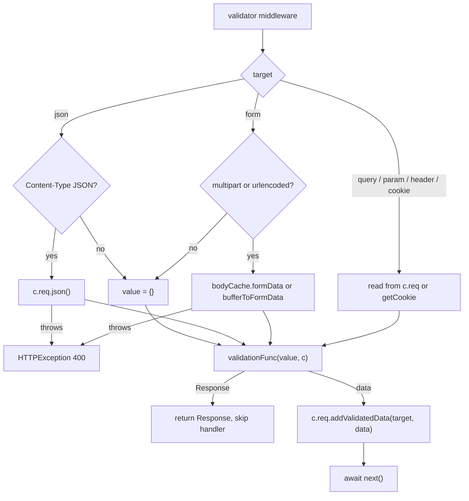

## Overview

`hono/validator` exports `validator(target, validationFunc)`, a factory that returns a middleware. The middleware pulls one part of the request (the JSON body, form data, query string, path parameters, headers or cookies), hands it to your validation function, and stores whatever the function returns so the route handler can read it back with `c.req.valid(target)`. Hono ships no schema library of its own: `validator` is the low-level hook that third-party adapters such as Zod or Valibot validators build on, and the `InferInput` helper type is exported for them.

Sources: [src/validator/index.ts:1-8](repo://src/validator/index.ts#L1-L8), [src/validator/validator.ts:46-88](repo://src/validator/validator.ts#L46-L88)

Besides the runtime work, `validator` carries types. Its return type is `MiddlewareHandler<E, P, V, ExtractValidationResponse<VF>>`, where `V` holds an `in` shape (what a client must send) and an `out` shape (what the handler receives). Hono merges `V` into the route's input, which is how `c.req.valid('json')` is typed in the handler and how the [[RPC Client (hc)]] knows what `$post` expects. See [[Type System and Schema Inference]] for how inputs become part of the app schema.

Sources: [src/validator/validator.ts:64-88](repo://src/validator/validator.ts#L64-L88), [src/types.ts:83-88](repo://src/types.ts#L83-L88)

## Basic usage

The validation function receives the extracted value and the `Context`. Return the (possibly transformed) data to accept the request, or return a `Response` to stop the chain.

Sources: [src/validator/validator.ts:89-171](repo://src/validator/validator.ts#L89-L171), [src/request.ts:339-354](repo://src/request.ts#L339-L354)

```ts
import { Hono } from 'hono'
import { validator } from 'hono/validator'

const app = new Hono()

app.post(
  '/posts',
  validator('json', (value, c) => {
    const title = value['title']
    if (!title || typeof title !== 'string') {
      return c.text('Invalid!', 400)
    }
    return { title }
  }),
  (c) => {
    const { title } = c.req.valid('json') // typed as { title: string }
    return c.json({ message: `Created ${title}` }, 201)
  }
)
```

Sources: [src/validator/validator.ts:89-171](repo://src/validator/validator.ts#L89-L171), [src/request.ts:339-354](repo://src/request.ts#L339-L354)

## Validation targets

### What each target reads

`target` is one of the keys of `ValidationTargets`. The middleware switches on it and builds the value passed to your function.

Sources: [src/validator/validator.ts:89-160](repo://src/validator/validator.ts#L89-L160), [src/types.ts:2680-2690](repo://src/types.ts#L2680-L2690)

| Target | Source in the request | Value shape passed to the function |
| --- | --- | --- |
| `json` | `c.req.json()`, only when `Content-Type` matches the JSON pattern | `any` |
| `form` | the raw body parsed as `FormData`, only for `multipart/form-data` or `application/x-www-form-urlencoded` | `Record<string, string \| File \| (string \| File)[]>` |
| `query` | `c.req.queries()`; single values are unwrapped | `Record<string, string \| string[]>` |
| `param` | `c.req.param()` | `Record<P, string>` (optional params may be `undefined`) |
| `header` | `c.req.header()` (all headers, lower-cased names) | `Record<string, string>` |
| `cookie` | `getCookie(c)` | `Record<string, string>` |

Sources: [src/validator/validator.ts:89-160](repo://src/validator/validator.ts#L89-L160), [src/types.ts:2680-2690](repo://src/types.ts#L2680-L2690)

### Body targets and GET requests

`json` and `form` are excluded from the allowed targets when the route method is `get` or `head`: `ValidationTargetByMethod<M>` removes them at the type level, because those requests must not carry a body. This is purely a compile-time restriction.

Sources: [src/validator/validator.ts:9-12](repo://src/validator/validator.ts#L9-L12)

### Query and form value shaping

For `query`, each key from `c.req.queries()` maps to an array; arrays of length one are unwrapped to the single string, so `?a=1&b=2&b=3` becomes `{ a: '1', b: ['2', '3'] }`. For `form`, the middleware builds a null-prototype object while iterating `formData`: a key ending in `[]` always collects into an array, a repeated key is promoted from a single value to an array, and any other key keeps its single value.

Sources: [src/validator/validator.ts:129-149](repo://src/validator/validator.ts#L129-L149)

## Content-type checks

### Matching rules

The body targets only parse when the request declares a matching `Content-Type`. Three regular expressions do the matching, all case-insensitive:

Sources: [src/validator/validator.ts:24-26](repo://src/validator/validator.ts#L24-L26)

```ts
const jsonRegex = /^application\/([a-z-\.]+\+)?json(;\s*[a-zA-Z0-9\-]+\=([^;]+))*$/i
const multipartRegex = /^multipart\/form-data(;\s?boundary=[a-zA-Z0-9'"()+_,\-./:=?]+)?$/i
const urlencodedRegex = /^application\/x-www-form-urlencoded(;\s*[a-zA-Z0-9\-]+\=([^;]+))*$/i
```

Sources: [src/validator/validator.ts:24-26](repo://src/validator/validator.ts#L24-L26)

`jsonRegex` accepts `application/json` and structured-syntax suffixes such as `application/vnd.api+json` or `application/merge-patch+json`, with optional parameters like `; charset=utf-8`.

Sources: [src/validator/validator.ts:24-24](repo://src/validator/validator.ts#L24-L24)

### Missing or mismatched content type

When the header is absent or does not match, the middleware does not throw: it `break`s out of the switch and calls your function with the initial empty object `{}`. Your validation function therefore decides whether a body is required, typically by rejecting the empty object.

Sources: [src/validator/validator.ts:89-111](repo://src/validator/validator.ts#L89-L111)

> [!WARNING]
> A client that sends JSON without `Content-Type: application/json` reaches your validator with `{}`, not with its payload. When using the [[RPC Client (hc)]], the `json` option sets this header for you.

Sources: [src/validator/validator.ts:94-97](repo://src/validator/validator.ts#L94-L97)

## Body parsing and caching

### JSON

For `json`, the middleware calls `c.req.json()`. If `JSON.parse` throws, it raises `HTTPException(400)` with the message `Malformed JSON in request body`, so malformed input never reaches your function. See [[Error Handling and HTTPException]] for how that exception becomes a response.

Sources: [src/validator/validator.ts:94-104](repo://src/validator/validator.ts#L94-L104)

### Form data

For `form`, the middleware first checks `c.req.bodyCache.formData`. If another middleware already parsed the body as form data, it reuses that promise. Otherwise it reads `c.req.arrayBuffer()` and converts it with `bufferToFormData`, which wraps the buffer in a `Response` with a normalized lower-case media type (keeping the `boundary` parameter) and calls `response.formData()`. The parsed `FormData` is written back into `bodyCache.formData`. A parse failure raises `HTTPException(400)` whose message starts with `Malformed FormData request.` followed by the underlying error message.

Sources: [src/validator/validator.ts:105-128](repo://src/validator/validator.ts#L105-L128), [src/utils/buffer.ts:106-117](repo://src/utils/buffer.ts#L106-L117)

### Why the body stays readable

Reading through `HonoRequest` methods (rather than `c.req.raw`) matters because of `#cachedBody`: each body read is stored in `bodyCache`, and a later read of a different format is derived from whichever cached body exists (re-serializing cached JSON when needed). That lets the validator consume the body while the handler, or `cloneRawRequest`, can still read it. See [[HonoRequest]].

Sources: [src/request.ts:220-239](repo://src/request.ts#L220-L239)

## Storing results for c.req.valid

After extraction, the middleware awaits `validationFunc(value, c)`. Two outcomes follow:

Sources: [src/validator/validator.ts:162-171](repo://src/validator/validator.ts#L162-L171)

1. The result is a `Response` (for example `c.json(..., 400)`): the middleware returns it immediately and `next()` is never called, so the handler does not run.
2. Anything else is stored with `c.req.addValidatedData(target, res)`, then `next()` runs.

Sources: [src/validator/validator.ts:162-171](repo://src/validator/validator.ts#L162-L171)

`HonoRequest` keeps validated data in the private field `#validatedData`, keyed by target and initialized to `{}` in the constructor. `valid(target)` returns that entry. Its overload types the return value as `InputToDataByTarget<I, T>`, which reads the `out` entry for the target from the request's input type `I`. Validating the same target twice overwrites the earlier entry; validating different targets keeps them side by side.

Sources: [src/request.ts:53-53](repo://src/request.ts#L53-L53), [src/request.ts:71-80](repo://src/request.ts#L71-L80), [src/request.ts:339-354](repo://src/request.ts#L339-L354), [src/types.ts:2720-2727](repo://src/types.ts#L2720-L2727)



Sources: [src/validator/validator.ts:89-171](repo://src/validator/validator.ts#L89-L171)

## Type inference into the schema

### Output type

`ExtractValidatorOutput<VF>` takes the return type of your function, unwraps a `Promise`, and drops any `Response` or `TypedResponse` branch. What remains becomes `V['out'][target]`, the type of `c.req.valid(target)`.

Sources: [src/validator/validator.ts:174-185](repo://src/validator/validator.ts#L174-L185)

### Input type

The `in` side describes what the client sends. For `json`, it is the explicit `InputType` generic when given, otherwise the output type. For every other target it is `InferInput<Output, K, FormValue>`, because those values arrive as strings or files no matter what the validator turns them into. `InferInput` maps each key of the output:

Sources: [src/validator/validator.ts:64-82](repo://src/validator/validator.ts#L64-L82), [src/validator/utils.ts:9-69](repo://src/validator/utils.ts#L9-L69)

- a literal union such as `'asc' | 'desc'` is kept as is (detected by `IsLiteralUnion`);
- an optional value (a union containing `undefined`) is kept as is;
- otherwise the key becomes the raw wire type: `T | T[]` for `form`, `string | string[]` for `query`, `string` for `param`, `header` and `cookie`.

Sources: [src/validator/validator.ts:64-82](repo://src/validator/validator.ts#L64-L82), [src/validator/utils.ts:9-69](repo://src/validator/utils.ts#L9-L69)

A non-object output yields `{}`.

Sources: [src/validator/validator.ts:64-82](repo://src/validator/validator.ts#L64-L82), [src/validator/utils.ts:9-69](repo://src/validator/utils.ts#L9-L69)

```ts
// What a schema adapter does with InferInput
type Input = InferInput<{ orderBy: 'asc' | 'desc'; page: number }, 'query'>
// { orderBy: 'asc' | 'desc'; page: string | string[] }
```

Sources: [src/validator/utils.ts:47-58](repo://src/validator/utils.ts#L47-L58)

### Error response types

`ExtractValidationResponse<VF>` keeps only the `Response` / `TypedResponse` branches of the function's return type. It becomes the middleware's response type `R`, so an early `return c.json({ error: '...' }, 400)` appears in the route's output union, and a typed client can narrow on that status. A function that never returns a response contributes `never`.

Sources: [src/validator/validator.ts:28-44](repo://src/validator/validator.ts#L28-L44), [src/validator/validator.ts:86-88](repo://src/validator/validator.ts#L86-L88)

### How the schema picks it up

When a route is registered, its handlers' input types are merged and passed to `ToSchema`, which places them under `input` for the path and the `$method` key (`$get`, `$post`, ...). The `in` shape produced by `validator` is what ends up there, alongside path parameters added by `AddParam`.

Sources: [src/types.ts:2500-2530](repo://src/types.ts#L2500-L2530)

## Validation function signature

`ValidationFunction<InputType, OutputType, E, P>` is the exported type for a reusable validation function. It receives the value and a `Context<E, P>` and may return the output, a `TypedResponse`, or a promise of either.

Sources: [src/validator/validator.ts:14-22](repo://src/validator/validator.ts#L14-L22)

```ts
export type ValidationFunction<
  InputType,
  OutputType,
  E extends Env = {},
  P extends string = string,
> = (
  value: InputType,
  c: Context<E, P>
) => OutputType | TypedResponse | Promise<OutputType> | Promise<TypedResponse>
```

Sources: [src/validator/validator.ts:14-22](repo://src/validator/validator.ts#L14-L22)
