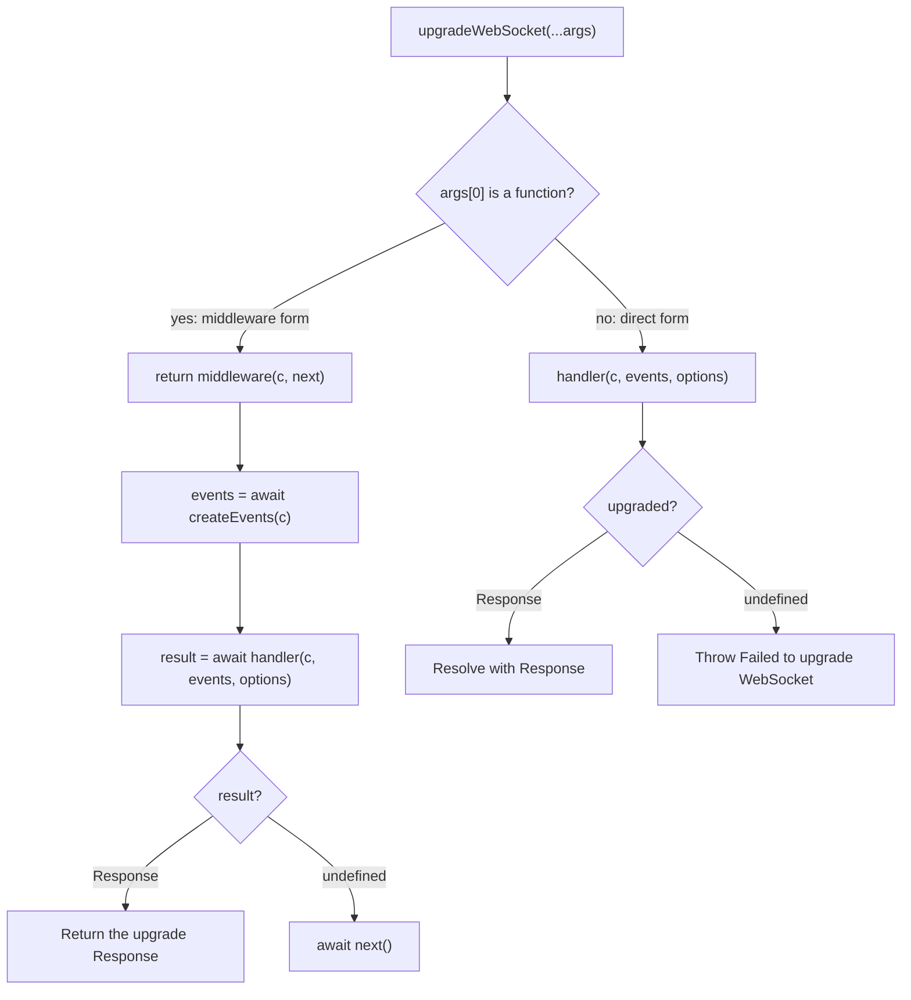
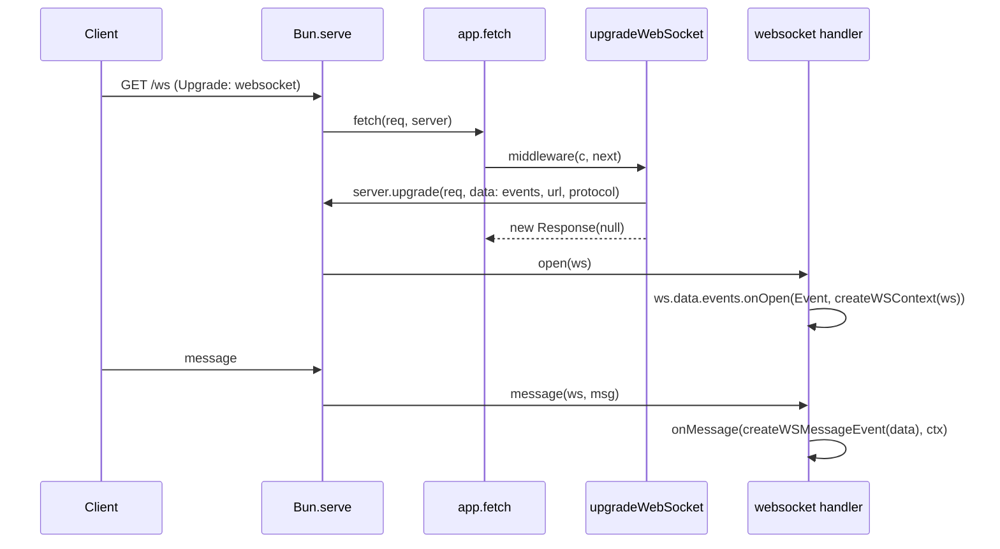

## Overview

Every JavaScript runtime upgrades HTTP connections to WebSockets differently: Cloudflare Workers use a `WebSocketPair`, Deno has `Deno.upgradeWebSocket`, and Bun upgrades through its server object and dispatches events to a global handler. Hono hides these differences behind one function, `upgradeWebSocket`, which each adapter exports. Application code registers the same `onOpen`, `onMessage`, `onClose` and `onError` callbacks and talks to the socket through a runtime-neutral `WSContext`.

Sources: [src/helper/websocket/index.ts:1-99](repo://src/helper/websocket/index.ts#L1-L99), [src/helper/websocket/index.ts:101-140](repo://src/helper/websocket/index.ts#L101-L140)

The shared types and the `defineWebSocketHelper` factory live in `hono/ws` (`src/helper/websocket/index.ts`). The runtime implementations live in the adapters and are imported from `hono/cloudflare-workers`, `hono/deno` and `hono/bun` (see [[Runtime Adapters]]).

Sources: [src/adapter/cloudflare-workers/index.ts:7-7](repo://src/adapter/cloudflare-workers/index.ts#L7-L7), [src/adapter/deno/index.ts:8-8](repo://src/adapter/deno/index.ts#L8-L8), [src/adapter/bun/index.ts:8-9](repo://src/adapter/bun/index.ts#L8-L9)

## Usage

```ts
import { Hono } from 'hono'
import { upgradeWebSocket } from 'hono/cloudflare-workers' // or 'hono/deno', 'hono/bun'

const app = new Hono()

app.get(
  '/ws',
  upgradeWebSocket((c) => {
    const user = c.req.query('user')
    return {
      onMessage(event, ws) {
        ws.send(`${user}: ${event.data}`)
      },
      onClose(event, ws) {
        console.log('closed', event.code)
      },
    }
  })
)

export default app
```

Sources: [src/helper/websocket/index.ts:14-40](repo://src/helper/websocket/index.ts#L14-L40), [src/adapter/cloudflare-workers/websocket.ts:5-53](repo://src/adapter/cloudflare-workers/websocket.ts#L5-L53)

Because the middleware form returns a handler typed with `outputFormat: 'ws'`, the [[RPC Client (hc)]] exposes a `$ws()` method for such routes that opens a `WebSocket` to the route URL.

Sources: [src/helper/websocket/index.ts:24-34](repo://src/helper/websocket/index.ts#L24-L34), [src/client/types.ts:112-115](repo://src/client/types.ts#L112-L115), [src/client/client.ts:187-211](repo://src/client/client.ts#L187-L211)

## Core abstraction

### WSEvents

Each callback receives the native event and the `WSContext` for the connection. All are optional.

Sources: [src/helper/websocket/index.ts:14-19](repo://src/helper/websocket/index.ts#L14-L19)

| Callback | Event type | Fires when |
| --- | --- | --- |
| `onOpen` | `Event` | The connection is established. Not supported on Cloudflare Workers. |
| `onMessage` | `MessageEvent<WSMessageReceive>` | A message arrives; `event.data` is `string`, `Blob` or `ArrayBufferLike`. |
| `onClose` | `CloseEvent` | The connection closes; carries `code` and `reason`. |
| `onError` | `Event` | The runtime reports a socket error. |

Sources: [src/helper/websocket/index.ts:11-19](repo://src/helper/websocket/index.ts#L11-L19), [src/helper/websocket/index.ts:93-93](repo://src/helper/websocket/index.ts#L93-L93)

### WSContext

`WSContext` wraps a `WSContextInit` that each adapter fills with closures over its native socket. The class stores the init privately and delegates to it, so adapters can supply getters for live values such as `readyState`.

Sources: [src/helper/websocket/index.ts:47-91](repo://src/helper/websocket/index.ts#L47-L91)

| Member | Type | Description |
| --- | --- | --- |
| `send(data, options?)` | `(string \| ArrayBuffer \| Uint8Array, SendOptions?) => void` | Sends a message. `options.compress` is honoured by Bun only. |
| `close(code?, reason?)` | `(number?, string?) => void` | Closes the connection. |
| `readyState` | `0 \| 1 \| 2 \| 3` | Read through the init on every access. |
| `raw` | `T` | The native socket (`WebSocket` on Workers and Deno, Bun's `ServerWebSocket`). |
| `url` | `URL \| null` | Connection URL, parsed with `new URL` when provided. |
| `protocol` | `string \| null` | Negotiated subprotocol. |
| `binaryType` | `BinaryType` | Always initialised to `'arraybuffer'`. |

Sources: [src/helper/websocket/index.ts:50-91](repo://src/helper/websocket/index.ts#L50-L91)

`createWSMessageEvent(source)` builds a standard `MessageEvent('message', { data })`. Adapters that receive raw payloads instead of DOM events, such as Bun, use it so `onMessage` always sees the same shape.

Sources: [src/helper/websocket/index.ts:95-99](repo://src/helper/websocket/index.ts#L95-L99)

### defineWebSocketHelper

`defineWebSocketHelper(handler)` turns a runtime-specific `handler(c, events, options)` into a function with the two call signatures of `UpgradeWebSocket`. The handler returns a `Response` when it upgraded the connection and nothing when the request was not an upgrade request.

Sources: [src/helper/websocket/index.ts:101-140](repo://src/helper/websocket/index.ts#L101-L140)



Sources: [src/helper/websocket/index.ts:111-140](repo://src/helper/websocket/index.ts#L111-L140)

In the middleware form, `createEvents` runs per request, so it can read headers, params or `c.var` and keep per-connection state in closures. A plain HTTP request to the route (no `Upgrade` header) falls through to `next()`, letting a later handler serve it. The direct form, `await upgradeWebSocket(c, events, options)`, is for use inside a handler and rejects instead of falling through.

Sources: [src/helper/websocket/index.ts:119-138](repo://src/helper/websocket/index.ts#L119-L138)

```ts
app.get('/ws', async (c) => {
  if (!(await isAuthorized(c))) return c.text('Unauthorized', 401)
  return upgradeWebSocket(c, {
    onMessage: (evt, ws) => ws.send(String(evt.data)),
  })
})
```

Sources: [src/helper/websocket/index.ts:35-39](repo://src/helper/websocket/index.ts#L35-L39), [src/helper/websocket/index.ts:129-138](repo://src/helper/websocket/index.ts#L129-L138)

A custom adapter for another runtime only needs to implement the handler: check the upgrade header, perform the upgrade, build a `WSContext` and wire the native events to `events`.

Sources: [src/helper/websocket/index.ts:101-113](repo://src/helper/websocket/index.ts#L101-L113)

## Runtime implementations

### Cloudflare Workers

The Workers handler returns nothing unless the `Upgrade` header equals `websocket`. It creates a `WebSocketPair`, keeps the server end and builds a `WSContext` whose `readyState` and `protocol` are getters on that socket. It attaches `close`, `message` and `error` listeners only for the callbacks provided, calls `server.accept()`, and returns a `101` response carrying the client end in its `webSocket` property.

Sources: [src/adapter/cloudflare-workers/websocket.ts:1-53](repo://src/adapter/cloudflare-workers/websocket.ts#L1-L53)

> [!NOTE]
> Workers never emit an `open` event on the server socket, so the Workers `upgradeWebSocket` is typed with `Omit<WSEvents<WebSocket>, 'onOpen'>` and an `onOpen` callback is a type error. The socket is already open when `onMessage` first fires.

Sources: [src/adapter/cloudflare-workers/websocket.ts:5-10](repo://src/adapter/cloudflare-workers/websocket.ts#L5-L10), [src/adapter/cloudflare-workers/websocket.ts:34-34](repo://src/adapter/cloudflare-workers/websocket.ts#L34-L34)

### Deno

The Deno handler checks the `upgrade` header, reads the first value of `Sec-WebSocket-Protocol` and calls `Deno.upgradeWebSocket(c.req.raw, ...)` with that `protocol`, letting the caller's `Deno.UpgradeWebSocketOptions` override it. Echoing the subprotocol matters because browsers such as Chrome reject a connection that requested one when the response lacks the header. It assigns `onopen`, `onmessage`, `onclose` and `onerror` on the socket to forward every event, then returns Deno's response.

Sources: [src/adapter/deno/websocket.ts:1-38](repo://src/adapter/deno/websocket.ts#L1-L38)

### Bun

Bun splits the work between the upgrade and the server's `websocket` option, because `Bun.serve` delivers socket events to one global handler object rather than to the socket.

Sources: [src/adapter/bun/websocket.ts:15-28](repo://src/adapter/bun/websocket.ts#L15-L28), [src/adapter/bun/websocket.ts:48-104](repo://src/adapter/bun/websocket.ts#L48-L104)



Sources: [src/adapter/bun/websocket.ts:48-104](repo://src/adapter/bun/websocket.ts#L48-L104)

`upgradeWebSocket` gets the server with `getBunServer(c)`, which reads `c.env.server` or `c.env` itself, and throws a `TypeError` when it is missing: the app must be called as `fetch(req, server)`. It calls `server.upgrade` with `data` holding the events, the request URL and the first requested subprotocol; on success it returns an empty `Response`, which Bun ignores after an upgrade.

Sources: [src/adapter/bun/server.ts:7-14](repo://src/adapter/bun/server.ts#L7-L14), [src/adapter/bun/websocket.ts:48-74](repo://src/adapter/bun/websocket.ts#L48-L74)

The exported `websocket` object implements Bun's `open`, `close` and `message` hooks. Each reads the events from `ws.data.events`, builds a fresh `WSContext` with `createWSContext(ws)` and calls the matching callback. `close` synthesises a `CloseEvent` from `code` and `reason`; `message` passes strings through and unwraps binary messages to their `buffer`. Bun's `send` takes a `compress` flag, so `SendOptions.compress` reaches it.

Sources: [src/adapter/bun/websocket.ts:30-46](repo://src/adapter/bun/websocket.ts#L30-L46), [src/adapter/bun/websocket.ts:76-104](repo://src/adapter/bun/websocket.ts#L76-L104)

```ts
import { Hono } from 'hono'
import { upgradeWebSocket, websocket } from 'hono/bun'

const app = new Hono()
app.get('/ws', upgradeWebSocket(() => ({ onMessage: (e, ws) => ws.send(String(e.data)) })))

export default { fetch: app.fetch, websocket }
```

Sources: [src/adapter/bun/websocket.ts:48-48](repo://src/adapter/bun/websocket.ts#L48-L48), [src/adapter/bun/websocket.ts:76-76](repo://src/adapter/bun/websocket.ts#L76-L76)

> [!WARNING]
> On Bun, `readyState` is copied when each `WSContext` is created rather than read live, and the Bun adapter does not forward `onError`. `createBunWebSocket()` is deprecated: import `upgradeWebSocket` and `websocket` from `hono/bun` directly.

Sources: [src/adapter/bun/websocket.ts:33-46](repo://src/adapter/bun/websocket.ts#L33-L46), [src/adapter/bun/websocket.ts:106-113](repo://src/adapter/bun/websocket.ts#L106-L113)

### Behaviour across runtimes

| Aspect | Cloudflare Workers | Deno | Bun |
| --- | --- | --- | --- |
| Upgrade check | `Upgrade` header is `websocket` | `upgrade` header is `websocket` | Delegated to `server.upgrade` |
| `onOpen` | Not supported | Supported | Supported |
| `onError` | Supported | Supported | Not forwarded |
| Options argument | Ignored | `Deno.UpgradeWebSocketOptions` | Ignored |
| Non-upgrade request | Falls through to `next()` | Falls through to `next()` | Falls through when `server.upgrade` returns `false` |
| Response | `101` with `webSocket: client` | Deno's upgrade response | Empty `Response` |

Sources: [src/adapter/cloudflare-workers/websocket.ts:10-53](repo://src/adapter/cloudflare-workers/websocket.ts#L10-L53), [src/adapter/deno/websocket.ts:4-38](repo://src/adapter/deno/websocket.ts#L4-L38), [src/adapter/bun/websocket.ts:48-104](repo://src/adapter/bun/websocket.ts#L48-L104)
