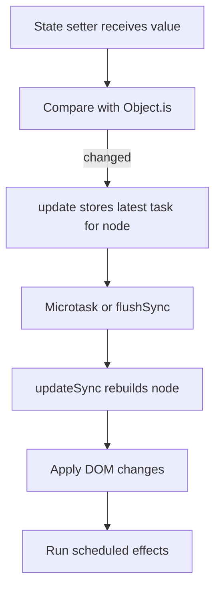

## Overview

The DOM renderer turns JSX into a retained node tree, builds component output, and applies that output to browser elements. Hook state is attached to component nodes and drives later updates. [[Server JSX and HTML Rendering]] describes the string-producing renderer; the browser implementation instead installs listeners, manages refs, and updates existing elements.

Sources: [src/jsx/dom/render.ts:164-207](repo://src/jsx/dom/render.ts#L164-L207), [src/jsx/dom/render.ts:497-555](repo://src/jsx/dom/render.ts#L497-L555), [src/jsx/hooks/index.ts:182-207](repo://src/jsx/hooks/index.ts#L182-L207)

## Mount and manage a root

`render(jsxNode, container)` wraps the input in a fragment node and calls renderNode. That operation builds the tree, applies it to a DocumentFragment, changes stored container references to the destination, and replaces the destination's children. It is an explicit initial render operation, not a call that attempts to preserve pre-existing server elements.

Sources: [src/jsx/dom/render.ts:783-799](repo://src/jsx/dom/render.ts#L783-L799)

`createRoot` returns render and unmount methods. The first render creates an internal stateful component; subsequent renders update that component's state. Unmount sends null and marks the root unmounted, after which render throws. Nonempty root options currently produce a warning. `hydrateRoot` calls createRoot and render; its comment explicitly states that hydration is equivalent to rendering in this implementation.

Sources: [src/jsx/dom/client.ts:23-84](repo://src/jsx/dom/client.ts#L23-L84)

## Build and reconcile children

`buildNode` drops undefined, null and boolean children, converts strings/numbers into text nodes, and initializes component hook storage. `build` invokes component functions or takes element children, flattens arrays, and searches the previous children for reusable nodes. Keyed nodes require matching key and tag; unkeyed nodes match by tag, while text nodes match other text nodes.

Sources: [src/jsx/dom/render.ts:497-555](repo://src/jsx/dom/render.ts#L497-L555), [src/jsx/dom/render.ts:667-703](repo://src/jsx/dom/render.ts#L667-L703)

Reused text nodes are marked dirty when their content changes. Reused component nodes keep their hook storage while receiving new props and captured context. Memoized components can skip rebuilding when their comparator or cached node identity permits it and the captured contexts match. Nodes left over from the old children become removals; retained children are recursively built before DOM application.

Sources: [src/jsx/dom/render.ts:557-609](repo://src/jsx/dom/render.ts#L557-L609)

The apply phase flattens component and fragment output, removes obsolete nodes, creates missing elements or text nodes, applies props, and moves elements into their required order. Select values are applied after options have rendered. Removing a component runs effect cleanup and ref cleanup, recursively removes descendants, and deletes pending update bookkeeping.

Sources: [src/jsx/dom/render.ts:293-331](repo://src/jsx/dom/render.ts#L293-L331), [src/jsx/dom/render.ts:341-361](repo://src/jsx/dom/render.ts#L341-L361), [src/jsx/dom/render.ts:387-458](repo://src/jsx/dom/render.ts#L387-L458)

## State updates and batching

`useState` allocates a state/setter pair at the current component's incrementing hook index. Its setter supports functional updates and compares with Object.is before scheduling work. The indexed storage explains why a component's hook order must remain stable across renders. Without active build data, the hook resolves its initial value and returns a no-op setter.

Sources: [src/jsx/hooks/index.ts:182-242](repo://src/jsx/hooks/index.ts#L182-L242)

Sources: [src/jsx/hooks/index.ts:199-239](repo://src/jsx/hooks/index.ts#L199-L239), [src/jsx/dom/render.ts:713-780](repo://src/jsx/dom/render.ts#L713-L780), [src/jsx/dom/render.ts:801-813](repo://src/jsx/dom/render.ts#L801-L813), [src/jsx/dom/render.ts:462-479](repo://src/jsx/dom/render.ts#L462-L479)

The update map keeps the latest pending task per node; a superseded task resolves with undefined. Ordinary updates yield through a resolved promise before executing the latest task. `flushSync` collects updated nodes during its callback and executes their queued tasks before returning. `useReducer` builds on useState by applying the reducer through a callback.

Sources: [src/jsx/dom/render.ts:734-813](repo://src/jsx/dom/render.ts#L734-L813), [src/jsx/hooks/index.ts:245-257](repo://src/jsx/hooks/index.ts#L245-L257)

## Effects, references, and subscriptions

| Hook | Implementation behavior |
| --- | --- |
| `useEffect` | Schedules its effect for requestAnimationFrame after application |
| `useLayoutEffect` | Runs its queued callback during the apply pass |
| `useInsertionEffect` | Runs before the collected layout-effect callbacks |
| `useMemo` / `useCallback` | Retains the value/callback while dependencies are unchanged |
| `useRef` | Retains a current-value object in hook storage |
| `useId` | Memoizes an ID from a module-level counter |
| `useDebugValue` | Currently does nothing |

Sources: [src/jsx/hooks/index.ts:260-315](repo://src/jsx/hooks/index.ts#L260-L315), [src/jsx/hooks/index.ts:320-369](repo://src/jsx/hooks/index.ts#L320-L369), [src/jsx/dom/render.ts:462-479](repo://src/jsx/dom/render.ts#L462-L479)

When effect dependencies change, the previous cleanup executes before the new runner is stored. During prop application, event handlers are installed with addEventListener and non-function handlers throw. Function refs can return cleanup functions; otherwise cleanup calls the ref with null. Object refs receive the element and are cleared during cleanup. Style strings replace cssText, while style objects are applied as properties.

Sources: [src/jsx/hooks/index.ts:260-285](repo://src/jsx/hooks/index.ts#L260-L285), [src/jsx/dom/render.ts:164-207](repo://src/jsx/dom/render.ts#L164-L207)

`useSyncExternalStore` reads a snapshot into state and subscribes through an effect. A server/stringifying call requires getServerSnapshot and throws if it is absent. A top-level browser render can initially use that snapshot and then update from getSnapshot when its effect runs. The subscription's return value becomes effect cleanup.

Sources: [src/jsx/hooks/index.ts:397-425](repo://src/jsx/hooks/index.ts#L397-L425)

## Async boundaries and transitions

`use(promise)` returns a cached fulfilled value, throws a cached rejection, or registers settlement callbacks and throws the pending promise. DOM Suspense handles promises, schedules a retry when they settle, and returns fallback content. DOM ErrorBoundary rethrows promises but handles other errors through onError and fallbackRender/fallback. The renderer stores boundary information on descendants and rebuilds the appropriate fallback on failure.

Sources: [src/jsx/hooks/index.ts:332-346](repo://src/jsx/hooks/index.ts#L332-L346), [src/jsx/dom/components.ts:7-38](repo://src/jsx/dom/components.ts#L7-L38), [src/jsx/dom/render.ts:610-659](repo://src/jsx/dom/render.ts#L610-L659)

Transition helpers mark updates with pending modes. useTransition tracks pending rendering and stores callback failures so they can be thrown during rendering. useDeferredValue keeps an earlier value while scheduling a deferred update. View-transition helpers wrap updates in document.startViewTransition when available and otherwise invoke the update callback directly.

Sources: [src/jsx/hooks/index.ts:43-98](repo://src/jsx/hooks/index.ts#L43-L98), [src/jsx/hooks/index.ts:101-175](repo://src/jsx/hooks/index.ts#L101-L175)

## Form actions

Function-valued form actions intercept submission, create FormData, publish pending state through FormContext, call the action, and await a returned promise. After successful completion the form clears its pending data. `useFormStatus` reads that context. Function-valued button/input formAction handlers dispatch a custom submit event carrying the selected action.

Sources: [src/jsx/dom/intrinsic-element/components.ts:325-383](repo://src/jsx/dom/intrinsic-element/components.ts#L325-L383), [src/jsx/dom/intrinsic-element/components.ts:388-427](repo://src/jsx/dom/intrinsic-element/components.ts#L388-L427), [src/jsx/dom/hooks/index.ts:24-43](repo://src/jsx/dom/hooks/index.ts#L24-L43)

`useActionState` returns a two-item state/action tuple in this repository. The action awaits the supplied function with current state and FormData, then sets the result; an optional permalink is attached for server rendering. `useOptimistic` applies a local updater and resets to the supplied state after the tracked action set settles, or immediately when no actions are tracked.

Sources: [src/jsx/dom/hooks/index.ts:31-35](repo://src/jsx/dom/hooks/index.ts#L31-L35), [src/jsx/dom/hooks/index.ts:52-91](repo://src/jsx/dom/hooks/index.ts#L52-L91)

