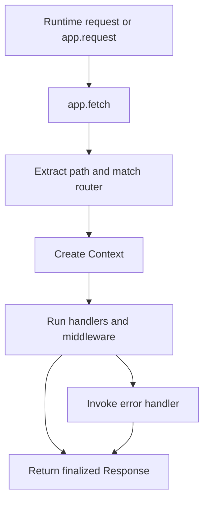

## Overview

Hono is a web framework built around the Web Standard `Request` and `Response` interfaces. An application registers handlers, exposes a `fetch` entry point, and turns a request into a response. This repository also contains middleware, a typed HTTP client, server and browser JSX implementations, streaming helpers, static generation, and runtime integrations. The minimal application in [[Quickstart]] shows the same interface used by the core dispatcher.

Sources: [README.md:22-47](repo://README.md#L22-L47), [src/hono-base.ts:479-517](repo://src/hono-base.ts#L479-L517), [package.json:38-73](repo://package.json#L38-L73)

## Parts of the system

| Area | What it does | Page |
| --- | --- | --- |
| First application | Registers a handler and exposes an application | [[Quickstart]] |
| Routing and execution | Matches requests and runs the middleware chain | [[Routing and Middleware Execution]] |
| Handler state | Supplies request access, bindings and response construction | [[Request and Context]] |
| Input contracts | Validates request data and serializes typed client requests | [[Validation and Typed Clients]] |
| Request guards | Applies authentication and browser access policy | [[Security Middleware]] |
| HTTP processing | Observes and transforms traffic around handlers | [[HTTP Middleware]] |
| Server rendering | Installs JSX layouts and returns HTML or a readable stream | [[Server JSX and HTML Rendering]] |
| Browser rendering | Creates roots and updates client component trees | [[Browser Rendering and Hooks]] |
| Incremental responses | Writes response chunks and closes the stream | [[Streaming Responses]] |
| Runtime boundary | Supplies host requests, bindings and execution context | [[Runtime Adapters]] |
| Static output | Invokes application routes and writes their responses to files | [[Static Site Generation]] |

Sources: [README.md:26-39](repo://README.md#L26-L39), [src/hono-base.ts:406-465](repo://src/hono-base.ts#L406-L465), [src/context.ts:352-368](repo://src/context.ts#L352-L368), [src/validator/validator.ts:144-170](repo://src/validator/validator.ts#L144-L170), [src/client/client.ts:110-128](repo://src/client/client.ts#L110-L128), [src/middleware/cors/index.ts:96-155](repo://src/middleware/cors/index.ts#L96-L155), [src/middleware/logger/index.ts:81-95](repo://src/middleware/logger/index.ts#L81-L95), [src/middleware/jsx-renderer/index.ts:66-79](repo://src/middleware/jsx-renderer/index.ts#L66-L79), [src/jsx/dom/client.ts:23-65](repo://src/jsx/dom/client.ts#L23-L65), [src/helper/streaming/stream.ts:7-45](repo://src/helper/streaming/stream.ts#L7-L45), [src/adapter/cloudflare-pages/handler.ts:32-46](repo://src/adapter/cloudflare-pages/handler.ts#L32-L46), [src/helper/ssg/ssg.ts:420-435](repo://src/helper/ssg/ssg.ts#L420-L435)

## Main request flow

Sources: [src/hono-base.ts:399-465](repo://src/hono-base.ts#L399-L465), [src/hono-base.ts:479-517](repo://src/hono-base.ts#L479-L517)

The host calls `app.fetch`, or a test calls `app.request` to construct a request first. [[Runtime Adapters]] explains how a host such as Cloudflare Pages supplies the request, bindings, and execution context. The application itself accepts those values directly, keeping the dispatch interface independent of the Pages event shape.

Sources: [src/adapter/cloudflare-pages/handler.ts:32-46](repo://src/adapter/cloudflare-pages/handler.ts#L32-L46), [src/hono-base.ts:479-517](repo://src/hono-base.ts#L479-L517)

The dispatcher extracts a path and asks its router for matches. [[Routing and Middleware Execution]] follows registration into that matching operation, then into either the single-handler branch or the composed chain. The chain tracks which route is running, so later request access can use the current route's parameter mapping.

Sources: [src/hono-base.ts:385-396](repo://src/hono-base.ts#L385-L396), [src/hono-base.ts:418-465](repo://src/hono-base.ts#L418-L465), [src/compose.ts:42-51](repo://src/compose.ts#L42-L51)

Each dispatch constructs a `Context` with the request and match result. [[Request and Context]] explains its lazy request wrapper, environment bindings, response state, and finalization. Handlers receive this one context while the chain moves forward through `next()` and returns through earlier middleware.

Sources: [src/hono-base.ts:421-427](repo://src/hono-base.ts#L421-L427), [src/context.ts:352-368](repo://src/context.ts#L352-L368), [src/compose.ts:32-70](repo://src/compose.ts#L32-L70)

The handler returns a response or delegates to the rest of the chain. An exception enters the configured error handler; an unmatched request reaches the not-found handler. [[Routing and Middleware Execution]] distinguishes those outcomes from the composed-chain error raised when no response was finalized. HTML and streaming helpers ultimately feed this same response boundary.

Sources: [src/compose.ts:49-70](repo://src/compose.ts#L49-L70), [src/hono-base.ts:429-465](repo://src/hono-base.ts#L429-L465), [src/middleware/jsx-renderer/index.ts:66-79](repo://src/middleware/jsx-renderer/index.ts#L66-L79)

## Design choices across the parts

The standard application separates handler execution from routing strategy. `Hono` supplies a `SmartRouter` with `RegExpRouter` and `TrieRouter` candidates, while accepting an explicit router option. On first matching, SmartRouter tries the candidates with the registered routes, continues only for `UnsupportedPathError`, and binds subsequent matches to the successful candidate. This keeps the common handler lifecycle usable with different path matchers without repeating selection on every request.

Sources: [src/hono.ts:26-32](repo://src/hono.ts#L26-L32), [src/router/smart-router/router.ts:21-60](repo://src/router/smart-router/router.ts#L21-L60)

The dispatcher explicitly avoids composition when exactly one handler matches. That branch invokes the handler directly and handles both immediate and promised responses. A second allocation is deferred inside `Context`: the `HonoRequest` wrapper is constructed only when code accesses `c.req`. These branches make the implementation's shortcuts visible without changing the public request-to-response interface.

Sources: [src/hono-base.ts:429-450](repo://src/hono-base.ts#L429-L450), [src/context.ts:363-368](repo://src/context.ts#L363-L368)

Middleware owns the decision to continue. The composer passes a closure for the next dispatch and rejects repeated `next()` calls with an index check. Validation uses the same contract: a validation callback returning a `Response` ends that branch, while ordinary output is stored before continuing. [[Validation and Typed Clients]] builds on this control flow instead of adding a separate execution pipeline.

Sources: [src/compose.ts:32-51](repo://src/compose.ts#L32-L51), [src/validator/validator.ts:162-170](repo://src/validator/validator.ts#L162-L170)

Static generation reuses the application's own fetch path. It first invokes a route to collect generation parameters and then requests concrete paths to capture responses. This means [[Static Site Generation]] depends on ordinary routing and rendering behavior, with filesystem writes added at the output boundary. Its filesystem interface requires only asynchronous file writing and directory creation.

Sources: [src/helper/ssg/ssg.ts:34-37](repo://src/helper/ssg/ssg.ts#L34-L37), [src/helper/ssg/ssg.ts:225-289](repo://src/helper/ssg/ssg.ts#L225-L289)
