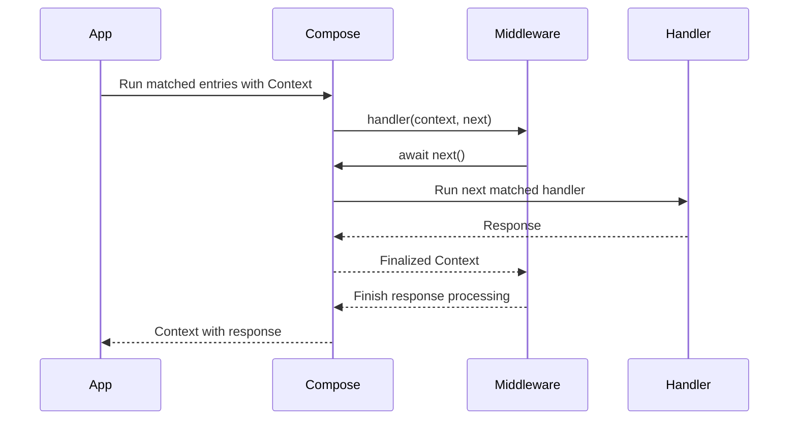

## Overview

Routing joins two stages: application registration stores method/path/handler records, and dispatch asks a router for the handlers matching one request. The handler receives the state described in [[Request and Context]]. Middleware participates in the same match result, so it can terminate a request or continue to another handler without a separate middleware registry.

Sources: [src/hono-base.ts:126-168](repo://src/hono-base.ts#L126-L168), [src/hono-base.ts:385-427](repo://src/hono-base.ts#L385-L427)

## Register and group handlers

The constructor installs method helpers for GET, POST, PUT, DELETE, OPTIONS, PATCH and ALL. Passing a path updates the current registration path; each subsequent handler is added separately. `on` accepts method and path arrays and registers their combinations. `use` registers against ALL, using `*` when its first argument is a middleware function. Every addition uppercases the method, merges the application's base path, calls the router, and appends a public route record.

Sources: [src/router.ts:9-17](repo://src/router.ts#L9-L17), [src/hono-base.ts:126-168](repo://src/hono-base.ts#L126-L168), [src/hono-base.ts:385-397](repo://src/hono-base.ts#L385-L397)

`basePath` returns a clone with a new base-path prefix, but that clone shares the original router and routes array. `route(path, app)` copies the child application's currently registered routes under that prefix. If the child has a custom error handler, the parent installs a wrapper that invokes that error handler for the copied handler. Registration is therefore concrete: grouping consumes the routes present in the child when `route` runs.

Sources: [src/hono-base.ts:175-184](repo://src/hono-base.ts#L175-L184), [src/hono-base.ts:208-230](repo://src/hono-base.ts#L208-L230), [src/hono-base.ts:247-253](repo://src/hono-base.ts#L247-L253)

`mount` integrates a request-taking application function. By default it removes the mount prefix from the incoming URL and passes environment and execution context as extra arguments. Options can replace this argument mapping or preserve/replace the request. The mounted function's response ends the handler; a falsy result delegates with `await next()`. This boundary is useful when the nested application exposes a fetch-like function instead of Hono route records.

Sources: [src/hono-base.ts:328-382](repo://src/hono-base.ts#L328-L382)

## Select a router

| Application or interface | Matching configuration |
| --- | --- |
| Standard `Hono` | Explicit router option, otherwise SmartRouter with RegExpRouter then TrieRouter |
| Quick preset | SmartRouter with LinearRouter then TrieRouter |
| Tiny preset | PatternRouter |
| Custom router | Implements `name`, `add(method, path, handler)`, and `match(method, path)` |
| PreparedRegExpRouter | Uses prepared matcher structures and a path relocation map |

Sources: [src/hono.ts:26-32](repo://src/hono.ts#L26-L32), [src/preset/quick.ts:18-23](repo://src/preset/quick.ts#L18-L23), [src/preset/tiny.ts:16-19](repo://src/preset/tiny.ts#L16-L19), [src/router.ts:29-51](repo://src/router.ts#L29-L51), [src/router/reg-exp-router/prepared-router.ts:9-17](repo://src/router/reg-exp-router/prepared-router.ts#L9-L17)

SmartRouter buffers registrations until its first match. It replays all routes into each candidate and tries matching. Only `UnsupportedPathError` advances to the next candidate; other errors escape. After success it replaces its own match method with the selected router's bound method and releases the registration list. Adding routes afterward throws the matcher-already-built error. Complete registration before sending the first request, including requests made by tests.

Sources: [src/router/smart-router/router.ts:13-60](repo://src/router/smart-router/router.ts#L13-L60)

Match results carry either parameter maps directly or maps into a shared parameter stash. This lets the dispatcher consume a uniform list of handler entries despite differing router representations. RegExpRouter builds matchers per method and releases its registration caches. TrieRouter expands optional parameters during insertion and delegates matching to its root node's search operation.

Sources: [src/router.ts:54-98](repo://src/router.ts#L54-L98), [src/router/reg-exp-router/router.ts:208-221](repo://src/router/reg-exp-router/router.ts#L208-L221), [src/router/trie-router/router.ts:13-26](repo://src/router/trie-router/router.ts#L13-L26)

The prepared router separates known paths from later handler attachment. `buildInitParams` registers paths into a temporary RegExpRouter and exports compiled structures; its relocation map identifies where handlers belong. An attachment for an unknown non-wildcard path throws. Wildcard attachments receive their own path through the prepared matchers, allowing shared middleware to be added across the prepared entries.

Sources: [src/router/reg-exp-router/prepared-router.ts:47-85](repo://src/router/reg-exp-router/prepared-router.ts#L47-L85), [src/router/reg-exp-router/prepared-router.ts:95-153](repo://src/router/reg-exp-router/prepared-router.ts#L95-L153)

## Dispatch a request

Strict path handling is the default. Constructor options select either the supplied/default path extractor or the non-strict extractor. Dispatch handles HEAD by running the GET dispatch and building a response with a null body. Other requests extract their path, match the router, and construct a context with the result, bindings, and not-found callback.

Sources: [src/hono-base.ts:170-172](repo://src/hono-base.ts#L170-L172), [src/hono-base.ts:406-427](repo://src/hono-base.ts#L406-L427)

Exactly one match takes a direct-handler branch. Its continuation sets the not-found response. Immediate throws and rejected promises go through the application error handler; an absent response falls back to not-found, with the asynchronous branch also recognizing an already-finalized context. Multiple matches, or no matches, use the composer and then require the resulting context to be finalized.

Sources: [src/hono-base.ts:429-465](repo://src/hono-base.ts#L429-L465)

Sources: [src/compose.ts:20-70](repo://src/compose.ts#L20-L70), [src/hono-base.ts:450-465](repo://src/hono-base.ts#L450-L465)

## Continuation and failure guarantees

The composer stores the greatest dispatched index. Calling a continuation for an index already entered throws `next() called multiple times`. Before invoking a matched handler, it updates `context.req.routeIndex`. It awaits each handler, assigns a returned response only when the context is not finalized or the result came from error handling, and calls not-found at the end only if no response is finalized.

Sources: [src/compose.ts:32-70](repo://src/compose.ts#L32-L70)

An `Error` thrown inside a composed handler is recorded in `context.error` and passed to the configured error callback. Non-Error thrown values are rethrown. The default callback recognizes errors exposing `getResponse`; otherwise it logs the error and returns status 500. `HTTPException.getResponse` uses its declared status even when supplied a custom response body and headers.

Sources: [src/compose.ts:49-59](repo://src/compose.ts#L49-L59), [src/hono-base.ts:31-42](repo://src/hono-base.ts#L31-L42), [src/hono-base.ts:399-404](repo://src/hono-base.ts#L399-L404), [src/http-exception.ts:55-76](repo://src/http-exception.ts#L55-L76)

A composed chain that finishes without finalization triggers an explicit error asking whether the handler forgot to return a response or await `next()`. This makes continuation discipline part of the public execution contract. [[Security Middleware]] uses early responses and exceptions to deny access, while [[HTTP Middleware]] uses the return from `next()` to inspect or transform the response.

Sources: [src/hono-base.ts:450-465](repo://src/hono-base.ts#L450-L465), [src/middleware/cors/index.ts:114-155](repo://src/middleware/cors/index.ts#L114-L155), [src/middleware/logger/index.ts:81-95](repo://src/middleware/logger/index.ts#L81-L95)

