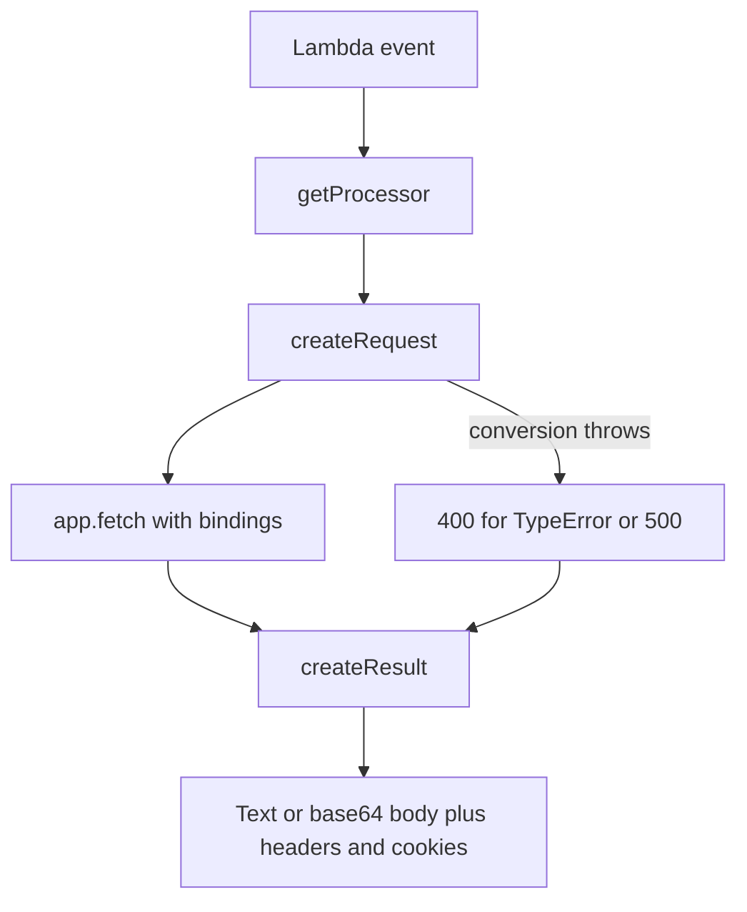

## Overview

An adapter translates a host callback into the application's standard fetch interface, or supplies host-specific capabilities such as files, connection information, and WebSocket upgrades. The common request lifecycle remains in [[Routing and Middleware Execution]]. Hosts that already deliver Request objects need little conversion; event-based hosts need request and result processors.

Sources: [src/adapter/vercel/handler.ts:4-8](repo://src/adapter/vercel/handler.ts#L4-L8), [src/adapter/aws-lambda/handler.ts:251-275](repo://src/adapter/aws-lambda/handler.ts#L251-L275), [src/adapter/deno/serve-static.ts:8-41](repo://src/adapter/deno/serve-static.ts#L8-L41)

## Select the host boundary

| Adapter | Input and application environment |
| --- | --- |
| Vercel handle | Passes the incoming Request to app.fetch |
| Netlify handle | Passes Request and places the host context in environment.context |
| Cloudflare Pages handle | Passes Request, merges bindings with eventContext, and supplies waitUntil/passThroughOnException |
| Service Worker handle | Calls respondWith; a 404 can fall back to the configured fetch function |
| AWS Lambda handle | Converts supported event shapes, exposes event/requestContext/lambdaContext, then serializes the Response |
| Lambda@Edge handle | Converts a CloudFront request and exposes event, context, callback, config, request and response |

Sources: [src/adapter/vercel/handler.ts:4-8](repo://src/adapter/vercel/handler.ts#L4-L8), [src/adapter/netlify/handler.ts:4-10](repo://src/adapter/netlify/handler.ts#L4-L10), [src/adapter/cloudflare-pages/handler.ts:32-46](repo://src/adapter/cloudflare-pages/handler.ts#L32-L46), [src/adapter/service-worker/handler.ts:18-37](repo://src/adapter/service-worker/handler.ts#L18-L37), [src/adapter/aws-lambda/handler.ts:251-275](repo://src/adapter/aws-lambda/handler.ts#L251-L275), [src/adapter/lambda-edge/handler.ts:116-145](repo://src/adapter/lambda-edge/handler.ts#L116-L145)

Cloudflare Pages also offers handleMiddleware. It constructs a Context around the Pages request, invokes the middleware, and uses the host's next callback as the continuation. It records Error failures on the context, returns an explicit middleware response first, converts HTTPException through getResponse, and rethrows other stored errors. This bridges individual middleware into Pages execution without registering a complete Hono application.

Sources: [src/adapter/cloudflare-pages/handler.ts:49-101](repo://src/adapter/cloudflare-pages/handler.ts#L49-L101)

The Service Worker adapter binds its default fetch to globalThis. After the application's response arrives, it invokes that fetch only for status 404 and only when a fetch function is configured. Lambda@Edge offers a different escape path: its wrapped callback records a result or error, and that result takes precedence over converting the application's response.

Sources: [src/adapter/service-worker/handler.ts:18-37](repo://src/adapter/service-worker/handler.ts#L18-L37), [src/adapter/lambda-edge/handler.ts:124-145](repo://src/adapter/lambda-edge/handler.ts#L124-L145)

## Follow a Lambda request

The Lambda handler selects a processor by event shape: ALB first, API Gateway v2 next, Lattice v2 next, and v1 otherwise. The v2 test requires both rawPath and a requestContext.http object because v1 custom-domain events can also contain rawPath. Each processor supplies path, method, query, header and cookie handling to the shared conversion logic.

Sources: [src/adapter/aws-lambda/handler.ts:278-289](repo://src/adapter/aws-lambda/handler.ts#L278-L289), [src/adapter/aws-lambda/handler.ts:625-657](repo://src/adapter/aws-lambda/handler.ts#L625-L657)

Sources: [src/adapter/aws-lambda/handler.ts:251-275](repo://src/adapter/aws-lambda/handler.ts#L251-L275), [src/adapter/aws-lambda/handler.ts:318-385](repo://src/adapter/aws-lambda/handler.ts#L318-L385)

createRequest constructs an HTTPS URL from domain, path and query, gets the processor's headers and method, and decodes a base64 event body or UTF-8 encodes its text. It sets Content-Length to the resulting byte length. Conversion exceptions are logged and converted to a 400 response for TypeError or 500 otherwise, then serialized through the selected processor.

Sources: [src/adapter/aws-lambda/handler.ts:251-266](repo://src/adapter/aws-lambda/handler.ts#L251-L266), [src/adapter/aws-lambda/handler.ts:301-342](repo://src/adapter/aws-lambda/handler.ts#L301-L342)

Result conversion decides binary encoding using the configurable content-type predicate and then Content-Encoding. It reads the body as bytes/base64 or text, records status and isBase64Encoded, and chooses normal or multivalue headers according to the event. Cookies are extracted separately before the remaining headers are copied, allowing the processor to place them in the host's expected result fields.

Sources: [src/adapter/aws-lambda/handler.ts:344-400](repo://src/adapter/aws-lambda/handler.ts#L344-L400)

streamHandle uses the Lambda runtime's streamifyResponse and HttpResponseStream facilities. It obtains the application's response, emits response metadata, reads chunks from its Web stream and writes them to the Node writable. Its catch logs and writes Internal Server Error, and finally ends the stream. This host streaming boundary consumes the response bodies produced by [[Streaming Responses]].

Sources: [src/adapter/aws-lambda/handler.ts:126-193](repo://src/adapter/aws-lambda/handler.ts#L126-L193)

## Bind environment and connection information

The adapter `env` helper chooses a source by runtime: process.env for Bun, Node and edge-light; Deno.env.toObject for Deno; c.env for workerd; and an empty object for Fastly/other. Runtime detection first checks known navigator user agents, then EdgeRuntime, Fastly globals and Node's process release name. Callers may pass an explicit runtime key.

Sources: [src/helper/adapter/index.ts:8-40](repo://src/helper/adapter/index.ts#L8-L40), [src/helper/adapter/index.ts:43-89](repo://src/helper/adapter/index.ts#L43-L89)

Connection helpers obtain information from the actual host integration. Bun looks for the server in c.env.server or c.env and calls requestIP, returning an empty remote record when that call has no result. Deno reads remoteAddr from the environment. Cloudflare Workers reads cf-connecting-ip. The IP guard in [[Security Middleware]] consumes such a provider and separately defines what missing addresses mean.

Sources: [src/adapter/bun/server.ts:13-14](repo://src/adapter/bun/server.ts#L13-L14), [src/adapter/bun/conninfo.ts:10-43](repo://src/adapter/bun/conninfo.ts#L10-L43), [src/adapter/deno/conninfo.ts:8-17](repo://src/adapter/deno/conninfo.ts#L8-L17), [src/adapter/cloudflare-workers/conninfo.ts:3-7](repo://src/adapter/cloudflare-workers/conninfo.ts#L3-L7)

## Supply static file content

Bun's static adapter supplies Bun.file and filesystem stat operations to the common middleware. Deno supplies Deno.open's readable stream and directory checks, returning null for unavailable files and warning for errors other than NotFound. Path checking, MIME selection and precompressed variants remain in the shared layer documented in [[HTTP Middleware]].

Sources: [src/adapter/bun/serve-static.ts:8-32](repo://src/adapter/bun/serve-static.ts#L8-L32), [src/adapter/deno/serve-static.ts:8-42](repo://src/adapter/deno/serve-static.ts#L8-L42), [src/middleware/serve-static/index.ts:60-123](repo://src/middleware/serve-static/index.ts#L60-L123)

Cloudflare Pages serves assets through env.ASSETS.fetch and converts an asset 404 to c.notFound. The Workers KV-backed static adapter is marked deprecated in this checkout and resolves content using a manifest and namespace. File output for offline generation is a different interface: Bun and Deno also supply filesystem implementations to [[Static Site Generation]].

Sources: [src/adapter/cloudflare-pages/handler.ts:114-123](repo://src/adapter/cloudflare-pages/handler.ts#L114-L123), [src/adapter/cloudflare-workers/serve-static.ts:12-40](repo://src/adapter/cloudflare-workers/serve-static.ts#L12-L40), [src/adapter/bun/ssg.ts:13-27](repo://src/adapter/bun/ssg.ts#L13-L27), [src/adapter/deno/ssg.ts:9-27](repo://src/adapter/deno/ssg.ts#L9-L27)

## Upgrade WebSocket connections

The shared WebSocket helper exposes event callbacks and a WSContext with send, close, raw socket, readyState, URL and protocol. In middleware form, it builds events and delegates if the runtime upgrade returns no response. In direct form, an absent upgrade response throws. This gives runtime adapters a common callback surface while retaining their own upgrade mechanism.

Sources: [src/helper/websocket/index.ts:14-39](repo://src/helper/websocket/index.ts#L14-L39), [src/helper/websocket/index.ts:70-90](repo://src/helper/websocket/index.ts#L70-L90), [src/helper/websocket/index.ts:119-139](repo://src/helper/websocket/index.ts#L119-L139)

Bun requires the server object, calls server.upgrade, and exports a websocket event dispatcher. Deno uses Deno.upgradeWebSocket and wires all four socket events, defaulting the protocol to the first requested subprotocol unless options override it. Workers uses WebSocketPair, accepts the server side, and returns status 101 with the client side; its event type omits onOpen because that host does not support the open event.

Sources: [src/adapter/bun/websocket.ts:48-104](repo://src/adapter/bun/websocket.ts#L48-L104), [src/adapter/deno/websocket.ts:4-38](repo://src/adapter/deno/websocket.ts#L4-L38), [src/adapter/cloudflare-workers/websocket.ts:5-53](repo://src/adapter/cloudflare-workers/websocket.ts#L5-L53)

