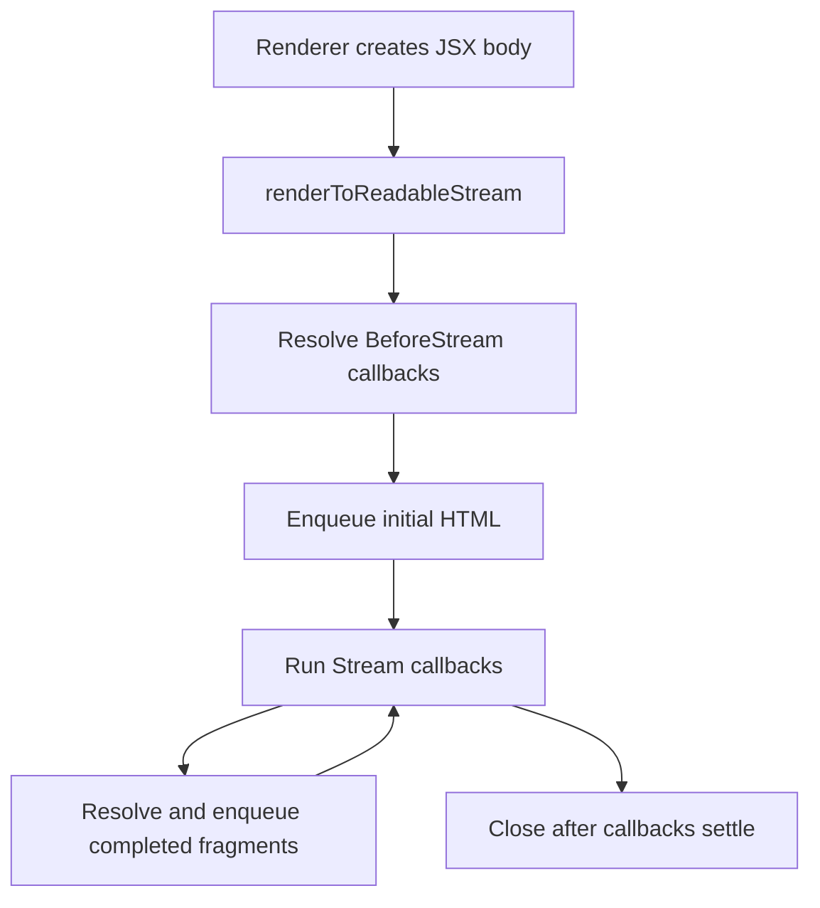

## Overview

Hono's server renderer converts JSX nodes or HTML template results into escaped strings, optionally carrying deferred rendering callbacks. The JSX renderer middleware installs that process behind `c.render`, adds layouts, and chooses a buffered HTML response or a readable stream. The response construction boundary remains the one described in [[Request and Context]].

Sources: [src/jsx/base.ts:140-176](repo://src/jsx/base.ts#L140-L176), [src/middleware/jsx-renderer/index.ts:33-79](repo://src/middleware/jsx-renderer/index.ts#L33-L79), [src/middleware/jsx-renderer/index.ts:116-128](repo://src/middleware/jsx-renderer/index.ts#L116-L128)

## Escape text and serialize nodes

The `html` tagged template copies literal template segments and escapes interpolated strings. Arrays are flattened, numbers are appended, and booleans/null/undefined disappear. Values already marked escaped keep their markup, while promises are retained in an asynchronous string buffer. This allows JSX results and HTML templates to share the same escaped-string and callback representation.

Sources: [src/helper/html/index.ts:11-57](repo://src/helper/html/index.ts#L11-L57)

`raw` marks a String object as escaped without validating or escaping its contents. Use that API only for content intentionally treated as markup. The shared buffer resolver awaits outstanding entries, propagates callbacks, and escapes resolved values unless they carry the escaped marker. Escaping applies to ampersands, angle brackets, and both quote characters.

Sources: [src/utils/html.ts:40-87](repo://src/utils/html.ts#L40-L87), [src/utils/html.ts:90-100](repo://src/utils/html.ts#L90-L100)

A JSXNode rejects invalid tag names at construction. During serialization it normalizes attribute names, skips invalid attributes, converts style objects to escaped style text, escapes string attributes, and treats known boolean attributes specially. Function-valued event and ref props are ignored on the server; unrelated function-valued props throw. `dangerouslySetInnerHTML` cannot be combined with children and converts its contents through `raw`.

Sources: [src/jsx/base.ts:147-154](repo://src/jsx/base.ts#L147-L154), [src/jsx/base.ts:179-250](repo://src/jsx/base.ts#L179-L250)

Function components receive copied props with children supplied as a single value or array. Null and boolean results render nothing. Nodes render recursively, ordinary string results are escaped, and promised results enter the asynchronous buffer. When contexts exist, a promised subtree captures the current rendering context so its eventual JSXNode can resume with that captured state.

Sources: [src/jsx/base.ts:254-295](repo://src/jsx/base.ts#L254-L295)

## Install layouts and request context

`jsxRenderer` takes an optional component and options, which may be computed from the request context. It captures the previous layout, supplies it to the new component as Layout, stores a new layout when one is provided, installs the renderer, and continues. A later handler returns `c.render` output. Nested middleware can therefore compose layouts through the Layout prop.

Sources: [src/middleware/jsx-renderer/index.ts:23-41](repo://src/middleware/jsx-renderer/index.ts#L23-L41), [src/middleware/jsx-renderer/index.ts:116-128](repo://src/middleware/jsx-renderer/index.ts#L116-L128)

The renderer defaults to an HTML doctype, accepts a custom doctype string, and omits it for false. It wraps the rendered tree in RequestContext.Provider with the HTTP context as its value. `useRequestContext` retrieves that value and throws if no provider exists. This permits components to read the same request data as route handlers without adding another request wrapper.

Sources: [src/middleware/jsx-renderer/index.ts:40-64](repo://src/middleware/jsx-renderer/index.ts#L40-L64), [src/middleware/jsx-renderer/index.ts:155-165](repo://src/middleware/jsx-renderer/index.ts#L155-L165)

| Renderer option | Result |
| --- | --- |
| `docType` omitted or true | Adds the standard HTML doctype |
| `docType: false` | Omits the doctype |
| String `docType` | Inserts that doctype string as markup |
| `stream` absent/false | Returns `c.html(body)` |
| `stream: true` | Sets chunked transfer, HTML content type, and Identity content encoding, then returns a readable stream |
| Header record `stream` | Applies the provided headers before returning the stream |

Sources: [src/middleware/jsx-renderer/index.ts:40-79](repo://src/middleware/jsx-renderer/index.ts#L40-L79)

## Preserve context across rendering

Server JSX context uses a per-render WeakMap. When AsyncLocalStorage is available, the store propagates across await boundaries. The loader probes runtime facilities without a static node:async_hooks import. Without that facility, a fallback store exists only during synchronous rendering; a context read after await can fall back to the default value and emit a one-time warning, rather than reading another request's value.

Sources: [src/jsx/context.ts:15-80](repo://src/jsx/context.ts#L15-L80), [src/jsx/context.ts:149-188](repo://src/jsx/context.ts#L149-L188)

Providers push the supplied value onto the render-local context array, stringify children, and pop from the same array on completion or failure. Deferred continuations use `captureRenderContext` to save the current store and values. This mechanism supports the async component and Suspense paths; it is separate from the HTTP context-storage middleware because it isolates a render tree's provider values.

Sources: [src/jsx/context.ts:117-147](repo://src/jsx/context.ts#L117-L147), [src/jsx/context.ts:191-250](repo://src/jsx/context.ts#L191-L250), [src/middleware/context-storage/index.ts:43-59](repo://src/middleware/context-storage/index.ts#L43-L59)

## Suspend and recover portions of a tree

Suspense stringifies its children and recognizes both returned promises and promises thrown during rendering. A thrown promise captures context before deferring a retry. If asynchronous work remains, the initial result contains a fallback and a deferred callback. That callback either replaces content in a buffered result or produces template/script output that replaces the fallback in the document. StreamingContext supplies a script nonce to this replacement path.

Sources: [src/jsx/streaming.ts:47-137](repo://src/jsx/streaming.ts#L47-L137)

Sources: [src/middleware/jsx-renderer/index.ts:60-78](repo://src/middleware/jsx-renderer/index.ts#L60-L78), [src/jsx/streaming.ts:146-219](repo://src/jsx/streaming.ts#L146-L219)

`renderToReadableStream` is marked experimental. It converts JSXNode input to text, resolves initial callbacks, encodes chunks, and follows newly discovered callbacks until they settle. Cancellation prevents further enqueue and close operations. Its error callback handles rendering failures; [[Streaming Responses]] describes the separate imperative stream and SSE helpers used when application code writes chunks itself.

Sources: [src/jsx/streaming.ts:140-219](repo://src/jsx/streaming.ts#L140-L219), [src/helper/streaming/stream.ts:7-45](repo://src/helper/streaming/stream.ts#L7-L45)

The experimental ErrorBoundary supports fallback, fallbackRender, and onError. It resolves fallback content with captured context and preserves escaped callbacks. Synchronous failures and deferred failures both reach fallback rendering. Its deferred catch path tracks whether an error was already handled so the replacement is emitted once.

Sources: [src/jsx/components.ts:50-146](repo://src/jsx/components.ts#L50-L146)

## Attach styles to rendered output

The CSS helper creates class values with rendering callbacks. It tracks pending and emitted class styles by render context, inserts styles into an existing style buffer when possible, and emits an append script when later output needs additional styles. External class names passed through composition are escaped before the result is marked escaped. This makes style emission follow the same callback lifecycle as asynchronous HTML.

Sources: [src/helper/css/index.ts:83-166](repo://src/helper/css/index.ts#L83-L166)

A CSS context exposes css, cx, keyframes, viewTransition, and Style. Style provides the style element and records its nonce for later append scripts. The custom context accepts a style ID and class-name generation hooks; the exported default helpers are built from a default context. Browser equivalents connect through DOM_RENDERER, with client behavior covered in [[Browser Rendering and Hooks]].

Sources: [src/helper/css/index.ts:63-84](repo://src/helper/css/index.ts#L63-L84), [src/helper/css/index.ts:169-227](repo://src/helper/css/index.ts#L169-L227)

