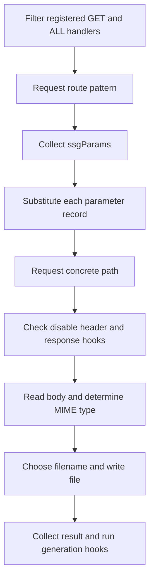

## Overview

Static site generation runs application routes in process, collects their responses, chooses output filenames, and writes those bodies through a small filesystem interface. It reuses the rendering behavior in [[Server JSX and HTML Rendering]] and the application's normal fetch path. The exported toSSG interface and its runtime filesystem adapters are marked experimental in this checkout.

Sources: [src/helper/ssg/ssg.ts:243-289](repo://src/helper/ssg/ssg.ts#L243-L289), [src/helper/ssg/ssg.ts:310-333](repo://src/helper/ssg/ssg.ts#L310-L333), [src/helper/ssg/ssg.ts:363-368](repo://src/helper/ssg/ssg.ts#L363-L368), [src/adapter/bun/ssg.ts:8-26](repo://src/adapter/bun/ssg.ts#L8-L26)

## Configure generation

The generic toSSG call receives an application, a filesystem implementation, and options. The default output directory is ./static and the generation concurrency is two. Options also provide an extension map and plugins. The filesystem contract requires asynchronous writeFile for text or Uint8Array and mkdir with a recursive option; it does not require a server socket.

Sources: [src/helper/ssg/ssg.ts:17-37](repo://src/helper/ssg/ssg.ts#L17-L37), [src/helper/ssg/ssg.ts:181-198](repo://src/helper/ssg/ssg.ts#L181-L198), [src/helper/ssg/ssg.ts:368-372](repo://src/helper/ssg/ssg.ts#L368-L372), [src/helper/ssg/ssg.ts:420-435](repo://src/helper/ssg/ssg.ts#L420-L435)

The Bun adapter passes Bun.write and a no-op mkdir implementation to the common generator. Deno encodes text into bytes and delegates to Deno.writeFile and Deno.mkdir. These wrappers preserve the same application/options interface while selecting filesystem operations. [[Runtime Adapters]] covers the host integrations used when the same application runs dynamically.

Sources: [src/adapter/bun/ssg.ts:13-27](repo://src/adapter/bun/ssg.ts#L13-L27), [src/adapter/deno/ssg.ts:9-27](repo://src/adapter/deno/ssg.ts#L9-L27)

## Discover routes and concrete parameters

Discovery scans the application's registered route records and keeps GET or ALL entries whose target handler is not classified as middleware. It unwraps composed-handler metadata before classification. The middleware test uses function arity greater than one, so route enumeration depends on registered handler shape, not on crawling links in returned HTML.

Sources: [src/helper/ssg/utils.ts:61-75](repo://src/helper/ssg/utils.ts#L61-L75), [src/utils/handler.ts:8-15](repo://src/utils/handler.ts#L8-L15)

For each route, fetchRoutesContent creates a localhost Request for the route pattern and passes it through beforeRequestHook. It then calls app.fetch with the SSG environment marker. The request may acquire ssgParams during that call. A dynamic route without such parameters is skipped; a static route without them receives one empty parameter record.

Sources: [src/helper/ssg/ssg.ts:222-251](repo://src/helper/ssg/ssg.ts#L222-L251)

The ssgParams middleware accepts either parameter records or an async generator callback. When the current request path contains a dynamic segment or wildcard, it attaches those records to the raw Request and returns not-found to prevent subsequent handler execution. When called with a concrete path it continues normally. This makes the first request a parameter-discovery pass and later requests ordinary page renders.

Sources: [src/helper/ssg/middleware.ts:24-49](repo://src/helper/ssg/middleware.ts#L24-L49), [src/helper/ssg/utils.ts:73-75](repo://src/helper/ssg/utils.ts#L73-L75), [src/helper/ssg/ssg.ts:258-269](repo://src/helper/ssg/ssg.ts#L258-L269)

Sources: [src/helper/ssg/utils.ts:61-70](repo://src/helper/ssg/utils.ts#L61-L70), [src/helper/ssg/ssg.ts:225-289](repo://src/helper/ssg/ssg.ts#L225-L289), [src/helper/ssg/ssg.ts:310-333](repo://src/helper/ssg/ssg.ts#L310-L333), [src/helper/ssg/ssg.ts:436-469](repo://src/helper/ssg/ssg.ts#L436-L469)

## Render and exclude output

Concrete requests substitute parameters into the registered route path and inherit method and headers from the discovery request. Both passes run through the pool and receive the SSG environment marker. beforeRequestHook is applied to discovery; the concrete request is constructed separately from the registered path. The generator does not automatically inherit a deployment's usual environment bindings.

Sources: [src/helper/ssg/ssg.ts:229-269](repo://src/helper/ssg/ssg.ts#L229-L269)

A concrete response with the disable-SSG header is skipped before afterResponseHook runs. disableSSG sets that header and returns not-found only in an SSG context; normal requests continue. onlySSG does the inverse, returning not-found outside generation. isSSGContext simply checks the marker in c.env. These controls let shared route code distinguish generation from runtime execution explicitly.

Sources: [src/helper/ssg/ssg.ts:270-281](repo://src/helper/ssg/ssg.ts#L270-L281), [src/helper/ssg/middleware.ts:56-83](repo://src/helper/ssg/middleware.ts#L56-L83)

After response hooks, the generator takes the MIME type before any semicolon, defaulting to text/plain if absent. Content with a text or JSON header is read as text; other content is read as ArrayBuffer. Body-reading failures are wrapped with an Error processing response message. A stream response must therefore finish before its complete content can be written to a static file.

Sources: [src/helper/ssg/ssg.ts:74-88](repo://src/helper/ssg/ssg.ts#L74-L88), [src/helper/ssg/ssg.ts:282-289](repo://src/helper/ssg/ssg.ts#L282-L289)

## Name files and constrain paths

| Route shape | Output under the chosen directory |
| --- | --- |
| Already ends in the selected extension | Keep that route filename |
| Root path | index plus the selected extension |
| Path ending in slash | Append index plus the extension |
| Other path | Append the extension to the path |

Sources: [src/helper/ssg/ssg.ts:50-71](repo://src/helper/ssg/ssg.ts#L50-L71)

Extension selection uses the provided extension map, or the default map when none is supplied, then the MIME utility, finally html. The default map includes HTML, XML-family types and YAML. The selected map is not merged with the default map. Before a write, normalized path containment must show that the target equals or sits beneath the output directory; otherwise generation throws a path-traversal error.

Sources: [src/helper/ssg/ssg.ts:90-108](repo://src/helper/ssg/ssg.ts#L90-L108), [src/helper/ssg/ssg.ts:69-71](repo://src/helper/ssg/ssg.ts#L69-L71), [src/helper/ssg/utils.ts:77-87](repo://src/helper/ssg/utils.ts#L77-L87)

saveContentToFile awaits content, returns immediately for a skipped result, computes the directory, creates it recursively if not already in the createdDirs cache, and writes text or converts ArrayBuffer to Uint8Array. It returns the output path after the write. Directory creation tracking is module-scoped, so it persists across calls using the same loaded generator module.

Sources: [src/helper/ssg/ssg.ts:309-333](repo://src/helper/ssg/ssg.ts#L309-L333)

## Extend the pipeline with plugins

Plugins expose beforeRequestHook, afterResponseHook, and afterGenerateHook, each optionally an array. Request and response hooks run sequentially, replacing the current value when they return a Request/Response and stopping when one returns false. Generation hooks run sequentially with the result, filesystem and options. Legacy top-level hooks are still collected first but are marked deprecated.

Sources: [src/helper/ssg/ssg.ts:118-198](repo://src/helper/ssg/ssg.ts#L118-L198), [src/helper/ssg/ssg.ts:368-419](repo://src/helper/ssg/ssg.ts#L368-L419)

Without a plugins option, toSSG installs defaultPlugin, which skips non-200 responses. Supplying a plugin array replaces that default selection. redirectPlugin converts supported redirect statuses with Location into an HTML redirect page with status 200; it skips redirects lacking Location. When using both plugins, put redirectPlugin first so conversion happens before the default status filter.

Sources: [src/helper/ssg/ssg.ts:368-372](repo://src/helper/ssg/ssg.ts#L368-L372), [src/helper/ssg/plugins.ts:11-20](repo://src/helper/ssg/plugins.ts#L11-L20), [src/helper/ssg/plugins.ts:38-72](repo://src/helper/ssg/plugins.ts#L38-L72)

## Interpret completion and failure

Successful generation returns success true and the collected paths. A caught discovery or saving failure returns success false, an empty files list, and an Error. Already completed writes are not rolled back by this catch branch. afterGenerate hooks run after either result is formed, outside that catch; a hook exception can reject toSSG instead of returning the result object.

Sources: [src/helper/ssg/ssg.ts:436-469](repo://src/helper/ssg/ssg.ts#L436-L469)

