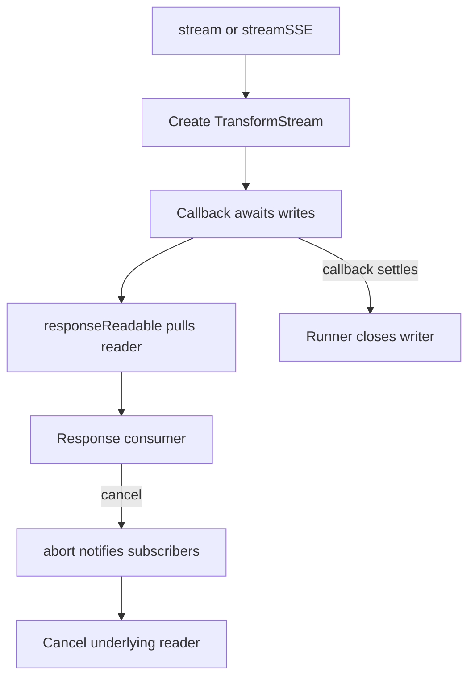

## Overview

Streaming helpers return a Response backed by a readable stream while an asynchronous callback writes data to its writable side. They reuse context headers through newResponse, so they fit the ordinary handler return contract. [[Server JSX and HTML Rendering]] handles deferred JSX fragments; these helpers expose an imperative interface for bytes, text, and server-sent events.

Sources: [src/helper/streaming/stream.ts:7-45](repo://src/helper/streaming/stream.ts#L7-L45), [src/helper/streaming/sse.ts:72-100](repo://src/helper/streaming/sse.ts#L72-L100)

## Choose the response format

| Helper | Interface and headers |
| --- | --- |
| `stream` | StreamingApi for strings or Uint8Array chunks; no format-specific headers added |
| `streamText` | StreamingApi plus text content type, nosniff and chunked transfer headers |
| `streamSSE` | SSEStreamingApi plus event-stream, no-cache, keep-alive and chunked transfer headers |

Sources: [src/helper/streaming/stream.ts:7-45](repo://src/helper/streaming/stream.ts#L7-L45), [src/helper/streaming/text.ts:6-15](repo://src/helper/streaming/text.ts#L6-L15), [src/helper/streaming/sse.ts:72-100](repo://src/helper/streaming/sse.ts#L72-L100)

Each helper receives a context, an async writer callback, and an optional async error callback. streamText prepares its headers and delegates to stream. streamSSE creates the specialized writer and launches its own callback runner. In both cases, the response is constructed immediately after callback execution is launched, rather than waiting for the full body to be written.

Sources: [src/helper/streaming/stream.ts:7-45](repo://src/helper/streaming/stream.ts#L7-L45), [src/helper/streaming/text.ts:6-15](repo://src/helper/streaming/text.ts#L6-L15), [src/helper/streaming/sse.ts:47-100](repo://src/helper/streaming/sse.ts#L47-L100)

## Move chunks through the stream

StreamingApi obtains a writer from the writable stream and a reader from the original readable stream. It exposes another readable stream whose pull operation reads one item and either enqueues it or closes. Cancelling that response-readable stream calls abort when the writer has not already been marked closed. The wrapper provides a place to connect consumer cancellation with application cleanup.

Sources: [src/utils/stream.ts:21-46](repo://src/utils/stream.ts#L21-L46)

Sources: [src/helper/streaming/stream.ts:12-44](repo://src/helper/streaming/stream.ts#L12-L44), [src/utils/stream.ts:21-57](repo://src/utils/stream.ts#L21-L57), [src/utils/stream.ts:69-97](repo://src/utils/stream.ts#L69-L97)

`write` encodes string input with TextEncoder and awaits writer.write; byte arrays go through directly. `writeln` adds a newline and delegates to write. Both resolve to the StreamingApi instance. Awaiting them preserves the sequencing of an application's writes, although write deliberately catches writer failures and returns instead of exposing those failures to the caller.

Sources: [src/utils/stream.ts:48-63](repo://src/utils/stream.ts#L48-L63)

`pipe` releases the current writer lock and pipes another readable body into the same writable with preventClose enabled. After successful piping it reacquires the writer, allowing later writes. The method itself does not close the destination. `sleep` is a timer-backed promise available for pacing callback work; it does not perform any cancellation check.

Sources: [src/utils/stream.ts:65-82](repo://src/utils/stream.ts#L65-L82)

## Format server-sent events

`writeSSE` accepts required data and optional event, id, and retry values. It first resolves the data's HTML callbacks in Stringify phase, permitting promised content. It splits data on CRLF, CR, or LF and prefixes every resulting line with `data: `. Event, ID, and retry metadata may not contain carriage return or newline characters; an invalid value throws before writing.

Sources: [src/helper/streaming/sse.ts:6-31](repo://src/helper/streaming/sse.ts#L6-L31)

The output orders event metadata, data lines, ID, and retry metadata, removes falsy optional entries, and ends with a blank line. Consequently an empty event or ID is omitted, and numeric retry zero is also omitted by the current truthiness checks. The entire framed event is passed to StreamingApi.write as one string. The helper does not maintain a replay buffer or generate event IDs.

Sources: [src/helper/streaming/sse.ts:18-44](repo://src/helper/streaming/sse.ts#L18-L44)

## Handle errors after response creation

The generic stream runner awaits the writer callback, invokes onError for an Error when supplied, otherwise logs the thrown value, and closes in finally. It treats an undefined rejection specially as a cancelled pipe with no reason and does nothing beyond final closure. The error callback receives the same writer, allowing it to append format-appropriate output while the stream remains writable.

Sources: [src/helper/streaming/stream.ts:26-44](repo://src/helper/streaming/stream.ts#L26-L44)

SSE has different error framing: for an Error with an onError callback, it awaits that callback and then writes an event named error whose data is the error's message. Without that callback it logs the error. It closes in finally in either case. Because the response is already returned and the runner owns these failures, ordinary handler error responses are not the mechanism used for these asynchronous callback errors.

Sources: [src/helper/streaming/sse.ts:47-68](repo://src/helper/streaming/sse.ts#L47-L68), [src/helper/streaming/sse.ts:97-100](repo://src/helper/streaming/sse.ts#L97-L100)

## Cancellation and closure

StreamingApi tracks aborted and closed separately. close sets closed and attempts writer.close, swallowing close failures. abort runs once: it marks aborted and invokes subscribers. The constructor installs a subscriber that cancels the underlying reader, which prevents writes from remaining blocked after a consumer disconnects. Application subscribers can be registered with onAbort, but abort does not await their returned promises.

Sources: [src/utils/stream.ts:12-33](repo://src/utils/stream.ts#L12-L33), [src/utils/stream.ts:69-97](repo://src/utils/stream.ts#L69-L97)

The helpers retain the context in a WeakMap keyed by responseReadable because their comments identify Bun context lifetime as a concern. A compatibility branch also listens to the request's abort signal for older Bun versions. Its detector checks version prefixes and caches its result; the helper only calls abort from that listener when the stream has not been closed.

Sources: [src/helper/streaming/stream.ts:5-25](repo://src/helper/streaming/stream.ts#L5-L25), [src/helper/streaming/sse.ts:70-90](repo://src/helper/streaming/sse.ts#L70-L90), [src/helper/streaming/utils.ts:1-11](repo://src/helper/streaming/utils.ts#L1-L11)

## Interaction with middleware

The transfer-encoding headers set by text and SSE helpers cause the built-in compression middleware to skip those responses. Cache middleware also excludes no-cache responses, which streamSSE sets explicitly. Generic stream adds neither policy automatically. Choose surrounding middleware with the actual headers and body behavior in mind; [[HTTP Middleware]] documents the relevant skip branches and body-consuming transformations.

Sources: [src/helper/streaming/text.ts:11-14](repo://src/helper/streaming/text.ts#L11-L14), [src/helper/streaming/sse.ts:92-95](repo://src/helper/streaming/sse.ts#L92-L95), [src/middleware/compress/index.ts:89-107](repo://src/middleware/compress/index.ts#L89-L107), [src/middleware/cache/index.ts:15-35](repo://src/middleware/cache/index.ts#L15-L35)

