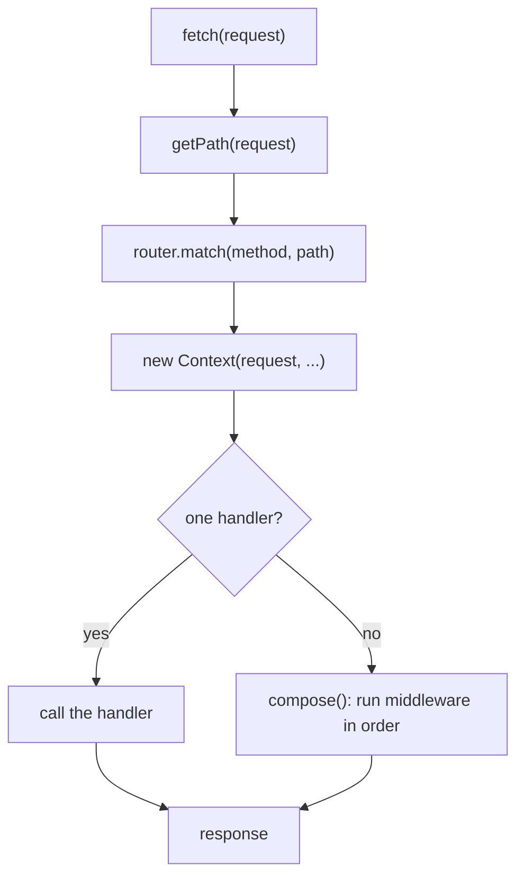

## Overview

Hono is a web framework built on the Web Standard `Request` and `Response` objects. An app is an instance of `Hono`, and its `fetch` method takes a `Request` and returns a `Response`, so the same app runs on any runtime that calls `fetch`. The package entry point exports `Hono` by name, and the `Hono` class sets up the default router.

Sources: [src/hono.ts:16-34](repo://src/hono.ts#L16-L34), [src/index.ts:39-53](repo://src/index.ts#L39-L53)

The `fetch` method is the entry point the code documents for the app. It hands the request to the private dispatch step, which matches the route, builds a `Context`, and runs the handlers.

Sources: [src/hono-base.ts:468-485](repo://src/hono-base.ts#L468-L485)

## The parts

| Area | What it does | Page |
| --- | --- | --- |
| Route registration | `get`, `post`, `on`, `use`, `route`, `mount` store handlers in the router | [[Registering Routes]] |
| Dispatch | Matches a request, builds the `Context`, runs handlers | [[Request Dispatch]] |
| Context | Builds responses and carries values across handlers | [[Context]] |
| Request | Reads path params, query, headers and bodies | [[HonoRequest]] |
| Validation | Checks request data with a function and stores the result | [[Validation]] |
| Routers | Match a method and path to handlers | [[Router Selection]], [[RegExp Router]] |
| Middleware | Auth, security, caching, logging and other handlers | [[Built-in Middleware]], [[JWT Authentication]] |
| Runtime adapters | Connect the app to Bun, Deno, Workers, Lambda and others | [[Runtime Adapters]] |
| JSX | Renders HTML on the server and DOM on the client | [[JSX Server Rendering]], [[JSX DOM Rendering]] |
| Static generation | Writes each route's response to a file | [[Static Site Generation]] |
| Helpers | Streaming, cookies, factories, WebSocket and testing | [[Helper Catalogue]] |
| Client | Calls the app with types taken from its routes | [[Typed Client]] |

Sources: [src/index.ts:1-53](repo://src/index.ts#L1-L53), [src/hono.ts:16-34](repo://src/hono.ts#L16-L34)

## Main flow

Sources: [src/hono-base.ts:406-466](repo://src/hono-base.ts#L406-L466)

1. `fetch` receives the request and the bindings. It is the entry point described in [[Request Dispatch]].
2. `getPath` reads the pathname, which can be changed by a custom `getPath` option.
3. `router.match` returns the handlers for the method and path. [[Router Selection]] explains which router answers.
4. A `Context` wraps the request, the match result and the bindings. [[Context]] explains how it builds the response.
5. With one handler the handler is called directly. With several, `compose` runs them in order, as [[Request Dispatch]] traces.
6. Handlers read input through `c.req`, described in [[HonoRequest]], and validators in [[Validation]] add typed data to it.

Sources: [src/hono-base.ts:413-466](repo://src/hono-base.ts#L413-L466), [src/compose.ts:32-71](repo://src/compose.ts#L32-L71)

## Design decisions

The router is chosen once, by default. `Hono` builds a `SmartRouter` over a `RegExpRouter` and a `TrieRouter` unless the caller passes a `router` option, so the common case needs no configuration.

Sources: [src/hono.ts:26-33](repo://src/hono.ts#L26-L33), [src/hono-base.ts:126-173](repo://src/hono-base.ts#L126-L173)

The `SmartRouter` decides on the first request. It adds the routes to each candidate in turn, keeps the first that does not throw `UnsupportedPathError`, and then replaces its own `match` with that router's `match`, so later requests skip the choice.

Sources: [src/router/smart-router/router.ts:21-50](repo://src/router/smart-router/router.ts#L21-L50)

Middleware and handlers share one calling convention. Each is called with `(context, next)`, and `compose` turns the matched list into a chain where `next()` runs the rest. Calling `next` twice throws, which keeps the order fixed.

Sources: [src/compose.ts:15-73](repo://src/compose.ts#L15-L73)

Errors and missing routes have replaceable handlers. `onError` and `notFound` store the handler on the instance, and dispatch falls back to a plain text 500 or 404 when none is set.

Sources: [src/hono-base.ts:31-42](repo://src/hono-base.ts#L31-L42), [src/hono-base.ts:271-294](repo://src/hono-base.ts#L271-L294)

## Pages

- [[Quickstart]] runs a small app from the constructor to a response.
- [[Registering Routes]] covers how each registration method stores its handler.
- [[Request Dispatch]] traces one request through the dispatch and compose code.
- [[Context]] and [[HonoRequest]] are the two objects a handler uses.
- [[Validation]], [[Router Selection]] and [[RegExp Router]] cover checking input and matching paths.
- [[Built-in Middleware]], [[JWT Authentication]], [[Runtime Adapters]], [[JSX Server Rendering]], [[JSX DOM Rendering]], [[Static Site Generation]], [[Helper Catalogue]] and [[Typed Client]] cover the remaining parts.

Sources: [src/middleware/jwt/jwt.ts:175-178](repo://src/middleware/jwt/jwt.ts#L175-L178), [src/adapter/bun/index.ts:1-11](repo://src/adapter/bun/index.ts#L1-L11), [src/jsx/index.ts:1-60](repo://src/jsx/index.ts#L1-L60), [src/client/index.ts:1-17](repo://src/client/index.ts#L1-L17)
