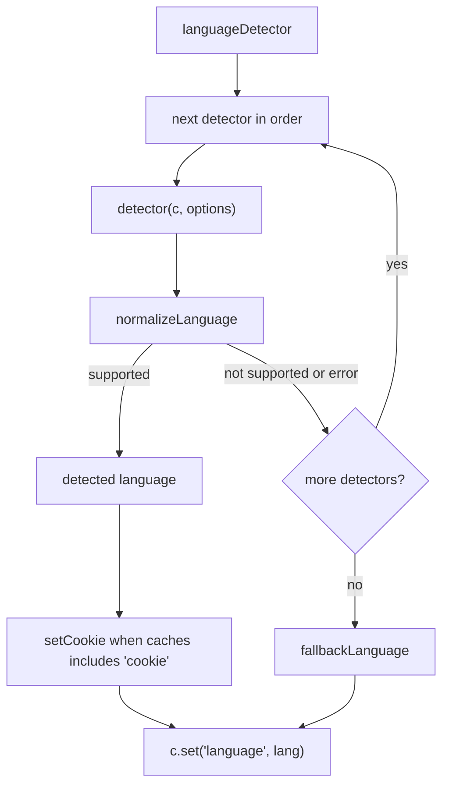

## Overview

Several request headers list options with quality weights: `Accept`, `Accept-Language`, `Accept-Encoding` and `Accept-Charset`. Hono parses all of them with one function, `parseAccept` in `utils/accept`, and builds two features on it: the `accepts()` helper from `hono/accepts`, which picks one value a handler supports, and the `languageDetector` middleware from `hono/language`, which settles the request's language from several sources. The `compress` middleware also uses `parseAccept` to choose an encoding ([[Response Middleware]]).

Sources: [src/utils/accept.ts:211-238](repo://src/utils/accept.ts#L211-L238), [src/helper/accepts/accepts.ts:40-49](repo://src/helper/accepts/accepts.ts#L40-L49), [src/middleware/language/language.ts:74-76](repo://src/middleware/language/language.ts#L74-L76), [src/middleware/compress/index.ts:24-44](repo://src/middleware/compress/index.ts#L24-L44)

## Parsing Accept headers

`parseAccept(header)` returns a list of `{ type, params, q }`, one per comma-separated value. It is a hand-written scanner rather than a set of `split` calls, so quoted parameter values containing `,` or `;` and backslash escapes inside quotes are handled.

Sources: [src/utils/accept.ts:1-5](repo://src/utils/accept.ts#L1-L5), [src/utils/accept.ts:66-157](repo://src/utils/accept.ts#L66-L157)

```ts
parseAccept('text/html, application/json;q=0.9, */*;q=0.8')
// [
//   { type: 'text/html', params: {}, q: 1 },
//   { type: 'application/json', params: { q: '0.9' }, q: 0.9 },
//   { type: '*/*', params: { q: '0.8' }, q: 0.8 },
// ]
```

Sources: [src/utils/accept.ts:159-238](repo://src/utils/accept.ts#L159-L238)

Malformed parts are skipped instead of failing the whole header: an empty type, a parameter without `=`, a value that starts with `=`, or text trailing after a closing quote. Parameters without a value are dropped.

Sources: [src/utils/accept.ts:30-64](repo://src/utils/accept.ts#L30-L64), [src/utils/accept.ts:83-102](repo://src/utils/accept.ts#L83-L102), [src/utils/accept.ts:195-206](repo://src/utils/accept.ts#L195-L206)

`parseQuality` turns the `q` parameter into a number. Missing, empty, non-numeric and out-of-range values become `1`, `NaN` and `-Infinity` become `0`, and `Infinity` becomes `1`.

Sources: [src/utils/accept.ts:240-266](repo://src/utils/accept.ts#L240-L266)

The result is sorted by `q`, highest first, but only when a value with a higher quality follows a lower one. A comment notes that headers usually arrive already sorted, so the sort is often skipped.

Sources: [src/utils/accept.ts:216-237](repo://src/utils/accept.ts#L216-L237)

## The accepts helper

`accepts(c, { header, supports, default, match? })` reads one header, parses it, and returns the first value, by descending quality, that appears in `supports`. Without the header, or when nothing matches, it returns `default`.

Sources: [src/helper/accepts/accepts.ts:11-49](repo://src/helper/accepts/accepts.ts#L11-L49)

```ts
import { accepts } from 'hono/accepts'

app.get('/users', (c) => {
  const lang = accepts(c, {
    header: 'Accept-Language',
    supports: ['en', 'zh'],
    default: 'en',
  })
  return c.json({ lang })
})
```

Sources: [src/helper/accepts/accepts.ts:27-39](repo://src/helper/accepts/accepts.ts#L27-L39)

The default matcher compares types exactly, so `*/*` or `en-US` only match a `supports` entry with the same string. A custom `match(accepts, config)` replaces that logic, for example to honour wildcards. `header` is typed as one of the Accept-family header names from `utils/headers`.

Sources: [src/helper/accepts/accepts.ts:17-25](repo://src/helper/accepts/accepts.ts#L17-L25), [src/helper/accepts/accepts.ts:3-3](repo://src/helper/accepts/accepts.ts#L3-L3), [src/utils/headers.ts:323-333](repo://src/utils/headers.ts#L323-L333)

## Language detection

`languageDetector(options)` decides the request's language once and stores it as `c.var.language`, typed through `ContextVariableMap`. It merges the options over `DEFAULT_OPTIONS` (merging `cookieOptions` separately) and validates them at setup.

Sources: [src/middleware/language/language.ts:283-300](repo://src/middleware/language/language.ts#L283-L300), [src/middleware/language/index.ts:1-12](repo://src/middleware/language/index.ts#L1-L12)

| Option | Default | Effect |
| --- | --- | --- |
| `supportedLanguages` | `['en']` | Languages the app serves |
| `fallbackLanguage` | `'en'` | Used when nothing is detected; must be in `supportedLanguages` |
| `order` | `['querystring', 'cookie', 'header']` | Detectors to try, in order; `path` is also available |
| `lookupQueryString` | `'lang'` | Query parameter to read |
| `lookupCookie` | `'language'` | Cookie to read and write |
| `lookupFromHeaderKey` | `'accept-language'` | Header to read |
| `lookupFromPathIndex` | `0` | Path segment to read; must not be negative |
| `caches` | `['cookie']` | Write the detected language to the cookie; `false` disables |
| `cookieOptions` | `Strict`, secure, HTTP-only, one year | Options for that cookie |
| `ignoreCase` | `true` | Compare case-insensitively |
| `convertDetectedLanguage` | | Maps a detected value before matching, for example `en_US` to `en-US` |
| `debug` | `false` | Logs which detector matched and any detector errors |

Sources: [src/middleware/language/language.ts:13-68](repo://src/middleware/language/language.ts#L13-L68), [src/middleware/language/language.ts:195-207](repo://src/middleware/language/language.ts#L195-L207)



Sources: [src/middleware/language/language.ts:212-258](repo://src/middleware/language/language.ts#L212-L258)

Each detector returns a supported language or `undefined`. The query, cookie and path detectors read one value; the header detector parses `Accept-Language` and tries each language in quality order. An error thrown by a detector is caught and the next detector runs.

Sources: [src/middleware/language/language.ts:128-182](repo://src/middleware/language/language.ts#L128-L182), [src/middleware/language/language.ts:229-249](repo://src/middleware/language/language.ts#L229-L249)

`normalizeLanguage` trims the value, applies `convertDetectedLanguage`, and looks for an exact match in `supportedLanguages`. Failing that, it drops trailing `-` subtags one at a time, the RFC 4647 Lookup scheme its comment names, so `zh-Hant-TW` can match `zh-Hant` and then `zh`. The returned value is the entry as written in `supportedLanguages`, not the request's spelling.

Sources: [src/middleware/language/language.ts:84-123](repo://src/middleware/language/language.ts#L84-L123)

When a detector found a language, it is written to the cookie on every such request, including when it came from the cookie itself. The fallback language is never cached. A failing `setCookie` is ignored, and logged when `debug` is on ([[Cookies]]).

Sources: [src/middleware/language/language.ts:212-257](repo://src/middleware/language/language.ts#L212-L257)

The detector functions are exported on their own (`detectFromQuery`, `detectFromCookie`, `detectFromHeader`, `detectFromPath`) for code that needs one source without the middleware.

Sources: [src/middleware/language/index.ts:1-9](repo://src/middleware/language/index.ts#L1-L9)
