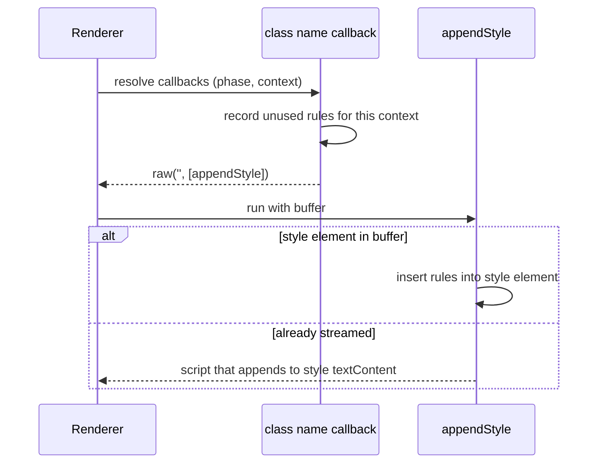

## Overview

Hono renders HTML on the server as strings, not as DOM trees. Every piece of trusted markup is an `HtmlEscapedString`, a `String` object flagged with `isEscaped` that can carry callbacks to run when the final output is assembled. The `html` tagged template from `hono/html` builds such strings by hand, escaping whatever is interpolated; JSX builds the same kind of value ([[JSX Server Rendering]]). The `css` helper from `hono/css` builds on the callback mechanism to collect the styles a page uses and put them into a single `<style>` element.

Sources: [src/utils/html.ts:6-46](repo://src/utils/html.ts#L6-L46), [src/helper/html/index.ts:11-57](repo://src/helper/html/index.ts#L11-L57), [src/helper/css/index.ts:83-147](repo://src/helper/css/index.ts#L83-L147), [src/helper/css/index.ts:192-215](repo://src/helper/css/index.ts#L192-L215)

## HtmlEscapedString and raw

`raw(value, callbacks?)` wraps any value in `new String(value)`, sets `isEscaped = true`, and attaches the callbacks. A value marked this way is inserted into templates without escaping, so `raw` is how trusted markup, such as a pre-rendered fragment, is passed through.

Sources: [src/utils/html.ts:17-46](repo://src/utils/html.ts#L17-L46)

Escaping is done by `escapeToBuffer`, based on React DOM's `escapeTextForBrowser`, as the comment says. It replaces `"`, `'`, `&`, `<` and `>` with `&quot;`, `&#39;`, `&amp;`, `&lt;` and `&gt;`, and returns the string untouched when none of them occur.

Sources: [src/utils/html.ts:48-51](repo://src/utils/html.ts#L48-L51), [src/utils/html.ts:90-127](repo://src/utils/html.ts#L90-L127)

## The html template

```ts
import { html, raw } from 'hono/html'

app.get('/:name', (c) => {
  const name = c.req.param('name')
  return c.html(html`<!doctype html>
    <h1>Hello, ${name}!</h1>
    ${raw('<p>trusted</p>')}`)
})
```

Sources: [src/helper/html/index.ts:11-57](repo://src/helper/html/index.ts#L11-L57)

Each interpolated value is handled by type:

Sources: [src/helper/html/index.ts:17-49](repo://src/helper/html/index.ts#L17-L49)

| Value | Output |
| --- | --- |
| string | Escaped |
| number | As is |
| `true`, `false`, `null`, `undefined` | Nothing |
| array | Flattened completely, each item handled by this table |
| `HtmlEscapedString` | As is; kept as a separate buffer entry when it has callbacks |
| Promise | Awaited later, then escaped unless the result is already escaped |
| any other object | `toString()`, escaped |

Sources: [src/helper/html/index.ts:17-49](repo://src/helper/html/index.ts#L17-L49)

The result is a plain `HtmlEscapedString` when everything was synchronous. If a Promise was interpolated, `html` returns a `Promise<HtmlEscapedString>` instead, and `c.html` awaits it ([[Context and Responses]]).

Sources: [src/helper/html/index.ts:50-57](repo://src/helper/html/index.ts#L50-L57), [src/context.ts:723-733](repo://src/context.ts#L723-L733)

## String buffers

While building, the output is a `StringBuffer`: an array alternating strings and Promises, with new entries unshifted at the front. Its comment says the array has odd length, strings at even indexes, and must be concatenated from the tail. `stringBufferToString` awaits every entry, walks the array backwards, escapes Promise results that are not marked escaped, gathers their callbacks, and returns one `HtmlEscapedString` carrying all of them.

Sources: [src/utils/html.ts:23-38](repo://src/utils/html.ts#L23-L38), [src/utils/html.ts:53-88](repo://src/utils/html.ts#L53-L88)

## Callbacks and phases

A callback receives `{ phase, buffer, context }` and returns a Promise of more HTML, or `undefined`. The phases are `Stringify` (1), used when the whole output becomes one string, and `BeforeStream` (2) and `Stream` (3), used by streaming rendering ([[Suspense and Streaming JSX]]). `context` is an object unique to one rendering, which a comment says callbacks use as a `WeakMap` key.

Sources: [src/utils/html.ts:6-16](repo://src/utils/html.ts#L6-L16)

`resolveCallback(str, phase, preserveCallbacks, context, buffer?)` resolves the string, runs its callbacks with a one-element `buffer` holding the output so far, and recursively resolves whatever HTML the callbacks return, appending it to the buffer. A callback can therefore both edit the output already produced and add more output after it. `resolveCallbackSync` does the same for the `Stringify` phase without Promises; `html` uses it when the template had callbacks but no Promises.

Sources: [src/utils/html.ts:129-181](repo://src/utils/html.ts#L129-L181), [src/helper/html/index.ts:52-56](repo://src/helper/html/index.ts#L52-L56)

## The css helper

```tsx
import { css, cx, keyframes, Style } from 'hono/css'

const fadeIn = keyframes`from { opacity: 0 } to { opacity: 1 }`
const title = css`
  /* page-title */
  font-size: 2rem;
  animation: ${fadeIn} 1s;
`

app.get('/', (c) =>
  c.html(
    <html>
      <head>
        <Style />
      </head>
      <body>
        <h1 class={cx(title, 'extra')}>Hello</h1>
      </body>
    </html>
  )
)
```

Sources: [src/helper/css/index.ts:225-262](repo://src/helper/css/index.ts#L225-L262)

`css` returns a Promise of an `HtmlEscapedString` holding the generated class name, with the rule data attached under private symbols. The class name is `css-` followed by a 32-bit hash of the label and the minified style string. The label is a leading `/* comment */`, which is also passed to a custom slug function.

Sources: [src/helper/css/index.ts:88-171](repo://src/helper/css/index.ts#L88-L171), [src/helper/css/common.ts:43-50](repo://src/helper/css/common.ts#L43-L50), [src/helper/css/common.ts:201-238](repo://src/helper/css/common.ts#L201-L238)

`buildStyleString` decides what an interpolated value means:

Sources: [src/helper/css/common.ts:139-199](repo://src/helper/css/common.ts#L139-L199), [src/helper/css/common.ts:26-36](repo://src/helper/css/common.ts#L26-L36)

| Value | Treatment |
| --- | --- |
| A `css` class followed by `{` | Used as a selector, `.css-…`, for nested rules |
| Another `css` class | Its declarations are inlined, which composes styles |
| A `keyframes` value | Its animation name |
| A string | Inserted with `\`, `"`, `'` and the `/` of `</` backslash-escaped |
| `rawCssString(value)` | Inserted unescaped |
| `true`, `false`, `null`, `undefined` | Nothing |

Sources: [src/helper/css/common.ts:139-199](repo://src/helper/css/common.ts#L139-L199), [src/helper/css/common.ts:26-36](repo://src/helper/css/common.ts#L26-L36)

The style string is then minified: comments, extra whitespace and trailing semicolons are removed, outside quoted strings. A style wrapped in `:-hono-global { … }` is emitted without a class wrapper, for global rules.

Sources: [src/helper/css/common.ts:79-106](repo://src/helper/css/common.ts#L79-L106), [src/helper/css/common.ts:2-3](repo://src/helper/css/common.ts#L2-L3), [src/helper/css/common.ts:207-211](repo://src/helper/css/common.ts#L207-L211)

`keyframes` returns a value whose name is `@keyframes css-…`. `cx(...)` combines `css` classes and plain class-name strings into one class attribute; a plain string containing `<`, `{` or `}` is dropped, because, as a comment says, such characters could break out of the `<style>` element. `viewTransition` creates a class with a `view-transition-name` and rewrites `::view-transition-*()` selectors in its content to that name.

Sources: [src/helper/css/common.ts:58-60](repo://src/helper/css/common.ts#L58-L60), [src/helper/css/common.ts:240-333](repo://src/helper/css/common.ts#L240-L333)

## How styles reach the page

`Style({ nonce? })` renders `<style id="hono-css">` and records the nonce for this rendering. Each class name carries a callback, `addClassNameToContext`, that records in a per-rendering `WeakMap` which rules this page uses and have not been emitted yet, and returns one more callback, `appendStyle`.

Sources: [src/helper/css/index.ts:83-147](repo://src/helper/css/index.ts#L83-L147), [src/helper/css/index.ts:192-203](repo://src/helper/css/index.ts#L192-L203)

`appendStyle` writes the pending rules. When the `<style id="hono-css">` element is in the output buffer, the rules are inserted into it. When it is not, because that part of the page was already streamed, the rules are emitted as a `<script>` (with the nonce) that appends them to the element's `textContent` in the browser. Each rule is emitted once per rendering.

Sources: [src/helper/css/index.ts:89-122](repo://src/helper/css/index.ts#L89-L122)



Sources: [src/helper/css/index.ts:88-147](repo://src/helper/css/index.ts#L88-L147), [src/utils/html.ts:142-181](repo://src/utils/html.ts#L142-L181)

Class names coming from `cx()` strings are escaped before they are marked as escaped HTML, since, as a comment notes, they are untrusted.

Sources: [src/helper/css/index.ts:149-161](repo://src/helper/css/index.ts#L149-L161)

## Separate contexts

The exported `css`, `cx`, `keyframes`, `viewTransition` and `Style` come from one default context with the style ID `hono-css`. `createCssContext({ id, classNameSlug?, onInvalidSlug? })` creates another set with its own `<style>` element. `classNameSlug(hash, label, styleString)` chooses class names; a slug that is not a valid class name, or for keyframes a CSS-wide keyword such as `none`, is rejected through `onInvalidSlug`, which by default logs a warning.

Sources: [src/helper/css/index.ts:72-80](repo://src/helper/css/index.ts#L72-L80), [src/helper/css/index.ts:225-227](repo://src/helper/css/index.ts#L225-L227), [src/helper/css/common.ts:56-77](repo://src/helper/css/common.ts#L56-L77)

The same functions also work with the client-side renderer: `Style` and class names carry DOM-specific behaviour, described on [[DOM Elements, Forms and CSS]].

Sources: [src/helper/css/index.ts:81-81](repo://src/helper/css/index.ts#L81-L81), [src/helper/css/index.ts:165-165](repo://src/helper/css/index.ts#L165-L165), [src/helper/css/index.ts:205-206](repo://src/helper/css/index.ts#L205-L206)
