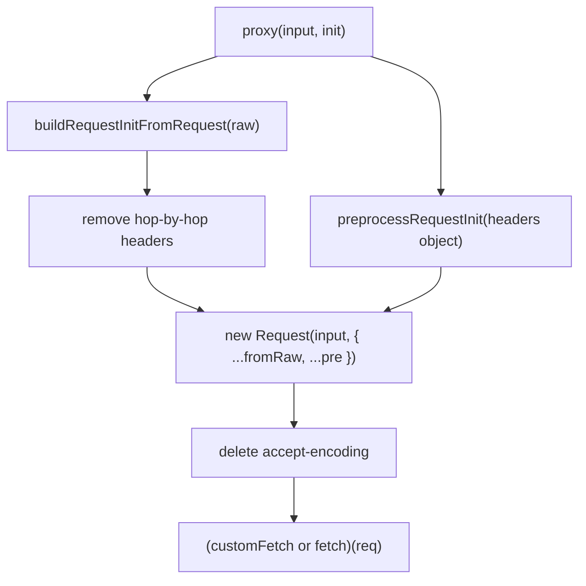

## Overview

`proxy(input, init?)` from `hono/proxy` forwards a request to another server and returns that server's response in a form a handler can return as it is. It has the signature of `fetch`, plus a few proxy-specific options, and does three things `fetch` alone does not: it can copy the incoming request, it removes hop-by-hop headers in both directions, and it cleans up the encoding headers so the response body and its headers agree.

Sources: [src/helper/proxy/index.ts:46-48](repo://src/helper/proxy/index.ts#L46-L48), [src/helper/proxy/index.ts:115-190](repo://src/helper/proxy/index.ts#L115-L190)

```ts
import { proxy } from 'hono/proxy'

app.all('/proxy/:path', (c) =>
  proxy(`http://${originServer}/${c.req.param('path')}`, {
    ...c.req,
    headers: {
      ...c.req.header(),
      'X-Forwarded-For': '127.0.0.1',
      'X-Forwarded-Host': c.req.header('host'),
      Authorization: undefined,
    },
  })
)
```

Sources: [src/helper/proxy/index.ts:139-149](repo://src/helper/proxy/index.ts#L139-L149)

## Options

`init` accepts every `RequestInit` field plus these:

Sources: [src/helper/proxy/index.ts:24-44](repo://src/helper/proxy/index.ts#L24-L44)

| Option | Effect |
| --- | --- |
| `raw` | A `Request` to copy the method, body, headers and abort signal from |
| `headers` | Headers for the outgoing request; in an object, a `null` or `undefined` value removes that header |
| `customFetch` | Called with the built `Request` instead of the global `fetch` |
| `strictConnectionProcessing` | Also remove the headers named in the incoming `Connection` header (default `false`) |

Sources: [src/helper/proxy/index.ts:24-44](repo://src/helper/proxy/index.ts#L24-L44)

Spreading `...c.req` works because `HonoRequest` stores the original request in its `raw` property, which becomes the `raw` option. A `Request` can also be passed directly as the second argument; it is treated as `{ raw: request }`.

Sources: [src/helper/proxy/index.ts:160-166](repo://src/helper/proxy/index.ts#L160-L166), [src/request.ts:51-51](repo://src/request.ts#L51-L51)

## Building the outgoing request



Sources: [src/helper/proxy/index.ts:50-113](repo://src/helper/proxy/index.ts#L50-L113), [src/helper/proxy/index.ts:160-174](repo://src/helper/proxy/index.ts#L160-L174)

From `raw`, `buildRequestInitFromRequest` copies the method, the body (with `duplex: 'half'` when there is one), the signal and a copy of the headers. It deletes the hop-by-hop headers listed in RFC 2616 section 13.5.1: `connection`, `keep-alive`, `proxy-authenticate`, `proxy-authorization`, `te`, `trailer`, `transfer-encoding` and `upgrade`.

Sources: [src/helper/proxy/index.ts:9-19](repo://src/helper/proxy/index.ts#L9-L19), [src/helper/proxy/index.ts:50-91](repo://src/helper/proxy/index.ts#L50-L91)

The explicit `init` fields are spread after those copied from `raw`, so they win. A `headers` object replaces the copied headers completely rather than merging with them, which is why the example spreads `c.req.header()` into it. In that object, `Authorization: undefined` drops the header that the spread added.

Sources: [src/helper/proxy/index.ts:93-113](repo://src/helper/proxy/index.ts#L93-L113), [src/helper/proxy/index.ts:168-171](repo://src/helper/proxy/index.ts#L168-L171)

`Accept-Encoding` is always removed from the outgoing request. The doc comment describes this as replacing it with an encoding the current runtime can handle.

Sources: [src/helper/proxy/index.ts:115-122](repo://src/helper/proxy/index.ts#L115-L122), [src/helper/proxy/index.ts:172-172](repo://src/helper/proxy/index.ts#L172-L172)

## The Connection header

The `Connection` header can name further headers to drop. By default `proxy` ignores those names; the option's comment explains that honouring them lets a client remove arbitrary headers, a hop-by-hop header injection, and recommends the default for untrusted clients.

Sources: [src/helper/proxy/index.ts:32-43](repo://src/helper/proxy/index.ts#L32-L43)

With `strictConnectionProcessing: true`, the listed names are removed as RFC 9110 section 7.6.1 requires. Each name must match the RFC 9110 token syntax; otherwise `proxy` throws `HTTPException(400)` with `Invalid Connection header value: …`.

Sources: [src/helper/proxy/index.ts:21-22](repo://src/helper/proxy/index.ts#L21-L22), [src/helper/proxy/index.ts:60-78](repo://src/helper/proxy/index.ts#L60-L78)

## The returned response

The upstream response is copied into a new `Response` with the same body, status and status text, so its headers can be changed. Hop-by-hop headers are removed. When the upstream sent `Content-Encoding`, that header and `Content-Length` are removed too; a comment notes that the length was that of the compressed content, not of the body being passed on.

Sources: [src/helper/proxy/index.ts:174-190](repo://src/helper/proxy/index.ts#L174-L190)

Because the result is a plain `Response`, a handler can adjust it before returning it, for example to drop `Set-Cookie` from the origin, as the first doc comment example does:

Sources: [src/helper/proxy/index.ts:123-137](repo://src/helper/proxy/index.ts#L123-L137)

```ts
app.get('/proxy/:path', (c) =>
  proxy(`http://${originServer}/${c.req.param('path')}`).then((res) => {
    res.headers.delete('Set-Cookie')
    return res
  })
)
```

Sources: [src/helper/proxy/index.ts:123-137](repo://src/helper/proxy/index.ts#L123-L137)

The body is streamed, not buffered, in both directions: the incoming body is passed as a stream with `duplex: 'half'`, and the upstream body is handed to the new `Response` unread. Response middleware such as `compress` can then work on it like on any other response ([[Response Middleware]]).

Sources: [src/helper/proxy/index.ts:84-90](repo://src/helper/proxy/index.ts#L84-L90), [src/helper/proxy/index.ts:185-189](repo://src/helper/proxy/index.ts#L185-L189)
