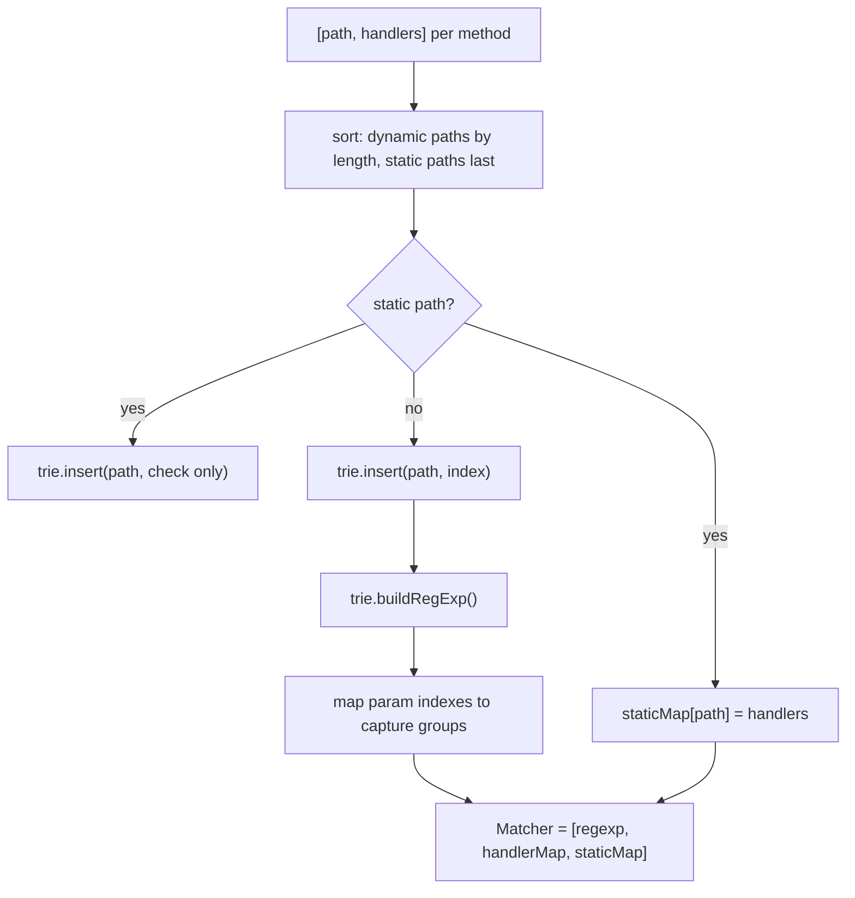

## Overview

`RegExpRouter` is the first router the default `Hono` tries. Instead of testing routes one by one, it compiles every route of a method into one regular expression, so a request is matched with a single `RegExp` call plus a lookup table. The README credits it for Hono's speed: "Not using linear loops".

Sources: [src/hono.ts:26-33](repo://src/hono.ts#L26-L33), [README.md:39-40](repo://README.md#L39-L40)

It returns the first result shape of the [[Router Interface and Presets]] contract: handler parameter maps that hold capture indexes, with the regular expression's match array itself as the parameter stash. Some route sets cannot be compiled this way; then it throws `UnsupportedPathError` and `SmartRouter` falls back to the [[TrieRouter]].

Sources: [src/router/reg-exp-router/matcher.ts:10-33](repo://src/router/reg-exp-router/matcher.ts#L10-L33), [src/router/reg-exp-router/router.ts:60-65](repo://src/router/reg-exp-router/router.ts#L60-L65)

## Registering routes

`add` does not compile anything. It keeps two maps per method, `#middleware` for paths ending in `*` and `#routes` for the others, each from path to a list of `[handler, paramCount]`, where `paramCount` is the number of `/:` in the path. The first time a method is seen, both maps are seeded with a copy of the `ALL` entries so that middleware registered earlier for every method applies to it too.

Sources: [src/router/reg-exp-router/router.ts:122-153](repo://src/router/reg-exp-router/router.ts#L122-L153)

Registration order is preserved by copying handlers into every list they apply to:

Sources: [src/router/reg-exp-router/router.ts:105-120](repo://src/router/reg-exp-router/router.ts#L105-L120), [src/router/reg-exp-router/router.ts:155-204](repo://src/router/reg-exp-router/router.ts#L155-L204)

- A wildcard path (ending in `*`, with `/*` normalised to `*`) gets its own middleware entry, seeded from the longest existing wildcard that matches it. The handler is then appended to every middleware entry and every route entry whose path the wildcard matches, for that method or for all methods.
- Any other path is first expanded by `checkOptionalParameter`, so `/a/:b?` adds both `/a` and `/a/:b`. Each entry is seeded with the handlers of the longest wildcard middleware matching it, and then gets the handler.

Sources: [src/router/reg-exp-router/router.ts:105-120](repo://src/router/reg-exp-router/router.ts#L105-L120), [src/router/reg-exp-router/router.ts:155-204](repo://src/router/reg-exp-router/router.ts#L155-L204)

The result is that every path's list already holds, in order, the middleware registered before it, the route handlers, and the middleware registered after it. Wildcard paths are turned into regular expressions by `buildWildcardRegExp`, where a trailing `/*` becomes `(?:|/.*)` and `*` alone matches everything; these are cached until the matchers are built.

Sources: [src/router/reg-exp-router/router.ts:19-32](repo://src/router/reg-exp-router/router.ts#L19-L32)

## Building the matchers

The class field `match` starts as the shared `match` function from `matcher.ts`. On the first call it runs `buildAllMatchers()`, replaces `this.match` with a closure over the built matchers, and answers the request. Later calls go straight to the closure.

Sources: [src/router/reg-exp-router/matcher.ts:10-33](repo://src/router/reg-exp-router/matcher.ts#L10-L33), [src/router/reg-exp-router/router.ts:206-206](repo://src/router/reg-exp-router/router.ts#L206-L206)

`buildAllMatchers` builds one `Matcher` per method, and then sets both maps to `undefined` and clears the wildcard cache. From then on, `add` throws `Can not add a route since the matcher is already built.`

Sources: [src/router/reg-exp-router/router.ts:132-138](repo://src/router/reg-exp-router/router.ts#L132-L138), [src/router/reg-exp-router/router.ts:208-222](repo://src/router/reg-exp-router/router.ts#L208-L222)

For a method, `#buildMatcher` collects that method's middleware and routes, or the `ALL` entries when the method has none of its own. A method with no own entries gets `null`, and `match` then uses the `ALL` matcher for it.

Sources: [src/router/reg-exp-router/router.ts:224-251](repo://src/router/reg-exp-router/router.ts#L224-L251), [src/router/reg-exp-router/matcher.ts:15-15](repo://src/router/reg-exp-router/matcher.ts#L15-L15)



Sources: [src/router/reg-exp-router/router.ts:34-103](repo://src/router/reg-exp-router/router.ts#L34-L103)

`buildMatcherFromPreprocessedRoutes` sorts the routes so that dynamic paths come first, shortest first, and static paths (no `*` and no `/:`) last. A static path's handlers go into `staticMap` with empty params; the path is still inserted into the trie, but only to check that it does not conflict with a dynamic route. Each dynamic path gets an index `j`, and its handlers get parameter maps from the parameter names the trie assigned.

Sources: [src/router/reg-exp-router/router.ts:43-80](repo://src/router/reg-exp-router/router.ts#L43-L80)

## The trie and the expression

`Trie.insert` splits a path into tokens: one per character, one per `:label` or `:label{pattern}`, and a final `/*`. Patterns in braces are masked first so their contents are not split.

Sources: [src/router/reg-exp-router/trie.ts:10-47](repo://src/router/reg-exp-router/trie.ts#L10-L47)

`Node.insert` walks those tokens. A literal token becomes a child keyed by the character. A parameter becomes a child keyed by its pattern (`[^/]+` by default) and takes the next variable index, recorded with its name in the path's parameter list. The end of a route stores the route's index on the node.

Sources: [src/router/reg-exp-router/node.ts:45-133](repo://src/router/reg-exp-router/node.ts#L45-L133)

`buildRegExpStr` turns the tree into one alternation. Children are sorted by `compareKey`, which a comment orders as literal, then special pattern such as `:label{[0-9]+}`, then plain label, then wildcard. A parameter is written as `(pattern)@varIndex` and a route end as `#index`.

Sources: [src/router/reg-exp-router/node.ts:13-43](repo://src/router/reg-exp-router/node.ts#L13-L43), [src/router/reg-exp-router/node.ts:135-161](repo://src/router/reg-exp-router/node.ts#L135-L161)

`Trie.buildRegExp` then counts capture groups from left to right. Each `#index` becomes `$()`, an empty capture at the end of the path, and `indexReplacementMap` records which route that capture belongs to. Each `@varIndex` marker is removed, and `paramReplacementMap` records the capture number of that parameter. The final expression is anchored with `^`.

Sources: [src/router/reg-exp-router/trie.ts:49-73](repo://src/router/reg-exp-router/trie.ts#L49-L73)

Back in the builder, every handler's parameter map is rewritten from variable indexes to capture numbers, and the handler lists are placed at the capture number of their route marker.

Sources: [src/router/reg-exp-router/router.ts:82-102](repo://src/router/reg-exp-router/router.ts#L82-L102)

## Matching a request

```ts
const match = ((method, path) => {
  const matcher = (matchers[method] || matchers[METHOD_NAME_ALL]) as Matcher<T>

  const staticMatch = matcher[2][path]
  if (staticMatch) {
    return staticMatch
  }

  const match = path.match(matcher[0])
  if (!match) {
    return [[], emptyParam]
  }

  const index = match.indexOf('', 1)
  return [matcher[1][index], match]
}) as Router<T>['match']
```

Sources: [src/router/reg-exp-router/matcher.ts:14-29](repo://src/router/reg-exp-router/matcher.ts#L14-L29)

A static path is answered from `staticMap` without running the expression. Otherwise the expression runs once. Parameters always capture at least one character, so the first empty string after index 0 in the match array is the `$()` of the route that matched, and its position selects the handler list. The match array is returned as the parameter stash, and each handler's map points into it.

Sources: [src/router/reg-exp-router/matcher.ts:14-29](repo://src/router/reg-exp-router/matcher.ts#L14-L29), [src/router/reg-exp-router/node.ts:1-3](repo://src/router/reg-exp-router/node.ts#L1-L3)

## Unsupported routes

`Node.insert` throws `PATH_ERROR` in these cases, which the builder turns into `UnsupportedPathError(path)`:

Sources: [src/router/reg-exp-router/node.ts:57-130](repo://src/router/reg-exp-router/node.ts#L57-L130), [src/router/reg-exp-router/router.ts:60-65](repo://src/router/reg-exp-router/router.ts#L60-L65)

| Case | Why it cannot be compiled |
| --- | --- |
| Two routes end at the same node, such as `/:a` and `/:b` | One `$()` marker cannot point to two routes |
| A named pattern of `.*` | It would swallow the rest of the path |
| A pattern with its own capturing group, such as `prefix(a\|b)` | It would shift the capture numbers; a pattern that is wholly `(a\|b)` is rewritten to `(?:a\|b)` |
| A parameter beside literal children, or a literal beside parameter children | The alternation would make the match depend on order, for example `/users/me` beside `/users/:id` |

Sources: [src/router/reg-exp-router/node.ts:57-130](repo://src/router/reg-exp-router/node.ts#L57-L130), [src/router/reg-exp-router/router.ts:60-65](repo://src/router/reg-exp-router/router.ts#L60-L65)

Because the matchers are built on the first `match`, these errors surface on the first request, not at registration. Inside `SmartRouter` that is exactly where the fallback to `TrieRouter` happens.

Sources: [src/router/reg-exp-router/matcher.ts:10-13](repo://src/router/reg-exp-router/matcher.ts#L10-L13), [src/router/smart-router/router.ts:32-50](repo://src/router/smart-router/router.ts#L32-L50)

## PreparedRegExpRouter

`PreparedRegExpRouter` skips the build at run time. A build step calls `buildInitParams({ paths })`, which registers each path on a `RegExpRouter` subclass with the path string itself as the handler, builds the matchers, and records in a `relocateMap` where each path's handler belongs: capture slots as numbers and static map keys as strings, with the parameter map. It then empties every handler list.

Sources: [src/router/reg-exp-router/prepared-router.ts:95-154](repo://src/router/reg-exp-router/prepared-router.ts#L95-L154)

`serializeInitParams` turns the matchers and the relocate map into JavaScript source. Regular expressions are embedded through `toString()` so the output can be evaluated as code, as its comment says.

Sources: [src/router/reg-exp-router/prepared-router.ts:156-165](repo://src/router/reg-exp-router/prepared-router.ts#L156-L165)

At run time, `new PreparedRegExpRouter(matchers, relocateMap)` receives those values. Its `add` copies the `ALL` matcher for a new method, appends a `*` or `/*` handler to every list, and puts any other handler into the slots the relocate map names; a path missing from the map throws `Path ${path} is not registered`. Its `buildAllMatchers` returns the prepared matchers, so the shared `match` function has nothing to compile on the first request.

Sources: [src/router/reg-exp-router/prepared-router.ts:9-93](repo://src/router/reg-exp-router/prepared-router.ts#L9-L93)

All three are exported from `hono/router/reg-exp-router`.

Sources: [src/router/reg-exp-router/index.ts:1-7](repo://src/router/reg-exp-router/index.ts#L1-L7)
