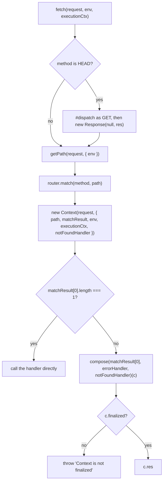
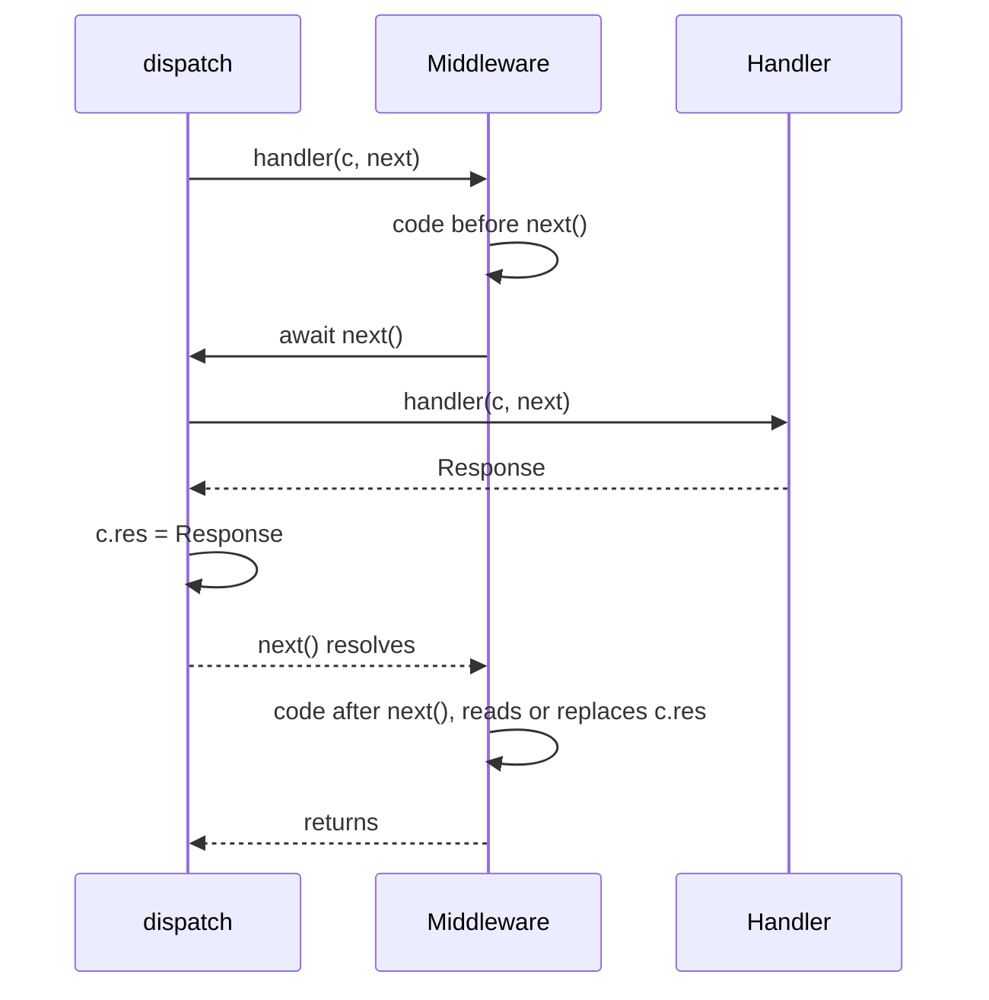

## Overview

Every request goes through the private `#dispatch` method of the app: it finds the path, asks the router for the matching handlers, wraps the request in a `Context` and runs the handlers. Middleware and route handlers are the same kind of function in Hono, `(c, next) => Response | void`, stored in the same router, so dispatch only has to run a list of functions in order.

Sources: [src/hono-base.ts:406-466](repo://src/hono-base.ts#L406-L466), [src/types.ts:35-35](repo://src/types.ts#L35-L35), [src/types.ts:83-88](repo://src/types.ts#L83-L88)

This page follows that path and the error handling around it. How routes get registered is on [[Hono Application]]; what handlers can do with `c` is on [[Context and Responses]].

Sources: [src/hono-base.ts:385-397](repo://src/hono-base.ts#L385-L397)

## From fetch to handlers



Sources: [src/hono-base.ts:406-485](repo://src/hono-base.ts#L406-L485)

1. `fetch` calls `#dispatch` with the request, the execution context, the bindings and `request.method`.
2. A `HEAD` request is dispatched again as `GET`, and the result is copied into `new Response(null, res)`, which keeps the status and headers and drops the body.
3. `getPath` extracts the path; it also receives `env`, so a custom `getPath` can route on bindings.
4. `router.match` returns every handler registered for the method and path, middleware included, in registration order.
5. A `Context` is created with the request and everything the handlers need to read it later. `c.req` is only built when a handler first reads it.

Sources: [src/hono-base.ts:406-427](repo://src/hono-base.ts#L406-L427), [src/context.ts:352-369](repo://src/context.ts#L352-L369)

## The single-handler fast path

A comment in `#dispatch` reads "Do not `compose` if it has only one handler". When the match result holds exactly one handler, the app calls it with a `next` that sets `c.res` to the not-found response, instead of building a composed chain.

Sources: [src/hono-base.ts:429-436](repo://src/hono-base.ts#L429-L436)

The handler's result is then handled in three ways:

Sources: [src/hono-base.ts:430-448](repo://src/hono-base.ts#L430-L448)

| Handler result | Answer |
| --- | --- |
| Throws synchronously | `#handleError` |
| A Promise | The resolved Response, else `c.res` if the context is finalized, else the not-found handler; a rejection goes to `#handleError` |
| A value | That value, or the not-found handler when it is `undefined` |

Sources: [src/hono-base.ts:430-448](repo://src/hono-base.ts#L430-L448)

Because a non-Promise result is returned as it is, a synchronous handler answers without any `await` in between.

Sources: [src/hono-base.ts:440-447](repo://src/hono-base.ts#L440-L447)

## compose and next()

With more than one handler, `compose` from `src/compose.ts` chains them. Its comment says it is based on the `koa-compose` package. It returns a function that runs `dispatch(0)`; each `dispatch(i)` calls handler `i` with `() => dispatch(i + 1)` as its `next`, so code before `await next()` runs on the way in and code after it runs on the way out.

Sources: [src/compose.ts:4-51](repo://src/compose.ts#L4-L51)



Sources: [src/compose.ts:32-71](repo://src/compose.ts#L32-L71)

`dispatch` keeps these rules:

Sources: [src/compose.ts:32-70](repo://src/compose.ts#L32-L70)

- Calling `next()` twice in one handler throws `next() called multiple times`, detected by comparing `i` with the last index run.
- Before each call it stores the handler's position in `c.req.routeIndex`, which the route helper uses to tell which route is running ([[Route Introspection]]).
- When `i` passes the end of the list, it calls the `next` given to the composed function, if any. With none, and the context not yet finalized, it calls the not-found handler.
- A handler's return value is stored in `c.res` only while the context is not finalized, or when it came from the error handler.

Sources: [src/compose.ts:32-70](repo://src/compose.ts#L32-L70)

The last rule matters for middleware: once a handler has produced a response, a middleware that returns a different `Response` after `await next()` is ignored. To replace the response, it assigns `c.res`. The setter on `Context` copies the old response's headers onto the new one (except `Content-Type`, and with every `Set-Cookie` kept), so headers set earlier survive.

Sources: [src/compose.ts:67-69](repo://src/compose.ts#L67-L69), [src/context.ts:414-434](repo://src/context.ts#L414-L434)

After the chain, `#dispatch` checks `context.finalized`. If no handler produced a response, for example a middleware that neither returned one nor awaited `next()`, it throws `Context is not finalized. Did you forget to return a Response object or `await next()`?`, which the error handler turns into a 500.

Sources: [src/hono-base.ts:450-465](repo://src/hono-base.ts#L450-L465)

## Errors

Errors are caught as close to their source as possible. Inside `compose`, a handler that throws an `Error` has it stored in `c.error`, and the error handler's response becomes `c.res`. The middleware that called `next()` then carries on normally: `await next()` resolves, and the middleware can read `c.error` or `c.res`. A thrown value that is not an `Error` is re-thrown.

Sources: [src/compose.ts:49-60](repo://src/compose.ts#L49-L60)

Errors outside `compose`, such as the not-finalized error or one thrown by the single handler, reach `#handleError`. It calls the app's error handler for an `Error` and re-throws anything else, so a thrown string or object leaves the app as a rejected promise.

Sources: [src/hono-base.ts:399-404](repo://src/hono-base.ts#L399-L404)

The default error handler checks for a `getResponse` method. `HTTPException` provides one, so throwing it answers a chosen status without writing an error handler:

Sources: [src/hono-base.ts:35-42](repo://src/hono-base.ts#L35-L42), [src/http-exception.ts:31-44](repo://src/http-exception.ts#L31-L44)

```ts
import { HTTPException } from 'hono/http-exception'

app.post('/auth', async (c, next) => {
  if (authorized === false) {
    throw new HTTPException(401, { message: 'Custom error message' })
  }
  await next()
})
```

Sources: [src/hono-base.ts:35-42](repo://src/hono-base.ts#L35-L42), [src/http-exception.ts:31-44](repo://src/http-exception.ts#L31-L44)

`HTTPException` takes a status (500 by default) and options `res`, `message` and `cause`. `getResponse()` answers a copy of `res` with the exception's status when `res` was given, and otherwise a response whose body is the message. Any object with `getResponse` that is an `Error` matches the `HTTPResponseError` type the error handler accepts.

Sources: [src/http-exception.ts:14-78](repo://src/http-exception.ts#L14-L78), [src/types.ts:113-119](repo://src/types.ts#L113-L119)

## Sub-app error handlers

`app.route()` keeps a sub-app's `onError` scoped to its routes. When the sub-app has a non-default error handler, each of its handlers is replaced by a wrapper that runs `compose([], subApp.errorHandler)(c, () => r.handler(c, next))`. With an empty middleware list, `compose` calls the given function as its final `next`, so an error from the sub-app's handler is caught by the sub-app's handler before the parent sees it.

Sources: [src/hono-base.ts:218-230](repo://src/hono-base.ts#L218-L230), [src/compose.ts:42-60](repo://src/compose.ts#L42-L60)

The wrapper stores the original handler under `COMPOSED_HANDLER` (the string `__COMPOSED_HANDLER`), which the dev and route helpers read to show the real handler name.

Sources: [src/hono-base.ts:226-226](repo://src/hono-base.ts#L226-L226), [src/utils/constants.ts:1-4](repo://src/utils/constants.ts#L1-L4)

## Writing middleware

A middleware is a `MiddlewareHandler`: `(c, next) => Promise<Response | void>`. It either returns a `Response` to stop the chain, or awaits `next()` and optionally works on `c.res` afterwards.

Sources: [src/types.ts:83-88](repo://src/types.ts#L83-L88)

```ts
import { createMiddleware } from 'hono/factory'

const timing = createMiddleware(async (c, next) => {
  const start = Date.now()
  await next()
  c.header('X-Response-Time', `${Date.now() - start}ms`)
})

app.use(timing)
```

Sources: [src/helper/factory/index.ts:368-375](repo://src/helper/factory/index.ts#L368-L375), [src/context.ts:515-527](repo://src/context.ts#L515-L527)

`createMiddleware` returns its argument unchanged; it exists to type the middleware's `Env` and the variables it sets, as [[Factory Helper]] explains. The built-in middleware, such as the [[Request Control Middleware]], are plain functions that return a `MiddlewareHandler` of this shape. `c.header` works after `next()` because, once the context is finalized, it first copies the response into a new `Response` whose headers can be changed.

Sources: [src/helper/factory/index.ts:368-375](repo://src/helper/factory/index.ts#L368-L375), [src/context.ts:515-527](repo://src/context.ts#L515-L527), [src/middleware/cors/index.ts:63-63](repo://src/middleware/cors/index.ts#L63-L63)
