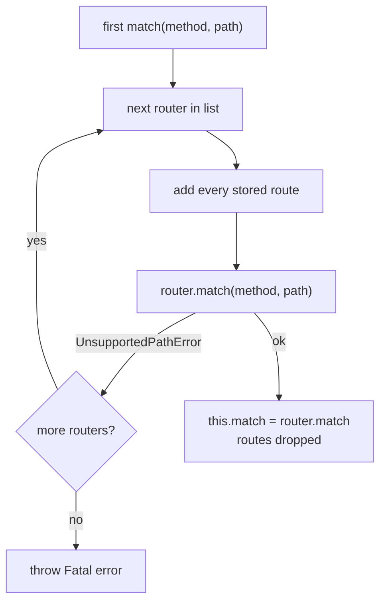

## Overview

Hono keeps routing behind a small interface so the matching algorithm can be swapped without touching the rest of the framework. The app only ever calls two methods on its router: `add` when a route is registered and `match` when a request arrives ([[Hono Application]], [[Request Dispatch and Middleware]]). Five routers implement the interface; this page covers the contract, `SmartRouter`, and the two simple routers used by the presets. The fast default routers have their own pages, [[RegExpRouter]] and [[TrieRouter]].

Sources: [src/router.ts:24-51](repo://src/router.ts#L24-L51), [src/hono-base.ts:385-397](repo://src/hono-base.ts#L385-L397), [src/hono-base.ts:418-419](repo://src/hono-base.ts#L418-L419)

## The Router contract

```ts
export interface Router<T> {
  name: string
  add(method: string, path: string, handler: T): void
  match(method: string, path: string): Result<T>
}
```

Sources: [src/router.ts:29-52](repo://src/router.ts#L29-L52)

The app stores `[handler, RouterRoute]` pairs as `T`, upper-cases methods before calling `add`, and registers middleware under the method `ALL`. A router must therefore return a route registered with `ALL` for any method, alongside the routes registered for that exact method, in registration order.

Sources: [src/hono-base.ts:385-397](repo://src/hono-base.ts#L385-L397), [src/router.ts:9-17](repo://src/router.ts#L9-L17)

## The two result shapes

`match` returns a `Result<T>`, which comes in two shapes:

Sources: [src/router.ts:98-98](repo://src/router.ts#L98-L98)

```ts
export type Result<T> = [[T, ParamIndexMap][], ParamStash] | [[T, Params][]]
```

Sources: [src/router.ts:98-98](repo://src/router.ts#L98-L98)

In the first shape, each handler comes with a map from parameter name to an index, and a single `ParamStash` array of captured strings is shared by all handlers. For `/user/123/abc` matched against `*`, `/user/:id/*` and `/user/:id/:action`, the stash is `['123', 'abc']` and the maps are `{}`, `{ id: 0 }` and `{ id: 0, action: 1 }`. In the second shape, each handler has its own `Params` object such as `{ id: '123', action: 'abc' }`, and there is no stash.

Sources: [src/router.ts:54-98](repo://src/router.ts#L54-L98)

`HonoRequest` tells the two apart by whether the result has a second element, so a router can return whichever shape is natural for it ([[HonoRequest]]).

Sources: [src/request.ts:126-128](repo://src/request.ts#L126-L128)

When a router cannot represent a path, it throws `UnsupportedPathError`. That error is what lets `SmartRouter` fall back to another router.

Sources: [src/router.ts:100-103](repo://src/router.ts#L100-L103)

## SmartRouter

`SmartRouter` takes a list of routers and picks one of them on the first request:

Sources: [src/router/smart-router/router.ts:4-61](repo://src/router/smart-router/router.ts#L4-L61)

1. `add` only stores `[method, path, handler]` in a list.
2. On the first `match`, it tries each router in order: it adds every stored route to it and calls its `match`.
3. If that router throws `UnsupportedPathError`, it moves on to the next one. Any other error is re-thrown.
4. The first router that succeeds becomes the only router. `SmartRouter` replaces its own `match` with that router's bound `match`, drops the stored routes, and renames itself to `SmartRouter + <name>`.
5. If no router succeeds, it throws `Fatal error`.

Sources: [src/router/smart-router/router.ts:4-61](repo://src/router/smart-router/router.ts#L4-L61)



Sources: [src/router/smart-router/router.ts:21-61](repo://src/router/smart-router/router.ts#L21-L61)

Once a router is picked, `add` throws `Can not add a route since the matcher is already built.` Routes must therefore all be registered before the first request. `activeRouter` returns the picked router, and throws if none has been picked yet.

Sources: [src/router/smart-router/router.ts:13-19](repo://src/router/smart-router/router.ts#L13-L19), [src/router/smart-router/router.ts:63-69](repo://src/router/smart-router/router.ts#L63-L69), [src/router.ts:18-22](repo://src/router.ts#L18-L22)

The default `Hono` uses `SmartRouter` over `RegExpRouter` and then `TrieRouter`. `RegExpRouter` builds its matcher on the first `match` and throws `UnsupportedPathError` for patterns it cannot compile, so an app falls back to `TrieRouter` only when one of its routes needs it.

Sources: [src/hono.ts:26-33](repo://src/hono.ts#L26-L33), [src/router/reg-exp-router/router.ts:55-66](repo://src/router/reg-exp-router/router.ts#L55-L66), [src/router/reg-exp-router/matcher.ts:10-33](repo://src/router/reg-exp-router/matcher.ts#L10-L33)

The dev helper's `getRouterName(app)` calls `app.router.match('GET', '/')` before reading `app.router.name`, which forces `SmartRouter` to pick and report a name such as `SmartRouter + RegExpRouter` ([[Route Introspection]]).

Sources: [src/helper/dev/index.ts:76-79](repo://src/helper/dev/index.ts#L76-L79)

## LinearRouter

`LinearRouter`, used by `hono/quick`, does no work at registration. `add` expands an optional parameter such as `/api/animals/:type?` into both `/api/animals` and `/api/animals/:type` with `checkOptionalParameter`, and pushes each into a list.

Sources: [src/router/linear-router/router.ts:11-23](repo://src/router/linear-router/router.ts#L11-L23), [src/utils/url.ts:171-206](repo://src/utils/url.ts#L171-L206)

`match` walks the whole list for every request and returns the second result shape. For each route with the right method, or `ALL`, it takes one of four branches:

Sources: [src/router/linear-router/router.ts:25-142](repo://src/router/linear-router/router.ts#L25-L142)

| Route path | How it matches |
| --- | --- |
| `*` or `/*` | Always |
| No `*` and no `:` | Equal to the path, or to the path minus one trailing slash |
| `*` but no `:` | Each piece between stars must appear at the current position |
| `:` but no `*` | Each `:name` takes the next segment, or the text matching its `{pattern}` |
| Both `*` and `:` | Throws `UnsupportedPathError` |

Sources: [src/router/linear-router/router.ts:25-142](repo://src/router/linear-router/router.ts#L25-L142)

Because of the last row, `hono/quick` puts `LinearRouter` in a `SmartRouter` with `TrieRouter` behind it. Adding a route only appends to a list, and every match walks the whole list.

Sources: [src/preset/quick.ts:16-23](repo://src/preset/quick.ts#L16-L23), [src/router/linear-router/router.ts:136-138](repo://src/router/linear-router/router.ts#L136-L138)

## PatternRouter

`PatternRouter`, used by `hono/tiny`, compiles each route into its own regular expression when it is added. A `:name` segment becomes a named group `(?<name>[^/]+)`, or `(?<name>pattern)` for `:name{pattern}`. A `/*` inside the path matches one segment, a trailing `*` leaves the expression open-ended, and other characters are escaped. Routes without a trailing wildcard end in `/?$`, so a trailing slash is allowed.

Sources: [src/router/pattern-router/router.ts:12-42](repo://src/router/pattern-router/router.ts#L12-L42)

An optional last parameter (`/:type?`) registers the route twice, once without the segment. If the expression cannot be built, `add` throws `UnsupportedPathError`.

Sources: [src/router/pattern-router/router.ts:17-20](repo://src/router/pattern-router/router.ts#L17-L20), [src/router/pattern-router/router.ts:33-41](repo://src/router/pattern-router/router.ts#L33-L41)

`match` runs every expression whose method fits and returns the named groups as each handler's params. `hono/tiny` uses `PatternRouter` alone, without a `SmartRouter`, which keeps the preset small.

Sources: [src/router/pattern-router/router.ts:44-59](repo://src/router/pattern-router/router.ts#L44-L59), [src/preset/tiny.ts:16-19](repo://src/preset/tiny.ts#L16-L19)

## Choosing a router

| Router | Import | Notes from the code |
| --- | --- | --- |
| `SmartRouter` + `RegExpRouter` + `TrieRouter` | `hono` | Default; one regular expression per method, with a fallback for unsupported paths |
| `SmartRouter` + `LinearRouter` + `TrieRouter` | `hono/quick` | No build step; linear matching |
| `PatternRouter` | `hono/tiny` | One expression per route; smallest preset |
| Any router | `new Hono({ router })` | Each is also exported from `hono/router/<name>` |

Sources: [src/hono.ts:26-33](repo://src/hono.ts#L26-L33), [src/preset/quick.ts:16-23](repo://src/preset/quick.ts#L16-L23), [src/preset/tiny.ts:16-19](repo://src/preset/tiny.ts#L16-L19), [src/hono-base.ts:55-65](repo://src/hono-base.ts#L55-L65), [package.json:284-313](repo://package.json#L284-L313)

A custom router passed through `options.router` only needs to implement `add`, `match` and `name`, and to throw `UnsupportedPathError` if it is meant to sit inside a `SmartRouter`.

Sources: [src/router.ts:29-52](repo://src/router.ts#L29-L52), [src/router/smart-router/router.ts:34-44](repo://src/router/smart-router/router.ts#L34-L44)
