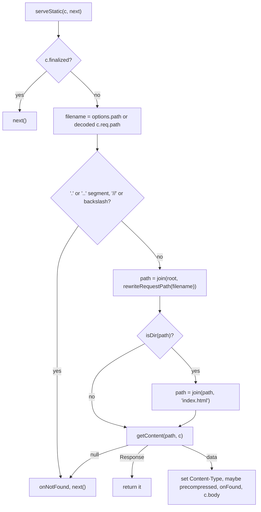

## Overview

Reading a file is different on every runtime, so Hono splits static file serving in two. The shared `serveStatic` middleware in `middleware/serve-static` does everything that does not touch the file system: it turns the request path into a file path, rejects traversal attempts, picks a precompressed variant and sets the content type. Each runtime adapter wraps it and supplies a `getContent(path, c)` function, plus optionally `join` and `isDir`, that actually reads the file.

Sources: [src/middleware/serve-static/index.ts:13-49](repo://src/middleware/serve-static/index.ts#L13-L49), [src/adapter/bun/serve-static.ts:8-32](repo://src/adapter/bun/serve-static.ts#L8-L32)

```ts
import { serveStatic } from 'hono/bun'

app.use('/static/*', serveStatic({ root: './' }))
app.get('/favicon.ico', serveStatic({ path: './favicon.ico' }))
```

Sources: [src/adapter/bun/index.ts:1-11](repo://src/adapter/bun/index.ts#L1-L11), [src/middleware/serve-static/index.ts:13-21](repo://src/middleware/serve-static/index.ts#L13-L21)

## Options

| Option | Effect |
| --- | --- |
| `root` | Directory joined in front of the path; default `./` |
| `path` | Serve this one file for every request, instead of using the request path |
| `rewriteRequestPath` | Maps the request path before it is joined, for example to strip a URL prefix |
| `precompressed` | Look for `.br`, `.zst` and `.gz` files next to the requested one |
| `mimes` | Extra extension-to-type mappings, checked before the built-in table |
| `onFound(path, c)` | Called before a found file is returned, for example to set cache headers |
| `onNotFound(path, c)` | Called before falling through to `next()` |

Sources: [src/middleware/serve-static/index.ts:13-21](repo://src/middleware/serve-static/index.ts#L13-L21), [src/middleware/serve-static/index.ts:50-53](repo://src/middleware/serve-static/index.ts#L50-L53)

## Resolving a request



Sources: [src/middleware/serve-static/index.ts:54-125](repo://src/middleware/serve-static/index.ts#L54-L125)

The middleware does nothing when the response is already set, so an earlier handler wins. Otherwise the file name is the `path` option, or the request path decoded with `tryDecodeURI`. A decoded path is rejected when it contains a `.` or `..` segment, two or more slashes in a row, or any backslash; the request then goes to `onNotFound` and `next()`, so a later route or the app's 404 answers.

Sources: [src/middleware/serve-static/index.ts:54-74](repo://src/middleware/serve-static/index.ts#L54-L74)

The checked name is joined with `root`. `rewriteRequestPath` only applies when `path` is not set. When the adapter provides `isDir` and the result is a directory, `index.html` is appended.

Sources: [src/middleware/serve-static/index.ts:76-83](repo://src/middleware/serve-static/index.ts#L76-L83)

`defaultJoin`, used when an adapter gives no `join`, joins with `/`, collapses repeated slashes and resolves `.` and `..`. Its comment says it does not support Windows paths and suggests `join` from `node:path` for that; the Bun and Deno adapters pass `node:path`'s `join`.

Sources: [src/middleware/serve-static/path.ts:1-25](repo://src/middleware/serve-static/path.ts#L1-L25), [src/adapter/bun/serve-static.ts:25-30](repo://src/adapter/bun/serve-static.ts#L25-L30), [src/adapter/deno/serve-static.ts:35-41](repo://src/adapter/deno/serve-static.ts#L35-L41)

## Building the response

### Content and type

`getContent` returns file data, a ready `Response`, or `null`. A `Response` is passed on as it is through `c.newResponse`, so an adapter can answer with its own status and headers. `null` means not found.

Sources: [src/middleware/serve-static/index.ts:85-90](repo://src/middleware/serve-static/index.ts#L85-L90), [src/middleware/serve-static/index.ts:122-124](repo://src/middleware/serve-static/index.ts#L122-L124)

For file data, `Content-Type` comes from `getMimeType`, looked up first in `mimes` and then in the built-in table, by the lower-cased extension after the last dot. An unknown extension gets `application/octet-stream`. The response is built with `c.body(content)` after `onFound` runs, so headers set in `onFound` are included.

Sources: [src/middleware/serve-static/index.ts:92-120](repo://src/middleware/serve-static/index.ts#L92-L120), [src/utils/mime.ts:6-16](repo://src/utils/mime.ts#L6-L16)

### Precompressed files

With `precompressed: true`, and a type that is unknown or compressible by the same rule the `compress` middleware uses ([[Response Middleware]]), the middleware reads `Accept-Encoding` and tries `br`, `zstd` and `gzip` in that order. For the first encoding the client accepts and that exists on disk as `file.br`, `file.zst` or `file.gz`, it serves that file with `Content-Encoding` and appends `Vary: Accept-Encoding`. The `Content-Type` stays the type of the original file.

Sources: [src/middleware/serve-static/index.ts:23-28](repo://src/middleware/serve-static/index.ts#L23-L28), [src/middleware/serve-static/index.ts:96-117](repo://src/middleware/serve-static/index.ts#L96-L117)

`Accept-Encoding` is split on commas and compared as whole strings, so an entry with a quality value such as `br;q=1` does not match `br`.

Sources: [src/middleware/serve-static/index.ts:97-107](repo://src/middleware/serve-static/index.ts#L97-L107)

## Runtime readers

### Bun and Deno

| Adapter | `getContent` | `isDir` | `join` |
| --- | --- | --- | --- |
| `hono/bun` | `Bun.file(path)`, or `null` when `exists()` is false | `stat` from `node:fs/promises` | `node:path` |
| `hono/deno` | `Deno.open(path)` and its `readable` stream; `null` for directories and missing files, other errors logged | `Deno.lstatSync` | `node:path` |
| `hono/cloudflare-workers` | The KV asset named in the static content manifest | none | `defaultJoin` |

Sources: [src/adapter/bun/serve-static.ts:8-32](repo://src/adapter/bun/serve-static.ts#L8-L32), [src/adapter/deno/serve-static.ts:1-42](repo://src/adapter/deno/serve-static.ts#L1-L42), [src/adapter/cloudflare-workers/serve-static.ts:21-42](repo://src/adapter/cloudflare-workers/serve-static.ts#L21-L42)

Bun returns the `BunFile` itself as the body, and Deno returns the file's readable stream, so neither reads the whole file into memory first.

Sources: [src/adapter/bun/serve-static.ts:12-16](repo://src/adapter/bun/serve-static.ts#L12-L16), [src/adapter/deno/serve-static.ts:12-26](repo://src/adapter/deno/serve-static.ts#L12-L26)

### Cloudflare Workers Sites

The Cloudflare Workers `serveStatic` reads from Workers Sites: `getContentFromKVAsset` looks the path up in a manifest (the `manifest` option, or the global `__STATIC_CONTENT_MANIFEST`, parsed when it is a string) and fetches the hashed key from a KV namespace as a stream. The namespace is the `namespace` option, else `c.env.__STATIC_CONTENT`. The ES module export, the one `hono/cloudflare-workers` exposes, omits the `namespace` option.

Sources: [src/adapter/cloudflare-workers/utils.ts:1-50](repo://src/adapter/cloudflare-workers/utils.ts#L1-L50), [src/adapter/cloudflare-workers/serve-static.ts:6-42](repo://src/adapter/cloudflare-workers/serve-static.ts#L6-L42), [src/adapter/cloudflare-workers/serve-static-module.ts:1-12](repo://src/adapter/cloudflare-workers/serve-static-module.ts#L1-L12)

> [!WARNING]
> This adapter's `serveStatic` is marked deprecated. Its comment recommends Cloudflare Static Assets, or Cloudflare Pages, instead.

Sources: [src/adapter/cloudflare-workers/serve-static.ts:12-20](repo://src/adapter/cloudflare-workers/serve-static.ts#L12-L20)

## Writing a reader

Other runtimes can pass their own reader to the base middleware, exported as `serveStatic` from `hono/serve-static`. The only required function is `getContent`; returning `null` falls through to the next handler.

Sources: [src/middleware/serve-static/index.ts:35-49](repo://src/middleware/serve-static/index.ts#L35-L49), [package.json:339-343](repo://package.json#L339-L343)

```ts
import { serveStatic } from 'hono/serve-static'

app.use(
  '/static/*',
  serveStatic({
    root: './public',
    getContent: async (path) => (await myStorage.get(path)) ?? null,
  })
)
```

Sources: [src/middleware/serve-static/index.ts:35-49](repo://src/middleware/serve-static/index.ts#L35-L49)
