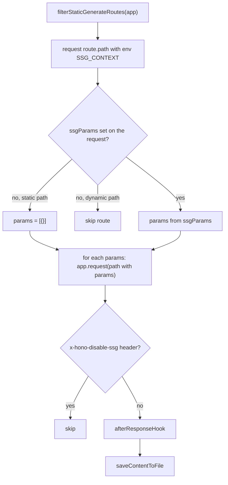

## Overview

`toSSG` from `hono/ssg` turns an app into static files. It does not render templates itself: it sends a request for every `GET` route through `app.request`, exactly as a client would, and writes each response body to a file named after the route. Anything an app can serve, such as HTML from JSX, JSON or XML feeds, can therefore be pre-built. File writing goes through a small `FileSystemModule` interface, so the core works on any runtime, and `hono/bun` and `hono/deno` provide ready-made wrappers.

Sources: [src/helper/ssg/ssg.ts:205-302](repo://src/helper/ssg/ssg.ts#L205-L302), [src/helper/ssg/ssg.ts:34-37](repo://src/helper/ssg/ssg.ts#L34-L37), [src/helper/ssg/index.ts:1-14](repo://src/helper/ssg/index.ts#L1-L14)

```ts
import { toSSG } from 'hono/ssg'
import fs from 'node:fs/promises'

const result = await toSSG(app, fs, { dir: './static' })
console.log(result.success, result.files)
```

Sources: [src/helper/ssg/ssg.ts:341-348](repo://src/helper/ssg/ssg.ts#L341-L348), [src/helper/ssg/ssg.ts:368-470](repo://src/helper/ssg/ssg.ts#L368-L470)

## Options

| Option | Default | Effect |
| --- | --- | --- |
| `dir` | `./static` | Output directory |
| `concurrency` | `2` | Maximum number of requests in flight |
| `extensionMap` | `defaultExtensionMap` | Content type to file extension |
| `beforeRequestHook` | | Change or skip each route's request |
| `afterResponseHook` | | Change or skip each response |
| `afterGenerateHook` | | Run after all files are written |
| `plugins` | `[defaultPlugin()]` | Bundles of the three hooks |

Sources: [src/helper/ssg/ssg.ts:17-27](repo://src/helper/ssg/ssg.ts#L17-L27), [src/helper/ssg/ssg.ts:181-198](repo://src/helper/ssg/ssg.ts#L181-L198), [src/helper/ssg/ssg.ts:420-422](repo://src/helper/ssg/ssg.ts#L420-L422)

`toSSG` resolves to `{ success, files, error? }`. Errors are caught and reported in `error` with `success: false`, rather than thrown.

Sources: [src/helper/ssg/ssg.ts:44-48](repo://src/helper/ssg/ssg.ts#L44-L48), [src/helper/ssg/ssg.ts:460-469](repo://src/helper/ssg/ssg.ts#L460-L469)

## How routes are crawled



Sources: [src/helper/ssg/ssg.ts:205-302](repo://src/helper/ssg/ssg.ts#L205-L302)

`filterStaticGenerateRoutes` takes every entry in `app.routes` registered for `GET` or `ALL` whose handler is not middleware, using the same one-argument test as the dev helper ([[Route Introspection]]).

Sources: [src/helper/ssg/utils.ts:62-72](repo://src/helper/ssg/utils.ts#L62-L72), [src/utils/handler.ts:8-15](repo://src/utils/handler.ts#L8-L15)

For each route, `toSSG` first sends an information request for the route path itself, such as `/posts/:id`, after passing it through `beforeRequestHook`. All requests carry the bindings `{ HONO_SSG_CONTEXT: true }`, which is how middleware can tell an SSG run from a real request.

Sources: [src/helper/ssg/ssg.ts:222-243](repo://src/helper/ssg/ssg.ts#L222-L243), [src/helper/ssg/middleware.ts:5-6](repo://src/helper/ssg/middleware.ts#L5-L6), [src/helper/ssg/middleware.ts:56-56](repo://src/helper/ssg/middleware.ts#L56-L56)

## Dynamic routes and ssgParams

A route whose path has a `:param` or `*` segment is skipped unless it uses the `ssgParams` middleware. That middleware only acts when the request path itself is dynamic, which is true for the information request. It stores the list of parameter sets on the raw request and answers not found, so the handler does not run:

Sources: [src/helper/ssg/middleware.ts:24-49](repo://src/helper/ssg/middleware.ts#L24-L49), [src/helper/ssg/utils.ts:74-76](repo://src/helper/ssg/utils.ts#L74-L76)

```tsx
import { ssgParams } from 'hono/ssg'

app.get(
  '/posts/:id',
  ssgParams(async () => (await getPosts()).map((p) => ({ id: p.id }))),
  (c) => c.html(<Post id={c.req.param('id')} />)
)
```

Sources: [src/helper/ssg/middleware.ts:24-49](repo://src/helper/ssg/middleware.ts#L24-L49), [src/helper/ssg/utils.ts:74-76](repo://src/helper/ssg/utils.ts#L74-L76)

`toSSG` reads those sets back from the request object. For each one it fills the path with `replaceUrlParam`, the RPC client's helper ([[RPC Client]]), and requests the concrete path, keeping the method and headers of the information request. A static route gets one empty parameter set.

Sources: [src/helper/ssg/ssg.ts:245-269](repo://src/helper/ssg/ssg.ts#L245-L269), [src/client/utils.ts:18-24](repo://src/client/utils.ts#L18-L24)

Both kinds of request run through a shared pool from `createPool({ concurrency })`, so no more than `concurrency` app requests are in flight.

Sources: [src/helper/ssg/ssg.ts:223-223](repo://src/helper/ssg/ssg.ts#L223-L223), [src/helper/ssg/ssg.ts:243-243](repo://src/helper/ssg/ssg.ts#L243-L243), [src/helper/ssg/ssg.ts:265-269](repo://src/helper/ssg/ssg.ts#L265-L269)

## Excluding and restricting routes

| Middleware | During SSG | On a normal request |
| --- | --- | --- |
| `disableSSG()` | Answers not found with the `x-hono-disable-ssg` header, so `toSSG` skips the route | `next()` |
| `onlySSG()` | `next()` | Answers not found |

Sources: [src/helper/ssg/middleware.ts:56-83](repo://src/helper/ssg/middleware.ts#L56-L83), [src/helper/ssg/ssg.ts:270-273](repo://src/helper/ssg/ssg.ts#L270-L273)

`isSSGContext(c)` is the check both use, and is exported for handlers that should behave differently while generating.

Sources: [src/helper/ssg/middleware.ts:56-56](repo://src/helper/ssg/middleware.ts#L56-L56), [src/helper/ssg/index.ts:6-12](repo://src/helper/ssg/index.ts#L6-L12)

## Hooks and plugins

The hooks from the options and from every plugin are gathered into lists, options first, and combined. A `beforeRequestHook` or `afterResponseHook` may return a new `Request` or `Response` to replace the current one, or `false` to skip the route; anything else keeps the current one. `afterGenerateHook` receives the result, the file system module and the options.

Sources: [src/helper/ssg/ssg.ts:110-179](repo://src/helper/ssg/ssg.ts#L110-L179), [src/helper/ssg/ssg.ts:368-419](repo://src/helper/ssg/ssg.ts#L368-L419), [src/helper/ssg/ssg.ts:465-468](repo://src/helper/ssg/ssg.ts#L465-L468)

| Plugin | Effect |
| --- | --- |
| `defaultPlugin()` | Skips every response whose status is not 200 |
| `redirectPlugin()` | Turns a 301, 302, 303, 307 or 308 with a `Location` into a 200 HTML page with a meta refresh, a canonical link and `noindex`; drops a redirect without `Location` |

Sources: [src/helper/ssg/plugins.ts:11-72](repo://src/helper/ssg/plugins.ts#L11-L72)

Passing `plugins` replaces the default list. To keep only successful pages and also write redirects, list `redirectPlugin()` before `defaultPlugin()`, so the redirect becomes a 200 before the status check runs.

Sources: [src/helper/ssg/ssg.ts:372-372](repo://src/helper/ssg/ssg.ts#L372-L372), [src/helper/ssg/ssg.ts:397-419](repo://src/helper/ssg/ssg.ts#L397-L419)

## Writing files

The response's `Content-Type`, without parameters, picks the extension: first through `extensionMap` (`text/html` to `html`, the XML types to `xml`, `application/yaml` to `yaml`), then through the MIME table, and `html` as the last resort. A response without a content type counts as `text/plain`; a long comment explains this matches `c.text()` on Bun, which omits the header for speed.

Sources: [src/helper/ssg/ssg.ts:19-25](repo://src/helper/ssg/ssg.ts#L19-L25), [src/helper/ssg/ssg.ts:90-108](repo://src/helper/ssg/ssg.ts#L90-L108), [src/helper/ssg/ssg.ts:282-283](repo://src/helper/ssg/ssg.ts#L282-L283)

| Route path | File |
| --- | --- |
| `/` | `index.html` |
| `/about` | `about.html` |
| `/blog/` | `blog/index.html` |
| `/feed.xml` with an XML type | `feed.xml` |

Sources: [src/helper/ssg/ssg.ts:50-72](repo://src/helper/ssg/ssg.ts#L50-L72)

`ensureWithinOutDir` throws `Path traversal detected` when the joined path would leave the output directory, for example through `..` in a parameter value. Text and JSON bodies are written as strings and everything else as bytes. Each directory is created once with `mkdir({ recursive: true })`.

Sources: [src/helper/ssg/utils.ts:78-87](repo://src/helper/ssg/utils.ts#L78-L87), [src/helper/ssg/ssg.ts:74-88](repo://src/helper/ssg/ssg.ts#L74-L88), [src/helper/ssg/ssg.ts:309-334](repo://src/helper/ssg/ssg.ts#L309-L334)

## Bun and Deno

`toSSG(app, options?)` from `hono/bun` and `hono/deno` call the core with a built-in file system module. Bun's writes with `Bun.write` and has a no-op `mkdir`. Deno's encodes strings and writes with `Deno.writeFile`, and creates folders with `Deno.mkdir`.

Sources: [src/adapter/bun/ssg.ts:1-27](repo://src/adapter/bun/ssg.ts#L1-L27), [src/adapter/deno/ssg.ts:1-27](repo://src/adapter/deno/ssg.ts#L1-L27)
