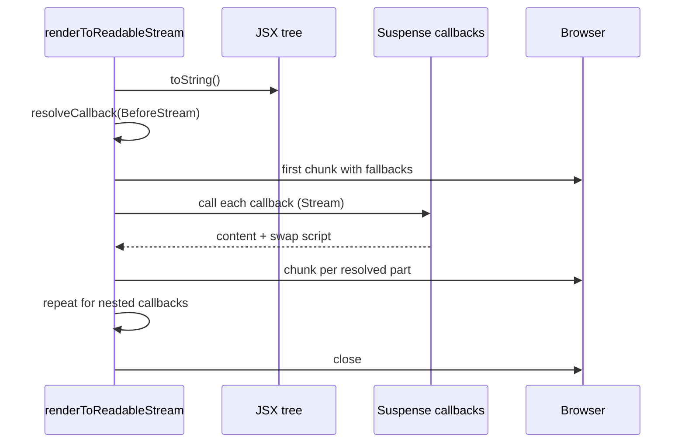

## Overview

An async component makes the whole page wait when it is rendered with `toString()`: the result is a Promise that settles only when every part is ready ([[JSX Server Rendering]]). `hono/jsx/streaming` offers the alternative. `Suspense` marks a part of the page that may arrive later and gives it a fallback, and `renderToReadableStream` sends the page in pieces: first everything that is ready, with fallbacks in place, then each delayed part as soon as it resolves, together with a small inline script that swaps it into place. Both are marked experimental in their doc comments.

Sources: [src/jsx/streaming.ts:36-137](repo://src/jsx/streaming.ts#L36-L137), [src/jsx/streaming.ts:140-220](repo://src/jsx/streaming.ts#L140-L220)

```tsx
import { Suspense, renderToReadableStream } from 'hono/jsx/streaming'

const Comments = async () => {
  const comments = await fetchComments()
  return <ul>{comments.map((c) => <li>{c.text}</li>)}</ul>
}

app.get('/', (c) => {
  const stream = renderToReadableStream(
    <html>
      <body>
        <h1>Post</h1>
        <Suspense fallback={<p>Loading comments…</p>}>
          <Comments />
        </Suspense>
      </body>
    </html>
  )
  return c.body(stream, { headers: { 'Content-Type': 'text/html; charset=UTF-8' } })
})
```

Sources: [src/jsx/streaming.ts:42-137](repo://src/jsx/streaming.ts#L42-L137), [src/jsx/streaming.ts:146-220](repo://src/jsx/streaming.ts#L146-L220)

The [[JSX Renderer Middleware]] wraps the same call when its `stream` option is set.

Sources: [src/middleware/jsx-renderer/index.ts:66-76](repo://src/middleware/jsx-renderer/index.ts#L66-L76)

## The callback phases

Streaming is built on the callbacks that an `HtmlEscapedString` can carry ([[HTML and CSS Helpers]]). Each callback is called with a phase:

Sources: [src/utils/html.ts:6-16](repo://src/utils/html.ts#L6-L16), [src/jsx/streaming.ts:92-95](repo://src/jsx/streaming.ts#L92-L95)

| Phase | Used by | Meaning |
| --- | --- | --- |
| `Stringify` (1) | `toString()`, `c.html()` | Everything is rendered into one string; callbacks may edit the buffer |
| `BeforeStream` (2) | `renderToReadableStream` | The first chunk is being prepared; delayed parts must not be waited for |
| `Stream` (3) | `renderToReadableStream` | The first chunk is sent; a callback returns the HTML to send later |

Sources: [src/utils/html.ts:6-16](repo://src/utils/html.ts#L6-L16), [src/jsx/streaming.ts:92-95](repo://src/jsx/streaming.ts#L92-L95)

`Suspense` and `ErrorBoundary` implement all three: in `BeforeStream` they return nothing, so the first chunk keeps the placeholder; in `Stringify` they edit the buffer in place; in `Stream` they return the markup plus a script.

Sources: [src/jsx/streaming.ts:90-133](repo://src/jsx/streaming.ts#L90-L133), [src/jsx/components.ts:164-257](repo://src/jsx/components.ts#L164-L257)

## Suspense

`Suspense({ children, fallback })` first tries to render its children synchronously. A child that throws a Promise (as the `use()` hook does while data loads) is retried when that Promise settles, with the render context captured and restored around it. A child whose `toString()` returns a Promise, an async component, simply stays a Promise.

Sources: [src/jsx/streaming.ts:42-85](repo://src/jsx/streaming.ts#L42-L85), [src/jsx/components.ts:14-30](repo://src/jsx/components.ts#L14-L30)

When nothing is pending, `Suspense` returns the children's HTML and the fallback is never used. Otherwise it takes a number `index` and returns the placeholder template, the rendered fallback, and an HTML comment whose text is `/$`:

Sources: [src/jsx/streaming.ts:87-91](repo://src/jsx/streaming.ts#L87-L91), [src/jsx/streaming.ts:134-136](repo://src/jsx/streaming.ts#L134-L136)

```html
<template id="H:0"></template><p>Loading comments…</p>
```

Sources: [src/jsx/streaming.ts:87-91](repo://src/jsx/streaming.ts#L87-L91), [src/jsx/streaming.ts:134-136](repo://src/jsx/streaming.ts#L134-L136)

with one callback that waits for all children. Its result depends on the phase:

Sources: [src/jsx/streaming.ts:92-131](repo://src/jsx/streaming.ts#L92-L131)

- With a buffer (the `Stringify` phase), it replaces everything from the template to the `/$` comment with the content, so a non-streamed page contains the final HTML and no fallback.
- Without a buffer (the `Stream` phase), it returns the content inside `<template data-hono-target="H:0">` followed by a script. The script takes the template's content, finds the `H:0` placeholder, removes the nodes up to the `/$` comment, and replaces the placeholder with the content.

Sources: [src/jsx/streaming.ts:92-131](repo://src/jsx/streaming.ts#L92-L131)

When the delayed content has callbacks of its own, such as a nested `Suspense`, they are passed on, and in the `Stream` phase the content is first resolved for `BeforeStream`, so nested parts stream in their own turn.

Sources: [src/jsx/streaming.ts:119-131](repo://src/jsx/streaming.ts#L119-L131)

## renderToReadableStream



Sources: [src/jsx/streaming.ts:146-220](repo://src/jsx/streaming.ts#L146-L220)

`renderToReadableStream(content, onError = console.trace)` accepts a node, an `HtmlEscapedString` or a Promise of one. Inside the stream's `start`:

Sources: [src/jsx/streaming.ts:146-214](repo://src/jsx/streaming.ts#L146-L214)

1. A node is turned into a string with `toString()`. The resulting object serves as the `context` key for all callbacks of this rendering.
2. `resolveCallback` runs the `BeforeStream` phase, and the result is enqueued as the first chunk.
3. Every callback of that result is called with the `Stream` phase. Each returned Promise is awaited, resolved for `BeforeStream` itself, enqueued, and its own callbacks are called in the same way.
4. The loop waits until every registered Promise has produced its chunk, then closes the stream.

Sources: [src/jsx/streaming.ts:146-214](repo://src/jsx/streaming.ts#L146-L214)

Chunks are sent in the order their data arrives, not in document order; the swap scripts put each part in its place. A failing part is logged, reported to `onError` and replaced with an empty string, so the rest of the page still streams. If the reader cancels, the stream stops enqueuing.

Sources: [src/jsx/streaming.ts:169-197](repo://src/jsx/streaming.ts#L169-L197), [src/jsx/streaming.ts:206-217](repo://src/jsx/streaming.ts#L206-L217)

## ErrorBoundary while streaming

When some children of an `ErrorBoundary` are pending, it works like `Suspense` but without a visible fallback at first. It renders an empty `<template id="E:n"></template>` followed by an HTML comment with the text `E:n` as a marker, and its callback inserts the children's content after the marker when they resolve, using a script in the `Stream` phase.

Sources: [src/jsx/components.ts:128-201](repo://src/jsx/components.ts#L128-L201)

If a child, or a delayed part inside it such as a nested `Suspense`, rejects, `catchCallback` renders the fallback once. In a buffer it replaces the marked region. While streaming it sends the fallback in a template with a script that removes everything between the marker and its closing comment, including content already streamed in, and puts the fallback there. After the last nested part resolves without error, a final script removes the marker elements.

Sources: [src/jsx/components.ts:134-160](repo://src/jsx/components.ts#L134-L160), [src/jsx/components.ts:203-255](repo://src/jsx/components.ts#L203-L255)

```tsx
<ErrorBoundary fallback={<p>Could not load comments</p>}>
  <Suspense fallback={<p>Loading…</p>}>
    <Comments />
  </Suspense>
</ErrorBoundary>
```

Sources: [src/jsx/components.ts:55-61](repo://src/jsx/components.ts#L55-L61), [src/jsx/streaming.ts:42-45](repo://src/jsx/streaming.ts#L42-L45)

## Nonces for the inline scripts

The swap scripts are inline, so a page with a Content Security Policy must allow them. `StreamingContext` carries a `scriptNonce` that `Suspense` and `ErrorBoundary` add to their `<script>` tags:

Sources: [src/jsx/streaming.ts:18-32](repo://src/jsx/streaming.ts#L18-L32), [src/jsx/streaming.ts:50-50](repo://src/jsx/streaming.ts#L50-L50), [src/jsx/components.ts:70-70](repo://src/jsx/components.ts#L70-L70)

```tsx
<StreamingContext.Provider value={{ scriptNonce: c.get('secureHeadersNonce') }}>
  <Suspense fallback={<p>Loading…</p>}>
    <Content />
  </Suspense>
</StreamingContext.Provider>
```

Sources: [src/jsx/streaming.ts:18-32](repo://src/jsx/streaming.ts#L18-L32), [src/jsx/streaming.ts:50-50](repo://src/jsx/streaming.ts#L50-L50), [src/jsx/components.ts:70-70](repo://src/jsx/components.ts#L70-L70)

The nonce generated by `secureHeaders` with `NONCE` is one value that fits ([[Security Middleware]]).

Sources: [src/middleware/secure-headers/secure-headers.ts:137-145](repo://src/middleware/secure-headers/secure-headers.ts#L137-L145)
