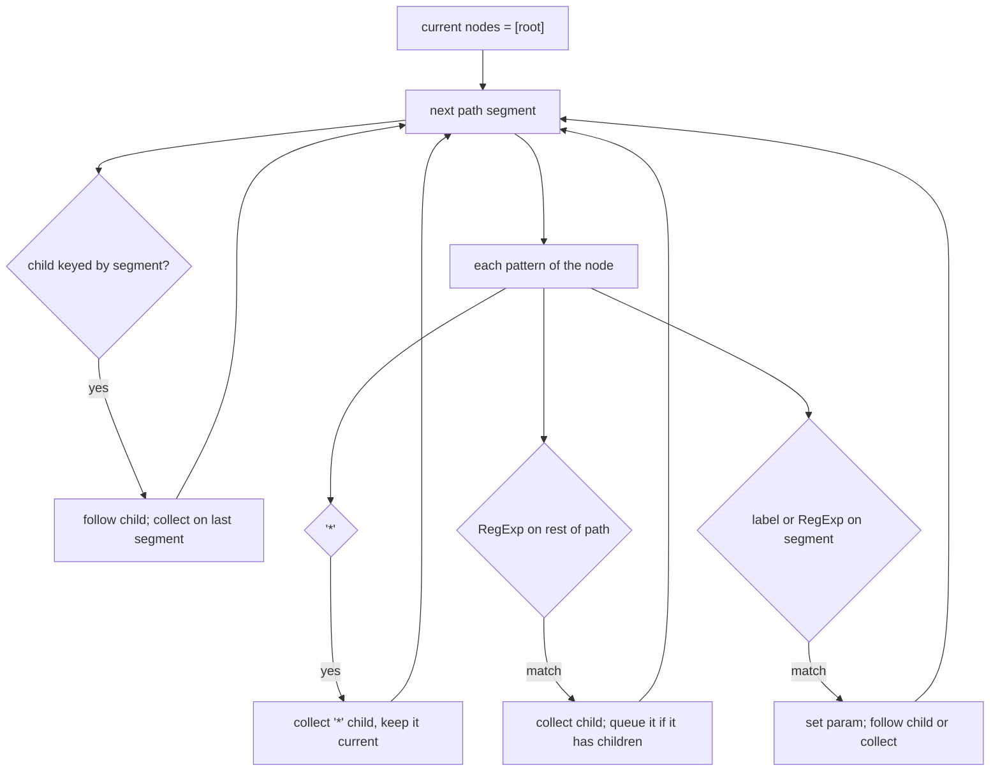

## Overview

`TrieRouter` stores routes in a tree with one level per path segment and matches a request by walking that tree. It is the fallback in both `SmartRouter` presets: the default `Hono` uses it when [[RegExpRouter]] rejects a route set, and `hono/quick` uses it when `LinearRouter` meets a path with both `*` and `:` ([[Router Interface and Presets]]). It never throws `UnsupportedPathError`, so every route set ends up with a router.

Sources: [src/router/trie-router/router.ts:1-28](repo://src/router/trie-router/router.ts#L1-L28), [src/hono.ts:26-33](repo://src/hono.ts#L26-L33), [src/preset/quick.ts:16-23](repo://src/preset/quick.ts#L16-L23)

It returns the second result shape of the router contract: every handler with its own params object, and no shared stash.

Sources: [src/router/trie-router/node.ts:114-114](repo://src/router/trie-router/node.ts#L114-L114), [src/router/trie-router/node.ts:243-243](repo://src/router/trie-router/node.ts#L243-L243)

## Adding routes

`TrieRouter.add` expands an optional trailing parameter with `checkOptionalParameter`, so `/api/animals/:type?` is inserted as `/api/animals` and `/api/animals/:type`; any other path is inserted once. `match` hands the request to the root node's `search`.

Sources: [src/router/trie-router/router.ts:13-27](repo://src/router/trie-router/router.ts#L13-L27), [src/utils/url.ts:171-206](repo://src/utils/url.ts#L171-L206)

`Node.insert` splits the path with `splitRoutingPath`, which masks `{…}` patterns first so a `/` inside a pattern does not split it. For each part it asks `getPattern` what the part is, and uses the answer as the child key:

Sources: [src/router/trie-router/node.ts:44-85](repo://src/router/trie-router/node.ts#L44-L85), [src/utils/url.ts:16-78](repo://src/utils/url.ts#L16-L78)

| Part | `getPattern` result | Child key |
| --- | --- | --- |
| `*` | `'*'` | `*` |
| `:id` | `[':id', 'id', true]` | `:id` |
| `:id{[0-9]+}` | `[label, 'id', /^[0-9]+$/]` | the label |
| `:id{[0-9]+}` followed by a literal `next` | `[label#next, 'id', /^[0-9]+(?=\/next)/]` | `label#next` |
| anything else | `null` | the literal part |

Sources: [src/router/trie-router/node.ts:44-85](repo://src/router/trie-router/node.ts#L44-L85), [src/utils/url.ts:16-78](repo://src/utils/url.ts#L16-L78)

A new pattern child is also pushed onto the parent's `#patterns` list, which the search tries for every segment. The parameter names on the way down are collected as `possibleKeys`. At the last node, the handler is stored under its method as `{ handler, possibleKeys, score }`, where `score` is a counter incremented on the root for every insert. The score is the handler's registration order across the whole router.

Sources: [src/router/trie-router/node.ts:44-85](repo://src/router/trie-router/node.ts#L44-L85)

Compiled patterns are cached in `patternCache` by label and next part, so routes that share a parameter pattern share one `RegExp`.

Sources: [src/utils/url.ts:50-78](repo://src/utils/url.ts#L50-L78)

## Searching

`search` splits the request path into segments and keeps a list of current nodes, starting with the root. Several nodes can be current at once, which is why a literal and a parameter at the same level both match. For each segment it builds the next list from every current node:

Sources: [src/router/trie-router/node.ts:127-235](repo://src/router/trie-router/node.ts#L127-L235)

1. **Literal child.** If the node has a child keyed by the segment, that child continues. On the last segment its handlers are collected, together with the handlers of its `*` child, so `/hello/*` also matches `/hello`.
2. **Wildcard.** A `*` pattern collects the handlers of the `*` child and keeps that child current, so `/hello/*/foo` matches `/hello/bar/foo` and a trailing `*` keeps matching deeper segments.
3. **Parameter with a regular expression.** The expression runs on the rest of the path from this segment on, not just the segment, so `/js/:filename{[a-z]+.js}` can match across slashes. On a match the value is recorded and the child's handlers are collected; a child with children of its own is queued in `curNodesQueue` to rejoin the search at a later segment.
4. **Plain parameter, or a regular expression tested on the segment.** The segment becomes the param value. On the last segment the child's handlers (and its `*` child's) are collected; otherwise the child continues with the new params.

Sources: [src/router/trie-router/node.ts:127-235](repo://src/router/trie-router/node.ts#L127-L235)

Sources: [src/router/trie-router/node.ts:127-235](repo://src/router/trie-router/node.ts#L127-L235)

An empty segment, such as the one after a trailing slash, only matches a pattern with a regular expression; a plain `:param` never captures an empty value.

Sources: [src/router/trie-router/node.ts:165-169](repo://src/router/trie-router/node.ts#L165-L169)

The `partOffsets` array, the start of each segment in the original path, is built only the first time a regular expression pattern needs the rest of the path.

Sources: [src/router/trie-router/node.ts:174-183](repo://src/router/trie-router/node.ts#L174-L183)

## Collecting handlers and params

`#pushHandlerSets` takes each handler stored on a node for the request's method, or for `ALL`, and fills its `params` from its `possibleKeys`. A value comes from the params gathered along the current branch or from the node's inherited params, so each handler only gets the names that appear in its own route.

Sources: [src/router/trie-router/node.ts:87-112](repo://src/router/trie-router/node.ts#L87-L112)

When the walk ends, the collected handler sets are sorted by `score`. The result therefore lists middleware and handlers in the order they were registered, whatever branch of the tree they were found on, which is the order `compose` runs them in ([[Request Dispatch and Middleware]]).

Sources: [src/router/trie-router/node.ts:237-243](repo://src/router/trie-router/node.ts#L237-L243)

## Compared with RegExpRouter

| | `TrieRouter` | `RegExpRouter` |
| --- | --- | --- |
| Work at registration | Inserts into the tree | Stores lists; compiles on the first match |
| Work per request | Walks segments, tries each pattern of each current node | One static-map lookup or one `RegExp` match |
| Literal and parameter at the same level | Both followed | `UnsupportedPathError` |
| Two routes with the same shape (`/:a`, `/:b`) | Both kept | `UnsupportedPathError` |
| Adding routes after the first match | Allowed | Throws |
| Result shape | Params object per handler | Index maps and a shared stash |

Sources: [src/router/trie-router/node.ts:44-85](repo://src/router/trie-router/node.ts#L44-L85), [src/router/trie-router/node.ts:127-243](repo://src/router/trie-router/node.ts#L127-L243), [src/router/reg-exp-router/router.ts:132-138](repo://src/router/reg-exp-router/router.ts#L132-L138), [src/router/reg-exp-router/node.ts:57-130](repo://src/router/reg-exp-router/node.ts#L57-L130)

Inside `SmartRouter`, the "Adding routes after the first match" row does not apply: `SmartRouter` itself refuses new routes once it has picked a router.

Sources: [src/router/smart-router/router.ts:13-19](repo://src/router/smart-router/router.ts#L13-L19)
