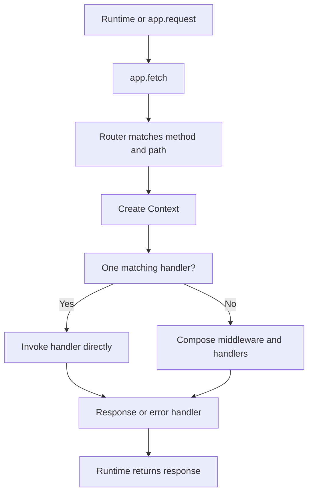

## Overview

Hono is a web framework built around the Web Standard `Request` and `Response` interfaces. An application registers handlers against HTTP methods and paths, then exposes `fetch` as its request entry point. The framework also supplies middleware, a typed HTTP client, JSX rendering, browser DOM updates, runtime adapters and static generation. Begin with [[Quickstart]] to exercise an application directly from the checkout; the rest of these pages explain the systems behind that application.

Sources: [README.md:22-47](repo://README.md#L22-L47), [src/hono-base.ts:479-517](repo://src/hono-base.ts#L479-L517), [src/client/client.ts:133-170](repo://src/client/client.ts#L133-L170), [src/jsx/dom/client.ts:23-65](repo://src/jsx/dom/client.ts#L23-L65), [src/helper/ssg/ssg.ts:205-227](repo://src/helper/ssg/ssg.ts#L205-L227)

## System map

| Area | What it does | Page |
| --- | --- | --- |
| Application setup | Creates an app and exercises its Fetch entry point | [[Quickstart]] |
| Routing | Registers paths, groups applications and selects a matcher | [[Routing]] |
| Handler state | Exposes the request and constructs responses | [[Request and Context]] |
| Execution | Orders handlers and translates failures into responses | [[Middleware and Errors]] |
| Security policies | Authenticates callers and applies request protections | [[Security Middleware]] |
| HTTP policies | Handles CORS, caching, compression and diagnostics | [[HTTP Middleware]] |
| Typed contracts | Validates input and serializes client calls | [[Validation and Typed Clients]] |
| Document rendering | Builds HTML, layouts and asynchronous output | [[Server Rendering]] |
| Browser rendering | Mounts roots and updates DOM from state | [[Browser Rendering]] |
| Persistent output | Writes incremental responses and upgrades sockets | [[Streaming and WebSockets]] |
| Platform integration | Translates runtime events and reads static assets | [[Runtime Adapters and Static Files]] |
| Generation | Fetches eligible routes and saves their responses | [[Static Generation]] |
| Contribution | Installs, checks, tests and builds the repository | [[Development and Verification]] |

Sources: [src/hono-base.ts:126-173](repo://src/hono-base.ts#L126-L173), [src/hono-base.ts:406-485](repo://src/hono-base.ts#L406-L485), [src/compose.ts:15-73](repo://src/compose.ts#L15-L73), [src/validator/validator.ts:89-170](repo://src/validator/validator.ts#L89-L170), [src/client/client.ts:53-128](repo://src/client/client.ts#L53-L128), [src/middleware/jsx-renderer/index.ts:33-80](repo://src/middleware/jsx-renderer/index.ts#L33-L80), [src/jsx/dom/client.ts:23-83](repo://src/jsx/dom/client.ts#L23-L83), [src/helper/streaming/index.ts:1-9](repo://src/helper/streaming/index.ts#L1-L9), [src/helper/websocket/index.ts:108-139](repo://src/helper/websocket/index.ts#L108-L139), [src/adapter/aws-lambda/handler.ts:138-150](repo://src/adapter/aws-lambda/handler.ts#L138-L150), [src/helper/ssg/ssg.ts:205-227](repo://src/helper/ssg/ssg.ts#L205-L227), [package.json:74-107](repo://package.json#L74-L107), [package.json:13-36](repo://package.json#L13-L36)

## Main request flow

Sources: [src/hono-base.ts:399-517](repo://src/hono-base.ts#L399-L517)

The runtime supplies a standard request to `app.fetch`; `app.request` supplies the same entry point with an in-process request for testing. [[Runtime Adapters and Static Files]] explains the platform boundary, while [[Quickstart]] shows the direct testing path.

Sources: [src/hono-base.ts:479-517](repo://src/hono-base.ts#L479-L517)

Dispatch extracts the path, asks the router for matching handlers, and creates one `Context` carrying the match, environment, execution context and not-found handler. [[Routing]] explains the match result; [[Request and Context]] explains how handlers use the resulting state.

Sources: [src/hono-base.ts:418-427](repo://src/hono-base.ts#L418-L427)

A single match runs directly. Multiple matches pass through `compose`, where a handler calls `next` to advance and can inspect the completed response after awaiting it. [[Middleware and Errors]] owns this ordering and the error boundary; the policy catalogues explain what individual middleware does within it.

Sources: [src/hono-base.ts:429-465](repo://src/hono-base.ts#L429-L465), [src/compose.ts:32-70](repo://src/compose.ts#L32-L70)

## Decisions shared across systems

The standard application chooses a `SmartRouter` backed by `RegExpRouter` and `TrieRouter`. Selection happens when the first request is matched: candidates receive all registered routes, and an `UnsupportedPathError` advances to the next candidate. After success, `match` is replaced with the chosen implementation. This makes route capability selection a setup event rather than repeating the selection loop for each request.

Sources: [src/hono.ts:26-32](repo://src/hono.ts#L26-L32), [src/router/smart-router/router.ts:21-60](repo://src/router/smart-router/router.ts#L21-L60)

Dispatch explicitly avoids composition when there is only one handler. The direct branch still supplies a not-found continuation and catches synchronous and asynchronous failures. The optimization therefore lives at the dispatch boundary while the multi-handler branch retains middleware sequencing and checks that the context was finalized.

Sources: [src/hono-base.ts:429-465](repo://src/hono-base.ts#L429-L465)

Error handling is response-oriented. The default error handler recognizes an error with `getResponse`, creates a context response from it, and otherwise logs the error and produces a 500 text response. Composition records caught `Error` objects on the context and permits the error handler's response to replace a finalized response. Both paths make error output part of the same response lifecycle described in [[Middleware and Errors]].

Sources: [src/hono-base.ts:35-42](repo://src/hono-base.ts#L35-L42), [src/compose.ts:49-69](repo://src/compose.ts#L49-L69)

Typed contracts cross the network boundary without a generated runtime route table in the client. The validator stores successful output on the request, and `hc` builds a property-access proxy whose final method call serializes arguments into an HTTP request. [[Validation and Typed Clients]] connects that runtime behavior to the app schema types rather than repeating request parsing on the client side.

Sources: [src/validator/validator.ts:162-170](repo://src/validator/validator.ts#L162-L170), [src/client/client.ts:15-30](repo://src/client/client.ts#L15-L30), [src/client/client.ts:214-232](repo://src/client/client.ts#L214-L232)

Rendering and generation reuse response-producing handlers. The JSX renderer installs a context renderer that returns either HTML or a readable-stream body, while static generation iterates eligible application routes. Browser roots have a separate lifecycle with render and unmount operations. This separates the HTTP document flow in [[Server Rendering]], the interactive lifecycle in [[Browser Rendering]], and the route-to-file flow in [[Static Generation]].

Sources: [src/middleware/jsx-renderer/index.ts:60-79](repo://src/middleware/jsx-renderer/index.ts#L60-L79), [src/middleware/jsx-renderer/index.ts:116-129](repo://src/middleware/jsx-renderer/index.ts#L116-L129), [src/jsx/dom/client.ts:37-65](repo://src/jsx/dom/client.ts#L37-L65), [src/helper/ssg/ssg.ts:205-227](repo://src/helper/ssg/ssg.ts#L205-L227)
