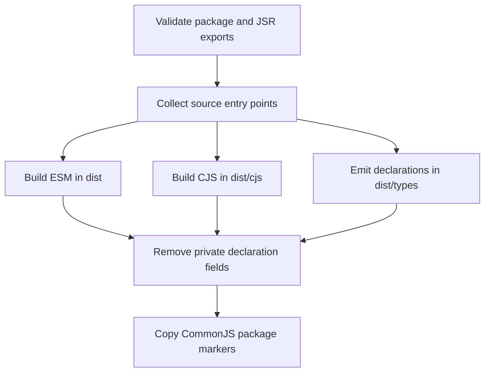

## Overview

Repository verification spans TypeScript contracts, unit tests, runtime integration, formatting and package output. Bun coordinates package scripts, while Vitest projects and direct Deno/Bun commands exercise different execution environments. [[Quickstart]] introduces dependency setup and in-process requests; this page follows a contributor's change through the repository checks and build pipeline. Runtime behavior itself belongs to [[Runtime Adapters and Static Files]].

Sources: [docs/CONTRIBUTING.md:27-39](repo://docs/CONTRIBUTING.md#L27-L39), [package.json:13-36](repo://package.json#L13-L36), [vitest.config.ts:25-70](repo://vitest.config.ts#L25-L70), [build/build.ts:103-114](repo://build/build.ts#L103-L114)

## Dependency setup and tool versions

The contribution guide installs with `bun install --frozen-lockfile` and asks that pull requests pass `bun run test`. CI reads Node, Bun and Deno versions from `.tool-versions`, which records Node 24.7.0, Bun 1.2.19 and Deno 2.4.5 in this checkout. Package metadata separately declares `bun@1.2.20` as its package manager. Treat those as the distinct checked-in declarations when reproducing a version-specific issue.

Sources: [docs/CONTRIBUTING.md:27-39](repo://docs/CONTRIBUTING.md#L27-L39), [.tool-versions:1-3](repo://.tool-versions#L1-L3), [.github/workflows/ci.yml:41-48](repo://.github/workflows/ci.yml#L41-L48), [.github/workflows/ci.yml:76-80](repo://.github/workflows/ci.yml#L76-L80), [package.json:695-698](repo://package.json#L695-L698)

```bash
bun install --frozen-lockfile
```

Sources: [docs/CONTRIBUTING.md:33-35](repo://docs/CONTRIBUTING.md#L33-L35)

## Check selection

| Package script | What it executes |
| --- | --- |
| `test` | Specification TypeScript check, then Vitest in run mode |
| `test:watch` | Vitest watch mode |
| `test:bun` | Bun runtime tests with the repository JSX import source |
| `test:deno` | Deno runtime tests plus precompiled and react-jsx configurations |
| `test:node`, `test:workerd`, `test:fastly` | Named Vitest runtime projects |
| `test:lambda`, `test:lambda-edge` | Named AWS integration projects |
| `test:all` | Main tests, then direct Deno and Bun tests |
| `lint` / `format` | ESLint and Prettier checks across source, runtime tests, build, performance and benchmark code |
| `editorconfig-checker` | EditorConfig verification |
| `build` | Removes dist, runs the build script and copies CommonJS package markers |

Sources: [package.json:13-36](repo://package.json#L13-L36)

The main test script performs a no-emit TypeScript check of source and test code before execution. The specification config selects automatic JSX with `hono/jsx` and Vitest global types. The build configuration separately excludes test files, emits declarations under `dist/types`, and enables unused-local/parameter checks. Consequently, a behavior test and a package build cover different constraints, especially for public type changes.

Sources: [package.json:14-14](repo://package.json#L14-L14), [tsconfig.spec.json:1-11](repo://tsconfig.spec.json#L1-L11), [tsconfig.build.json:1-19](repo://tsconfig.build.json#L1-L19)

## Vitest projects and coverage

Vitest discovers runtime project configurations and adds a main source/build test project. It also executes DOM tests with two JSX import sources: the default JSX runtime and `src/jsx/dom`. The main project's include patterns cover source, scripts and build tests, while excluding sandbox and case-test patterns. These repeated DOM suites check that the browser rendering tests work through both supported import paths described in [[Browser Rendering]].

Sources: [vitest.config.ts:25-70](repo://vitest.config.ts#L25-L70)

Coverage is enabled with the V8 provider and writes JSON, text and HTML reports under `coverage/raw/default`. Its exclusions omit runtime-test source, benchmarks, performance code, the build entry script and compile-time-only type files. CI's coverage job waits for main, Bun and Deno jobs and merges their uploaded coverage artifacts before submission. A source coverage percentage therefore reflects explicit exclusions rather than every tracked file.

Sources: [vitest.config.ts:5-23](repo://vitest.config.ts#L5-L23), [.github/workflows/ci.yml:18-35](repo://.github/workflows/ci.yml#L18-L35)

## JavaScript and declaration build

The build reads `package.json` and `jsr.json` exports and validates each against the other before collecting entry points. It scans TypeScript files under source and applies ignore patterns, including tests and legacy entry paths. CJS output preserves the source base under `dist/cjs`. ESM output goes under `dist`, with an extension plugin that resolves source files or directory indexes to explicit `.js` import paths marked external.

Sources: [build/build.ts:18-39](repo://build/build.ts#L18-L39), [build/build.ts:45-92](repo://build/build.ts#L45-L92)



Sources: [build/build.ts:22-39](repo://build/build.ts#L22-L39), [build/build.ts:78-114](repo://build/build.ts#L78-L114), [package.json:29-31](repo://package.json#L29-L31)

ESM, CJS and declaration compilation run concurrently. After they complete, declaration cleanup parses `.d.ts` files and removes private-identifier property definitions by replacing their source ranges with spaces. The package script then copies the CommonJS package marker into both CJS and types directories; its postbuild runs `publint`. Watch mode uses esbuild contexts and TypeScript watch instead of one-shot compilation.

Sources: [build/build.ts:94-114](repo://build/build.ts#L94-L114), [build/remove-private-fields.ts:5-56](repo://build/remove-private-fields.ts#L5-L56), [package.json:29-32](repo://package.json#L29-L32)

## Public exports and CI boundaries

Export validation checks direct keys and wildcard coverage. A wildcard source key is accepted when the target has a child entry under that prefix; a concrete key can be covered by a target wildcard at an ancestor path. Missing coverage throws an error naming the missing key and manifest. It validates the correspondence of exposed entry names, while the separate build and package checks verify generated output.

Sources: [build/validate-exports.ts:1-37](repo://build/validate-exports.ts#L1-L37), [build/build.ts:22-26](repo://build/build.ts#L22-L26), [package.json:30-31](repo://package.json#L30-L31)

The main CI job runs format, lint, EditorConfig, build and tests. Additional jobs cover Bun, Deno, Fastly, workerd, AWS adapters, and a Node 20/22/24 matrix; JSR validation uses a publication dry run. Pull-request jobs also run type/bundle performance checks and an HTTP benchmark. The workflow's path filters skip selected documentation and metadata changes, so the checked-in workflow remains the precise reference for which automated jobs a change triggers.

Sources: [.github/workflows/ci.yml:1-12](repo://.github/workflows/ci.yml#L1-L12), [.github/workflows/ci.yml:37-70](repo://.github/workflows/ci.yml#L37-L70), [.github/workflows/ci.yml:72-158](repo://.github/workflows/ci.yml#L72-L158), [.github/workflows/ci.yml:160-215](repo://.github/workflows/ci.yml#L160-L215)
