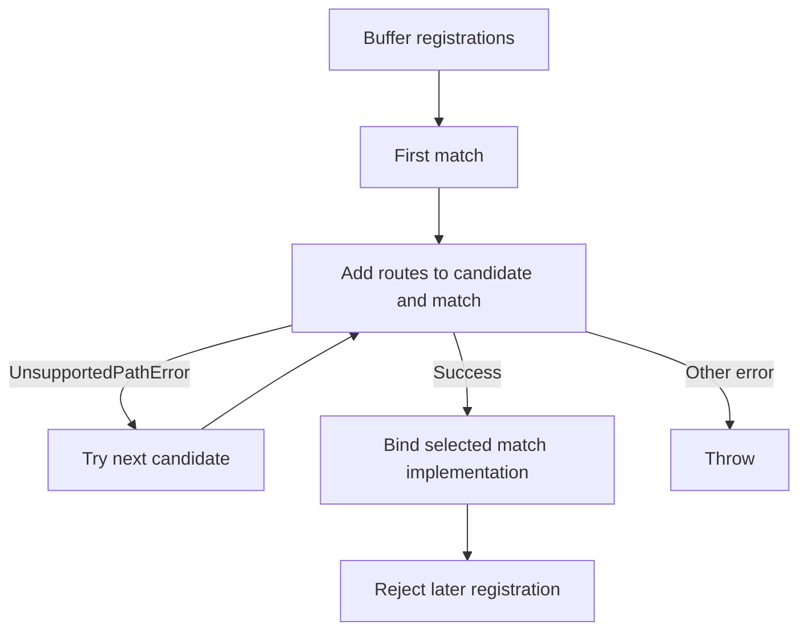

## Overview

Routing turns application registration into an ordered list of matching handlers and their parameter data. The standard `Hono` supplies a SmartRouter with regular-expression and trie candidates; the shared base class handles method registration, path prefixes and mounting. [[Quickstart]] shows a minimal registration. This page follows what happens to it before [[Middleware and Errors]] executes its handlers.

Sources: [src/hono.ts:16-33](repo://src/hono.ts#L16-L33), [src/hono-base.ts:126-173](repo://src/hono-base.ts#L126-L173), [src/hono-base.ts:385-427](repo://src/hono-base.ts#L385-L427)

## Registration and path extraction

The constructor creates `get`, `post`, `put`, `delete`, `options`, `patch` and `all`. A string first argument changes the current registration path; each supplied handler becomes a separate route. `on` accepts arrays of paths and methods and uppercases each method. `use` registers method `ALL`, using `*` when its first argument is a handler. Registration merges the application base path, calls `router.add`, and appends metadata to `app.routes`.

Sources: [src/router.ts:9-17](repo://src/router.ts#L9-L17), [src/hono-base.ts:126-168](repo://src/hono-base.ts#L126-L168), [src/hono-base.ts:385-397](repo://src/hono-base.ts#L385-L397)

Path extraction is configured at construction. Strict mode defaults to true and chooses the supplied `getPath` or the standard extractor. With `strict: false`, the base selects `getPathNoStrict` instead. During dispatch the extractor receives the request and environment, so a custom strict-mode extractor can incorporate bindings into its routing decision. HEAD is dispatched using GET matching and returned with a null body.

Sources: [src/hono-base.ts:170-173](repo://src/hono-base.ts#L170-L173), [src/hono-base.ts:406-427](repo://src/hono-base.ts#L406-L427)

## Groups and mounted applications

`basePath` clones the registration view and merges its prefix. The clone shares the router and routes array, and copies the error and not-found handlers; it is not an independent route store. `route(path, app)` walks the child application's existing routes and registers them under that prefix. A child with a custom error handler gets a wrapper that composes the route with that handler. Because grouping copies existing registrations, the child routes must exist when `route` is called.

Sources: [src/hono-base.ts:175-184](repo://src/hono-base.ts#L175-L184), [src/hono-base.ts:208-252](repo://src/hono-base.ts#L208-L252)

`mount` integrates a request-taking application rather than copying its Hono routes. By default it strips the merged mount prefix from the request pathname, creates a replacement `Request`, and passes environment and available execution context to the mounted handler. `replaceRequest: false` preserves the original request; a replacement function can implement another mapping. An `optionHandler` controls extra arguments and may return either an array or one value. A returned response ends the mounted handler; no result falls through with `await next()`.

Sources: [src/hono-base.ts:328-382](repo://src/hono-base.ts#L328-L382)

## SmartRouter selection

SmartRouter initially buffers registrations. On the first match it adds every buffered route to the first candidate and asks that candidate to match. `UnsupportedPathError` advances to the next candidate; another exception escapes. Success binds future `match` calls directly to that router, drops the buffered registrations, and changes its name to include the active router. The active router getter throws before selection. Attempts to add routes after selection fail with the matcher-already-built error.

Sources: [src/router/smart-router/router.ts:4-69](repo://src/router/smart-router/router.ts#L4-L69)

Sources: [src/router/smart-router/router.ts:13-60](repo://src/router/smart-router/router.ts#L13-L60)

## Matcher implementations and presets

| Matcher or preset | Implementation behavior |
| --- | --- |
| Standard `Hono` | SmartRouter tries RegExpRouter, then TrieRouter; accepts a custom router option |
| RegExpRouter | Collects method routes and wildcard middleware, builds matchers, then releases registration caches |
| TrieRouter | Expands optional parameters and inserts paths into a node tree; search collects handlers by registration score |
| LinearRouter | Scans registered routes; a path combining labels and stars raises `UnsupportedPathError` |
| PatternRouter | Compiles route-specific regular expressions with named groups, then scans them for matches |
| `hono/quick` | SmartRouter tries LinearRouter, then TrieRouter |
| `hono/tiny` | Installs PatternRouter directly |
| PreparedRegExpRouter | Attaches handlers to prebuilt path locations and rejects an unregistered non-wildcard path |

Sources: [src/hono.ts:26-32](repo://src/hono.ts#L26-L32), [src/router/reg-exp-router/router.ts:132-155](repo://src/router/reg-exp-router/router.ts#L132-L155), [src/router/reg-exp-router/router.ts:189-221](repo://src/router/reg-exp-router/router.ts#L189-L221), [src/router/trie-router/router.ts:13-27](repo://src/router/trie-router/router.ts#L13-L27), [src/router/trie-router/node.ts:237-243](repo://src/router/trie-router/node.ts#L237-L243), [src/router/linear-router/router.ts:25-41](repo://src/router/linear-router/router.ts#L25-L41), [src/router/linear-router/router.ts:135-142](repo://src/router/linear-router/router.ts#L135-L142), [src/router/pattern-router/router.ts:12-58](repo://src/router/pattern-router/router.ts#L12-L58), [src/preset/quick.ts:18-22](repo://src/preset/quick.ts#L18-L22), [src/preset/tiny.ts:16-19](repo://src/preset/tiny.ts#L16-L19), [src/router/reg-exp-router/prepared-router.ts:47-85](repo://src/router/reg-exp-router/prepared-router.ts#L47-L85)

RegExpRouter incorporates `ALL` registrations into method-specific maps, normalizes `/*` to `*`, and propagates wildcard middleware into matching paths. Optional routes expand during registration. Building consumes its mutable route maps, so its own `add` also refuses calls after the matcher has been built. These registration semantics explain why middleware placement belongs to route setup rather than being an independently executed global stack.

Sources: [src/router/reg-exp-router/router.ts:132-221](repo://src/router/reg-exp-router/router.ts#L132-L221)

TrieRouter stores an increasing score with each inserted handler. Search explores literal children and patterns, including wildcards and constrained parameters, then sorts collected handlers by score. A match can therefore contain both middleware and route handlers; the output is a chain for dispatch, rather than just the identity of one endpoint.

Sources: [src/router/trie-router/node.ts:44-82](repo://src/router/trie-router/node.ts#L44-L82), [src/router/trie-router/node.ts:127-174](repo://src/router/trie-router/node.ts#L127-L174), [src/router/trie-router/node.ts:237-243](repo://src/router/trie-router/node.ts#L237-L243)

## Match result contract

Every router implements `name`, `add` and `match`. A result contains handler entries paired either with direct parameter maps or with index maps plus a shared parameter stash. Hono registers each handler together with route metadata, then passes the match result to `Context`. [[Request and Context]] explains how its request wrapper resolves the currently executing handler's parameter map. The contract lets router implementations use different internal representations while dispatch consumes the same outer structure.

Sources: [src/router.ts:29-98](repo://src/router.ts#L29-L98), [src/hono-base.ts:385-427](repo://src/hono-base.ts#L385-L427)
