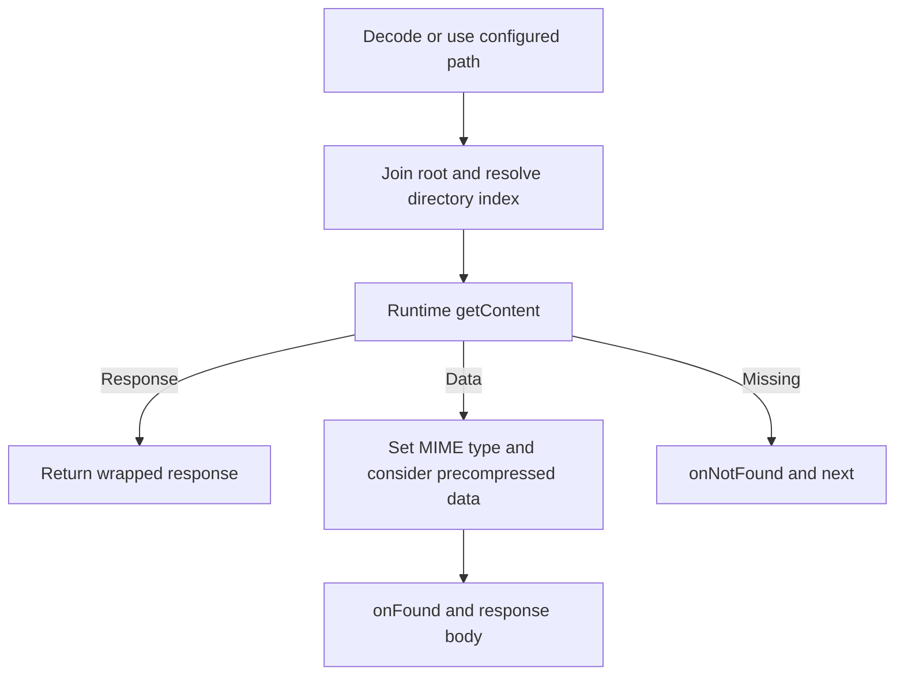

## Overview

The application boundary is `app.fetch(request, env, executionCtx)`. Runtime adapters either forward a native request or translate a platform event into one, then convert the resulting response when the platform requires another shape. Static-file adapters use runtime storage APIs behind a common middleware interface. [[Middleware and Errors]] explains what happens inside dispatch, and [[Streaming and WebSockets]] owns socket upgrade and stream-writer lifecycles.

Sources: [src/hono-base.ts:479-485](repo://src/hono-base.ts#L479-L485), [src/adapter/cloudflare-pages/handler.ts:32-46](repo://src/adapter/cloudflare-pages/handler.ts#L32-L46), [src/adapter/aws-lambda/handler.ts:252-275](repo://src/adapter/aws-lambda/handler.ts#L252-L275), [src/middleware/serve-static/index.ts:32-49](repo://src/middleware/serve-static/index.ts#L32-L49)

## Runtime entry points

| Platform boundary | Adapter behavior |
| --- | --- |
| Fetch-native caller | Invokes the app's Fetch entry point directly |
| Cloudflare Pages `handle` | Forwards the request, adds `eventContext` to bindings, and supplies waitUntil/pass-through execution methods |
| Cloudflare Pages `handleMiddleware` | Runs one Hono middleware around Pages' `next` with a constructed context |
| Vercel `handle` | Returns a function that calls `app.fetch(req)` |
| Netlify `handle` | Passes its platform context as `env.context` |
| Service Worker `handle` | Calls `respondWith` and optionally falls back to native fetch for a Hono 404 |
| AWS Lambda `handle` | Selects an event processor, constructs a request and converts the response to a Lambda result |
| Lambda@Edge `handle` | Converts CloudFront records and exposes event, context, callback and CloudFront metadata as bindings |

Sources: [src/hono-base.ts:479-485](repo://src/hono-base.ts#L479-L485), [src/adapter/cloudflare-pages/handler.ts:32-101](repo://src/adapter/cloudflare-pages/handler.ts#L32-L101), [src/adapter/vercel/handler.ts:4-8](repo://src/adapter/vercel/handler.ts#L4-L8), [src/adapter/netlify/handler.ts:4-10](repo://src/adapter/netlify/handler.ts#L4-L10), [src/adapter/service-worker/handler.ts:18-37](repo://src/adapter/service-worker/handler.ts#L18-L37), [src/adapter/aws-lambda/handler.ts:252-275](repo://src/adapter/aws-lambda/handler.ts#L252-L275), [src/adapter/lambda-edge/handler.ts:116-146](repo://src/adapter/lambda-edge/handler.ts#L116-L146)

The repository's Node integration tests import `serve` and `createAdaptorServer` from `@hono/node-server`, then import Hono from this checkout. That boundary is a separate package exercised here. For in-process testing, [[Quickstart]] uses `app.request`, which needs no listening server and still reaches the same Fetch dispatch.

Sources: [runtime-tests/node/index.test.ts:1-15](repo://runtime-tests/node/index.test.ts#L1-L15), [src/hono-base.ts:499-517](repo://src/hono-base.ts#L499-L517)

## Translated event processing

Lambda's event processor obtains path, domain, method, headers and query string from the selected event format. It builds an HTTPS URL, decodes a base64 body or text-encodes a plain body, and sets the decoded byte length. `handle` catches request-construction failures: TypeError becomes a 400 invalid-request response and other failures become 500, both converted through the same processor. A successful call passes `event`, `requestContext` and `lambdaContext` as bindings to Hono.

Sources: [src/adapter/aws-lambda/handler.ts:252-275](repo://src/adapter/aws-lambda/handler.ts#L252-L275), [src/adapter/aws-lambda/handler.ts:301-341](repo://src/adapter/aws-lambda/handler.ts#L301-L341)

Result conversion chooses text or base64 from content type and content encoding, consumes the response body, copies status and headers, and routes cookies through event-specific handling. A custom `isContentTypeBinary` replaces the default classifier. `streamHandle` instead uses Lambda's streaming APIs, writes response metadata, reads chunks from the Hono body into the platform writer, and ends that writer in `finally`; its error path logs and writes an internal-server-error message.

Sources: [src/adapter/aws-lambda/handler.ts:138-192](repo://src/adapter/aws-lambda/handler.ts#L138-L192), [src/adapter/aws-lambda/handler.ts:344-385](repo://src/adapter/aws-lambda/handler.ts#L344-L385)

Lambda@Edge constructs its request from the first CloudFront record, using Host or the distribution domain. Its binding callback records the first callback error/result; a callback error is rethrown and a callback result can replace normal response conversion. Otherwise conversion creates CloudFront header arrays and selects text/base64 output. Pages middleware has another specialized error boundary: it returns an HTTPException response, rethrows other recorded errors, and otherwise returns the middleware response or context response.

Sources: [src/adapter/lambda-edge/handler.ts:124-179](repo://src/adapter/lambda-edge/handler.ts#L124-L179), [src/adapter/cloudflare-pages/handler.ts:60-101](repo://src/adapter/cloudflare-pages/handler.ts#L60-L101)

## Environment and connection details

The adapter helper `env` selects a runtime-specific environment source: process environment for Bun/Node/edge-light, `Deno.env.toObject` for Deno, context bindings for workerd, and an empty record for Fastly/other. Runtime detection checks user-agent prefixes, EdgeRuntime and Fastly globals, then Node's process release name. This helper is separate from the bindings object supplied to `app.fetch`; [[Request and Context]] describes direct `c.env` access.

Sources: [src/helper/adapter/index.ts:10-83](repo://src/helper/adapter/index.ts#L10-L83)

Connection-info helpers also follow the runtime boundary. Bun retrieves the supplied server from `c.env.server` or `c.env` and calls `requestIP`, returning an empty remote record for unavailable connection details. Cloudflare reads `cf-connecting-ip`. These getters are inputs to the address policies in [[Security Middleware]], so applications choose the getter matching the actual invocation environment.

Sources: [src/adapter/bun/server.ts:13-14](repo://src/adapter/bun/server.ts#L13-L14), [src/adapter/bun/conninfo.ts:10-42](repo://src/adapter/bun/conninfo.ts#L10-L42), [src/adapter/cloudflare-workers/conninfo.ts:3-7](repo://src/adapter/cloudflare-workers/conninfo.ts#L3-L7), [src/middleware/ip-restriction/index.ts:218-245](repo://src/middleware/ip-restriction/index.ts#L218-L245)

## Shared static-file resolution

The shared static middleware requires a runtime `getContent` and optionally a path joiner and directory checker. It skips work when a response is already finalized. A fixed `path` bypasses URL-derived filename extraction; otherwise it decodes the request path and rejects dot segments, repeated separators and backslashes by invoking the miss callback and continuing. It joins the root with that filename, optionally rewrites the request path, and appends `index.html` when the runtime checker identifies a directory.

Sources: [src/middleware/serve-static/index.ts:13-21](repo://src/middleware/serve-static/index.ts#L13-L21), [src/middleware/serve-static/index.ts:35-86](repo://src/middleware/serve-static/index.ts#L35-L86)

Sources: [src/middleware/serve-static/index.ts:60-123](repo://src/middleware/serve-static/index.ts#L60-L123)

An existing `Response` from the content reader is wrapped directly. Data receives a MIME type or application/octet-stream. With precompression enabled for an eligible type, the middleware looks for accepted br, zstd and gzip variants in that order and adds content encoding plus Vary when one exists. A missing asset calls `onNotFound` and continues; a found data asset awaits `onFound` and returns its body. General dynamic compression has its own policy in [[HTTP Middleware]].

Sources: [src/middleware/serve-static/index.ts:23-30](repo://src/middleware/serve-static/index.ts#L23-L30), [src/middleware/serve-static/index.ts:88-123](repo://src/middleware/serve-static/index.ts#L88-L123)

## Runtime asset readers

Bun wraps `Bun.file` and a filesystem directory check. Deno opens files and returns their readable streams, treating missing files as misses and logging other read failures. The Cloudflare Workers KV reader uses a manifest and explicit namespace or `__STATIC_CONTENT`; this wrapper is marked deprecated in the checkout. Pages' separate advanced-mode helper calls `env.ASSETS.fetch`, converting an asset 404 to `c.notFound`. These adapters select storage access while shared static middleware owns the common resolution flow.

Sources: [src/adapter/bun/serve-static.ts:8-31](repo://src/adapter/bun/serve-static.ts#L8-L31), [src/adapter/deno/serve-static.ts:8-41](repo://src/adapter/deno/serve-static.ts#L8-L41), [src/adapter/cloudflare-workers/serve-static.ts:12-41](repo://src/adapter/cloudflare-workers/serve-static.ts#L12-L41), [src/adapter/cloudflare-pages/handler.ts:108-122](repo://src/adapter/cloudflare-pages/handler.ts#L108-L122)
