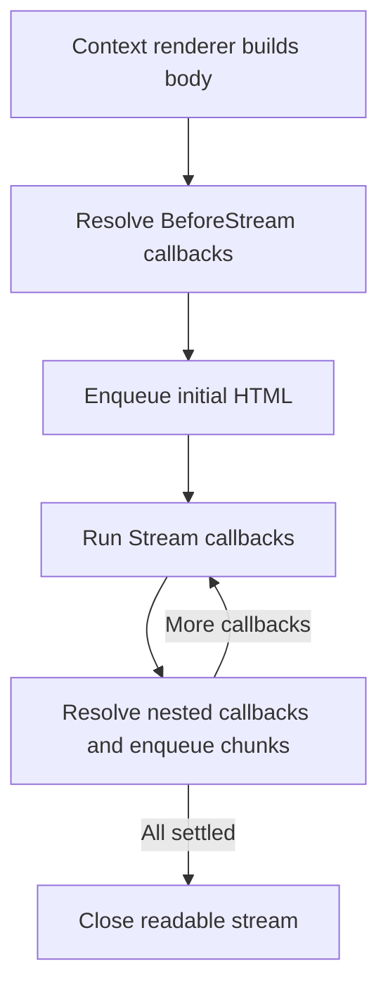

## Overview

Hono server rendering turns JSX nodes and escaped HTML templates into response bodies. The context can return HTML directly or delegate to a renderer installed by middleware, including a layout and a streaming mode. [[Request and Context]] explains those response hooks. Browser node reconciliation belongs to [[Browser Rendering]]; this page follows document serialization, request-aware rendering and asynchronous HTML output.

Sources: [src/context.ts:448-496](repo://src/context.ts#L448-L496), [src/context.ts:723-733](repo://src/context.ts#L723-L733), [src/middleware/jsx-renderer/index.ts:33-80](repo://src/middleware/jsx-renderer/index.ts#L33-L80)

## HTML templates and escaping

The `html` tagged template copies literal segments and processes interpolated values. Strings are escaped, numbers are appended, and booleans/null/undefined contribute nothing. Arrays flatten recursively. Values already marked escaped are serialized without another escaping pass, preserving callbacks; promises enter the asynchronous string buffer. The helper returns a raw escaped-string wrapper for a completed synchronous result or resolves a larger buffer asynchronously.

Sources: [src/helper/html/index.ts:11-56](repo://src/helper/html/index.ts#L11-L56)

JSX intrinsic nodes validate their tag name and filter invalid attribute names. String attribute values and object style strings are escaped. Known boolean attributes render when true, nullish values are omitted, and void tags with no children close immediately. `dangerouslySetInnerHTML` inserts its raw HTML but rejects simultaneous children. Function-valued event/ref props are ignored during server serialization; other function-valued intrinsic props raise an error. These branches define the distinction between serialized HTML attributes and browser behavior.

Sources: [src/jsx/base.ts:147-154](repo://src/jsx/base.ts#L147-L154), [src/jsx/base.ts:179-250](repo://src/jsx/base.ts#L179-L250)

## Components and render scope

`jsx` extracts the key and chooses a function node, special intrinsic implementation, or ordinary node. Function nodes merge children into props and call the component. Nullish/boolean results disappear, JSX results serialize recursively, numbers and escaped results append directly, and ordinary strings are escaped. Promised results enter the buffer; when context providers exist, Hono captures their render context and attaches it to a resumed JSX subtree. `toString()` establishes the render scope or resumes a previously captured one.

Sources: [src/jsx/base.ts:166-176](repo://src/jsx/base.ts#L166-L176), [src/jsx/base.ts:254-350](repo://src/jsx/base.ts#L254-L350)

Context values use a per-render WeakMap. The implementation probes for AsyncLocalStorage through runtime property access so bundlers do not statically resolve `node:async_hooks`. With storage available, the scope follows asynchronous execution. Without it, the fallback store covers synchronous rendering, and a context read after an await can fall back to its default value; the implementation warns once when it detects this situation. Captured subtree resumption restores saved values for deferred work without using another request's provider state.

Sources: [src/jsx/context.ts:15-31](repo://src/jsx/context.ts#L15-L31), [src/jsx/context.ts:34-78](repo://src/jsx/context.ts#L34-L78), [src/jsx/context.ts:100-180](repo://src/jsx/context.ts#L100-L180)

## Request-aware layouts

`jsxRenderer(component, options)` reads the current layout or uses `Fragment`, optionally installs a new layout that receives the previous `Layout`, and installs a renderer on the context before advancing. Rendering wraps the resulting tree in `RequestContext.Provider`, whose value is the HTTP context. `useRequestContext` reads this provider and throws when missing. Nested middleware can therefore build layouts while components retain access to request state.

Sources: [src/middleware/jsx-renderer/index.ts:15-16](repo://src/middleware/jsx-renderer/index.ts#L15-L16), [src/middleware/jsx-renderer/index.ts:49-64](repo://src/middleware/jsx-renderer/index.ts#L49-L64), [src/middleware/jsx-renderer/index.ts:116-129](repo://src/middleware/jsx-renderer/index.ts#L116-L129), [src/middleware/jsx-renderer/index.ts:155-165](repo://src/middleware/jsx-renderer/index.ts#L155-L165)

| Renderer option | Result |
| --- | --- |
| `docType` omitted or true | Prefixes the default HTML doctype |
| `docType: false` | Omits the doctype |
| String `docType` | Uses that exact prefix |
| No `stream` | Returns `c.html(body)` |
| `stream: true` | Sets chunked transfer, HTML content type and Identity encoding, then returns a readable-stream body |
| Header-record `stream` | Sets supplied headers before returning the stream |
| Options function | Computes renderer options from the current context |

Sources: [src/middleware/jsx-renderer/index.ts:18-21](repo://src/middleware/jsx-renderer/index.ts#L18-L21), [src/middleware/jsx-renderer/index.ts:33-79](repo://src/middleware/jsx-renderer/index.ts#L33-L79)

## Suspense and streamed documents

Suspense first tries its children. A thrown promise becomes deferred work with captured context; an ordinary error is rethrown. If any result is pending, it returns a fallback plus a placeholder and callback. In buffered rendering the callback replaces the placeholder within the output buffer; in streamed rendering it emits a template and replacement script. Synchronous children produce their joined output directly. `StreamingContext` can supply a nonce for generated Suspense scripts.

Sources: [src/jsx/streaming.ts:18-32](repo://src/jsx/streaming.ts#L18-L32), [src/jsx/streaming.ts:42-135](repo://src/jsx/streaming.ts#L42-L135)

Sources: [src/middleware/jsx-renderer/index.ts:60-78](repo://src/middleware/jsx-renderer/index.ts#L60-L78), [src/jsx/streaming.ts:146-218](repo://src/jsx/streaming.ts#L146-L218)

`renderToReadableStream` encodes output as bytes, processes callbacks discovered by later chunks, and waits until all recorded callback promises settle. Cancellation suppresses further enqueues and stream closure. Failures call the configured error callback, which defaults to `console.trace`; callback rejection also passes through that handler. Both this API and Suspense are marked experimental. Generic text and event-stream writing have a separate lifecycle in [[Streaming and WebSockets]].

Sources: [src/jsx/streaming.ts:36-40](repo://src/jsx/streaming.ts#L36-L40), [src/jsx/streaming.ts:140-219](repo://src/jsx/streaming.ts#L140-L219)

## Rendering failures and CSS output

The experimental `ErrorBoundary` accepts `fallback`, `fallbackRender` and `onError`. It captures context before deferring error handling and renders the fallback within that captured scope. Synchronous child errors and rejected deferred children take its fallback path; a thrown promise is retried before a later rejection is handled. This operates inside the document tree, while unhandled handler failures still use the HTTP error boundary described in [[Middleware and Errors]].

Sources: [src/jsx/components.ts:48-132](repo://src/jsx/components.ts#L48-L132), [src/compose.ts:49-59](repo://src/compose.ts#L49-L59)

CSS helpers create class-name objects whose callbacks register used styles in a render-context WeakMap. Styles already emitted are tracked separately from styles waiting to be added. A callback can insert styles into an existing buffered style element or generate output for later insertion. `createCssContext` accepts an element ID and custom class-name slug handling, making style collection part of the same callback-driven document flow rather than a separate HTTP response pass.

Sources: [src/helper/css/index.ts:63-108](repo://src/helper/css/index.ts#L63-L108), [src/helper/css/index.ts:110-158](repo://src/helper/css/index.ts#L110-L158)
