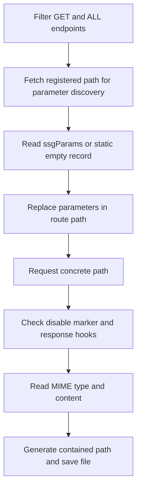

## Overview

Static generation runs eligible application routes through Hono and writes their responses through a supplied filesystem interface. It reuses normal response construction, including HTML from [[Server Rendering]], and supplies its own SSG environment marker. The generic `toSSG` takes an app, filesystem and options; Bun and Deno wrappers bind the filesystem automatically. [[Runtime Adapters and Static Files]] covers serving the resulting assets later.

Sources: [src/helper/ssg/ssg.ts:34-47](repo://src/helper/ssg/ssg.ts#L34-L47), [src/helper/ssg/ssg.ts:368-375](repo://src/helper/ssg/ssg.ts#L368-L375), [src/helper/ssg/ssg.ts:243-269](repo://src/helper/ssg/ssg.ts#L243-L269), [src/adapter/bun/ssg.ts:13-26](repo://src/adapter/bun/ssg.ts#L13-L26), [src/adapter/deno/ssg.ts:9-26](repo://src/adapter/deno/ssg.ts#L9-L26)

## Eligible routes and discovery

Route filtering walks `app.routes`, unwraps composed handlers and keeps GET/ALL entries whose target handler is not identified as middleware. A dynamic route is one with a segment beginning with `:` or containing `*`. Generation first requests the registered route path using a localhost base and the `HONO_SSG_CONTEXT` binding. This first request discovers parameter data, rather than immediately writing the discovery response to disk.

Sources: [src/helper/ssg/utils.ts:61-75](repo://src/helper/ssg/utils.ts#L61-L75), [src/utils/handler.ts:8-15](repo://src/utils/handler.ts#L8-L15), [src/helper/ssg/ssg.ts:221-250](repo://src/helper/ssg/ssg.ts#L221-L250)

`ssgParams` accepts an array of parameter records or a context-dependent generator. When the request path is still dynamic it attaches the generated records to the raw request and returns `c.notFound` to prevent the endpoint from running during discovery. On an expanded concrete path it calls `next`. Dynamic paths with no discovered parameter array are skipped; static paths get one empty parameter record. The parameter middleware therefore defines which concrete resources a dynamic route generates.

Sources: [src/helper/ssg/middleware.ts:24-48](repo://src/helper/ssg/middleware.ts#L24-L48), [src/helper/ssg/ssg.ts:243-260](repo://src/helper/ssg/ssg.ts#L243-L260)

Sources: [src/helper/ssg/utils.ts:61-75](repo://src/helper/ssg/utils.ts#L61-L75), [src/helper/ssg/ssg.ts:225-289](repo://src/helper/ssg/ssg.ts#L225-L289), [src/helper/ssg/ssg.ts:310-333](repo://src/helper/ssg/ssg.ts#L310-L333)

## Concrete fetches and generation-only routes

For each parameter record, generation substitutes values into the route path and calls `app.request` with the discovery request's method and headers plus the SSG marker. A response bearing `x-hono-disable-ssg` is discarded before response hooks. Otherwise the after-response hook may replace or discard it. The resulting content type, without parameters, determines the MIME type; an absent type defaults to text/plain. Text/JSON content is read as text and other output as an array buffer.

Sources: [src/helper/ssg/ssg.ts:17-25](repo://src/helper/ssg/ssg.ts#L17-L25), [src/helper/ssg/ssg.ts:74-87](repo://src/helper/ssg/ssg.ts#L74-L87), [src/helper/ssg/ssg.ts:253-289](repo://src/helper/ssg/ssg.ts#L253-L289)

`isSSGContext` checks the environment marker. `disableSSG` sets the disable header and returns not-found only inside generation; normal requests advance. `onlySSG` returns not-found outside generation and advances inside it. `ssgParams` itself checks whether the request path is dynamic, rather than testing this marker, so its discovery behavior is a path-based branch.

Sources: [src/helper/ssg/middleware.ts:43-82](repo://src/helper/ssg/middleware.ts#L43-L82)

## Options and plugin ordering

| Option | Effect |
| --- | --- |
| `dir` | Output root; defaults to `./static` |
| `concurrency` | Request pool limit; defaults to 2 |
| `extensionMap` | Custom MIME-to-extension map used in place of the built-in map |
| `plugins` | Ordered plugin list; absent configuration installs `defaultPlugin()` |
| Legacy top-level hooks | Accepted but marked deprecated in favor of plugin hooks |

Sources: [src/helper/ssg/ssg.ts:17-27](repo://src/helper/ssg/ssg.ts#L17-L27), [src/helper/ssg/ssg.ts:99-107](repo://src/helper/ssg/ssg.ts#L99-L107), [src/helper/ssg/ssg.ts:181-198](repo://src/helper/ssg/ssg.ts#L181-L198), [src/helper/ssg/ssg.ts:368-375](repo://src/helper/ssg/ssg.ts#L368-L375), [src/helper/ssg/ssg.ts:420-434](repo://src/helper/ssg/ssg.ts#L420-L434)

Plugins can provide before-request, after-response and after-generate hooks, individually or as arrays. Legacy hooks are collected first, followed by plugin hooks in order. Request and response hooks run sequentially, pass replacements onward and stop on false. After-generate hooks run sequentially with the result, filesystem and options. The before-request hook is applied to discovery requests; concrete requests then inherit the discovery method and headers.

Sources: [src/helper/ssg/ssg.ts:118-179](repo://src/helper/ssg/ssg.ts#L118-L179), [src/helper/ssg/ssg.ts:234-256](repo://src/helper/ssg/ssg.ts#L234-L256), [src/helper/ssg/ssg.ts:376-418](repo://src/helper/ssg/ssg.ts#L376-L418)

The default plugin drops every non-200 response. `redirectPlugin` converts 301, 302, 303, 307 and 308 responses with a Location header into status-200 HTML redirect documents, and drops redirects without Location. Place it before the default plugin so conversion occurs before non-200 filtering. Supplying a custom plugin list replaces the implicit default list, so include `defaultPlugin()` explicitly when retaining that filter.

Sources: [src/helper/ssg/plugins.ts:11-20](repo://src/helper/ssg/plugins.ts#L11-L20), [src/helper/ssg/plugins.ts:22-71](repo://src/helper/ssg/plugins.ts#L22-L71), [src/helper/ssg/ssg.ts:372-372](repo://src/helper/ssg/ssg.ts#L372-L372)

## Output paths and filesystem contract

The filesystem interface needs asynchronous `mkdir` and `writeFile`. Output naming preserves a route already ending in its selected extension, maps `/` to `index.extension`, places an index file under paths ending in `/`, and otherwise appends the extension. Built-in overrides cover HTML, XML feeds and YAML; unknown MIME types fall back through MIME lookup and finally html. Before writing, the generated path must normalize to the output directory or a descendant, otherwise generation raises a traversal error.

Sources: [src/helper/ssg/ssg.ts:34-37](repo://src/helper/ssg/ssg.ts#L34-L37), [src/helper/ssg/ssg.ts:50-71](repo://src/helper/ssg/ssg.ts#L50-L71), [src/helper/ssg/ssg.ts:90-107](repo://src/helper/ssg/ssg.ts#L90-L107), [src/helper/ssg/utils.ts:77-87](repo://src/helper/ssg/utils.ts#L77-L87)

Saving creates parent directories recursively and records created directories to avoid repeated creation. String content writes directly; an ArrayBuffer becomes Uint8Array. Bun's filesystem wrapper delegates writes to `Bun.write` and supplies a no-op mkdir, while Deno encodes strings and uses `Deno.writeFile` plus recursive directory creation. These bindings keep output mechanics outside route rendering.

Sources: [src/helper/ssg/ssg.ts:309-333](repo://src/helper/ssg/ssg.ts#L309-L333), [src/adapter/bun/ssg.ts:13-18](repo://src/adapter/bun/ssg.ts#L13-L18), [src/adapter/deno/ssg.ts:9-18](repo://src/adapter/deno/ssg.ts#L9-L18)

## Completion and failures

`toSSG` waits for discovery tasks, then iterates collected save promises. A save error is captured as a value and thrown when encountered in that iteration. The enclosing catch turns discovery or save failures into a result with `success: false`, an empty reported files list and an Error, even if some files were already written. Successful completion reports the saved file paths. After-generate hooks run after this result is constructed, for either success or caught failure; their own errors are outside that catch and can reject the call. The API and its filesystem/result interfaces are marked experimental in this checkout.

Sources: [src/helper/ssg/ssg.ts:29-48](repo://src/helper/ssg/ssg.ts#L29-L48), [src/helper/ssg/ssg.ts:363-366](repo://src/helper/ssg/ssg.ts#L363-L366), [src/helper/ssg/ssg.ts:436-470](repo://src/helper/ssg/ssg.ts#L436-L470)
