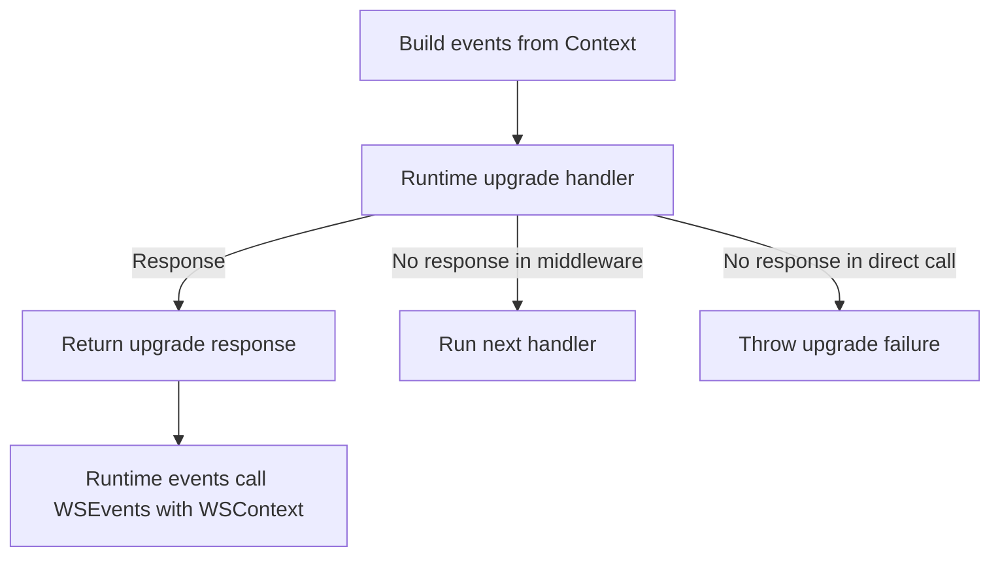

## Overview

Incremental HTTP output uses a response body backed by a readable stream; WebSockets use a runtime upgrade and an event-based socket context. Hono supplies helpers for both, while [[Server Rendering]] owns JSX's document-stream callback system. This page follows generic stream writing, server-sent event framing and socket upgrades. [[Runtime Adapters and Static Files]] describes the surrounding platform entry points.

Sources: [src/helper/streaming/stream.ts:7-44](repo://src/helper/streaming/stream.ts#L7-L44), [src/helper/streaming/sse.ts:72-99](repo://src/helper/streaming/sse.ts#L72-L99), [src/helper/websocket/index.ts:108-139](repo://src/helper/websocket/index.ts#L108-L139)

## Stream creation and writer lifecycle

`stream(c, callback, onError)` creates a TransformStream and a `StreamingApi`, starts the asynchronous callback, and immediately returns `c.newResponse` with the readable side. The callback runs to completion in the background relative to response construction, and its `finally` closes the writer. A WeakMap holds the context by readable stream because Bun can destroy request context after the request returns. An older-Bun compatibility branch also subscribes to the request's abort signal.

Sources: [src/helper/streaming/stream.ts:5-44](repo://src/helper/streaming/stream.ts#L5-L44)

| Writer operation | Behavior |
| --- | --- |
| `write` | Encodes strings with TextEncoder and awaits the writer; accepts byte arrays directly |
| `writeln` | Appends a newline before writing |
| `sleep` | Returns a timer-backed promise |
| `pipe` | Releases the writer lock, pipes another readable with `preventClose`, then reacquires the writer |
| `close` | Marks normal closure and attempts to close the writer |
| `onAbort` | Registers a cancellation subscriber |
| `abort` | Marks aborted once and invokes subscribers |

Sources: [src/utils/stream.ts:48-97](repo://src/utils/stream.ts#L48-L97)

The response-readable wrapper pulls from the TransformStream's reader. Cancelling that response triggers `abort` unless already closed; an internal subscriber cancels the reader so writes do not remain blocked indefinitely. `aborted` and `closed` are separate flags. Writes and normal close suppress their underlying writer errors, so applications should use abort subscriptions for cleanup rather than depending on every failed write to throw.

Sources: [src/utils/stream.ts:13-45](repo://src/utils/stream.ts#L13-L45), [src/utils/stream.ts:48-97](repo://src/utils/stream.ts#L48-L97)

## Text and error behavior

`streamText` sets the plain-text content type, `X-Content-Type-Options: nosniff` and chunked transfer encoding, then delegates to `stream`. The generic helper leaves representation headers to the caller. Inside `stream`, an `Error` reaches the optional error callback; an undefined cancellation rejection is ignored, and other thrown values are logged. Closure still runs in `finally`. These callback errors occur during body production, after the helper has already produced the HTTP response object.

Sources: [src/helper/streaming/text.ts:6-14](repo://src/helper/streaming/text.ts#L6-L14), [src/helper/streaming/stream.ts:26-44](repo://src/helper/streaming/stream.ts#L26-L44)

## Server-sent events

`streamSSE` sets event-stream content type, no-cache, keep-alive and chunked transfer headers. Its `SSEStreamingApi` extends the ordinary writer with `writeSSE`, accepting data plus optional event, ID and retry fields. Data is resolved through escaped-string callbacks and split on line endings into individual `data:` lines. The optional fields may not contain carriage returns or newlines; a violation throws. Frames end with a blank line and are sent through the shared byte writer.

Sources: [src/helper/streaming/sse.ts:6-44](repo://src/helper/streaming/sse.ts#L6-L44), [src/helper/streaming/sse.ts:72-99](repo://src/helper/streaming/sse.ts#L72-L99)

SSE callback failure has a specific branch: when the error is an `Error` and `onError` exists, the helper awaits that callback and then writes an SSE event named `error` with the error message. Otherwise it logs the failure. It closes in `finally`. This differs from returning a new status/body through the application's ordinary error handler in [[Middleware and Errors]], because an event-stream response has already been constructed.

Sources: [src/helper/streaming/sse.ts:47-68](repo://src/helper/streaming/sse.ts#L47-L68), [src/helper/streaming/sse.ts:97-99](repo://src/helper/streaming/sse.ts#L97-L99)

## Socket helper contract

`WSEvents` defines optional open, message, close and error callbacks receiving a `WSContext`. The context delegates send/close to the adapter and exposes the raw socket, URL, protocol and ready state. `defineWebSocketHelper` supports middleware form with a context-dependent event factory, and a direct form with an existing context and events. In middleware form an unsupported upgrade falls through to `next`; direct form throws `Failed to upgrade WebSocket` if the adapter returns no response.

Sources: [src/helper/websocket/index.ts:14-39](repo://src/helper/websocket/index.ts#L14-L39), [src/helper/websocket/index.ts:70-90](repo://src/helper/websocket/index.ts#L70-L90), [src/helper/websocket/index.ts:111-139](repo://src/helper/websocket/index.ts#L111-L139)

Sources: [src/helper/websocket/index.ts:111-139](repo://src/helper/websocket/index.ts#L111-L139), [src/adapter/deno/websocket.ts:15-37](repo://src/adapter/deno/websocket.ts#L15-L37)

## Runtime socket implementations

| Runtime | Upgrade boundary and event integration |
| --- | --- |
| Bun | Uses the server supplied through environment, calls `server.upgrade`, stores events in socket data, and exports a `websocket` handler for open/message/close |
| Deno | Requires an upgrade header, calls `Deno.upgradeWebSocket`, wires all four callbacks and returns its response |
| Cloudflare Workers | Requires an upgrade header, creates a WebSocketPair, attaches listeners, accepts the server socket and returns 101 with the client socket |

Sources: [src/adapter/bun/server.ts:13-14](repo://src/adapter/bun/server.ts#L13-L14), [src/adapter/bun/websocket.ts:48-104](repo://src/adapter/bun/websocket.ts#L48-L104), [src/adapter/deno/websocket.ts:4-38](repo://src/adapter/deno/websocket.ts#L4-L38), [src/adapter/cloudflare-workers/websocket.ts:5-53](repo://src/adapter/cloudflare-workers/websocket.ts#L5-L53)

Bun throws when no server is available through the context environment and normalizes binary messages to their array-buffer data. Its factory `createBunWebSocket` is deprecated in favor of direct `upgradeWebSocket` and `websocket` imports. Deno defaults to the first requested subprotocol while allowing explicit options to override it. Cloudflare's event type omits `onOpen`, matching its implementation comment that open events are unsupported. Client `$ws` URL construction is described in [[Validation and Typed Clients]].

Sources: [src/adapter/bun/websocket.ts:48-73](repo://src/adapter/bun/websocket.ts#L48-L73), [src/adapter/bun/websocket.ts:95-113](repo://src/adapter/bun/websocket.ts#L95-L113), [src/adapter/deno/websocket.ts:10-18](repo://src/adapter/deno/websocket.ts#L10-L18), [src/adapter/cloudflare-workers/websocket.ts:5-10](repo://src/adapter/cloudflare-workers/websocket.ts#L5-L10), [src/adapter/cloudflare-workers/websocket.ts:34-44](repo://src/adapter/cloudflare-workers/websocket.ts#L34-L44)
