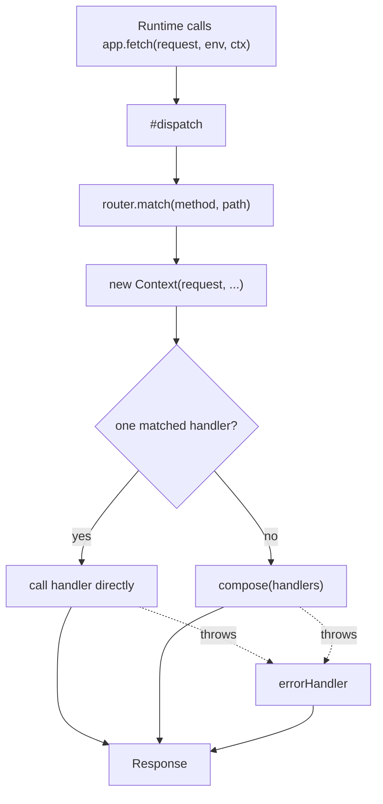

## Overview

Hono is a small web framework built on Web Standards: handlers receive and return the standard `Request` and `Response` objects, so the same app runs on Cloudflare Workers, Fastly Compute, Deno, Bun, Vercel, AWS Lambda, Lambda@Edge and Node.js. The package has no runtime dependencies and is published as ESM with a CommonJS build.

Sources: [README.md:22-47](repo://README.md#L22-L47), [package.json:1-12](repo://package.json#L1-L12)

A complete app is three lines: create a `Hono`, register a handler, and export the app, whose `fetch` method is the entry point runtimes call.

```ts
import { Hono } from 'hono'
const app = new Hono()

app.get('/', (c) => c.text('Hono!'))

export default app
```

Sources: [README.md:26-33](repo://README.md#L26-L33)

## Parts of the project

| Area | What it does | Page |
| --- | --- | --- |
| Getting started | Create an app, choose a preset, run the tests | [[Quickstart]] |
| App and dispatch | Route registration, grouping, `mount`, error handling, the `fetch` pipeline | [[Application and Request Dispatch]] |
| Context | Per-request object: env, variables, response helpers | [[Context and Responses]] |
| Request | `HonoRequest`, params, query, cached body parsing | [[Request and Body Parsing]] |
| Validation | `validator()` middleware and typed inputs | [[Validation]] |
| Routers | The `Router` contract, `SmartRouter`, linear and pattern routers | [[Router Interface and Selection]] |
| Fast routers | `RegExpRouter` and `TrieRouter` internals | [[RegExpRouter and TrieRouter]] |
| Auth | basic, bearer, JWT and JWK middleware | [[Authentication Middleware and JWT]] |
| Middleware | cors, csrf, etag, compress and the rest | [[Built-in Middleware Catalogue]] |
| Helpers | cookie, factory, proxy, html, adapter and others | [[Helpers Catalogue]] |
| Streaming | `stream`, `streamText`, `streamSSE` | [[Streaming and Server-Sent Events]] |
| SSG | Static site generation | [[Static Site Generation]] |
| RPC client | Typed `hc` client | [[Typed RPC Client]] |
| JSX on the server | JSX to HTML strings, `jsxRenderer` | [[JSX Server Rendering]] |
| JSX in the browser | DOM renderer and hooks | [[JSX DOM Rendering and Hooks]] |
| Adapters | Per-runtime entry points and static serving | [[Runtime Adapters]] |
| Package | Subpath exports, build, tests | [[Build and Package Layout]] |

Sources: [src/index.ts:1-50](repo://src/index.ts#L1-L50), [src/hono.ts:16-34](repo://src/hono.ts#L16-L34)

## Request flow



Sources: [src/hono-base.ts:406-466](repo://src/hono-base.ts#L406-L466)

1. The runtime calls `fetch`, which forwards to `#dispatch` with the request method. See [[Application and Request Dispatch]].
2. `#dispatch` asks the router for every handler matching the method and path. The router algorithms are in [[Router Interface and Selection]] and [[RegExpRouter and TrieRouter]].
3. A `Context` wraps the request and the match result; handlers use it to read input and build the response. See [[Context and Responses]] and [[Request and Body Parsing]].
4. With one matching handler it is called directly; otherwise `compose` runs the middleware chain, each calling `next()`.
5. A thrown `Error` goes to the app's error handler; an unmatched request goes to the not-found handler (a plain `404 Not Found` by default).

Sources: [src/hono-base.ts:406-466](repo://src/hono-base.ts#L406-L466), [src/hono-base.ts:31-42](repo://src/hono-base.ts#L31-L42), [src/compose.ts:15-73](repo://src/compose.ts#L15-L73)

## Design decisions

**`HonoBase` has no router.** The comment on the class says it is "like an abstract class": subclasses assign `router` in their constructor. The default `Hono` class installs a `SmartRouter` over `RegExpRouter` and `TrieRouter`, while the `hono/quick` and `hono/tiny` presets pick other routers, so an app pays only for the router code it imports.

Sources: [src/hono-base.ts:114-118](repo://src/hono-base.ts#L114-L118), [src/hono.ts:26-33](repo://src/hono.ts#L26-L33), [src/preset/quick.ts:12-20](repo://src/preset/quick.ts#L12-L20), [src/preset/tiny.ts:9-20](repo://src/preset/tiny.ts#L9-L20)

**Every router implements one two-method contract.** `Router<T>` has `add` and `match`, and `HonoOptions.router` lets an app supply its own implementation. See [[Router Interface and Selection]].

Sources: [src/router.ts:25-50](repo://src/router.ts#L25-L50), [src/hono-base.ts:55-65](repo://src/hono-base.ts#L55-L65)

**Handlers are registered by assigning closures in the constructor.** Methods `get`, `post`, `put`, `delete`, `options`, `patch` and `all` accept either `(path, ...handlers)` or `(...handlers)`; in the second form the previously used path is reused. `use` without a path registers on `*`.

Sources: [src/hono-base.ts:126-168](repo://src/hono-base.ts#L126-L168)

**Strict path matching is the default.** `strict` defaults to `true`; setting it false swaps `getPath` for `getPathNoStrict`.

Sources: [src/hono-base.ts:170-172](repo://src/hono-base.ts#L170-L172)

**Features ship as separate subpath exports.** Middleware, helpers, adapters, JSX and presets each have their own entry in `package.json` `exports`, with `types`, `import` and `require` conditions. See [[Build and Package Layout]].

Sources: [package.json:13-48](repo://package.json#L13-L48)

**Errors are values handed to a handler.** The default error handler uses an error's `getResponse()` when it has one (the `HTTPException` case), otherwise logs and answers `500 Internal Server Error`.

Sources: [src/hono-base.ts:35-42](repo://src/hono-base.ts#L35-L42)
