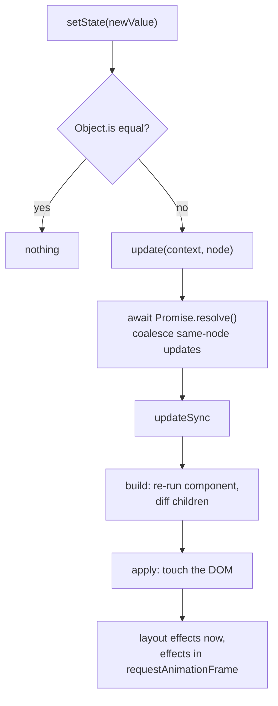

## Overview

`hono/jsx/dom` runs Hono's JSX in the browser with a small React-compatible surface: `createRoot`, `hydrateRoot`, hooks, context, portals and form actions. It is separate from the string renderer in [[JSX Server Rendering]]. The renderer keeps its own tree of nodes between renders. A state change rebuilds only the affected component's subtree (`build`), then writes the difference into the real DOM (`apply`). The hooks live in `src/jsx/hooks` and keep their data on that tree.

Sources: [src/jsx/dom/client.ts:1-89](repo://src/jsx/dom/client.ts#L1-L89), [src/jsx/dom/render.ts:497-504](repo://src/jsx/dom/render.ts#L497-L504), [src/jsx/hooks/index.ts:182-243](repo://src/jsx/hooks/index.ts#L182-L243)

Sources: [src/jsx/hooks/index.ts:197-243](repo://src/jsx/hooks/index.ts#L197-L243), [src/jsx/dom/render.ts:713-781](repo://src/jsx/dom/render.ts#L713-L781), [src/jsx/dom/render.ts:462-480](repo://src/jsx/dom/render.ts#L462-L480)

## Roots

`createRoot(element)` returns `{ render, unmount }` and warns that its options are not supported. The first `render(jsxNode)` builds a wrapper component whose state holds the JSX node, so later `render` calls just set that state, which makes the root update like any other component. After `unmount()` the state is set to `null` and further renders throw `Cannot update an unmounted root`. `hydrateRoot` is, per its comment, equivalent to `createRoot` followed by `render`, so existing server markup is replaced rather than adopted.

Sources: [src/jsx/dom/client.ts:23-84](repo://src/jsx/dom/client.ts#L23-L84)

`renderNode` runs the first render: it builds the tree with a fresh context, applies it into a `DocumentFragment` and then moves the fragment into the container with `replaceChildren`. `render(jsxNode, container)` is the same with the node wrapped in a fragment.

Sources: [src/jsx/dom/render.ts:783-799](repo://src/jsx/dom/render.ts#L783-L799)

## The node tree

Each rendered element or component is a `NodeObject` with short field names: `vC` are its virtual children, `pP` the previous props, `nN` the next sibling node, `e` the real DOM element, `c` the container, and `vR` children to remove. A text child is a `NodeString` with its text `t` and a dirty flag `d`. Function components also carry a stash (`DOM_STASH`) holding the hook index and per-hook arrays, the context values captured at render, and the closest error boundary or Suspense handler.

Sources: [src/jsx/dom/render.ts:41-80](repo://src/jsx/dom/render.ts#L41-L80)

## Build: diffing the virtual tree

`build(context, node, children?)` computes a node's new children. A function component is called through `invokeTag`, which resets the hook index, pushes `[context, node]` on `buildDataStack` (this is how hooks find their component), applies `defaultProps` and calls the function (or its `DOM_RENDERER` variant). Elements take `props.children` instead. Nested arrays are flattened, and each child goes through `buildNode`, which turns strings and numbers into `NodeString`s and drops `null`, `undefined` and booleans.

Sources: [src/jsx/dom/render.ts:274-291](repo://src/jsx/dom/render.ts#L274-L291), [src/jsx/dom/render.ts:497-526](repo://src/jsx/dom/render.ts#L497-L526), [src/jsx/dom/render.ts:667-704](repo://src/jsx/dom/render.ts#L667-L704)

Each new child is matched with an old child of the same `tag` (and the same `key` when one is given; text matches text). A match is reused: its props are replaced, and a text change marks it dirty. A component child is marked skipped (`s`) when it is not forced, its props pass the `memo` comparison stored under `DOM_MEMO`, and its context values are unchanged. Unskipped children are built recursively. Old children left unmatched go to `vR` to be removed. Siblings are chained through `nN` so insertion points can be found later.

Sources: [src/jsx/dom/render.ts:541-605](repo://src/jsx/dom/render.ts#L541-L605)

If a component throws, the code looks for the closest error handler recorded in the stash (an `ErrorBoundary` or `Suspense`). The handler's fallback is built in its place, and the failed node is marked for rebuilding. The handler receives a `retry` function that schedules a rebuild. With no handler the error propagates. Context providers use the same mechanism to pop their value when an error passes through.

Sources: [src/jsx/dom/render.ts:610-665](repo://src/jsx/dom/render.ts#L610-L665), [src/jsx/dom/context.ts:7-52](repo://src/jsx/dom/context.ts#L7-L52)

## Apply: writing the DOM

`applyNodeObject` gathers the flat list of real nodes to place (`getNextChildren` looks through components and fragments and also collects pending effect data), removes `vR` nodes with `removeNode` (which runs effect cleanups and ref cleanups first), then walks the list. For each node it creates or reuses the element (`createElementNS` for `svg` and `math`), calls `applyProps`, recurses into its children, and inserts or moves it only when it is not already in the expected position. After placement it runs `useInsertionEffect` and `useLayoutEffect` callbacks synchronously and schedules `useEffect` callbacks with `requestAnimationFrame`.

Sources: [src/jsx/dom/render.ts:293-362](repo://src/jsx/dom/render.ts#L293-L362), [src/jsx/dom/render.ts:387-481](repo://src/jsx/dom/render.ts#L387-L481)

`applyProps` diffs old and new props: names starting with `on` become `addEventListener` calls with the event name lowercased (a `Capture` suffix selects capture, and aliases such as `onChange` map to `input`), `ref` supports callback and object forms with cleanup, `style` sets `cssText` or properties, form values set the property directly, `null`, `undefined` and `false` remove an attribute, `true` sets an empty one, and removed props are cleaned up. Invalid attribute names are ignored by catching the DOM exception, not by checking up front.

Sources: [src/jsx/dom/render.ts:19-22](repo://src/jsx/dom/render.ts#L19-L22), [src/jsx/dom/render.ts:115-133](repo://src/jsx/dom/render.ts#L115-L133), [src/jsx/dom/render.ts:158-272](repo://src/jsx/dom/render.ts#L158-L272)

`createPortal(children, container, key)` returns a special node with the tag `_hp` whose element is the target container, which `findInsertBefore` and `apply` skip when computing positions in the parent. `flushSync(callback)` collects updates raised inside the callback and runs them synchronously when it returns.

Sources: [src/jsx/dom/render.ts:334-339](repo://src/jsx/dom/render.ts#L334-L339), [src/jsx/dom/render.ts:801-825](repo://src/jsx/dom/render.ts#L801-L825)

## Scheduling updates

`update(context, node)` keeps one pending entry per node in `updateMap`, replacing an earlier one (whose promise resolves with `undefined`). Outside `flushSync` it waits one microtask and then runs the latest entry through `updateSync`, so several `setState` calls in one tick cause one rebuild. `updateSync` pushes the node's captured context values, runs `build`, pops them, and calls `apply` unless the build was cancelled.

Sources: [src/jsx/dom/render.ts:713-781](repo://src/jsx/dom/render.ts#L713-L781)

## Hooks

### Core hooks

Every hook reads `buildDataStack.at(-1)`. Outside a render (for example on the server) most return a plain value or do nothing, which is why the same component code can be stringified in SSR. Inside a render each hook takes a slot in the component's stash by incrementing the hook index, so hooks must be called in the same order every time.

Sources: [src/jsx/hooks/index.ts:8-12](repo://src/jsx/hooks/index.ts#L8-L12), [src/jsx/hooks/index.ts:182-197](repo://src/jsx/hooks/index.ts#L182-L197)

| Hook | Behaviour |
| --- | --- |
| `useState` | Holds `[value, setter]`; the setter accepts a function, skips equal values with `Object.is`, and otherwise calls `update` |
| `useReducer` | `useState` plus a callback that applies the reducer |
| `useEffect`, `useLayoutEffect`, `useInsertionEffect` | Store an effect with its dependencies; when dependencies change the previous cleanup runs and the new effect is queued for the phase that applies it |
| `useCallback`, `useMemo` | Cache a value and its dependencies in the stash; `useId` is a `useMemo` over a counter |
| `useRef`, `createRef`, `forwardRef`, `useImperativeHandle` | Mutable `{ current }` holders and ref plumbing |
| `use(promise)` | Throws the promise until it resolves, caching the result so a later render returns it (or throws its error) |
| `useSyncExternalStore` | Subscribes in an effect; without a build context it needs `getServerSnapshot` |
| `useDebugValue` | Does nothing |

Sources: [src/jsx/hooks/index.ts:182-243](repo://src/jsx/hooks/index.ts#L182-L243), [src/jsx/hooks/index.ts:245-297](repo://src/jsx/hooks/index.ts#L245-L297), [src/jsx/hooks/index.ts:299-373](repo://src/jsx/hooks/index.ts#L299-L373), [src/jsx/hooks/index.ts:397-425](repo://src/jsx/hooks/index.ts#L397-L425)

A thrown promise from `use` is how `Suspense` learns that a subtree is pending, as in the server's `Suspense` in [[JSX Server Rendering]].

Sources: [src/jsx/hooks/index.ts:332-346](repo://src/jsx/hooks/index.ts#L332-L346), [src/jsx/streaming.ts:60-85](repo://src/jsx/streaming.ts#L60-L85)

### Transitions and deferred values

`startTransition(cb)` runs the callback with a pending marker on `pendingStack`, so state updates made inside it are issued with pending type 1 (global). `useTransition()` returns `[isPending, start]` with the hook-level type 2; its starter flips a local state to re-render and records an async callback's error in state so it can be rethrown. In `useState`'s setter, updates raised while `pendingStack` is non-empty are deferred through `requestAnimationFrame` and `setTimeout` after the pending promise, skipping the follow-up if the children changed meanwhile. `useDeferredValue(value, initial?)` returns the previous value for the current render and sets state to the new one under pending type 3.

Sources: [src/jsx/hooks/index.ts:100-176](repo://src/jsx/hooks/index.ts#L100-L176), [src/jsx/hooks/index.ts:206-240](repo://src/jsx/hooks/index.ts#L206-L240)

`startViewTransition(cb)` and `useViewTransition()` route updates through `document.startViewTransition` when the browser has it, and otherwise call the callback directly.

Sources: [src/jsx/hooks/index.ts:36-99](repo://src/jsx/hooks/index.ts#L36-L99)

### Form actions

The `form` element in `src/jsx/dom/intrinsic-element/components.ts` takes a function `action`. It listens for `submit`, prevents the default, builds a `FormData`, marks the form pending and calls the action; an async action is passed to `registerAction`. The form provides `FormContext`, which `useFormStatus()` reads as `{ pending, data, method, action }`. `useActionState(fn, initial, permalink?)` returns `[state, action]` where the action calls `fn(state, formData)` and stores the result, tagging itself with the permalink that the server's `form` uses for its `action` attribute. `useOptimistic(state, reducer)` keeps a local copy of `state` that the returned function updates immediately, resetting it to the real `state` once all registered actions have settled.

Sources: [src/jsx/dom/intrinsic-element/components.ts:315-375](repo://src/jsx/dom/intrinsic-element/components.ts#L315-L375), [src/jsx/dom/hooks/index.ts:11-91](repo://src/jsx/dom/hooks/index.ts#L11-L91)
