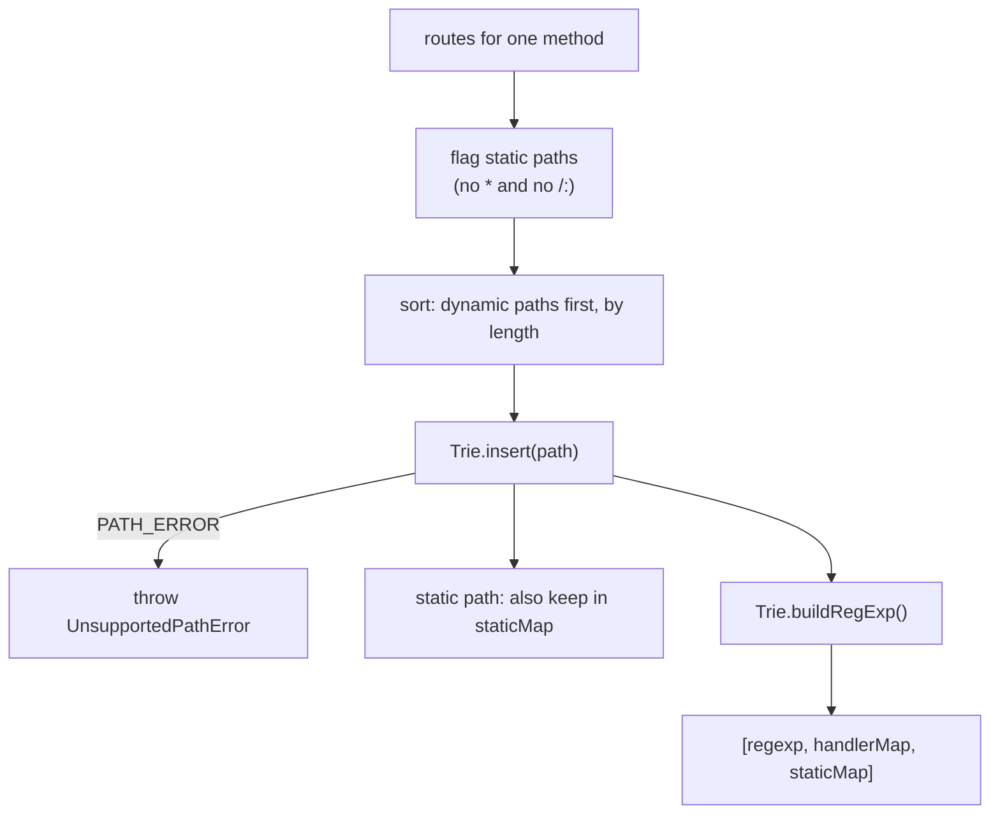

## Overview

The default `Hono` class runs a `SmartRouter` over two routers: `RegExpRouter`, which compiles all routes into one regular expression per method, and `TrieRouter`, a node tree that is walked segment by segment. The first is the fast one; the second accepts every route pattern the first refuses. This page shows how each builds and matches, using the `Router` contract from [[Router Interface and Selection]].

Sources: [src/hono.ts:26-33](repo://src/hono.ts#L26-L33), [src/router/reg-exp-router/router.ts:122-130](repo://src/router/reg-exp-router/router.ts#L122-L130), [src/router/trie-router/router.ts:5-28](repo://src/router/trie-router/router.ts#L5-L28)

## RegExpRouter: collecting routes

`add` does no matching work, it only sorts a route into two tables keyed by method then path: `#middleware` for paths ending in `*` and `#routes` for the rest. Each entry holds `[handler, paramCount]` pairs, where `paramCount` counts the `/:` segments in the path.

Sources: [src/router/reg-exp-router/router.ts:122-153](repo://src/router/reg-exp-router/router.ts#L122-L153)

The first time a method appears, its tables are seeded with copies of everything already registered under `ALL`, so method-specific tables always contain the shared middleware. A wildcard path (`/*` is normalised to `*`) is registered in the middleware table, inheriting the handlers of the closest matching wildcard first (longest key wins), and then pushed onto every existing path in both tables that its pattern covers. A plain path is registered in the routes table, starting from a copy of the middleware that already matches it and then adding the handler. This ordering is what yields the middleware-before-handler order in a match result. Optional-parameter paths are expanded through `checkOptionalParameter`, with `paramCount` adjusted for each variant.

Sources: [src/router/reg-exp-router/router.ts:19-28](repo://src/router/reg-exp-router/router.ts#L19-L28), [src/router/reg-exp-router/router.ts:105-120](repo://src/router/reg-exp-router/router.ts#L105-L120), [src/router/reg-exp-router/router.ts:140-203](repo://src/router/reg-exp-router/router.ts#L140-L203)

## RegExpRouter: building the matcher

### Per-method matchers

Matching is `match` from `matcher.ts`, assigned as a property. On its first call it calls `buildAllMatchers`, which builds a matcher per method with `#buildMatcher`, then drops the tables (`#middleware` and `#routes` become undefined) and clears the wildcard cache, which is why `add` afterwards throws `Can not add a route since the matcher is already built.`

Sources: [src/router/reg-exp-router/router.ts:206-222](repo://src/router/reg-exp-router/router.ts#L206-L222), [src/router/reg-exp-router/matcher.ts:10-33](repo://src/router/reg-exp-router/matcher.ts#L10-L33)

`#buildMatcher(method)` collects that method's middleware and route paths (falling back to the `ALL` entries when the method has none) and returns null when a method has no routes of its own. `buildMatcherFromPreprocessedRoutes` then turns the list into a `Matcher`, a triple of `[RegExp, handler data by capture index, static map]`.

Sources: [src/router/reg-exp-router/router.ts:224-251](repo://src/router/reg-exp-router/router.ts#L224-L251), [src/router/reg-exp-router/matcher.ts:1-8](repo://src/router/reg-exp-router/matcher.ts#L1-L8)

Sources: [src/router/reg-exp-router/router.ts:34-103](repo://src/router/reg-exp-router/router.ts#L34-L103)

Static paths (no `*` and no `/:`) are stored in `staticMap` with their handlers directly, so an exact path match never touches the regex. They are still inserted into the trie with `pathErrorCheckOnly` set, only so that conflicts are detected. Dynamic paths get an index `j` and their parameter names are mapped to capture-group positions (`paramIndexMap`) after the regex is built.

Sources: [src/router/reg-exp-router/router.ts:43-94](repo://src/router/reg-exp-router/router.ts#L43-L94)

### The trie that becomes a regex

`Trie.insert` replaces any `{...}` custom pattern with a mark, tokenises the path into `:label` parameters, a trailing `/*`, or single characters, puts the patterns back, and inserts the tokens into a `Node` tree, returning the list of `[paramName, varIndex]` pairs.

Sources: [src/router/reg-exp-router/trie.ts:10-47](repo://src/router/reg-exp-router/trie.ts#L10-L47)

`Node.insert` creates children by token. A parameter token is a child keyed by its regex (`[^/]+` by default) and gets a variable index; `*` as the last token becomes `.*` and `/*` becomes `(?:|/.*)`. A leaf stores the handler index and refuses a duplicate by throwing the `PATH_ERROR` symbol.

Sources: [src/router/reg-exp-router/node.ts:50-133](repo://src/router/reg-exp-router/node.ts#L50-L133)

`buildRegExpStr` emits children sorted by `compareKey`: literals first, then special patterns, then the common label, then wildcards. Siblings are joined as an alternation `(?:a|b)`, parameters become capture groups, and a leaf's `#index` prefixes its branch.

Sources: [src/router/reg-exp-router/node.ts:20-43](repo://src/router/reg-exp-router/node.ts#L20-L43), [src/router/reg-exp-router/node.ts:135-162](repo://src/router/reg-exp-router/node.ts#L135-L162)

`Trie.buildRegExp` then rewrites the placeholders: each leaf marker `#n` becomes an empty capture `$()` that records which handler list matched, each parameter marker `@n` is removed and its capture position recorded, and the result is anchored with `^`. If the trie is empty the result is `/^$/`, which never matches a real path.

Sources: [src/router/reg-exp-router/trie.ts:49-73](repo://src/router/reg-exp-router/trie.ts#L49-L73)

### When it gives up

The trie refuses patterns it cannot represent as a single regex. `Node.insert` throws `PATH_ERROR` for a duplicate leaf, for a parameter `{.*}` pattern, for a capture group in a custom pattern that is not non-capturing, and when a new parameter or literal branch would sit beside incompatible siblings. `buildMatcherFromPreprocessedRoutes` converts that into `UnsupportedPathError`, and `SmartRouter` moves on to `TrieRouter`.

Sources: [src/router/reg-exp-router/node.ts:50-133](repo://src/router/reg-exp-router/node.ts#L50-L133), [src/router/reg-exp-router/router.ts:61-65](repo://src/router/reg-exp-router/router.ts#L61-L65)

### Matching a path

The matcher picks the method's matcher (or `ALL`), returns the `staticMap` entry on an exact path hit, and otherwise runs the single regex. The index of the first empty capture (`match.indexOf('', 1)`) selects the handler list, and the full match array is the stash that `HonoRequest.param` reads (see [[Request and Body Parsing]]). No match gives `[[], emptyParam]`. After the first call `match` is replaced on the instance with the closure that skips `buildAllMatchers`.

Sources: [src/router/reg-exp-router/matcher.ts:10-33](repo://src/router/reg-exp-router/matcher.ts#L10-L33)

## PreparedRegExpRouter

`PreparedRegExpRouter` skips the build at runtime. `buildInitParams({ paths })` builds a `RegExpRouter` offline with every path, exports its matchers through a subclass that exposes `buildAllMatchers`, empties the handler lists, and records a `relocateMap` saying where each path's handlers belong. `serializeInitParams` stringifies the result, embedding the regular expressions as source. The runtime router takes those parameters, and its `add` looks each path up in the `relocateMap` to put handlers into the prepared lists, throwing `Path ... is not registered` for a path that was not in the build-time list.

Sources: [src/router/reg-exp-router/prepared-router.ts:9-93](repo://src/router/reg-exp-router/prepared-router.ts#L9-L93), [src/router/reg-exp-router/prepared-router.ts:95-165](repo://src/router/reg-exp-router/prepared-router.ts#L95-L165)

## TrieRouter

### Router and node tree

`TrieRouter.add` expands optional parameters and inserts each path into a `Node` tree; `match` calls `node.search`. The router returns the params-object `Result` shape, with no stash.

Sources: [src/router/trie-router/router.ts:5-28](repo://src/router/trie-router/router.ts#L5-L28)

### Inserting

`Node.insert` splits the path into segments (`splitRoutingPath`) and, for each, asks `getPattern` whether it is a parameter, a custom-regex parameter or a wildcard. A pattern segment is stored as a child under its pattern key and added to that node's `#patterns` list. Every handler is stored at its leaf with an incrementing `score`, which records registration order, and the list of parameter names that can apply (`possibleKeys`).

Sources: [src/router/trie-router/node.ts:25-85](repo://src/router/trie-router/node.ts#L25-L85)

### Searching

`search` walks the path one segment at a time, keeping a list of current nodes so several branches can be alive at once. For each node it checks the literal child, then every stored pattern: a `*` pattern pushes the wildcard child, a pattern with a custom regex is run against the rest of the path (so a parameter can span slashes), and any other parameter records `params[name] = part`. A `/hello/*` route also matches `/hello` itself, and the last segment pushes handlers right away rather than descending.

Sources: [src/router/trie-router/node.ts:114-233](repo://src/router/trie-router/node.ts#L114-L233)

Handlers collected from different branches are finally sorted by `score`, which restores registration order across branches, so middleware registered earlier still runs earlier. The result is `[[handler, params], ...]`.

Sources: [src/router/trie-router/node.ts:87-112](repo://src/router/trie-router/node.ts#L87-L112), [src/router/trie-router/node.ts:237-244](repo://src/router/trie-router/node.ts#L237-L244)
