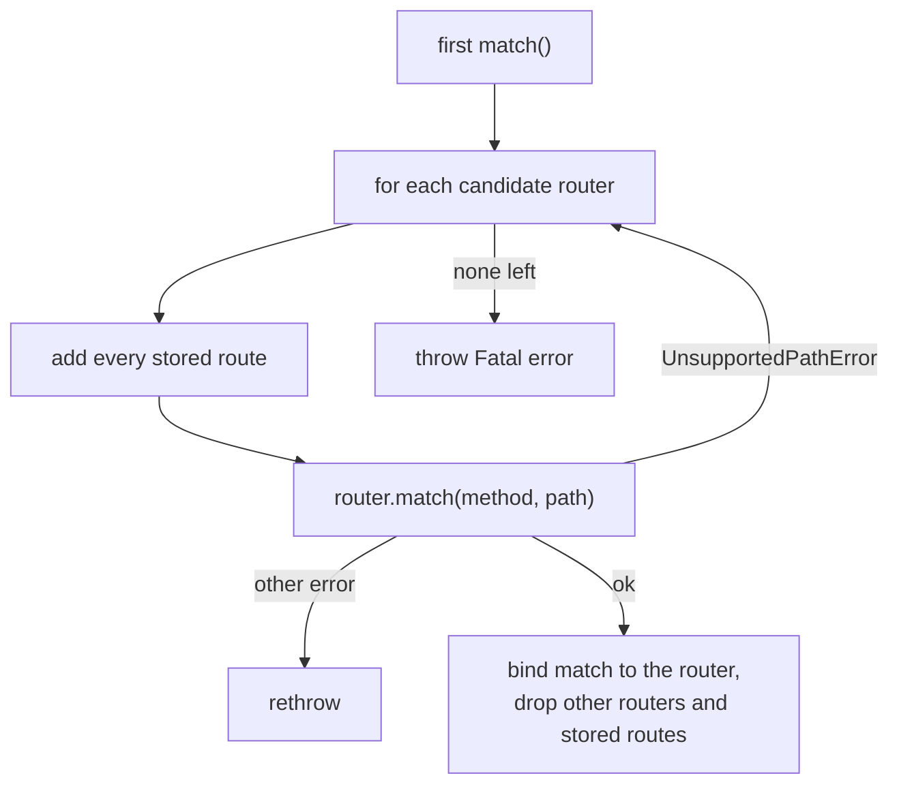

## Overview

Routing in Hono is pluggable. `HonoBase` only talks to a `Router<T>`, an object with `add(method, path, handler)` and `match(method, path)`, and the concrete router is picked by the class you import (`hono`, `hono/quick` or `hono/tiny`) or by the `router` option. This page covers the contract, `SmartRouter`, which chooses between routers at the first request, and the two small routers `LinearRouter` and `PatternRouter`. The two routers that the default app is built on are in [[RegExpRouter and TrieRouter]].

Sources: [src/router.ts:25-50](repo://src/router.ts#L25-L50), [src/hono-base.ts:55-65](repo://src/hono-base.ts#L55-L65)

## The Router contract

`Router<T>` has a `name`, `add` and `match`. `HonoBase` registers `[handler, routeInfo]` tuples as `T` (`#addRoute` calls `this.router.add(method, path, [handler, r])`), and the router hands those tuples back from `match`.

Sources: [src/router.ts:25-50](repo://src/router.ts#L25-L50), [src/hono-base.ts:385-397](repo://src/hono-base.ts#L385-L397)

A match returns `Result<T>`, in one of two shapes:

Sources: [src/router.ts:60-93](repo://src/router.ts#L60-L93)

| Shape | Meaning | Produced by |
| --- | --- | --- |
| `[[T, ParamIndexMap][], ParamStash]` | Each handler carries a map from parameter name to an index in a shared string array | RegExp-based routers |
| `[[T, Params][]]` | Each handler carries its own name-to-value object | `LinearRouter` and `PatternRouter` |

Sources: [src/router.ts:60-93](repo://src/router.ts#L60-L93)

Handlers come back in registration order, middleware (`*`) first, as in the example in the type's doc comment. `HonoRequest.param` handles both shapes (see [[Request and Body Parsing]]).

Sources: [src/router.ts:60-93](repo://src/router.ts#L60-L93), [src/request.ts:126-128](repo://src/request.ts#L126-L128)

`METHODS` lists `get`, `post`, `put`, `delete`, `options` and `patch`; `ALL` is the method name middleware and `app.all` register under. Two extra exports are shared by every router: `UnsupportedPathError`, which a router throws for a path pattern it cannot handle, and `MESSAGE_MATCHER_IS_ALREADY_BUILT`, the text used when a route is added after matching has started.

Sources: [src/router.ts:6-23](repo://src/router.ts#L6-L23), [src/router.ts:100-103](repo://src/router.ts#L100-L103)

## SmartRouter

`SmartRouter` takes a list of candidate routers and, on the first `match`, finds one that can handle every registered route. Until then `add` only stores `[method, path, handler]` in a `#routes` array; adding after selection throws `Can not add a route since the matcher is already built.`

Sources: [src/router/smart-router/router.ts:4-22](repo://src/router/smart-router/router.ts#L4-L22)

Sources: [src/router/smart-router/router.ts:24-62](repo://src/router/smart-router/router.ts#L24-L62)

For each candidate the code adds all stored routes and runs the match. An `UnsupportedPathError` thrown from either step skips to the next candidate; any other error propagates. On success, `match` is replaced on the instance with the winner's bound `match`, `#routers` becomes just that router, and `#routes` is cleared, so later requests call the winner directly without any `SmartRouter` overhead. The name becomes `SmartRouter + <router name>`, and `activeRouter` exposes the winner (it throws if called before a router has been chosen).

Sources: [src/router/smart-router/router.ts:24-70](repo://src/router/smart-router/router.ts#L24-L70)

The consequence is that the order of the list matters: the preferred, faster router goes first, and a slower but more general one goes last as the fallback. Route registration has to be finished before the first request.

Sources: [src/hono.ts:26-33](repo://src/hono.ts#L26-L33), [src/router/smart-router/router.ts:24-62](repo://src/router/smart-router/router.ts#L24-L62)

## Which router each preset uses

| Import | Router | Candidate order |
| --- | --- | --- |
| `hono` | `SmartRouter` | `RegExpRouter`, then `TrieRouter` |
| `hono/quick` | `SmartRouter` | `LinearRouter`, then `TrieRouter` |
| `hono/tiny` | `PatternRouter` | none, no fallback |

Sources: [src/hono.ts:26-33](repo://src/hono.ts#L26-L33), [src/preset/quick.ts:12-20](repo://src/preset/quick.ts#L12-L20), [src/preset/tiny.ts:9-20](repo://src/preset/tiny.ts#L9-L20)

The `hono/quick` preset's module comment says it uses `LinearRouter`, and `hono/tiny` says it uses `PatternRouter`. `hono/tiny` has no fallback, so a path `PatternRouter` cannot compile fails with `UnsupportedPathError` instead of moving on to another router.

Sources: [src/hono.ts:26-33](repo://src/hono.ts#L26-L33), [src/preset/quick.ts:1-20](repo://src/preset/quick.ts#L1-L20), [src/preset/tiny.ts:1-20](repo://src/preset/tiny.ts#L1-L20)

## LinearRouter

`LinearRouter` keeps a flat list of `[method, path, handler]` and, for each `match`, loops through it in order. Optional-parameter paths such as `/animals/:type?` are expanded by `checkOptionalParameter` into two entries on `add`. A route whose method equals the request method or is `ALL` is then tested by shape:

Sources: [src/router/linear-router/router.ts:15-30](repo://src/router/linear-router/router.ts#L15-L30)

| Route shape | Test |
| --- | --- |
| `*` or `/*` | always matches, with empty params |
| no star, no label | exact string equality with the path, or the path with one trailing slash |
| star, no label | split by `*`, each part must appear in order, each at the position reached so far, with the final part anchored unless the route ends in `*` |
| label, no star | split into `/:label` and static parts; a label takes the text to the next `/`, a `:label{regex}` runs the regex against the rest (with a lookahead for the next static part) |
| label and star | throws `UnsupportedPathError` |

Sources: [src/router/linear-router/router.ts:9-23](repo://src/router/linear-router/router.ts#L9-L23), [src/router/linear-router/router.ts:25-143](repo://src/router/linear-router/router.ts#L25-L143)

Mixing a `:label` and a `*` in one path is the case that makes it throw, which is why `hono/quick` follows it with `TrieRouter`. Because it never builds a matcher in advance, routes can be added at any time, and the cost is that every match scans every route.

Sources: [src/router/linear-router/router.ts:136-138](repo://src/router/linear-router/router.ts#L136-L138), [src/preset/quick.ts:12-20](repo://src/preset/quick.ts#L12-L20)

## PatternRouter

`PatternRouter` compiles each route into one regular expression on `add`. A trailing `*` is cut off and makes the pattern open-ended; a trailing `?` is removed and the route is also added without its last segment; a `:name` segment becomes a named group `(?<name>[^/]+)` (or the custom `{pattern}`); a `/*` segment in the middle becomes `/[^/]+`; other segments have regex characters escaped. Without a trailing wildcard the pattern ends with `/?$`, so a trailing slash is accepted. A pattern that fails to compile throws `UnsupportedPathError`.

Sources: [src/router/pattern-router/router.ts:12-42](repo://src/router/pattern-router/router.ts#L12-L42)

`match` loops over all stored patterns, executes each one whose method is the request method or `ALL`, and uses `match.groups` as the params object. Like `LinearRouter` it returns the second `Result` shape, and it is a linear scan that makes no use of a stash.

Sources: [src/router/pattern-router/router.ts:44-60](repo://src/router/pattern-router/router.ts#L44-L60)
