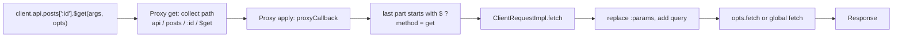

## Overview

`hc` builds a client whose method calls mirror an app's routes, with request and response types inferred from the handlers: `hc<typeof app>('http://localhost')` and then `client.posts[':id'].$get({ param: { id: '1' } })`. There is no code generation. At runtime a `Proxy` records the property path and, when it is called, turns that path into a URL and a `fetch`. The types come from a `Schema` that each registered route adds to the app's type. Route registration itself is covered in [[Application and Request Dispatch]], and the validators that contribute `input` types in [[Validation]].

Sources: [src/client/client.ts:15-31](repo://src/client/client.ts#L15-L31), [src/client/client.ts:133-137](repo://src/client/client.ts#L133-L137), [src/client/index.ts:6-17](repo://src/client/index.ts#L6-L17)

Sources: [src/client/client.ts:15-31](repo://src/client/client.ts#L15-L31), [src/client/client.ts:137-232](repo://src/client/client.ts#L137-L232), [src/client/client.ts:53-129](repo://src/client/client.ts#L53-L129)

## The path-collecting Proxy

`createProxy(callback, path)` returns a function-target `Proxy`. Reading any string property other than `then` returns a new proxy with that key appended to the path, which is why `await client` does not mistake the proxy for a thenable. Calling the proxy runs the callback with the collected `path` and the call's `args`.

Sources: [src/client/client.ts:15-31](repo://src/client/client.ts#L15-L31)

`hc`'s callback then interprets the path. A trailing `toString` or `valueOf` (optionally after `name`) is answered directly so the proxy can be printed. If the last part starts with `$`, it is removed and becomes the HTTP method (`$get` is `get`); the other parts are joined with `/` and merged onto `baseUrl` with `mergePath`, which makes sure exactly one slash separates them.

Sources: [src/client/client.ts:137-170](repo://src/client/client.ts#L137-L170), [src/client/utils.ts:11-16](repo://src/client/utils.ts#L11-L16)

## What a call does

Special `$` names do not issue requests:

Sources: [src/client/client.ts:171-212](repo://src/client/client.ts#L171-L212)

| Call | Result |
| --- | --- |
| `$url(args?)` | A `URL`, with `:param` segments replaced and the query appended |
| `$path(args?)` | The same without the origin, as a string starting with `/` |
| `$ws(args?)` | A `WebSocket` for the URL with its protocol changed from `http` to `ws`; query values are added to the URL, and `options.webSocket` can supply the constructor |

Sources: [src/client/client.ts:171-212](repo://src/client/client.ts#L171-L212), [src/client/utils.ts:46-53](repo://src/client/utils.ts#L46-L53)

Any other method name creates a `ClientRequestImpl` and calls `fetch` with the first argument as the request description and the merged options as the second. Headers from `hc`'s options and from the call are combined, with the per-call ones winning, and the rest of the options are combined with `deepMerge`.

Sources: [src/client/client.ts:214-232](repo://src/client/client.ts#L214-L232), [src/client/utils.ts:62-82](repo://src/client/utils.ts#L62-L82)

`ClientRequestImpl.fetch` turns the argument object into a request, matching the validation targets used on the server:

Sources: [src/client/client.ts:53-108](repo://src/client/client.ts#L53-L108)

| Argument | Effect |
| --- | --- |
| `query` | Becomes a `URLSearchParams` through `buildSearchParams` (arrays become repeated keys; undefined values are skipped) or the custom `buildSearchParams` option |
| `form` | A `FormData` body; array values are appended one by one |
| `json` | A JSON string body with `Content-Type: application/json` |
| `param` | Replaces `:name` segments (including `{regex}` and optional `?` forms) in the URL |
| `header` | Added to the request headers, merged with the `headers` option, which may be an object or a function, sync or async |
| `cookie` | Serialised into a `Cookie` header |

Sources: [src/client/client.ts:53-108](repo://src/client/client.ts#L53-L108), [src/client/utils.ts:18-44](repo://src/client/utils.ts#L18-L44)

Finally the URL is cleaned (`removeIndexString` drops a trailing `/index`), the query string is appended, and `(opt?.fetch || fetch)(url, { body, method, headers, ...opt?.init })` is called. The body is sent only for methods other than `GET` and `HEAD`. Since `init` is spread last, the option comment warns that it takes the highest priority and can overwrite the method, body and headers. The `fetch` option can be `app.request`, which is how [[Helpers Catalogue]]'s `testClient` runs against an in-process app.

Sources: [src/client/client.ts:110-129](repo://src/client/client.ts#L110-L129), [src/client/types.ts:28-41](repo://src/client/types.ts#L28-L41), [src/helper/testing/index.ts:16-27](repo://src/helper/testing/index.ts#L16-L27)

## Where the types come from

Each route registration adds an entry to the app's `Schema` type, and `Hono` carries it as its second type parameter. `ToSchema<Method, Path, Input, Response>` produces `{ [path]: { $method: { input, output, outputFormat, status } } }`; an `any` response gives a generic `{}` output, and a handler that returns nothing adds no entry. `input` is the validator input plus `param` keys extracted from the path.

Sources: [src/types.ts:2500-2530](repo://src/types.ts#L2500-L2530), [src/types.ts:2531-2561](repo://src/types.ts#L2531-L2561)

Grouping preserves the types. `route(path, subApp)` returns an app typed with `MergeSchemaPath<SubSchema, MergePath<BasePath, SubPath>>`, which prefixes every path key and merges path parameters found in the prefix into each endpoint's `param` input.

Sources: [src/hono-base.ts:208-217](repo://src/hono-base.ts#L208-L217), [src/types.ts:2563-2608](repo://src/types.ts#L2563-L2608)

On the client side, `Client<T, Prefix>` reads the schema out of `HonoBase`, and `PathToChain` splits each path key into nested properties. `ClientRequest` then maps each `$method` to a function. Arguments are required when the input has required keys (for example a validated `json` body or a path `param`) and optional otherwise; `$all` expands to every standard method. The result type is `ClientResponse<Output, Status, Format>`, a `Response` look-alike whose `json()` is typed from the handler's output and whose `ok` narrows with the status.

Sources: [src/client/types.ts:67-80](repo://src/client/types.ts#L67-L80), [src/client/types.ts:120-154](repo://src/client/types.ts#L120-L154), [src/client/types.ts:294-319](repo://src/client/types.ts#L294-L319)

`$url` and `$path` have literal-aware types: when the `hc` base URL is a literal string, `HonoURL` builds a `TypedURL` with protocol, host, port and `pathname` as string literals.

Sources: [src/client/types.ts:156-215](repo://src/client/types.ts#L156-L215)

## Helper types and response parsing

`InferRequestType<typeof client.x.$post>` and `InferResponseType<typeof client.x.$get, 200>` extract the argument and the output of one endpoint, the latter optionally filtered by status code. `FilterClientResponseByStatusCode` does the filtering on the response union, `ApplyGlobalResponse` adds a set of responses to every route of an app type, and `PickResponseByStatusCode` keeps only the responses with a given status, which its comment suggests when errors are handled centrally in a custom fetch.

Sources: [src/client/types.ts:245-290](repo://src/client/types.ts#L245-L290), [src/client/types.ts:352-393](repo://src/client/types.ts#L352-L393)

`parseResponse(fetchResponse)` is a shortcut for reading the body. It uses `fetchRP`: the body is read as JSON when the content type matches a JSON pattern and as text otherwise (nothing for status 101, 204, 205 and 304), and a non-`ok` response throws a `DetailedError` carrying `statusCode` and `detail: { data, statusText }`. The return type is derived from the non-error status responses.

Sources: [src/client/utils.ts:84-114](repo://src/client/utils.ts#L84-L114), [src/client/fetch-result-please.ts:7-95](repo://src/client/fetch-result-please.ts#L7-L95)
