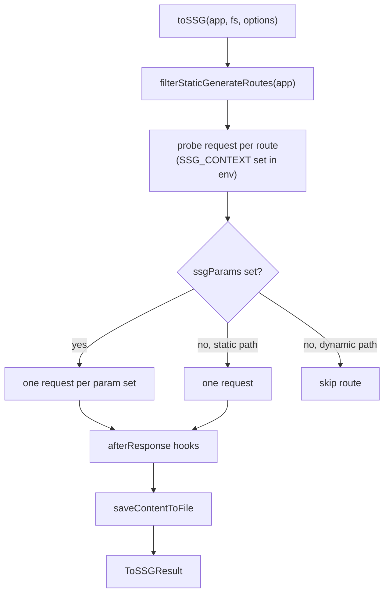

## Overview

`toSSG(app, fs, options)` turns a Hono app into files. It does not render anything itself: it lists the app's GET routes, requests each one through the app in memory, and writes the responses into an output directory. The file system is abstracted behind `FileSystemModule`, so a runtime adapter only has to supply `writeFile` and `mkdir`. Everything in this feature is marked experimental in the source.

Sources: [src/helper/ssg/ssg.ts:29-48](repo://src/helper/ssg/ssg.ts#L29-L48), [src/helper/ssg/ssg.ts:363-372](repo://src/helper/ssg/ssg.ts#L363-L372)



Sources: [src/helper/ssg/ssg.ts:205-302](repo://src/helper/ssg/ssg.ts#L205-L302), [src/helper/ssg/ssg.ts:368-470](repo://src/helper/ssg/ssg.ts#L368-L470)

## Collecting routes

`filterStaticGenerateRoutes(app)` walks `app.routes` and keeps routes whose method is `GET` or `ALL` and whose final handler is not middleware (`findTargetHandler` unwraps composed handlers). `isDynamicRoute(path)` is true when any segment starts with `:` or contains `*`; such routes can only be generated when parameters are provided.

Sources: [src/helper/ssg/utils.ts:57-75](repo://src/helper/ssg/utils.ts#L57-L75)

## Requesting each route

`fetchRoutesContent` is a generator yielding one promise per route. For a route it first sends a probe request to `http://localhost<path>` via `app.fetch`, with an environment object `{ [SSG_CONTEXT]: true }` that tells the app it is being generated (see below). A probe may carry `ssgParams` set by the `ssgParams` middleware. If it did not, a dynamic route is skipped, and a static route is generated once with an empty parameter set. For every parameter set, `replaceUrlParam(route.path, param)` produces a concrete path, which is requested with `app.request`. Both kinds of request run through a pool limited by `concurrency` (default 2).

Sources: [src/helper/ssg/ssg.ts:17](repo://src/helper/ssg/ssg.ts#L17), [src/helper/ssg/ssg.ts:222-268](repo://src/helper/ssg/ssg.ts#L222-L268)

A response carrying the `x-hono-disable-ssg` header, or one rejected by an after-response hook, produces no file. Otherwise the response's media type (falling back to `text/plain`) and its body are returned, read as text for `text` and `json` content types and as an `ArrayBuffer` for others.

Sources: [src/helper/ssg/ssg.ts:19-25](repo://src/helper/ssg/ssg.ts#L19-L25), [src/helper/ssg/ssg.ts:270-293](repo://src/helper/ssg/ssg.ts#L270-L293), [src/helper/ssg/ssg.ts:74-88](repo://src/helper/ssg/ssg.ts#L74-L88)

## Middleware for SSG

`ssgParams(params)` is middleware on a dynamic route. It accepts an array of parameter objects or a function of the context. During the probe request, it stores the result on the raw request as `ssgParams` and returns `c.notFound()` so the real handler does not run. For a request to a non-dynamic path, it just calls `next()`.

Sources: [src/helper/ssg/middleware.ts:24-49](repo://src/helper/ssg/middleware.ts#L24-L49)

```ts
app.get('/post/:id', ssgParams([{ id: '1' }, { id: '2' }]), (c) => c.html('...'))
```

Sources: [src/helper/ssg/middleware.ts:29-49](repo://src/helper/ssg/middleware.ts#L29-L49)

`isSSGContext(c)` reads the flag from `c.env`. `disableSSG()` makes a route return a not-found with the disable header during generation (so it is skipped), and `onlySSG()` does the reverse: outside generation it returns not-found.

Sources: [src/helper/ssg/middleware.ts:5-6](repo://src/helper/ssg/middleware.ts#L5-L6), [src/helper/ssg/middleware.ts:56-83](repo://src/helper/ssg/middleware.ts#L56-L83)

## Hooks and plugins

An `SSGPlugin` can provide `beforeRequestHook`, `afterResponseHook` and `afterGenerateHook`, each a function or an array. The first two can return `false` to skip the route (or replace the request or response). The same three hooks are accepted directly in the options but are marked deprecated in favour of plugins. `toSSG` collects the options' hooks first and the plugins' hooks after them, and chains each kind with `combine...Hooks`, which passes the output of one hook to the next and stops at `false`. With no plugins given, `defaultPlugin()` is used.

Sources: [src/helper/ssg/ssg.ts:110-198](repo://src/helper/ssg/ssg.ts#L110-L198), [src/helper/ssg/ssg.ts:368-429](repo://src/helper/ssg/ssg.ts#L368-L429)

`defaultPlugin` drops every response whose status is not 200. `redirectPlugin` converts 301, 302, 303, 307 and 308 responses into a 200 HTML page with a meta refresh, canonical link and `noindex`, and skips redirects with no `Location`. The plugin's comment says it must come before `defaultPlugin` in the list, because `defaultPlugin` would otherwise discard the redirect first.

Sources: [src/helper/ssg/plugins.ts:11-20](repo://src/helper/ssg/plugins.ts#L11-L20), [src/helper/ssg/plugins.ts:22-72](repo://src/helper/ssg/plugins.ts#L22-L72)

## Writing files

`saveContentToFile` picks the path with `generateFilePath` and creates each directory once. `/` becomes `index.<ext>`, a path ending in `/` becomes `<path>/index.<ext>`, a path that already ends in the extension is used as is, and anything else gets `.<ext>` appended. The extension comes from `extensionMap` (default `text/html` to `html`, XML types to `xml`, `application/yaml` to `yaml`) and otherwise from the MIME table, falling back to `html`. String content is written as text and `ArrayBuffer` content as bytes.

Sources: [src/helper/ssg/ssg.ts:50-72](repo://src/helper/ssg/ssg.ts#L50-L72), [src/helper/ssg/ssg.ts:90-108](repo://src/helper/ssg/ssg.ts#L90-L108), [src/helper/ssg/ssg.ts:309-334](repo://src/helper/ssg/ssg.ts#L309-L334)

> [!WARNING]
> Every output path goes through `ensureWithinOutDir`, which normalises both paths and throws `Path traversal detected` if the file would land outside the output directory (default `./static`).

Sources: [src/helper/ssg/utils.ts:77-87](repo://src/helper/ssg/utils.ts#L77-L87), [src/helper/ssg/ssg.ts:27](repo://src/helper/ssg/ssg.ts#L27)

## Result and failure

`toSSG` waits for all probes and all saves. If a save failed, the first error is thrown inside a `try`, and the function returns `{ success: false, files: [], error }`; otherwise `{ success: true, files }` lists the written paths. The after-generate hooks then run with the result either way.

Sources: [src/helper/ssg/ssg.ts:420-470](repo://src/helper/ssg/ssg.ts#L420-L470)

## Runtime file systems

The generic function takes the file system as an argument; adapters bind it. Bun's `toSSG(app, options)` uses `Bun.write` and a no-op `mkdir`, and Deno's uses `Deno.writeFile` (encoding strings to bytes) and `Deno.mkdir`. See [[Runtime Adapters]] for the rest of the adapter surface.

Sources: [src/adapter/bun/ssg.ts:1-27](repo://src/adapter/bun/ssg.ts#L1-L27), [src/adapter/deno/ssg.ts:1-27](repo://src/adapter/deno/ssg.ts#L1-L27)
