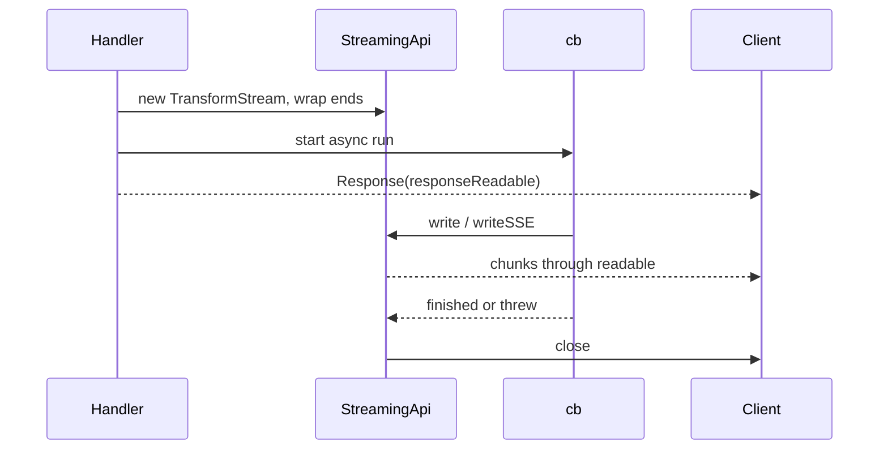

## Overview

The streaming helpers return a `Response` right away and keep writing to its body after the handler has returned. `stream`, `streamText` and `streamSSE` all build the same pipeline: a `TransformStream` whose writable end your callback writes to, and whose readable end becomes the response body through `c.newResponse`. They differ in the headers they set and in how they format data. The response-building methods they use are in [[Context and Responses]].

Sources: [src/helper/streaming/stream.ts:7-45](repo://src/helper/streaming/stream.ts#L7-L45), [src/helper/streaming/sse.ts:72-100](repo://src/helper/streaming/sse.ts#L72-L100), [src/helper/streaming/text.ts:6-15](repo://src/helper/streaming/text.ts#L6-L15)

| Helper | Headers it sets | Callback receives |
| --- | --- | --- |
| `stream(c, cb, onError)` | none | `StreamingApi` |
| `streamText(c, cb, onError)` | `Content-Type: text/plain; charset=UTF-8`, `X-Content-Type-Options: nosniff`, `Transfer-Encoding: chunked` | `StreamingApi` |
| `streamSSE(c, cb, onError)` | `Transfer-Encoding: chunked`, `Content-Type: text/event-stream`, `Cache-Control: no-cache`, `Connection: keep-alive` | `SSEStreamingApi` |

Sources: [src/helper/streaming/text.ts:11-14](repo://src/helper/streaming/text.ts#L11-L14), [src/helper/streaming/sse.ts:92-95](repo://src/helper/streaming/sse.ts#L92-L95), [src/context.ts:279](repo://src/context.ts#L279)

## How a stream is wired

`stream` creates `new TransformStream()` and wraps both ends in a `StreamingApi`. It then starts an immediately-invoked async function that awaits your callback and returns `c.newResponse(stream.responseReadable)` without waiting for it, so the response with its headers is sent while the callback is still running.

Sources: [src/helper/streaming/stream.ts:12-13](repo://src/helper/streaming/stream.ts#L12-L13), [src/helper/streaming/stream.ts:26-44](repo://src/helper/streaming/stream.ts#L26-L44)



Sources: [src/helper/streaming/stream.ts:7-45](repo://src/helper/streaming/stream.ts#L7-L45), [src/utils/stream.ts:21-58](repo://src/utils/stream.ts#L21-L58)

Two details protect the response from runtime quirks. The context is stored in a `WeakMap` keyed by the readable, because in Bun the context is destroyed when the request returns and has to be kept until streaming ends. And for Bun up to v1.1.x, which did not call `cancel()` on the response stream, the helper listens to the request signal's `abort` event and aborts the stream itself; `isOldBunVersion` checks the version once and caches the answer.

Sources: [src/helper/streaming/stream.ts:15-25](repo://src/helper/streaming/stream.ts#L15-L25), [src/helper/streaming/utils.ts:1-11](repo://src/helper/streaming/utils.ts#L1-L11)

## The StreamingApi object

`StreamingApi` in `src/utils/stream.ts` is what your callback gets. Its `responseReadable` pulls from the transform's readable side: each `pull` reads one chunk and enqueues it, closing when the source is done.

Sources: [src/utils/stream.ts:6-46](repo://src/utils/stream.ts#L6-L46)

| Member | Behaviour |
| --- | --- |
| `write(input)` | Encodes strings as UTF-8 and writes; write errors are swallowed, with a comment suggesting creating the stream yourself to handle them |
| `writeln(input)` | `write(input + '\n')` |
| `sleep(ms)` | Promise that resolves after a timer |
| `pipe(body)` | Releases the writer, pipes a `ReadableStream` into the writable without closing it, then reacquires the writer |
| `close()` | Sets `closed` and closes the writer, ignoring errors |
| `onAbort(listener)` | Registers a callback for aborts |
| `abort()` | On first call sets `aborted` and runs every registered listener |

Sources: [src/utils/stream.ts:48-98](repo://src/utils/stream.ts#L48-L98)

## Abort and error handling

When the client disconnects, the response stream's `cancel` handler calls `abort()` if the stream is not already closed. The constructor registers a first abort listener that cancels the reader, which, per its comment, lets `responseReadable` close so that pending writes do not block forever. Application cleanup can be added with `stream.onAbort(...)`; check `stream.aborted` in a loop to stop producing data.

Sources: [src/utils/stream.ts:26-45](repo://src/utils/stream.ts#L26-L45), [src/utils/stream.ts:84-97](repo://src/utils/stream.ts#L84-L97)

The callback's failure path in `stream` has three cases. An `undefined` rejection (reading cancelled without a reason, for instance by the abort handling above) is ignored because the stream is already closed. An `Error` goes to `onError(e, stream)` when one was given. Anything else is logged with `console.error`. In every case `finally` calls `stream.close()`.

Sources: [src/helper/streaming/stream.ts:26-42](repo://src/helper/streaming/stream.ts#L26-L42)

For SSE the `run` function behaves similarly, with one addition: after your `onError` callback, it also writes an SSE message with `event: 'error'` and the error's message as `data`, so the browser's event stream sees the failure. Without an `onError`, or for non-`Error` values, it only logs.

Sources: [src/helper/streaming/sse.ts:47-68](repo://src/helper/streaming/sse.ts#L47-L68)

## SSE message format

`SSEStreamingApi` extends `StreamingApi` with `writeSSE({ data, event, id, retry })`. `data` may be a promise or a JSX string, and is first resolved with `resolveCallback`. It is split on any line ending into one `data:` line per line. `event`, `id` and `retry` must not contain `\r` or `\n`, otherwise the call throws. The frame is the `event:` line, the data lines, the `id:` line and the `retry:` line, in that order, joined with newlines and followed by a blank line, and then written with `write`.

Sources: [src/helper/streaming/sse.ts:6-45](repo://src/helper/streaming/sse.ts#L6-L45)

```ts
app.get('/sse', (c) =>
  streamSSE(c, async (stream) => {
    await stream.writeSSE({ event: 'tick', data: 'hello', id: '1' })
  })
)
```

Sources: [src/helper/streaming/sse.ts:6-45](repo://src/helper/streaming/sse.ts#L6-L45), [src/helper/streaming/sse.ts:72-100](repo://src/helper/streaming/sse.ts#L72-L100)
