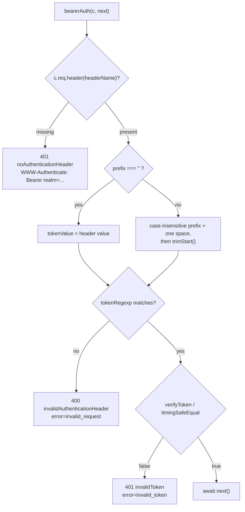
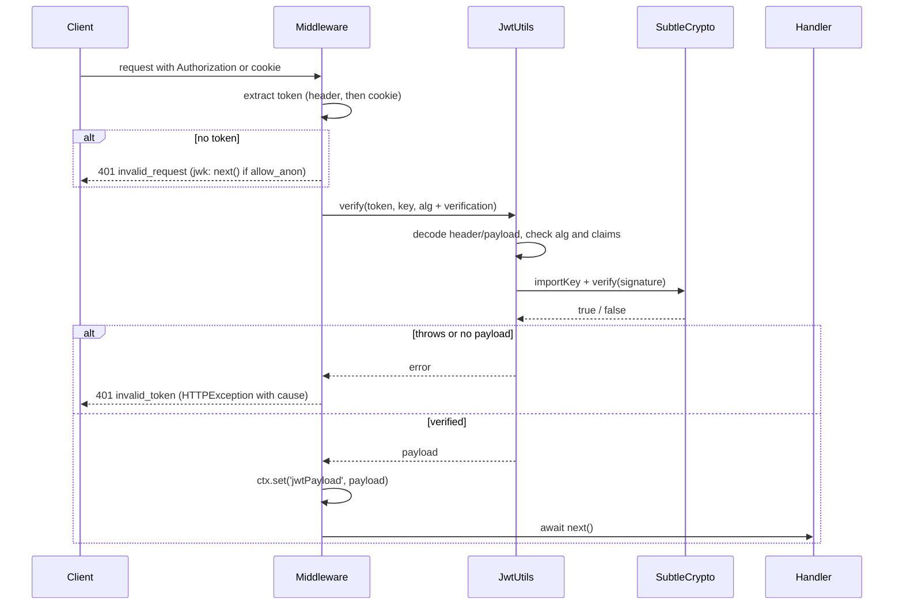

## Overview

Hono ships four authentication middleware that guard routes before a handler runs: `basicAuth` checks HTTP Basic credentials, `bearerAuth` checks an opaque bearer token, `jwt` verifies a JSON Web Token signed with a known secret or key, and `jwk` verifies a JWT against a set of public JSON Web Keys, optionally fetched from a JWKS endpoint. Each is a factory that validates its options once and returns a `MiddlewareHandler`. On success the handler calls `next()`; on failure it throws an `HTTPException` that carries a ready-made `401` (or `400`) response with a `WWW-Authenticate` header, so the app's error handling can return it unchanged.

Sources: [src/middleware/basic-auth/index.ts:80-153](repo://src/middleware/basic-auth/index.ts#L80-L153), [src/middleware/bearer-auth/index.ts:104-121](repo://src/middleware/bearer-auth/index.ts#L104-L121), [src/middleware/jwt/jwt.ts:53-76](repo://src/middleware/jwt/jwt.ts#L53-L76), [src/middleware/jwk/jwk.ts:48-75](repo://src/middleware/jwk/jwk.ts#L48-L75)

The `jwt` and `jwk` middleware are thin wrappers over the JWT utilities in `src/utils/jwt`: `sign`, `verify`, `decode` and `verifyWithJwks`, built on the Web Crypto API (`crypto.subtle`) so they run unchanged on every runtime Hono supports. Those utilities are re-exported from `hono/jwt` and also exposed as `hono/utils/jwt`. Middleware ordering and how a thrown exception becomes a response are covered in [[Middleware and Composition]] and [[Error Handling]].

Sources: [src/utils/jwt/index.ts:1-7](repo://src/utils/jwt/index.ts#L1-L7), [src/middleware/jwt/jwt.ts:175-178](repo://src/middleware/jwt/jwt.ts#L175-L178), [src/middleware/jwt/index.ts:1-9](repo://src/middleware/jwt/index.ts#L1-L9), [jsr.json:16-17](repo://jsr.json#L16-L17), [jsr.json:43-44](repo://jsr.json#L43-L44), [jsr.json:95-100](repo://jsr.json#L95-L100)

| Middleware | Import | Credential source | Verifies with | On success |
| --- | --- | --- | --- | --- |
| `basicAuth` | `hono/basic-auth` | `Authorization: Basic …` | static user list or `verifyUser` | `onAuthSuccess`, then `next()` |
| `bearerAuth` | `hono/bearer-auth` | `Authorization: Bearer …` (configurable header and prefix) | `token` string/array or `verifyToken` | `next()` |
| `jwt` | `hono/jwt` | `Authorization: Bearer …` or a cookie | `Jwt.verify` with `secret` + `alg` | `c.set('jwtPayload', payload)`, then `next()` |
| `jwk` | `hono/jwk` | `Authorization: Bearer …` or a cookie | `Jwt.verifyWithJwks` with `keys` / `jwks_uri` | `c.set('jwtPayload', payload)`, then `next()` |

Sources: [jsr.json:16-17](repo://jsr.json#L16-L17), [jsr.json:43-44](repo://jsr.json#L43-L44), [src/middleware/basic-auth/index.ts:105-131](repo://src/middleware/basic-auth/index.ts#L105-L131), [src/middleware/bearer-auth/index.ts:156-220](repo://src/middleware/bearer-auth/index.ts#L156-L220), [src/middleware/jwt/jwt.ts:76-157](repo://src/middleware/jwt/jwt.ts#L76-L157), [src/middleware/jwk/jwk.ts:75-167](repo://src/middleware/jwk/jwk.ts#L75-L167)

## Basic Auth

### basicAuth options

`basicAuth` accepts one of two option shapes: a fixed `username` and `password`, or a `verifyUser` callback. Passing neither throws `Error('basic auth middleware requires options for "username and password" or "verifyUser"')` when the middleware is created, not per request. Extra users can be passed as further arguments after the options object; when `username`/`password` are in the options they are put first in that list with `users.unshift`.

Sources: [src/middleware/basic-auth/index.ts:14-29](repo://src/middleware/basic-auth/index.ts#L14-L29), [src/middleware/basic-auth/index.ts:80-103](repo://src/middleware/basic-auth/index.ts#L80-L103)

| Option | Type | Default | Description |
| --- | --- | --- | --- |
| `username` | `string` | required with `password` | Expected user name. |
| `password` | `string` | required with `username` | Expected password. |
| `verifyUser` | `(username, password, c) => boolean \| Promise<boolean>` | none | Custom check; replaces the static comparison entirely. |
| `realm` | `string` | `'Secure Area'` | Realm in the `WWW-Authenticate` challenge; `"` is escaped as `\"`. |
| `hashFunction` | `Function` | `sha256` | Hash used by `timingSafeEqual` before comparing. |
| `invalidUserMessage` | `string \| object \| MessageFunction` | `'Unauthorized'` | Body of the 401 response; an object is sent as JSON. |
| `onAuthSuccess` | `(c, username) => void \| Promise<void>` | none | Runs after a successful check and before `next()`, e.g. to `c.set` the user. |

Sources: [src/middleware/basic-auth/index.ts:12-45](repo://src/middleware/basic-auth/index.ts#L12-L45), [src/middleware/basic-auth/index.ts:93-99](repo://src/middleware/basic-auth/index.ts#L93-L99), [src/utils/buffer.ts:44-63](repo://src/utils/buffer.ts#L44-L63)

```ts
import { Hono } from 'hono'
import { basicAuth } from 'hono/basic-auth'

const app = new Hono()

app.use(
  '/auth/*',
  basicAuth(
    {
      username: 'hono',
      password: 'ahotproject',
      onAuthSuccess: (c, username) => {
        c.set('user', { name: username, role: 'admin' })
      },
    },
    { username: 'second', password: 'another-secret' }
  )
)
```

Sources: [src/middleware/basic-auth/index.ts:47-83](repo://src/middleware/basic-auth/index.ts#L47-L83)

### Credential parsing and comparison

Per request, `auth(ctx.req.raw)` parses the header. `CREDENTIALS_REGEXP` accepts the scheme `Basic` in any letter case surrounded by optional spaces, then base64 characters; the decoded bytes are read as UTF-8 and split on the first `:` by `USER_PASS_REGEXP`, so a password may itself contain colons. Invalid base64 makes `atob` throw a `DOMException`, which is swallowed so the request is simply treated as unauthenticated.

Sources: [src/utils/basic-auth.ts:1-26](repo://src/utils/basic-auth.ts#L1-L26), [src/middleware/basic-auth/index.ts:105-107](repo://src/middleware/basic-auth/index.ts#L105-L107)

With `verifyUser`, the parsed username and password are handed to the callback. Otherwise every configured user is tried in order, comparing username and password in parallel with `timingSafeEqual`. That function hashes both strings (with `hashFunction`, default `sha256`) and then compares both the hashes and the original strings with `constantTimeEqualString`, which XORs every character up to the longer length, so the comparison time does not reveal how many leading characters matched.

Sources: [src/middleware/basic-auth/index.ts:108-131](repo://src/middleware/basic-auth/index.ts#L108-L131), [src/utils/buffer.ts:29-63](repo://src/utils/buffer.ts#L29-L63), [src/utils/buffer.ts:76-83](repo://src/utils/buffer.ts#L76-L83)

### Basic Auth failure response

Any failure (missing header, unparsable credentials, no matching user, or `verifyUser` returning false) reaches one path: status `401`, header `WWW-Authenticate: Basic realm="<realm>"`, and a body from `invalidUserMessage`. A function message is awaited with the context; a string becomes a plain-text body; anything else is `JSON.stringify`-ed with `content-type: application/json`. The response is thrown as `new HTTPException(401, { res })`.

Sources: [src/middleware/basic-auth/index.ts:132-152](repo://src/middleware/basic-auth/index.ts#L132-L152)

## Bearer Auth

### bearerAuth options

`bearerAuth` requires either `token` (a string or an array of accepted strings) or `verifyToken`; with neither it throws `Error('bearer auth middleware requires options for "token" or "verifyToken"')` at setup. The deprecated `*Message` options are still read as a fallback after their nested replacements.

Sources: [src/middleware/bearer-auth/index.ts:22-66](repo://src/middleware/bearer-auth/index.ts#L22-L66), [src/middleware/bearer-auth/index.ts:104-109](repo://src/middleware/bearer-auth/index.ts#L104-L109)

| Option | Type | Default | Description |
| --- | --- | --- | --- |
| `token` | `string \| string[]` | required unless `verifyToken` | Accepted token value(s). |
| `verifyToken` | `(token, c) => boolean \| Promise<boolean>` | none | Custom check; takes precedence over `token`. |
| `realm` | `string` | `''` | Realm in the "no header" challenge. |
| `prefix` | `string` | `'Bearer'` | Scheme expected before the token; `''` means the whole header value is the token. |
| `headerName` | `string` | `'Authorization'` | Header to read the credential from. |
| `hashFunction` | `Function` | `sha256` | Hash used by `timingSafeEqual`. |
| `noAuthenticationHeader` | `{ wwwAuthenticateHeader?, message? }` | `Bearer realm=""`, `'Unauthorized'` | Response when the header is missing (401). |
| `invalidAuthenticationHeader` | `{ wwwAuthenticateHeader?, message? }` | `Bearer error="invalid_request"`, `'Bad Request'` | Response when the header is malformed (400). |
| `invalidToken` | `{ wwwAuthenticateHeader?, message? }` | `Bearer error="invalid_token"`, `'Unauthorized'` | Response when the token does not match (401). |
| `noAuthenticationHeaderMessage`, `invalidAuthenticationHeaderMessage`, `invalidTokenMessage` | `string \| object \| MessageFunction` | none | Deprecated forms of the nested `message` fields. |

Sources: [src/middleware/bearer-auth/index.ts:12-20](repo://src/middleware/bearer-auth/index.ts#L12-L20), [src/middleware/bearer-auth/index.ts:68-89](repo://src/middleware/bearer-auth/index.ts#L68-L89), [src/middleware/bearer-auth/index.ts:110-120](repo://src/middleware/bearer-auth/index.ts#L110-L120)

### Token extraction and checks

At setup the middleware escapes quotes in `realm`, compiles `tokenRegexp` from `TOKEN_STRINGS` (`[A-Za-z0-9._~+/-]+=*`, the RFC 6750 `b64token` grammar) and computes `wwwAuthenticatePrefix` (`'Bearer '`, or empty when `prefix` is `''`). Each request then goes through three gates.

Sources: [src/middleware/bearer-auth/index.ts:12-14](repo://src/middleware/bearer-auth/index.ts#L12-L14), [src/middleware/bearer-auth/index.ts:117-120](repo://src/middleware/bearer-auth/index.ts#L117-L120)



Sources: [src/middleware/bearer-auth/index.ts:156-220](repo://src/middleware/bearer-auth/index.ts#L156-L220)

The prefix match lowercases both the header and `prefix`, and also requires the character right after the prefix to be a space, so `Bearertoken` is rejected as a malformed header rather than read as a token. Token comparison prefers `verifyToken`; otherwise a string `token` is compared with `timingSafeEqual`, and an array is scanned until one entry matches. An empty array never matches.

Sources: [src/middleware/bearer-auth/index.ts:170-206](repo://src/middleware/bearer-auth/index.ts#L170-L206)

### Bearer Auth error responses

`throwHTTPException` builds every failure. `wwwAuthenticateHeader` may be a string (used as-is), a function (awaited with the context), or an object, which is rendered as `key="value"` pairs joined by commas after `wwwAuthenticatePrefix`. The message follows the same string-or-JSON rule as Basic Auth, and the resulting `Response` is thrown inside an `HTTPException`.

Sources: [src/middleware/bearer-auth/index.ts:122-154](repo://src/middleware/bearer-auth/index.ts#L122-L154)

```ts
import { bearerAuth } from 'hono/bearer-auth'

app.use(
  '/api/*',
  bearerAuth({
    verifyToken: async (token, c) => token === (await c.env.KV.get('api-token')),
    invalidToken: {
      wwwAuthenticateHeader: { error: 'invalid_token', error_description: 'expired' },
      message: { message: 'token rejected' },
    },
  })
)
```

Sources: [src/middleware/bearer-auth/index.ts:16-20](repo://src/middleware/bearer-auth/index.ts#L16-L20), [src/middleware/bearer-auth/index.ts:45-66](repo://src/middleware/bearer-auth/index.ts#L45-L66), [src/middleware/bearer-auth/index.ts:128-140](repo://src/middleware/bearer-auth/index.ts#L128-L140)

## JWT and JWK Middleware

### jwt options

`jwt` verifies tokens signed with a single known key. It throws at setup when `secret` or `alg` is missing, or when `crypto.subtle.importKey` is unavailable in the runtime. On success the decoded payload is stored with `ctx.set('jwtPayload', payload)`; the module augments `ContextVariableMap` with `JwtVariables`, so `c.get('jwtPayload')` is typed (as `unknown` by default).

Sources: [src/middleware/jwt/jwt.ts:17-20](repo://src/middleware/jwt/jwt.ts#L17-L20), [src/middleware/jwt/jwt.ts:53-74](repo://src/middleware/jwt/jwt.ts#L53-L74), [src/middleware/jwt/jwt.ts:154-157](repo://src/middleware/jwt/jwt.ts#L154-L157), [src/middleware/jwt/index.ts:1-9](repo://src/middleware/jwt/index.ts#L1-L9)

| Option | Type | Default | Description |
| --- | --- | --- | --- |
| `secret` | `string \| HonoJsonWebKey \| CryptoKey` | required | HMAC secret, PEM key, JWK or `CryptoKey` used by `Jwt.verify`. |
| `alg` | `SignatureAlgorithm` | required | The only algorithm accepted; the token header must match it. |
| `headerName` | `string` | `'Authorization'` | Header holding `Bearer <token>`. |
| `cookie` | `string \| { key, secret?, prefixOptions? }` | none | Fallback cookie name; with `secret` it is read via `getSignedCookie`. |
| `verification` | `VerifyOptions` | `{}` | Claim checks passed to `Jwt.verify` (`iss`, `aud`, `nbf`, `exp`, `iat`). |

Sources: [src/middleware/jwt/jwt.ts:22-61](repo://src/middleware/jwt/jwt.ts#L22-L61), [src/utils/jwt/jws.ts:27](repo://src/utils/jwt/jws.ts#L27-L27)

```ts
import { Hono } from 'hono'
import { jwt } from 'hono/jwt'
import type { JwtVariables } from 'hono/jwt'

const app = new Hono<{ Variables: JwtVariables<{ sub: string }> }>()

app.use(
  '/auth/*',
  jwt({
    secret: 'it-is-very-secret',
    alg: 'HS256',
    cookie: 'token',
    verification: { iss: 'https://issuer.example', aud: 'my-api' },
  })
)

app.get('/auth/me', (c) => c.json({ sub: c.get('jwtPayload').sub }))
```

Sources: [src/middleware/jwt/jwt.ts:17-61](repo://src/middleware/jwt/jwt.ts#L17-L61), [src/utils/jwt/jwt.ts:78-89](repo://src/utils/jwt/jwt.ts#L78-L89)

### jwk options

`jwk` verifies tokens issued by an identity provider that publishes rotating public keys. It needs `keys`, `jwks_uri`, or both (otherwise it throws `JWK auth middleware requires options for either "keys" or "jwks_uri" or both`), plus `alg`, the list of asymmetric algorithms to accept. Both `keys` and `jwks_uri` may be functions of the context, resolved per request, which lets the key source depend on `c.env`. The optional second argument `init` is passed to `fetch` when the JWKS is downloaded.

Sources: [src/middleware/jwk/jwk.ts:48-73](repo://src/middleware/jwk/jwk.ts#L48-L73), [src/middleware/jwk/jwk.ts:133-143](repo://src/middleware/jwk/jwk.ts#L133-L143)

| Option | Type | Default | Description |
| --- | --- | --- | --- |
| `keys` | `HonoJsonWebKey[] \| (c) => HonoJsonWebKey[] \| Promise<…>` | none | Static public keys, merged before the fetched ones. |
| `jwks_uri` | `string \| (c) => string \| Promise<string>` | none | URL of a JWKS document whose `keys` array is fetched on every request. |
| `alg` | `AsymmetricAlgorithm[]` | required | Allowed algorithms; HS256/384/512 are always rejected. |
| `allow_anon` | `boolean` | `false` | When no token is present, call `next()` without setting `jwtPayload`. |
| `headerName` | `string` | `'Authorization'` | Header holding `Bearer <token>`. |
| `cookie` | `string \| { key, secret?, prefixOptions? }` | none | Fallback cookie, as in `jwt`. |
| `verification` | `VerifyOptions` | `{}` | Claim checks passed through to `verify`. |

Sources: [src/middleware/jwk/jwk.ts:17-63](repo://src/middleware/jwk/jwk.ts#L17-L63), [src/middleware/jwk/jwk.ts:118-121](repo://src/middleware/jwk/jwk.ts#L118-L121)

> [!NOTE]
> `jwks_uri` is fetched on every request that carries a token; there is no built-in cache. To avoid a network round trip per request, pass `init` with caching hints your runtime honours, or resolve keys yourself in a `keys` function backed by a cache.

Sources: [src/middleware/jwk/jwk.ts:136-143](repo://src/middleware/jwk/jwk.ts#L136-L143), [src/utils/jwt/jwt.ts:228-246](repo://src/utils/jwt/jwt.ts#L228-L246)

### Token lookup and verification flow

Both middleware find the token the same way. If the configured header is present it must split on whitespace into exactly two parts with a first part of `bearer` (any case); anything else is an immediate 401 `invalid_request` with description `invalid credentials structure`. The cookie is consulted only when the header is absent, choosing `getCookie` or `getSignedCookie` according to whether `cookie` is a string or an object with `secret`, and passing `prefixOptions` when given.

Sources: [src/middleware/jwt/jwt.ts:76-117](repo://src/middleware/jwt/jwt.ts#L76-L117), [src/middleware/jwk/jwk.ts:75-116](repo://src/middleware/jwk/jwk.ts#L75-L116)



Sources: [src/middleware/jwt/jwt.ts:119-157](repo://src/middleware/jwt/jwt.ts#L119-L157), [src/middleware/jwk/jwk.ts:118-167](repo://src/middleware/jwk/jwk.ts#L118-L167), [src/utils/jwt/jwt.ts:96-188](repo://src/utils/jwt/jwt.ts#L96-L188)

### JWT and JWK error responses

Every failure is an `HTTPException(401)` whose `res` comes from `unauthorizedResponse`: body `Unauthorized`, and a header of the form `WWW-Authenticate: Bearer realm="<request URL>",error="<code>",error_description="<text>"`. The verification error is attached as `cause`, so an `onError` handler can inspect the specific `Jwt*` error class while the client sees only the generic description.

Sources: [src/middleware/jwt/jwt.ts:119-173](repo://src/middleware/jwt/jwt.ts#L119-L173), [src/middleware/jwk/jwk.ts:170-183](repo://src/middleware/jwk/jwk.ts#L170-L183)

| Situation | `error` | `error_description` |
| --- | --- | --- |
| Header present but not `Bearer <token>` | `invalid_request` | `invalid credentials structure` |
| No header and no cookie token | `invalid_request` | `no authorization included in request` |
| Verification threw or returned nothing | `invalid_token` | `token verification failure` |

Sources: [src/middleware/jwt/jwt.ts:81-152](repo://src/middleware/jwt/jwt.ts#L81-L152), [src/middleware/jwk/jwk.ts:80-162](repo://src/middleware/jwk/jwk.ts#L80-L162)

> [!WARNING]
> In `jwk`, an error whose constructor is exactly `Error` is rethrown instead of being turned into a 401. Those are the operational failures from `verifyWithJwks` (the JWKS fetch returned a non-OK status, or its body has no `keys` array), so a broken identity provider surfaces as a server error through [[Error Handling]] rather than as a misleading "invalid token".

Sources: [src/middleware/jwk/jwk.ts:148-151](repo://src/middleware/jwk/jwk.ts#L148-L151), [src/utils/jwt/jwt.ts:230-246](repo://src/utils/jwt/jwt.ts#L230-L246)

## JWT Utilities

### sign

`sign(payload, privateKey, alg = 'HS256')` produces a compact JWS. Header and payload are JSON-serialised, UTF-8 encoded and base64url-encoded without padding. If `privateKey` is a JWK object with an `alg` field, that `alg` overrides the argument and the key's `kid` is written into the header, so tokens signed with a JWK can later be matched by `verifyWithJwks`. The signature over `header.payload` comes from `signing` in `jws.ts`.

Sources: [src/utils/jwt/jwt.ts:31-76](repo://src/utils/jwt/jwt.ts#L31-L76)

```ts
import { sign, verify, decode } from 'hono/jwt'

const token = await sign(
  { sub: 'user123', role: 'admin', exp: Math.floor(Date.now() / 1000) + 60 * 5 },
  'mySecretKey'
)
const payload = await verify(token, 'mySecretKey', 'HS256')
const { header, payload: unverified } = decode(token)
```

Sources: [src/utils/jwt/jwt.ts:56-60](repo://src/utils/jwt/jwt.ts#L56-L60), [src/utils/jwt/jwt.ts:96-100](repo://src/utils/jwt/jwt.ts#L96-L100), [src/utils/jwt/jwt.ts:264-279](repo://src/utils/jwt/jwt.ts#L264-L279), [src/middleware/jwt/jwt.ts:175-178](repo://src/middleware/jwt/jwt.ts#L175-L178)

### verify

`verify(token, publicKey, algOrOptions)` takes either an algorithm name or a `VerifyOptionsWithAlg` object. The algorithm is mandatory (`JwtAlgorithmRequired`), which blocks the classic attack where a token chooses its own algorithm: the header's `alg` must equal the caller's or `JwtAlgorithmMismatch` is thrown. The checks run in this order, and the costly signature check comes last:

Sources: [src/utils/jwt/jwt.ts:96-129](repo://src/utils/jwt/jwt.ts#L96-L129)

1. Token has exactly three `.`-separated parts, else `JwtTokenInvalid`.
2. `decode` succeeds and `isTokenHeader` accepts the header (a known `alg`, and `typ` absent or `'JWT'`), else `JwtHeaderInvalid`.
3. `header.alg === alg`, else `JwtAlgorithmMismatch`.
4. `nbf`: must be a finite number not greater than now, else `JwtTokenNotBefore`.
5. `exp`: must be a finite number greater than now, else `JwtTokenExpired`.
6. `iat`: must be a finite number not in the future, else `JwtTokenIssuedAt`.
7. `iss` (if configured): payload `iss` must exist and equal the string or match the `RegExp`, else `JwtTokenIssuer`.
8. `aud` (if configured): payload `aud` must exist (`JwtPayloadRequiresAud`) and at least one of its values must match the string, array or `RegExp`, else `JwtTokenAudience`.
9. Signature verified with `verifying`, else `JwtTokenSignatureMismatched`.

Sources: [src/utils/jwt/jwt.ts:44-54](repo://src/utils/jwt/jwt.ts#L44-L54), [src/utils/jwt/jwt.ts:96-188](repo://src/utils/jwt/jwt.ts#L96-L188)

The time claims are only checked when present in the payload; a token without `exp` never expires. Setting `nbf`, `exp` or `iat` to `false` in the options skips that check. Times are compared in whole seconds (`Math.floor(Date.now() / 1000)`), with no clock-skew allowance.

Sources: [src/utils/jwt/jwt.ts:78-89](repo://src/utils/jwt/jwt.ts#L78-L89), [src/utils/jwt/jwt.ts:105-145](repo://src/utils/jwt/jwt.ts#L105-L145)

| `VerifyOptions` field | Type | Default | Effect |
| --- | --- | --- | --- |
| `iss` | `string \| RegExp` | none | Required issuer. |
| `aud` | `string \| string[] \| RegExp` | none | Acceptable audience(s). |
| `nbf` | `boolean` | `true` | Check "not before". |
| `exp` | `boolean` | `true` | Check expiry. |
| `iat` | `boolean` | `true` | Reject tokens issued in the future. |

Sources: [src/utils/jwt/jwt.ts:78-94](repo://src/utils/jwt/jwt.ts#L78-L94)

### verifyWithJwks

`verifyWithJwks(token, { keys, jwks_uri, verification, allowedAlgorithms }, init)` reads only the header first via `decodeHeader`. It requires a `kid` (`JwtHeaderRequiresKid`), rejects HS256/HS384/HS512 outright (`JwtSymmetricAlgorithmNotAllowed`), since a public key must never be usable as an HMAC secret, and rejects any algorithm outside `allowedAlgorithms` (`JwtAlgorithmNotAllowed`). It then copies `keys`, appends the `keys` array fetched from `jwks_uri`, picks the key whose `kid` equals the header's, checks that the key's own `alg` (if set) agrees with the header, and finally delegates to `verify` with `alg: header.alg` and the `verification` options.

Sources: [src/utils/jwt/jwt.ts:190-262](repo://src/utils/jwt/jwt.ts#L190-L262), [src/utils/jwt/jwt.ts:281-291](repo://src/utils/jwt/jwt.ts#L281-L291)

### decode and decodeHeader

`decode(token)` splits the token and JSON-parses the header and payload without checking the signature, so its output must never be trusted for authorisation. A token without three parts, or with parts that are not valid base64url JSON, throws `JwtTokenInvalid`. `decodeHeader` does the same for the header alone.

Sources: [src/utils/jwt/jwt.ts:264-291](repo://src/utils/jwt/jwt.ts#L264-L291)

### Algorithms and keys

`AlgorithmTypes` lists the thirteen supported algorithms, and `SymmetricAlgorithm` and `AsymmetricAlgorithm` split them for the type system. `getKeyAlgorithm` in `jws.ts` maps each one to Web Crypto parameters; any other name throws `JwtAlgorithmNotImplemented`.

Sources: [src/utils/jwt/jwa.ts:7-37](repo://src/utils/jwt/jwa.ts#L7-L37), [src/utils/jwt/jws.ts:122-224](repo://src/utils/jwt/jws.ts#L122-L224)

| `alg` | Web Crypto algorithm | Hash | Extra parameters |
| --- | --- | --- | --- |
| `HS256` / `HS384` / `HS512` | `HMAC` | SHA-256 / 384 / 512 | none |
| `RS256` / `RS384` / `RS512` | `RSASSA-PKCS1-v1_5` | SHA-256 / 384 / 512 | none |
| `PS256` / `PS384` / `PS512` | `RSA-PSS` | SHA-256 / 384 / 512 | `saltLength` 32 / 48 / 64 |
| `ES256` / `ES384` / `ES512` | `ECDSA` | SHA-256 / 384 / 512 | `namedCurve` P-256 / P-384 / P-521 |
| `EdDSA` | `Ed25519` | none | `namedCurve: 'Ed25519'` |

Sources: [src/utils/jwt/jws.ts:122-224](repo://src/utils/jwt/jws.ts#L122-L224)

A `SignatureKey` is a string, a `HonoJsonWebKey` (a `JsonWebKey` plus optional `kid`) or a `CryptoKey`, and `importPrivateKey` / `importPublicKey` decide the import format from its shape:

Sources: [src/utils/jwt/jws.ts:21-27](repo://src/utils/jwt/jws.ts#L21-L27), [src/utils/jwt/jws.ts:54-105](repo://src/utils/jwt/jws.ts#L54-L105)

- A `CryptoKey` is used directly when its `type` suits the operation (`private`/`secret` to sign, `public`/`secret` to verify). A private `CryptoKey` passed for verification is converted to a public JWK by `exportPublicJwkFrom`, which requires it to be extractable.
- An object is imported as `'jwk'`.
- A string containing `PRIVATE` is a PEM imported as `'pkcs8'`; when verifying, its public half is derived first.
- A string containing `PUBLIC` is a PEM imported as `'spki'` (verify only).
- Any other string is raw HMAC key material, UTF-8 encoded.

Sources: [src/utils/jwt/jws.ts:21-120](repo://src/utils/jwt/jws.ts#L21-L120), [src/utils/jwt/jws.ts:226-234](repo://src/utils/jwt/jws.ts#L226-L234)

### Error classes

All verification failures are subclasses of `Error` in `src/utils/jwt/types.ts`, each with a matching `name`, which is how they reach the middleware's `cause`. `JWTPayload` in the same file types the registered claims (`exp`, `nbf`, `iat`, `iss`, `aud`) and allows arbitrary extra keys.

Sources: [src/utils/jwt/types.ts:6-115](repo://src/utils/jwt/types.ts#L6-L115), [src/utils/jwt/types.ts:128-154](repo://src/utils/jwt/types.ts#L128-L154)

| Class | Thrown when |
| --- | --- |
| `JwtAlgorithmRequired` | `verify` is called without an algorithm. |
| `JwtAlgorithmNotImplemented` | `getKeyAlgorithm` gets an unknown name. |
| `JwtTokenInvalid` | Token is malformed, or no JWKS key matches `kid`. |
| `JwtHeaderInvalid` | Header has an unknown `alg` or a `typ` other than `JWT`. |
| `JwtHeaderRequiresKid` | `verifyWithJwks` gets a header without `kid`. |
| `JwtAlgorithmMismatch` | Header `alg` differs from the expected one or from the JWK's `alg`. |
| `JwtSymmetricAlgorithmNotAllowed` | `verifyWithJwks` sees an HS* algorithm. |
| `JwtAlgorithmNotAllowed` | Header `alg` is not in `allowedAlgorithms`. |
| `JwtTokenNotBefore` / `JwtTokenExpired` / `JwtTokenIssuedAt` | A time claim fails or is not a finite number. |
| `JwtTokenIssuer` | `iss` is missing or does not match. |
| `JwtPayloadRequiresAud` / `JwtTokenAudience` | `aud` is missing or does not match. |
| `JwtTokenSignatureMismatched` | The signature does not verify. |

Sources: [src/utils/jwt/types.ts:6-115](repo://src/utils/jwt/types.ts#L6-L115), [src/utils/jwt/jwt.ts:96-188](repo://src/utils/jwt/jwt.ts#L96-L188), [src/utils/jwt/jwt.ts:197-262](repo://src/utils/jwt/jwt.ts#L197-L262)
