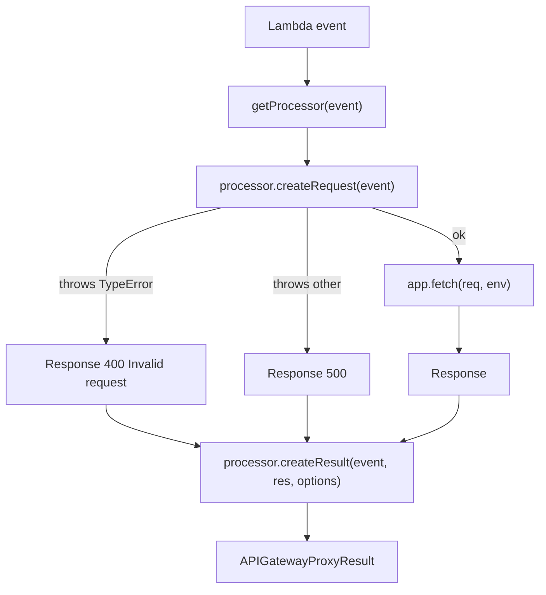
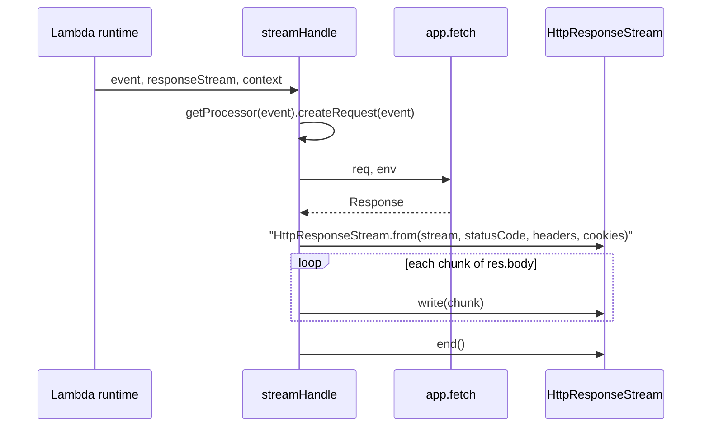
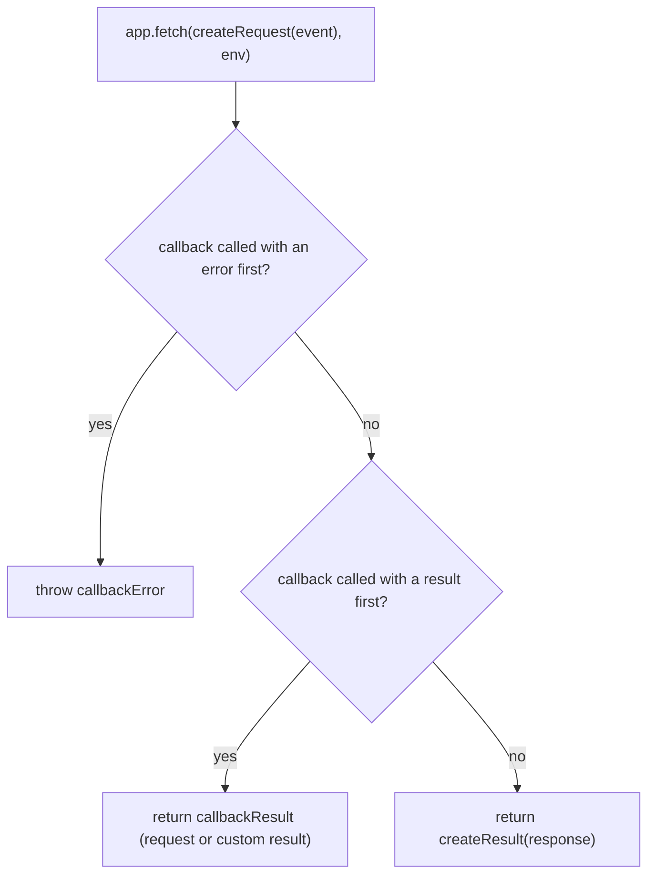

## Overview

AWS Lambda never hands a function a Web `Request`: it invokes it with a JSON event whose shape depends on the trigger (API Gateway REST, API Gateway HTTP or a function URL, an Application Load Balancer, VPC Lattice, or CloudFront). Hono ships two adapters that translate those events into a `Request`, call `app.fetch`, and translate the `Response` back into the result object Lambda expects. `hono/aws-lambda` exports `handle`, `streamHandle`, `defaultIsContentTypeBinary` and `getConnInfo`; `hono/lambda-edge` exports `handle` and `getConnInfo` for CloudFront functions.

Sources: [src/adapter/aws-lambda/index.ts:1-14](repo://src/adapter/aws-lambda/index.ts#L1-L14), [src/adapter/lambda-edge/index.ts:1-14](repo://src/adapter/lambda-edge/index.ts#L1-L14)

Both entry points are published as package subpaths, so they are imported as `hono/aws-lambda` and `hono/lambda-edge` from npm and from JSR. The other runtimes are covered in [[Runtime Adapters]].

Sources: [package.json:364-383](repo://package.json#L364-L383), [jsr.json:72-75](repo://jsr.json#L72-L75)

## Using the aws-lambda adapter

### Buffered handler with handle

`handle(app, options)` returns an async Lambda handler `(event, lambdaContext?) => Promise<APIGatewayProxyResult>`. The whole response body is read into a string before it is returned, which is what API Gateway, ALB and function URLs in buffered mode require.

Sources: [src/adapter/aws-lambda/handler.ts:199-276](repo://src/adapter/aws-lambda/handler.ts#L199-L276)

```ts
import { Hono } from 'hono'
import { handle } from 'hono/aws-lambda'

const app = new Hono()

app.get('/', (c) => c.text('Hello from Lambda'))
app.get('/json', (c) => c.json({ message: 'Hello JSON' }))

export const handler = handle(app)
```

Sources: [src/adapter/aws-lambda/handler.ts:211-222](repo://src/adapter/aws-lambda/handler.ts#L211-L222)

| Option | Type | Default | Description |
| --- | --- | --- | --- |
| `isContentTypeBinary` | `((contentType: string) => boolean) \| undefined` | `undefined` (falls back to `defaultIsContentTypeBinary`) | Decides from the response `content-type` whether the body is base64-encoded in the result. |

Sources: [src/adapter/aws-lambda/handler.ts:195-197](repo://src/adapter/aws-lambda/handler.ts#L195-L197), [src/adapter/aws-lambda/handler.ts:344-357](repo://src/adapter/aws-lambda/handler.ts#L344-L357)

### Bindings passed to the app

The handler passes the raw event and its parts to `app.fetch` as the environment, so routes read them from `c.env`. Note the different key for the Lambda context: `handle` uses `lambdaContext`, `streamHandle` uses `context`.

Sources: [src/adapter/aws-lambda/handler.ts:153-157](repo://src/adapter/aws-lambda/handler.ts#L153-L157), [src/adapter/aws-lambda/handler.ts:268-272](repo://src/adapter/aws-lambda/handler.ts#L268-L272)

| Binding | `handle` | `streamHandle` | Contents |
| --- | --- | --- | --- |
| `event` | yes | yes | The original `LambdaEvent` |
| `requestContext` | yes | yes | `event.requestContext` (API Gateway v1, v2, ALB or Lattice context) |
| `lambdaContext` | yes | no | The `LambdaContext` (function name, `awsRequestId`, `getRemainingTimeInMillis()` and so on) |
| `context` | no | yes | The `LambdaContext` |

Sources: [src/adapter/aws-lambda/handler.ts:116-124](repo://src/adapter/aws-lambda/handler.ts#L116-L124), [src/adapter/aws-lambda/types.ts:31-56](repo://src/adapter/aws-lambda/types.ts#L31-L56)

The request-context types are exported so a typed app can declare them in its `Bindings`: `ApiGatewayRequestContext` (REST, with `identity.sourceIp` and `authorizer.claims`), `ApiGatewayRequestContextV2` (HTTP API, with `http.method` and `http.sourceIp`), `ALBRequestContext` (only `elb.targetGroupArn`) and `LambdaContext`.

Sources: [src/adapter/aws-lambda/types.ts:85-144](repo://src/adapter/aws-lambda/types.ts#L85-L144)

```ts
import { Hono } from 'hono'
import type { LambdaContext, LambdaEvent } from 'hono/aws-lambda'
import { handle } from 'hono/aws-lambda'

type Bindings = {
  event: LambdaEvent
  lambdaContext: LambdaContext
}

const app = new Hono<{ Bindings: Bindings }>()

app.get('/id', (c) => c.text(c.env.lambdaContext.awsRequestId))

export const handler = handle(app)
```

Sources: [src/adapter/aws-lambda/index.ts:6-14](repo://src/adapter/aws-lambda/index.ts#L6-L14), [src/adapter/aws-lambda/handler.ts:268-272](repo://src/adapter/aws-lambda/handler.ts#L268-L272)

### Request flow

`handle` first picks an event processor for the event shape, then builds the `Request`. If building it throws, the handler does not crash the invocation: a `TypeError` (for example an invalid URL or header) becomes a `400 Invalid request` response, any other error becomes `500 Internal Server Error`, and either one goes through the same `createResult` path as a normal response.

Sources: [src/adapter/aws-lambda/handler.ts:252-275](repo://src/adapter/aws-lambda/handler.ts#L252-L275)



Sources: [src/adapter/aws-lambda/handler.ts:252-276](repo://src/adapter/aws-lambda/handler.ts#L252-L276), [src/adapter/aws-lambda/handler.ts:318-386](repo://src/adapter/aws-lambda/handler.ts#L318-L386)

## Event processors

### Detecting the event source

`getProcessor` inspects the event in a fixed order and returns one of four shared processor instances. A V1 (REST API) event behind a custom-domain base path mapping also carries `rawPath`, so a V2 event is only recognised when `requestContext.http` exists too.

Sources: [src/adapter/aws-lambda/handler.ts:625-658](repo://src/adapter/aws-lambda/handler.ts#L625-L658)

| Order | Check | Processor | Event type |
| --- | --- | --- | --- |
| 1 | `requestContext` has own key `elb` | `ALBProcessor` | `ALBProxyEvent` |
| 2 | event has `rawPath` and `requestContext.http` | `EventV2Processor` | `APIGatewayProxyEventV2` (HTTP API, function URL) |
| 3 | `requestContext` has own key `serviceArn` | `LatticeV2Processor` | `LatticeProxyEventV2` |
| 4 | anything else | `EventV1Processor` | `APIGatewayProxyEvent` (REST API) |

Sources: [src/adapter/aws-lambda/handler.ts:625-658](repo://src/adapter/aws-lambda/handler.ts#L625-L658), [src/adapter/aws-lambda/handler.ts:23-97](repo://src/adapter/aws-lambda/handler.ts#L23-L97)

### Building the Request

`EventProcessor` is an abstract class: subclasses supply `getPath`, `getMethod`, `getQueryString`, `getHeaders`, `getCookies` and `setCookiesToResult`, and the base class does the rest. `createRequest` always builds an `https://` URL. The host comes from `requestContext.domainName` when the context has one, then from a `host` header, then from a `host` entry in `multiValueHeaders`. A body is decoded from base64 when `isBase64Encoded` is true, otherwise UTF-8 encoded, and `content-length` is set from the byte length.

Sources: [src/adapter/aws-lambda/handler.ts:278-342](repo://src/adapter/aws-lambda/handler.ts#L278-L342)

| Processor | Path | Method | Query string | Headers and cookies |
| --- | --- | --- | --- | --- |
| `EventV2Processor` | `rawPath` | `requestContext.http.method` | `rawQueryString` as received | `event.cookies` joined with `; ` into one `Cookie` header, then each header with `set` |
| `EventV1Processor` | `path` | `httpMethod` | rebuilt from `multiValueQueryStringParameters`, else `queryStringParameters`, with `encodeURIComponent` on keys and values | `multiValueHeaders` appended first; `headers` only fill names not already present |
| `ALBProcessor` | `path` | `httpMethod` | rebuilt from `multiValueQueryStringParameters` first, else `queryStringParameters`, without re-encoding | `multiValueHeaders` values joined with `; ` when present, else `headers` |
| `LatticeV2Processor` | `path` | `method` | always empty | each array entry of `headers` appended |

Sources: [src/adapter/aws-lambda/handler.ts:404-439](repo://src/adapter/aws-lambda/handler.ts#L404-L439), [src/adapter/aws-lambda/handler.ts:443-499](repo://src/adapter/aws-lambda/handler.ts#L443-L499), [src/adapter/aws-lambda/handler.ts:503-621](repo://src/adapter/aws-lambda/handler.ts#L503-L621)

API Gateway V1 passes query values already decoded, which is why `EventV1Processor` re-encodes them to restore the original URL. The ALB processor checks `multiValueQueryStringParameters` first because tools such as the Serverless framework send both fields, and only the multi-value one keeps repeated keys like `?select=amount&select=currency`.

Sources: [src/adapter/aws-lambda/handler.ts:452-468](repo://src/adapter/aws-lambda/handler.ts#L452-L468), [src/adapter/aws-lambda/handler.ts:534-558](repo://src/adapter/aws-lambda/handler.ts#L534-L558)

> [!NOTE]
> V1, ALB and Lattice header values containing non-ASCII characters are passed through `encodeURIComponent` by `sanitizeHeaderValue`, because the `Headers` constructor rejects them. V2 headers are set as received.

Sources: [src/adapter/aws-lambda/handler.ts:13-21](repo://src/adapter/aws-lambda/handler.ts#L13-L21), [src/adapter/aws-lambda/handler.ts:474-492](repo://src/adapter/aws-lambda/handler.ts#L474-L492)

### Building the result

`createResult` decides first whether the body must be base64-encoded: when the `content-type` is binary according to `isContentTypeBinary` (or `defaultIsContentTypeBinary`), or when a `content-encoding` other than `identity` is set, as with a compressed response. The result carries `body`, `statusCode` and `isBase64Encoded`, and uses `multiValueHeaders` when the incoming event had them, `headers` otherwise.

Sources: [src/adapter/aws-lambda/handler.ts:344-386](repo://src/adapter/aws-lambda/handler.ts#L344-L386), [src/adapter/aws-lambda/handler.ts:672-674](repo://src/adapter/aws-lambda/handler.ts#L672-L674)

`defaultIsContentTypeBinary` treats everything as binary except `text/plain`, `text/html`, `text/css`, `text/javascript`, `text/csv` and any type ending in `/json`, `+json`, `/xml` or `+xml`. To treat more types as binary, wrap it.

Sources: [src/adapter/aws-lambda/handler.ts:660-670](repo://src/adapter/aws-lambda/handler.ts#L660-L670)

```js
import { handle, defaultIsContentTypeBinary } from 'hono/aws-lambda'
export const handler = handle(app, {
  isContentTypeBinary: (contentType) => {
    if (defaultIsContentTypeBinary(contentType)) {
      // default logic same as prior to v4.8.4
      return true
    }
    return contentType.startsWith('image/') || contentType === 'application/pdf'
  }
})
```

Sources: [src/adapter/aws-lambda/handler.ts:224-237](repo://src/adapter/aws-lambda/handler.ts#L224-L237)

Before headers are copied, `setCookies` pulls every `Set-Cookie` value out of the response (with `getSetCookie()` when available) and removes it from the headers, then hands the list to the processor, because each trigger expects multiple cookies in a different place.

Sources: [src/adapter/aws-lambda/handler.ts:388-401](repo://src/adapter/aws-lambda/handler.ts#L388-L401)

| Processor | Where cookies go |
| --- | --- |
| `EventV2Processor` | `result.cookies` array |
| `EventV1Processor` | `result.multiValueHeaders['set-cookie']`; because `multiValueHeaders` is then set, every other header is also written there as a one-item array |
| `ALBProcessor` | `multiValueHeaders['set-cookie']` when multi-value headers are enabled, otherwise only the first cookie in `headers['set-cookie']` |
| `LatticeV2Processor` | `headers['set-cookie']` as an array |

Sources: [src/adapter/aws-lambda/handler.ts:423-425](repo://src/adapter/aws-lambda/handler.ts#L423-L425), [src/adapter/aws-lambda/handler.ts:494-498](repo://src/adapter/aws-lambda/handler.ts#L494-L498), [src/adapter/aws-lambda/handler.ts:572-579](repo://src/adapter/aws-lambda/handler.ts#L572-L579), [src/adapter/aws-lambda/handler.ts:615-620](repo://src/adapter/aws-lambda/handler.ts#L615-L620), [src/adapter/aws-lambda/handler.ts:374-383](repo://src/adapter/aws-lambda/handler.ts#L374-L383)

> [!WARNING]
> An ALB target group without multi-value headers can return only one `Set-Cookie`: the adapter keeps `cookies[0]` and drops the rest. Enable multi-value headers on the target group when a route sets several cookies.

Sources: [src/adapter/aws-lambda/handler.ts:572-579](repo://src/adapter/aws-lambda/handler.ts#L572-L579)

## Response streaming with streamHandle

`streamHandle(app)` wraps the handler with the Lambda runtime's global `awslambda.streamifyResponse`, so it only works where that global exists (the Node.js Lambda runtime with response streaming, for example a function URL in `RESPONSE_STREAM` mode). The request is built by the same processors, but instead of a result object the handler writes to the response stream.

Sources: [src/adapter/aws-lambda/handler.ts:138-157](repo://src/adapter/aws-lambda/handler.ts#L138-L157)



Sources: [src/adapter/aws-lambda/handler.ts:126-193](repo://src/adapter/aws-lambda/handler.ts#L126-L193)

The status code, headers and `set-cookie` values (collected into a separate `cookies` array) are sent as the HTTP response metadata through `awslambda.HttpResponseStream.from`. The body's reader is pumped chunk by chunk into the Node stream by `streamToNodeStream`; a response without a body writes an empty string. Any error during request creation or the app call is logged and the text `Internal Server Error` is written, and the stream is always ended in `finally`. Bodies are never base64-encoded here, so `isContentTypeBinary` does not apply. This pairs with `streamSSE` and `stream` from [[Streaming and Server-Sent Events]].

Sources: [src/adapter/aws-lambda/handler.ts:126-136](repo://src/adapter/aws-lambda/handler.ts#L126-L136), [src/adapter/aws-lambda/handler.ts:159-192](repo://src/adapter/aws-lambda/handler.ts#L159-L192)

> [!NOTE]
> Once metadata has been sent, an error can no longer change the status code: the 500 path in `streamHandle` only writes a body, unlike `handle`, which returns a 400 or 500 result.

Sources: [src/adapter/aws-lambda/handler.ts:185-190](repo://src/adapter/aws-lambda/handler.ts#L185-L190)

## Client IP with getConnInfo

`getConnInfo` from `hono/aws-lambda` reads `c.env.requestContext` and returns `{ remote: { address } }`. For API Gateway V1 it uses `requestContext.identity.sourceIp`, for V2 `requestContext.http.sourceIp`; for ALB, which has no source IP in its context, it takes the last entry of `X-Forwarded-For`, because the ALB appends the real client address to the end of that header.

Sources: [src/adapter/aws-lambda/conninfo.ts:34-73](repo://src/adapter/aws-lambda/conninfo.ts#L34-L73)

```ts
import { Hono } from 'hono'
import { handle, getConnInfo } from 'hono/aws-lambda'

const app = new Hono()

app.get('/', (c) => {
  const info = getConnInfo(c)
  return c.text(`Your IP: ${info.remote.address}`)
})

export const handler = handle(app)
```

Sources: [src/adapter/aws-lambda/conninfo.ts:44-57](repo://src/adapter/aws-lambda/conninfo.ts#L44-L57)

## Lambda@Edge

### The lambda-edge handle

`hono/lambda-edge` targets CloudFront viewer and origin triggers. Its `handle(app)` returns `(event, context?, callback?) => Promise<CloudFrontResult | CloudFrontRequest>`. The event is a `CloudFrontEdgeEvent` whose first record holds `cf.config`, `cf.request` and, for response triggers, `cf.response`. The module also sets `globalThis.crypto` from `node:crypto` when it is missing, so Web Crypto based middleware works on older Node runtimes.

Sources: [src/adapter/lambda-edge/handler.ts:1-8](repo://src/adapter/lambda-edge/handler.ts#L1-L8), [src/adapter/lambda-edge/handler.ts:41-99](repo://src/adapter/lambda-edge/handler.ts#L41-L99), [src/adapter/lambda-edge/handler.ts:116-147](repo://src/adapter/lambda-edge/handler.ts#L116-L147)

| Binding | Contents |
| --- | --- |
| `event` | The whole `CloudFrontEdgeEvent` |
| `context` | The Lambda context argument |
| `callback` | A wrapper around the Lambda callback (see below) |
| `config` | `Records[0].cf.config` (`distributionDomainName`, `distributionId`, `eventType`, `requestId`) |
| `request` | `Records[0].cf.request` |
| `response` | `Records[0].cf.response`, present on response triggers |

Sources: [src/adapter/lambda-edge/handler.ts:128-141](repo://src/adapter/lambda-edge/handler.ts#L128-L141), [src/adapter/lambda-edge/handler.ts:62-75](repo://src/adapter/lambda-edge/handler.ts#L62-L75)

`createRequest` builds `https://<host><uri>?<querystring>` with the host from the `host` header or, failing that, `config.distributionDomainName`, and copies every CloudFront header value with `append`. The body is used only when the request carries `body.data` and the method is not `GET` or `HEAD`; base64 bodies are decoded, and `content-length` is set from the byte length. CloudFront only includes the body when the trigger is configured with "include body".

Sources: [src/adapter/lambda-edge/handler.ts:164-212](repo://src/adapter/lambda-edge/handler.ts#L164-L212)

`createResult` turns the `Response` into a CloudFront result: `status` as a string, headers converted to CloudFront's lower-cased `{ key, value }` arrays by `convertHeaders`, and the body base64-encoded with `bodyEncoding: 'base64'` when the content type is binary or a non-`identity` `content-encoding` is set. Its `isContentTypeBinary` is fixed (text types, JSON, XML and SVG are text) and cannot be overridden, unlike the aws-lambda option.

Sources: [src/adapter/lambda-edge/handler.ts:105-114](repo://src/adapter/lambda-edge/handler.ts#L105-L114), [src/adapter/lambda-edge/handler.ts:149-162](repo://src/adapter/lambda-edge/handler.ts#L149-L162), [src/adapter/lambda-edge/handler.ts:214-218](repo://src/adapter/lambda-edge/handler.ts#L214-L218)

### Forwarding with the callback

A Lambda@Edge request trigger often must not answer itself but pass the (possibly modified) request on to the origin. The app does this by calling `c.env.callback(null, c.env.request)`. The wrapper records only the first call, forwards every call to the real Lambda callback when one was passed, and after `app.fetch` resolves the handler decides what to return.

Sources: [src/adapter/lambda-edge/handler.ts:124-146](repo://src/adapter/lambda-edge/handler.ts#L124-L146)



Sources: [src/adapter/lambda-edge/handler.ts:124-147](repo://src/adapter/lambda-edge/handler.ts#L124-L147)

```ts
import { Hono } from 'hono'
import type { Callback, CloudFrontRequest } from 'hono/lambda-edge'
import { handle } from 'hono/lambda-edge'

type Bindings = {
  callback: Callback
  request: CloudFrontRequest
}

const app = new Hono<{ Bindings: Bindings }>()

app.get('*', async (c, next) => {
  await next()
  c.env.callback(null, c.env.request)
})

export const handler = handle(app)
```

Sources: [src/adapter/lambda-edge/handler.test.ts:226-241](repo://src/adapter/lambda-edge/handler.test.ts#L226-L241), [src/adapter/lambda-edge/handler.ts:83-85](repo://src/adapter/lambda-edge/handler.ts#L83-L85), [src/adapter/lambda-edge/handler.ts:116-147](repo://src/adapter/lambda-edge/handler.ts#L116-L147), [src/adapter/lambda-edge/index.ts:6-14](repo://src/adapter/lambda-edge/index.ts#L6-L14)

Because the handler returns a promise, the callback result is honoured both when Lambda invokes it as an async function and when it passes a positional callback: the result is resolved from the promise and also forwarded through `callback?.(err, result)`.

Sources: [src/adapter/lambda-edge/handler.ts:124-146](repo://src/adapter/lambda-edge/handler.ts#L124-L146)

### Client IP on Lambda@Edge

The `getConnInfo` from `hono/lambda-edge` reads `c.env.event.Records[0].cf.request.clientIp`, the viewer address CloudFront puts on every request record.

Sources: [src/adapter/lambda-edge/conninfo.ts:1-15](repo://src/adapter/lambda-edge/conninfo.ts#L1-L15)
