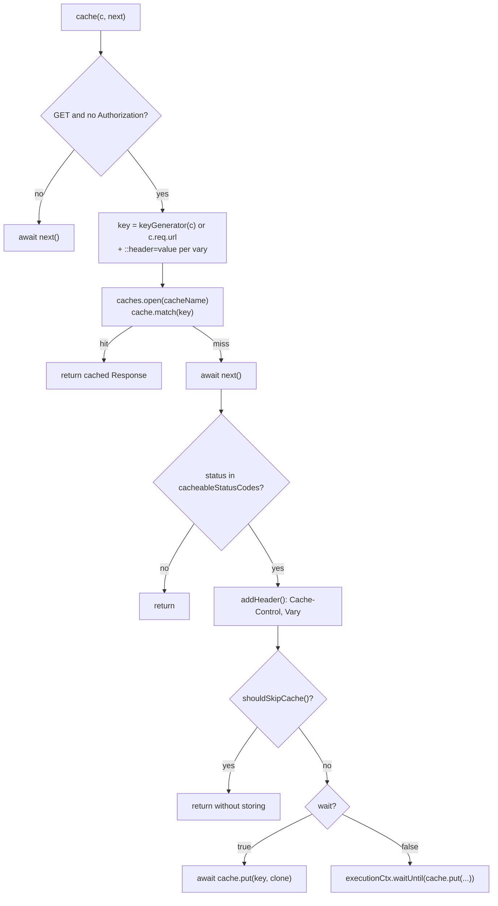
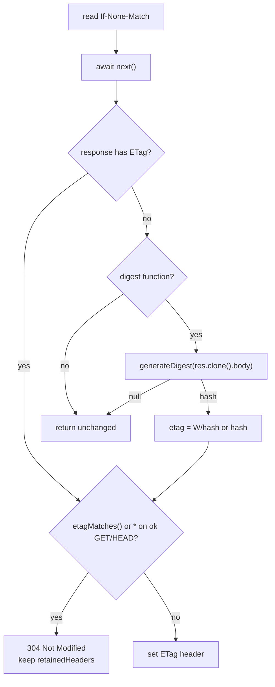

## Overview

Three built-in middleware shape how responses are reused and sent over the wire. `cache` (imported from `hono/cache`) stores whole responses in the Web Cache API (`globalThis.caches`) and answers later GET requests from it without running the handler. `etag` (`hono/etag`) gives every response an `ETag` and turns a matching conditional request into an empty `304 Not Modified`. `compress` (`hono/compress`) pipes the response body through a `CompressionStream` when the client accepts gzip or deflate and the response is worth compressing.

Sources: [src/middleware/cache/index.ts:64-72](repo://src/middleware/cache/index.ts#L64-L72), [src/middleware/etag/index.ts:79-84](repo://src/middleware/etag/index.ts#L79-L84), [src/middleware/compress/index.ts:70-86](repo://src/middleware/compress/index.ts#L70-L86), [package.json:94-138](repo://package.json#L94-L138)

All three work on `c.res` after `await next()` returns, so they act on whatever the handler and the inner middleware produced. Their order relative to each other matters, because each one reads headers the others write: see [[Middleware and Composition]] for how the onion order is built, and [[Context]] for how assigning `c.res` keeps the headers already set.

Sources: [src/middleware/cache/index.ts:166-182](repo://src/middleware/cache/index.ts#L166-L182), [src/middleware/etag/index.ts:84-128](repo://src/middleware/etag/index.ts#L84-L128), [src/middleware/compress/index.ts:86-121](repo://src/middleware/compress/index.ts#L86-L121), [src/context.ts:414-434](repo://src/context.ts#L414-L434)

## Cache middleware

### cache options

`cache` takes one options object; only `cacheName` is required.

Sources: [src/middleware/cache/index.ts:64-72](repo://src/middleware/cache/index.ts#L64-L72)

| Option | Type | Default | Description |
| --- | --- | --- | --- |
| `cacheName` | `string \| (c: Context) => Promise<string> \| string` | required | Name passed to `caches.open()`. A function picks the cache per request. |
| `wait` | `boolean` | `false` | When `true`, `await cache.put()` before finishing; when `false`, hand the write to `c.executionCtx.waitUntil()`. Must be `true` on Deno. |
| `cacheControl` | `string` | none | Comma-separated directives appended to the response's `Cache-Control`, skipping any directive name already present. |
| `vary` | `string \| string[]` | none | Request headers that become part of the cache key; also written to the response `Vary` header. `"*"` throws. |
| `keyGenerator` | `(c: Context) => Promise<string> \| string` | `c.req.url` | Builds the cache key for a request. |
| `cacheableStatusCodes` | `StatusCode[]` | `[200]` | Only responses with one of these statuses are stored. |
| `onCacheNotAvailable` | `(() => void) \| false` | logs a message | Called when `globalThis.caches` is missing; `false` silences it. |

Sources: [src/middleware/cache/index.ts:10-13](repo://src/middleware/cache/index.ts#L10-L13), [src/middleware/cache/index.ts:37-63](repo://src/middleware/cache/index.ts#L37-L63), [src/middleware/cache/index.ts:84-103](repo://src/middleware/cache/index.ts#L84-L103), [src/middleware/cache/index.ts:147-150](repo://src/middleware/cache/index.ts#L147-L150)

```ts
import { Hono } from 'hono'
import { cache } from 'hono/cache'

const app = new Hono()

app.get(
  '*',
  cache({
    cacheName: 'my-app',
    cacheControl: 'max-age=3600',
    vary: ['Accept-Language'],
  })
)
```

Sources: [src/middleware/cache/index.ts:53-72](repo://src/middleware/cache/index.ts#L53-L72), [package.json:94-98](repo://package.json#L94-L98)

### Setup-time checks

The factory does its work once, when the middleware is created. If `globalThis.caches` is undefined (Node.js without a polyfill, for example), it calls `onCacheNotAvailable` or logs `Cache Middleware is not enabled because caches is not defined.` and returns a pass-through middleware that only calls `next()`. Otherwise it lower-cases the `cacheControl` directives, parses `vary` into a lower-cased `Set`, and throws if that set contains `*`, since RFC 7231 forbids `*` as a cache variant.

Sources: [src/middleware/cache/index.ts:73-103](repo://src/middleware/cache/index.ts#L73-L103), [src/middleware/cache/index.ts:18-25](repo://src/middleware/cache/index.ts#L18-L25)

```ts
  // RFC 7231 Section 7.1.4 specifies that "*" is not allowed in Vary header.
  // See: https://datatracker.ietf.org/doc/html/rfc7231#section-7.1.4
  if (varyDirectives?.has('*')) {
    throw new Error(
      'Middleware vary configuration cannot include "*", as it disallows effective caching.'
    )
  }
```

Sources: [src/middleware/cache/index.ts:93-99](repo://src/middleware/cache/index.ts#L93-L99)

### Request flow

Each request goes through these steps:

Sources: [src/middleware/cache/index.ts:141-146](repo://src/middleware/cache/index.ts#L141-L146)

1. A request whose method is not `GET`, or that carries an `Authorization` header, skips the cache entirely and just calls `next()`.
2. The key starts as `c.req.url` (or the result of `keyGenerator`). For each `vary` header it appends `::<name>=<encoded value>`, so `Accept-Language: en` and `Accept-Language: fr` get separate entries.
3. The cache named by `cacheName` is opened and matched by key. A hit returns `new Response(response.body, response)` at once: the handler and every middleware registered after `cache` never run.
4. On a miss the middleware calls `next()`. If the resulting status is not in `cacheableStatusCodes`, it returns without touching the response.
5. `addHeader` merges the `cacheControl` and `vary` options into the response headers.
6. `shouldSkipCache` decides whether the response may be stored. If not, the response is still sent, only not cached.
7. A clone of `c.res` is written with `cache.put(key, res)`, awaited when `wait` is `true`, otherwise passed to `c.executionCtx.waitUntil()`.

Sources: [src/middleware/cache/index.ts:141-184](repo://src/middleware/cache/index.ts#L141-L184)



Sources: [src/middleware/cache/index.ts:141-184](repo://src/middleware/cache/index.ts#L141-L184)

> [!WARNING]
> With the default `wait: false`, the write goes through `c.executionCtx`, whose getter throws `This context has no ExecutionContext` on runtimes that pass none (such as Deno). Set `wait: true` there.

Sources: [src/middleware/cache/index.ts:177-182](repo://src/middleware/cache/index.ts#L177-L182), [src/context.ts:385-397](repo://src/context.ts#L385-L397)

### Header merging

`addHeader` runs before the store decision, so the headers it adds appear on the response whether or not it is cached. For `Cache-Control` it collects the directive names already on the response (lower-cased, values dropped) and appends only the configured directives whose name is not there yet. A handler that set `Max-Age=60` therefore keeps it, and the configured `max-age=3600` is not added. For `Vary` it sets the configured list when the response has none, and otherwise merges both lists into one set, collapsing to `*` if the response already said `*`.

Sources: [src/middleware/cache/index.ts:105-139](repo://src/middleware/cache/index.ts#L105-L139)

### When a response is not stored

`shouldSkipCache` returns true, and the response is not written to the cache, in three cases:

Sources: [src/middleware/cache/index.ts:27-35](repo://src/middleware/cache/index.ts#L27-L35)

- The response has a `Vary` header and either no `vary` option was given, or the response varies on a header the option does not list. The cache key would not distinguish those variants, so storing it could serve the wrong one. A response `Vary: *` always lands here.
- The `Cache-Control` header contains `private`, `no-store` or `no-cache`, whether the handler set it or the `cacheControl` option added it.
- The response sets a cookie (`Set-Cookie`), which must not be replayed to other clients.

Sources: [src/middleware/cache/index.ts:15-35](repo://src/middleware/cache/index.ts#L15-L35), [src/middleware/cache/index.ts:170-175](repo://src/middleware/cache/index.ts#L170-L175)

```ts
const shouldSkipCacheControl = (cacheControl: string | null): boolean =>
  !!cacheControl && /(?:^|,\s*)(?:private|no-(?:store|cache))(?:\s*(?:=|,|$))/i.test(cacheControl)
```

Sources: [src/middleware/cache/index.ts:15-16](repo://src/middleware/cache/index.ts#L15-L16)

## ETag middleware

### etag options

`etag()` takes an optional `ETagOptions` object.

Sources: [src/middleware/etag/index.ts:9-13](repo://src/middleware/etag/index.ts#L9-L13)

| Option | Type | Default | Description |
| --- | --- | --- | --- |
| `weak` | `boolean` | `false` | Prefix generated tags with `W/`, marking them as weak validators. |
| `retainedHeaders` | `string[]` | `RETAINED_304_HEADERS` | Lower-case header names kept on a `304` response; every other header is removed. |
| `generateDigest` | `(body: Uint8Array) => ArrayBuffer \| Promise<ArrayBuffer>` | SHA-1 via `crypto.subtle.digest` | Hash function used to build the tag. |

Sources: [src/middleware/etag/index.ts:56-82](repo://src/middleware/etag/index.ts#L56-L82)

`RETAINED_304_HEADERS` is exported, so you can extend it rather than replace it, following the spec rule that a 304 carries the headers an equivalent 200 would.

Sources: [src/middleware/etag/index.ts:15-28](repo://src/middleware/etag/index.ts#L15-L28)

```ts
import { Hono } from 'hono'
import { etag, RETAINED_304_HEADERS } from 'hono/etag'

const app = new Hono()

app.use(
  '/etag/*',
  etag({
    retainedHeaders: ['x-message', ...RETAINED_304_HEADERS],
  })
)
app.get('/etag/abc', (c) => {
  return c.text('Hono is hot')
})
```

Sources: [src/middleware/etag/index.ts:21-28](repo://src/middleware/etag/index.ts#L21-L28), [src/middleware/etag/index.ts:69-84](repo://src/middleware/etag/index.ts#L69-L84), [package.json:134-138](repo://package.json#L134-L138)

### How the tag is produced

The middleware reads `If-None-Match` before calling `next()`, then inspects the response. A response that already has an `ETag` header (set by the handler or by [[Serving Static Files]] middleware upstream) keeps it, and no hashing happens. Otherwise the middleware hashes a clone of the body. If there is no digest function (no `crypto.subtle` and no `generateDigest`) or the body is empty, it returns and leaves the response without a tag.

Sources: [src/middleware/etag/index.ts:38-54](repo://src/middleware/etag/index.ts#L38-L54), [src/middleware/etag/index.ts:84-105](repo://src/middleware/etag/index.ts#L84-L105)

`generateDigest` in `digest.ts` reads the cloned stream chunk by chunk. It does not hash the whole body at once: for each chunk it hashes the previous digest followed by the chunk (`generator(mergeBuffers(result, value))`), so memory stays bounded for large or streamed bodies. The final digest is hex-encoded and wrapped in quotes, with `W/` added when `weak` is set.

Sources: [src/middleware/etag/digest.ts:1-43](repo://src/middleware/etag/digest.ts#L1-L43), [src/middleware/etag/index.ts:104](repo://src/middleware/etag/index.ts#L104)

> [!NOTE]
> Because the digest is chained per chunk, the same bytes split into different chunks give different tags. A custom `generateDigest` receives these merged buffers, not the full body.

Sources: [src/middleware/etag/digest.ts:24-34](repo://src/middleware/etag/digest.ts#L24-L34)

### Conditional requests and 304

The tag is compared with `If-None-Match` using weak comparison: `W/` is stripped from both sides, and the header may list several tags separated by commas. `If-None-Match: *` matches any successful (`res.ok`) `GET` or `HEAD` response. On a match `c.res` is replaced with an empty `304 Not Modified` carrying the tag; the `c.res` setter copies the old headers over, and the middleware then deletes every header whose lower-cased name is not in `retainedHeaders`. Without a match it sets the `ETag` header on the original response.

Sources: [src/middleware/etag/index.ts:30-36](repo://src/middleware/etag/index.ts#L30-L36), [src/middleware/etag/index.ts:107-128](repo://src/middleware/etag/index.ts#L107-L128), [src/context.ts:414-434](repo://src/context.ts#L414-L434)



Sources: [src/middleware/etag/index.ts:84-128](repo://src/middleware/etag/index.ts#L84-L128)

## Compress middleware

### compress options

`compress()` takes an optional `CompressionOptions` object.

Sources: [src/middleware/compress/index.ts:16-22](repo://src/middleware/compress/index.ts#L16-L22)

| Option | Type | Default | Description |
| --- | --- | --- | --- |
| `encoding` | `'gzip' \| 'deflate'` | both | Restrict to one encoding. Without it, both are candidates and gzip wins a tie. |
| `threshold` | `number` | `1024` | Responses whose `Content-Length` is below this many bytes are not compressed. |
| `contentTypeFilter` | `RegExp \| (contentType: string) => boolean` | `COMPRESSIBLE_CONTENT_TYPE_REGEX` | Decides from `Content-Type` whether the response is compressible. |

Sources: [src/middleware/compress/index.ts:46-84](repo://src/middleware/compress/index.ts#L46-L84)

`COMPRESSIBLE_CONTENT_TYPE_REGEX` lives in `src/utils/compress.ts` and is re-exported from `hono/compress`, so a custom filter can extend it. It matches every `text/*` type except `text/event-stream` (server-sent events must not be buffered by a compressor), a list of `application/*` types such as JSON, JavaScript, XML and WASM, some font and image types, and any `+json`, `+xml`, `+text`, `+yaml` or `+msgpack` suffix. The same constant decides which files [[Serving Static Files]] looks for in precompressed form.

Sources: [src/utils/compress.ts:1-10](repo://src/utils/compress.ts#L1-L10), [src/middleware/compress/index.ts:6-10](repo://src/middleware/compress/index.ts#L6-L10), [src/middleware/serve-static/index.ts:96](repo://src/middleware/serve-static/index.ts#L96)

```ts
import { Hono } from 'hono'
import { compress, COMPRESSIBLE_CONTENT_TYPE_REGEX } from 'hono/compress'

const app = new Hono()

app.use(compress())

// Compress only JSON responses
app.use(compress({ contentTypeFilter: /^application\/json/ }))

// Compress based on custom Content-Type logic
app.use(compress({ contentTypeFilter: (type) => COMPRESSIBLE_CONTENT_TYPE_REGEX.test(type) || type === "application/x-myformat" }))
```

Sources: [src/middleware/compress/index.ts:57-70](repo://src/middleware/compress/index.ts#L57-L70), [package.json:114-118](repo://package.json#L114-L118)

### When compression is skipped

After `next()`, the middleware leaves the response untouched if any of these hold:

Sources: [src/middleware/compress/index.ts:91-102](repo://src/middleware/compress/index.ts#L91-L102)

- The status is `206 Partial Content`: its `Content-Range` refers to the uncompressed bytes.
- The response already has `Content-Encoding` or `Transfer-Encoding`.
- The request method is `HEAD`.
- `Content-Length` is present and below `threshold`. A streamed response with no `Content-Length` passes this check.
- `Content-Type` is missing or rejected by `contentTypeFilter`.
- `Cache-Control` contains `no-transform`, which by RFC 7234 forbids intermediaries from changing the body.
- No encoding is acceptable to the client, or the response has no body.

Sources: [src/middleware/compress/index.ts:86-108](repo://src/middleware/compress/index.ts#L86-L108), [src/middleware/compress/index.ts:124-129](repo://src/middleware/compress/index.ts#L124-L129)

### Choosing the encoding

`selectEncoding` parses `Accept-Encoding` with `parseAccept` and walks the candidates in order (`gzip`, then `deflate`, or only the configured `encoding`). Each candidate takes its explicit `q` value, matched case-insensitively, or else the `q` of a `*` entry, or else 0. The first candidate with `q=1` wins immediately; otherwise the one with the highest positive `q` wins, and a candidate with `q=0` is never chosen. A missing header means no compression. Tokens such as `x-gzip` are not treated as gzip.

Sources: [src/middleware/compress/index.ts:24-44](repo://src/middleware/compress/index.ts#L24-L44), [src/utils/accept.ts:211-216](repo://src/utils/accept.ts#L211-L216)

### Rewriting the response

When an encoding is chosen, the body is piped through `new CompressionStream(encoding)` into a new `Response` that keeps the original status and headers. `Content-Length` is deleted because the compressed size is unknown, and `Content-Encoding` is set. A strong `ETag` already on the response is turned into a weak one (`W/"…"`), since the compressed bytes are no longer identical to the ones the strong tag described; a weak tag stays as it is.

Sources: [src/middleware/compress/index.ts:110-121](repo://src/middleware/compress/index.ts#L110-L121)

```ts
    // Convert strong ETag to weak ETag since compressed content is not byte-identical
    const etag = ctx.res.headers.get('ETag')
    if (etag && !etag.startsWith('W/')) {
      ctx.res.headers.set('ETag', `W/${etag}`)
    }
```

Sources: [src/middleware/compress/index.ts:116-120](repo://src/middleware/compress/index.ts#L116-L120)

## Combining the three

Middleware registered first runs its post-`next()` code last. The order changes what each one sees:

Sources: [src/middleware/compress/index.ts:86-87](repo://src/middleware/compress/index.ts#L86-L87), [src/middleware/etag/index.ts:84-87](repo://src/middleware/etag/index.ts#L84-L87)

| Registration order | Effect |
| --- | --- |
| `compress()` then `etag()` | `etag` hashes the uncompressed body and sets a strong tag; `compress` then weakens it to `W/"…"`. Because `etag` compares weakly, the client's `If-None-Match: W/"…"` still produces a 304. |
| `etag()` then `compress()` | `compress` runs first on the way out, so `etag` hashes the compressed stream through `res.clone()`. |
| `cache()` before the others | A cache hit returns before `etag` or `compress` run, so the stored response is served as stored, with the headers it had when it was cached. |

Sources: [src/middleware/compress/index.ts:86-121](repo://src/middleware/compress/index.ts#L86-L121), [src/middleware/etag/index.ts:30-36](repo://src/middleware/etag/index.ts#L30-L36), [src/middleware/etag/index.ts:84-128](repo://src/middleware/etag/index.ts#L84-L128), [src/middleware/cache/index.ts:158-166](repo://src/middleware/cache/index.ts#L158-L166), [src/middleware/compress/index.test.ts:210-259](repo://src/middleware/compress/index.test.ts#L210-L259)

> [!TIP]
> `cache` skips any request with an `Authorization` header, so placing it after an auth check from [[Authentication Middleware]] does not make per-user responses shareable. Other request headers that change the response must be listed in `vary`.

Sources: [src/middleware/cache/index.ts:141-156](repo://src/middleware/cache/index.ts#L141-L156)
