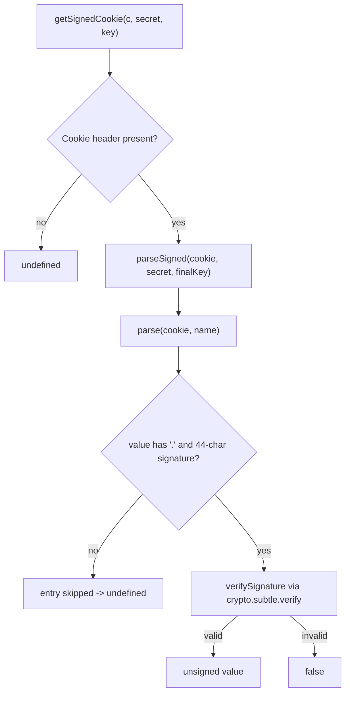

## Overview

The cookie helper (`hono/cookie`) reads the request's `Cookie` header and writes `Set-Cookie` headers on the response through the [[Context]] object. It wraps a small set of pure functions in `src/utils/cookie.ts` (`parse`, `parseSigned`, `serialize`, `serializeSigned`) that do the actual RFC 6265 parsing, HMAC signing and attribute serialization, so the same logic can be reused outside a request (for example by middleware that builds cookies itself).

Sources: [src/helper/cookie/index.ts:1-8](repo://src/helper/cookie/index.ts#L1-L8), [src/utils/cookie.ts:1-9](repo://src/utils/cookie.ts#L1-L9)

The helper is exported as the `./cookie` subpath of the package, and the low-level utilities as `./utils/cookie` on JSR.

Sources: [package.json:104-108](repo://package.json#L104-L108), [jsr.json:22-22](repo://jsr.json#L22-L22), [jsr.json:86-86](repo://jsr.json#L86-L86)

## Public functions

| Function | Signature | Returns | Purpose |
| --- | --- | --- | --- |
| `getCookie` | `(c, key?, prefix?)` | `string \| undefined`, or the whole `Cookie` record when no key is given | Read one cookie or all cookies from the request |
| `getSignedCookie` | `(c, secret, key?, prefix?)` | `Promise` of `string \| undefined \| false`, or a `SignedCookie` record | Read and verify HMAC-signed cookies |
| `setCookie` | `(c, name, value, opt?)` | `void` | Append a `Set-Cookie` header |
| `setSignedCookie` | `(c, name, value, secret, opt?)` | `Promise<void>` | Append a signed `Set-Cookie` header |
| `generateCookie` | `(name, value, opt?)` | `string` | Build a `Set-Cookie` value without a context |
| `generateSignedCookie` | `(name, value, secret, opt?)` | `Promise<string>` | Build a signed `Set-Cookie` value without a context |
| `deleteCookie` | `(c, name, opt?)` | `string \| undefined` | Expire a cookie and return its previous value |

Sources: [src/helper/cookie/index.ts:10-76](repo://src/helper/cookie/index.ts#L10-L76), [src/helper/cookie/index.ts:78-145](repo://src/helper/cookie/index.ts#L78-L145)

```ts
import { Hono } from 'hono'
import { getCookie, setCookie, deleteCookie } from 'hono/cookie'

const app = new Hono()

app.get('/login', (c) => {
  setCookie(c, 'session', 'abc123', { httpOnly: true, sameSite: 'Lax', maxAge: 3600 })
  return c.text('logged in')
})

app.get('/me', (c) => {
  const session = getCookie(c, 'session') // string | undefined
  const all = getCookie(c) // Record<string, string>
  return c.json({ session, all })
})

app.get('/logout', (c) => {
  const previous = deleteCookie(c, 'session')
  return c.text(`removed ${previous}`)
})
```

Sources: [src/helper/cookie/index.ts:27-48](repo://src/helper/cookie/index.ts#L27-L48), [src/helper/cookie/index.ts:99-102](repo://src/helper/cookie/index.ts#L99-L102), [src/helper/cookie/index.ts:141-145](repo://src/helper/cookie/index.ts#L141-L145)

## Reading cookies

### getCookie

`getCookie` is overloaded on whether a key is passed. With a string key it returns `undefined` immediately when the request has no `Cookie` header; otherwise it calls `parse(cookie, finalKey)` and returns that single entry. Without a key it returns `{}` for a missing header, or the whole parsed record.

Sources: [src/helper/cookie/index.ts:10-48](repo://src/helper/cookie/index.ts#L10-L48)

The third argument is a `CookiePrefixOptions` value (`'secure'` or `'host'`). It rewrites the key before lookup, so `getCookie(c, 'token', 'host')` reads the cookie named `__Host-token`. The prefix only applies to single-key lookups; reading all cookies returns raw names including their prefixes.

Sources: [src/helper/cookie/index.ts:33-40](repo://src/helper/cookie/index.ts#L33-L40), [src/utils/cookie.ts:29-29](repo://src/utils/cookie.ts#L29-L29)

### How parse works

`parse(cookie, name?)` is a hand-written parser tuned for the common single-key case:

Sources: [src/utils/cookie.ts:68-138](repo://src/utils/cookie.ts#L68-L138), [src/utils/url.ts:80-93](repo://src/utils/url.ts#L80-L93)

1. If a `name` is given and the raw header does not contain it as a substring, it returns `{}` without splitting.
2. It splits on `;` and builds the result in an `Object.create(null)` object, so names such as `__proto__` cannot pollute the prototype.
3. For each pair it skips entries without `=`, trims spaces and tabs with `trimCookieWhitespace`, and skips names that fail `validCookieNameRegEx`, do not match the requested `name`, or were already seen (the first occurrence wins).
4. A value wrapped in double quotes is unquoted. Values that fail `validCookieValueRegEx` are dropped.
5. Values containing `%` are decoded with `tryDecode(cookieValue, decodeURIComponent_)`, which falls back to decoding only the valid percent sequences when the whole string is malformed.
6. When a `name` was requested, the loop breaks after the first accepted match.

Sources: [src/utils/cookie.ts:68-138](repo://src/utils/cookie.ts#L68-L138), [src/utils/url.ts:80-93](repo://src/utils/url.ts#L80-L93)

The value regular expression accepts ASCII 32 to 126 except `"`, `;` and `\`. RFC 6265 also forbids spaces and commas, but Hono allows them because they are common in real traffic.

Sources: [src/utils/cookie.ts:72-77](repo://src/utils/cookie.ts#L72-L77)

## Signed cookies

### Signing and verification

Signed cookies carry an HMAC-SHA256 signature next to the value. `getCryptoKey` imports the secret (a string is UTF-8 encoded, a `BufferSource` is used as is) as a raw HMAC key with `sign` and `verify` usages through `crypto.subtle`, so it works on every runtime with Web Crypto.

Sources: [src/utils/cookie.ts:37-42](repo://src/utils/cookie.ts#L37-L42)

`serializeSigned` signs the raw value with `makeSignature`, which base64-encodes the 32-byte digest (always 44 characters ending in `=`). It then joins `value.signature`, URL-encodes the whole string and hands it to `_serialize`.

Sources: [src/utils/cookie.ts:44-49](repo://src/utils/cookie.ts#L44-L49), [src/utils/cookie.ts:264-274](repo://src/utils/cookie.ts#L264-L274)

`parseSigned` first runs `parse`, then for each entry splits at the last `.`. Entries with no dot (or a dot at position 0), or whose signature part is not 44 characters ending in `=`, are skipped entirely, so they do not appear in the result. Entries that pass the shape check are verified with `crypto.subtle.verify`; a verified entry maps to the unsigned value and a failed one maps to `false`.

Sources: [src/utils/cookie.ts:51-66](repo://src/utils/cookie.ts#L51-L66), [src/utils/cookie.ts:140-165](repo://src/utils/cookie.ts#L140-L165)



Sources: [src/helper/cookie/index.ts:50-76](repo://src/helper/cookie/index.ts#L50-L76), [src/utils/cookie.ts:140-165](repo://src/utils/cookie.ts#L140-L165)

### Using signed cookies

Distinguish the three results of a keyed `getSignedCookie`: `undefined` means the cookie is missing (or not in signed form), `false` means it was tampered with or signed by another secret, and a string is the verified value.

Sources: [src/helper/cookie/index.ts:16-25](repo://src/helper/cookie/index.ts#L16-L25)

```ts
import { getSignedCookie, setSignedCookie } from 'hono/cookie'

const secret = 'a-long-random-secret'

app.get('/set', async (c) => {
  await setSignedCookie(c, 'uid', '42', secret, { httpOnly: true })
  return c.text('ok')
})

app.get('/get', async (c) => {
  const uid = await getSignedCookie(c, secret, 'uid')
  if (uid === false) return c.text('tampered', 401)
  return c.text(uid ?? 'anonymous')
})
```

Sources: [src/helper/cookie/index.ts:50-76](repo://src/helper/cookie/index.ts#L50-L76), [src/helper/cookie/index.ts:130-139](repo://src/helper/cookie/index.ts#L130-L139)

## Writing cookies

### setCookie and generateCookie

`setCookie` calls `generateCookie` and appends the result with `c.header('Set-Cookie', cookie, { append: true })`, so several cookies set in one request become several `Set-Cookie` headers instead of overwriting each other. `setSignedCookie` does the same through `generateSignedCookie`.

Sources: [src/helper/cookie/index.ts:99-102](repo://src/helper/cookie/index.ts#L99-L102), [src/helper/cookie/index.ts:130-139](repo://src/helper/cookie/index.ts#L130-L139), [src/context.ts:515-527](repo://src/context.ts#L515-L527)

`generateCookie` defaults `path` to `/` unless the options override it. The value is URL-encoded by `serialize` with `encodeURIComponent` before `_serialize` builds the header string.

Sources: [src/helper/cookie/index.ts:78-97](repo://src/helper/cookie/index.ts#L78-L97), [src/utils/cookie.ts:255-262](repo://src/utils/cookie.ts#L255-L262)

### CookieOptions

| Option | Type | Default | Serialized as |
| --- | --- | --- | --- |
| `domain` | `string` | none | `Domain=...` (omitted when `prefix` is `'host'`) |
| `expires` | `Date` | none | `Expires=` via `toUTCString()` |
| `httpOnly` | `boolean` | `false` | `HttpOnly` |
| `maxAge` | `number` (seconds) | none | `Max-Age=` truncated to an integer, only when `>= 0` |
| `path` | `string` | `'/'` from the helper | `Path=...` |
| `secure` | `boolean` | `false` | `Secure` |
| `sameSite` | `'Strict' \| 'Lax' \| 'None'` (any case) | none | `SameSite=` with the first letter capitalized |
| `partitioned` | `boolean` | `false` | `Partitioned`, requires `secure: true` |
| `priority` | `'Low' \| 'Medium' \| 'High'` (any case) | none | `Priority=` with the first letter capitalized |
| `prefix` | `'secure' \| 'host'` | none | Adds `__Secure-` or `__Host-` to the name |

Sources: [src/utils/cookie.ts:17-29](repo://src/utils/cookie.ts#L17-L29), [src/utils/cookie.ts:200-252](repo://src/utils/cookie.ts#L200-L252)

### Validation errors

`_serialize` throws instead of emitting an invalid header:

Sources: [src/utils/cookie.ts:167-252](repo://src/utils/cookie.ts#L167-L252)

| Condition | Error message |
| --- | --- |
| Name fails the RFC 6265 token pattern | `Invalid cookie name` |
| `__Secure-` name without `secure` | `__Secure- Cookie must have Secure attributes` |
| `__Host-` name without `secure` | `__Host- Cookie must have Secure attributes` |
| `__Host-` name with a path other than `/` | `__Host- Cookie must have Path attributes with "/"` |
| `__Host-` name with a `domain` | `__Host- Cookie must not have Domain attributes` |
| `domain`, `path`, `sameSite` or `priority` containing `;`, CR or LF | `<key> must not contain ";", "\r", or "\n"` |
| `maxAge` above 34560000 seconds (400 days) | `Cookies Max-Age SHOULD NOT be greater than 400 days ...` |
| `expires` more than 400 days in the future | `Cookies Expires SHOULD NOT be greater than 400 days ...` |
| `partitioned` without `secure` | `Partitioned Cookie must have Secure attributes` |

Sources: [src/utils/cookie.ts:167-252](repo://src/utils/cookie.ts#L167-L252)

The CR/LF check on `domain`, `path`, `sameSite` and `priority` blocks header injection when those values come from user input. The value itself is always URL-encoded, so it cannot inject attributes.

Sources: [src/utils/cookie.ts:194-198](repo://src/utils/cookie.ts#L194-L198), [src/utils/cookie.ts:255-262](repo://src/utils/cookie.ts#L255-L262)

## Cookie prefixes

### What the prefix option enforces

Browsers only accept `__Secure-` cookies set with `Secure`, and `__Host-` cookies set with `Secure`, `Path=/` and no `Domain`. The `prefix` option lets the helper satisfy those rules for you instead of throwing:

Sources: [src/helper/cookie/index.ts:78-97](repo://src/helper/cookie/index.ts#L78-L97), [src/helper/cookie/index.ts:104-128](repo://src/helper/cookie/index.ts#L104-L128)

- `prefix: 'secure'` prepends `__Secure-`, keeps your `path` (default `/`) and forces `secure: true`.
- `prefix: 'host'` prepends `__Host-`, and after spreading your options forces `path: '/'`, `secure: true` and `domain: undefined`, so a conflicting option you pass is silently replaced.

Sources: [src/helper/cookie/index.ts:78-97](repo://src/helper/cookie/index.ts#L78-L97), [src/helper/cookie/index.ts:104-128](repo://src/helper/cookie/index.ts#L104-L128)

```ts
setCookie(c, 'token', 'xyz', { prefix: 'host', domain: 'example.com', path: '/admin' })
// Set-Cookie: __Host-token=xyz; Path=/; Secure

const token = getCookie(c, 'token', 'host') // reads __Host-token
```

Sources: [src/helper/cookie/index.ts:86-92](repo://src/helper/cookie/index.ts#L86-L92), [src/utils/cookie.ts:210-216](repo://src/utils/cookie.ts#L210-L216), [src/helper/cookie/index.ts:33-40](repo://src/helper/cookie/index.ts#L33-L40)

### Type-level constraints

When you call `serialize` directly with a literal name, `CookieConstraint<Name>` checks the options at compile time: a name starting with `__Secure-` requires `secure: true`, and a `__Host-` name requires `secure: true`, `path: '/'` and no `domain`. `PartitionedCookieConstraint` similarly makes `partitioned: true` require `secure: true` in `CookieOptions`.

Sources: [src/utils/cookie.ts:11-35](repo://src/utils/cookie.ts#L11-L35), [src/utils/cookie.ts:255-262](repo://src/utils/cookie.ts#L255-L262)

## Deleting cookies

`deleteCookie` reads the current value with `getCookie(c, name, opt?.prefix)`, then calls `setCookie` with an empty value and `maxAge: 0`, and returns the value it read. Pass the same `path`, `domain` and `prefix` the cookie was set with: browsers only remove a cookie when those attributes match.

Sources: [src/helper/cookie/index.ts:141-145](repo://src/helper/cookie/index.ts#L141-L145)

```ts
deleteCookie(c, 'token', { prefix: 'host' })
// Set-Cookie: __Host-token=; Max-Age=0; Path=/; Secure
```

Sources: [src/helper/cookie/index.ts:141-145](repo://src/helper/cookie/index.ts#L141-L145), [src/utils/cookie.ts:200-234](repo://src/utils/cookie.ts#L200-L234)

> [!NOTE]
> The returned value is what the browser sent with this request, not what the current response already set. A `setCookie` earlier in the same handler is not visible to `getCookie` or `deleteCookie`.

Sources: [src/helper/cookie/index.ts:27-28](repo://src/helper/cookie/index.ts#L27-L28), [src/helper/cookie/index.ts:141-145](repo://src/helper/cookie/index.ts#L141-L145)
