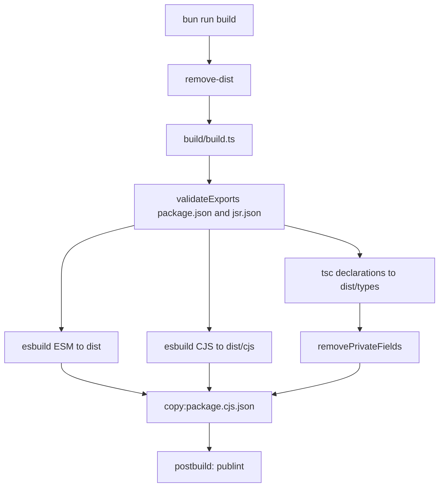

## Overview

Hono is developed with Bun as the package manager and script runner, esbuild and `tsc` for the build, Vitest for the main test suite, and separate per-runtime suites that run the same framework code under Deno, Bun, Node.js, workerd, Fastly Compute, AWS Lambda and Lambda@Edge. The contribution guide asks every contributor to install Bun, install the locked dependencies and make sure `bun run test` passes before opening a pull request.

Sources: [docs/CONTRIBUTING.md:27-39](repo://docs/CONTRIBUTING.md#L27-L39), [package.json:13-37](repo://package.json#L13-L37)

The tool versions CI uses are pinned in `.tool-versions` (Node.js 24.7.0, Bun 1.2.19, Deno 2.4.5), and every workflow job reads them through `node-version-file`, `bun-version-file` or `deno-version-file`. `package.json` additionally declares `packageManager: bun@1.2.20` and an `engines.node` floor of `>=16.9.0` for consumers of the published package.

Sources: [.tool-versions:1-3](repo://.tool-versions#L1-L3), [package.json:695-699](repo://package.json#L695-L699), [.github/workflows/ci.yml:37-53](repo://.github/workflows/ci.yml#L37-L53)

## Local Setup

Clone the repository and install with the frozen lockfile so the dependency tree matches `bun.lock` exactly, which is also what every CI job does.

Sources: [docs/CONTRIBUTING.md:27-35](repo://docs/CONTRIBUTING.md#L27-L35), [.github/workflows/ci.yml:48-48](repo://.github/workflows/ci.yml#L48-L48)

```bash
git clone git@github.com:honojs/hono.git && cd hono && bun install --frozen-lockfile
```

Sources: [docs/CONTRIBUTING.md:56-60](repo://docs/CONTRIBUTING.md#L56-L60)

The dev dependencies show the toolchain: `esbuild` and `typescript` (plus `@typescript/native-preview` for `tsgo`) for building, `vitest`, `@vitest/coverage-v8`, `jsdom`, `msw` and `undici` for tests, `wrangler`, `@hono/node-server` and `vite-plugin-fastly-js-compute` for runtime suites, `eslint` with `@hono/eslint-config`, `prettier` and `editorconfig-checker` for style, `oxc-parser` for post-processing declarations, `publint` for package validation, and `np` and `pkg-pr-new` for releases and preview packages.

Sources: [package.json:668-694](repo://package.json#L668-L694)

## Package Scripts

| Script | Command | Purpose |
| --- | --- | --- |
| `test` | `tsc -p tsconfig.spec.json && vitest --run` | Type-check sources and tests, then run every Vitest project once |
| `test:watch` | `vitest --watch` | Re-run tests on change |
| `test:deno` | three `deno test` runs | Runtime suite under Deno plus the JSX suite with `precompile` and `react-jsx` configs |
| `test:bun` | `bun test --jsx-import-source ../../src/jsx runtime-tests/bun/*` | Runtime suite under Bun |
| `test:fastly`, `test:node`, `test:workerd`, `test:lambda`, `test:lambda-edge` | `vitest --run --project <name>` | One runtime project from the Vitest workspace |
| `test:all` | `bun run test && bun test:deno && bun test:bun` | Main suite plus Deno and Bun |
| `lint` / `lint:fix` | `eslint src runtime-tests build perf-measures benchmarks` | Lint, optionally fixing |
| `format` / `format:fix` | `prettier --check` / `--write` over the same folders | Check or apply formatting |
| `editorconfig-checker` | `editorconfig-checker` | Enforce `.editorconfig` rules |
| `build` | `remove-dist`, `bun ./build/build.ts`, `copy:package.cjs.json` | Produce `dist/` |
| `postbuild` | `publint` | Lint the built package |
| `watch` | `build.ts --watch` | Incremental rebuilds |
| `coverage` | `vitest --run --coverage` | Coverage report |
| `prerelease` / `release` | `bun test:deno && bun run build` / `np --no-publish` | Release preparation |

Sources: [package.json:13-37](repo://package.json#L13-L37)

## Build

### Export Map Validation

Hono ships to npm from `dist/` and to JSR directly from `src/`, so it keeps two export maps: `exports` in `package.json` (pointing at `dist/types`, `dist` and `dist/cjs`) and `exports` in `jsr.json` (pointing at `./src/*.ts`). Before compiling anything, `build/build.ts` reads both maps and calls `validateExports` in each direction, so a subpath added to one file but forgotten in the other stops the build.

Sources: [build/build.ts:18-26](repo://build/build.ts#L18-L26), [package.json:38-58](repo://package.json#L38-L58), [jsr.json:1-12](repo://jsr.json#L1-L12)

`validateExports(source, target, fileName)` throws `Missing "<entry>" in '<fileName>'` for any source key not found in the target. A key matches when it exists verbatim, when it is a wildcard such as `./utils/*` and the target has at least one key under `./utils/`, or when any parent path of it has a wildcard entry in the target (it pops segments and tests `<prefix>/*`). This is why the single `./utils/*` entry in `package.json` can stand for the many individual utility entries listed in `jsr.json`.

Sources: [build/validate-exports.ts:1-37](repo://build/validate-exports.ts#L1-L37), [package.json:319-323](repo://package.json#L319-L323)

### Entry Points and Output Formats

Every `src/**/*.ts` file becomes an entry point except tests, `src/mod.ts`, `src/middleware.ts` and `src/deno/**`. The build then runs three jobs in parallel: an ESM build into `dist/`, a CommonJS build into `dist/cjs/`, and `tsc --emitDeclarationOnly --declaration --project tsconfig.build.json` into `dist/types/`. With `--watch`, esbuild uses `context(...).watch()` and `tsc` gets `-w`.

Sources: [build/build.ts:28-39](repo://build/build.ts#L28-L39), [build/build.ts:72-107](repo://build/build.ts#L72-L107), [tsconfig.build.json:1-19](repo://tsconfig.build.json#L1-L19)

The ESM build sets `bundle: true` but adds the `add-extension` plugin, which resolves every import made from another module as external and rewrites its specifier: `./foo` becomes `./foo.js` when `foo.ts` exists, and `./dir` becomes `./dir/index.js` when `dir/index.ts` exists. The result is one output file per source file with Node-compatible ESM specifiers, rather than a single bundle, which keeps every subpath export tree-shakable. The CJS build is a plain per-file transform without the plugin.

Sources: [build/build.ts:41-92](repo://build/build.ts#L41-L92)

```ts
const esmConfig: BuildOptions = {
  ...commonOptions,
  bundle: true,
  outbase: './src',
  outdir: './dist',
  format: 'esm',
  plugins: [addExtension('.js')],
}
```

Sources: [build/build.ts:85-92](repo://build/build.ts#L85-L92)

### Declaration Post-processing

After `tsc` finishes, the build collects every `dist/types/**/*.d.ts` and passes them to `removePrivateFields`. It parses each file with `oxc-parser`, visits every `ClassDeclaration`, and records each `PropertyDefinition` whose key is a `PrivateIdentifier` (a `#field`). Each recorded range is overwritten with spaces instead of being cut out, so the byte offsets of the remaining removals stay valid; files with no private fields are left untouched. This keeps ECMAScript private fields out of the public type surface.

Sources: [build/build.ts:109-114](repo://build/build.ts#L109-L114), [build/remove-private-fields.ts:1-57](repo://build/remove-private-fields.ts#L1-L57)

### Packaging

Because `package.json` declares `"type": "module"`, the `copy:package.cjs.json` script copies `package.cjs.json` (containing only `"type": "commonjs"`) into `dist/cjs/` and `dist/types/` so Node.js treats those `.js` files as CommonJS. `postbuild` then runs `publint` against the finished package. The `files` field publishes only `dist`, excluding `*.tsbuildinfo`.

Sources: [package.json:1-12](repo://package.json#L1-L12), [package.json:29-31](repo://package.json#L29-L31), [package.cjs.json:1-3](repo://package.cjs.json#L1-L3)



Sources: [package.json:29-31](repo://package.json#L29-L31), [build/build.ts:18-114](repo://build/build.ts#L18-L114)

## Tests

### Vitest Projects

`vitest.config.ts` enables globals and V8 coverage, then defines a workspace of projects. The first entry is a glob, `./runtime-tests/*/vitest.config.ts`, which pulls in each runtime suite as its own project. Three inline projects follow, all compiling JSX with the automatic runtime through oxc.

Sources: [vitest.config.ts:3-30](repo://vitest.config.ts#L3-L30)

| Project | JSX import source | Includes |
| --- | --- | --- |
| `main` | `./src/jsx` | `src/**`, `scripts/**` and `build/**` spec/test files, excluding `**/sandbox/**` and `**/*.case.test.*` |
| `jsx-runtime-default` | `./src/jsx` | `src/jsx/dom/**` tests and `src/jsx/hooks/dom.test.tsx` |
| `jsx-runtime-dom` | `./src/jsx/dom` | the same files as `jsx-runtime-default` |

Sources: [vitest.config.ts:1-73](repo://vitest.config.ts#L1-L73)

The DOM tests run twice on purpose: once with `hono/jsx` as the JSX source and once with `hono/jsx/dom`, so client components behave the same whichever runtime a project configures (see [[Client-Side JSX (hono/jsx/dom)]]). `bun run test` first runs `tsc -p tsconfig.spec.json`, which type-checks `src` including tests with `jsxImportSource: "hono/jsx"` and `vitest/globals` types, so type-level tests fail the run even when the runtime assertions pass.

Sources: [vitest.config.ts:45-70](repo://vitest.config.ts#L45-L70), [tsconfig.spec.json:1-11](repo://tsconfig.spec.json#L1-L11), [package.json:14-14](repo://package.json#L14-L14)

### Runtime Test Suites

Each folder under `runtime-tests/` exercises Hono on one runtime using that runtime's adapter (see [[Runtime Adapters]] and [[AWS Lambda and Lambda@Edge]]). The Vitest-based ones are small `defineProject` configs that set a `name` and, for Node-like runtimes, an `env.NAME` value that tests read back through the `env()` helper.

Sources: [vitest.config.ts:25-26](repo://vitest.config.ts#L25-L26), [runtime-tests/lambda/vitest.config.ts:1-11](repo://runtime-tests/lambda/vitest.config.ts#L1-L11)

| Folder | Runner | Notes |
| --- | --- | --- |
| `runtime-tests/node` | Vitest project `node` | Uses `@hono/node-server` and `undici`; covers minimal patterns only |
| `runtime-tests/workerd` | Vitest project `workerd` | Starts `runtime-tests/workerd/index.ts` with wrangler `unstable_dev` |
| `runtime-tests/fastly` | Vitest project `fastly` | Uses `vite-plugin-fastly-js-compute` |
| `runtime-tests/lambda` | Vitest project `lambda` | Includes handler and streaming mocks |
| `runtime-tests/lambda-edge` | Vitest project `lambda-edge` | Lambda@Edge handler |
| `runtime-tests/deno` | `deno test` | Uses `runtime-tests/deno/deno.json` |
| `runtime-tests/deno-jsx` | `deno test` | Runs twice, `precompile` and `react-jsx` |
| `runtime-tests/bun` | `bun test` | JSX source set via `--jsx-import-source` |

Sources: [runtime-tests/node/vitest.config.ts:1-11](repo://runtime-tests/node/vitest.config.ts#L1-L11), [runtime-tests/workerd/vitest.config.ts:1-8](repo://runtime-tests/workerd/vitest.config.ts#L1-L8), [runtime-tests/fastly/vitest.config.ts:1-10](repo://runtime-tests/fastly/vitest.config.ts#L1-L10), [runtime-tests/lambda/vitest.config.ts:1-11](repo://runtime-tests/lambda/vitest.config.ts#L1-L11), [runtime-tests/lambda-edge/vitest.config.ts:1-11](repo://runtime-tests/lambda-edge/vitest.config.ts#L1-L11), [runtime-tests/node/index.test.ts:1-15](repo://runtime-tests/node/index.test.ts#L1-L15), [package.json:16-22](repo://package.json#L16-L22)

The workerd suite shows the pattern: a real Worker script built from `src/` is started in-process with `unstable_dev`, given a `NAME` var and a compatibility date, and the tests call `worker.fetch` and assert on the response, such as `Hello from workerd` from `getRuntimeKey()`.

Sources: [runtime-tests/workerd/index.test.ts:1-39](repo://runtime-tests/workerd/index.test.ts#L1-L39), [runtime-tests/workerd/index.ts:1-30](repo://runtime-tests/workerd/index.ts#L1-L30)

The Deno configs map `hono/jsx/jsx-runtime` to `../../src/jsx/jsx-runtime.ts` through an import map and enable `sloppy-imports`, so Deno can load the extensionless relative imports in `src/`. The two `deno-jsx` configs differ only in `compilerOptions.jsx`, which checks that both Deno's `precompile` transform and the standard `react-jsx` transform work with [[JSX Server Rendering]].

Sources: [runtime-tests/deno/deno.json:1-14](repo://runtime-tests/deno/deno.json#L1-L14), [runtime-tests/deno-jsx/deno.precompile.json:1-12](repo://runtime-tests/deno-jsx/deno.precompile.json#L1-L12), [runtime-tests/deno-jsx/deno.react-jsx.json:1-12](repo://runtime-tests/deno-jsx/deno.react-jsx.json#L1-L12)

The root `tsconfig.json` is a solution file with no files of its own; it references the build and spec configs, the perf-measures script config and each runtime suite's `tsconfig.json`, so `tsc --build` type-checks them all.

Sources: [tsconfig.json:1-14](repo://tsconfig.json#L1-L14), [runtime-tests/bun/tsconfig.json:1-12](repo://runtime-tests/bun/tsconfig.json#L1-L12)

### Coverage

Vitest writes V8 coverage to `coverage/raw/default` as JSON, text and HTML, and excludes `benchmarks`, `runtime-tests`, `build/build.ts`, `perf-measures` and compile-time-only files such as `src/**/types.ts`, `src/jsx/intrinsic-elements.ts` and `src/utils/http-status.ts`. Bun writes its own coverage to `coverage/raw/bun` via `bunfig.toml`, and the Deno CI job writes LCOV. The CI `coverage` job merges the artifacts of the `main`, `bun` and `deno` jobs and uploads them to Codecov.

Sources: [vitest.config.ts:4-24](repo://vitest.config.ts#L4-L24), [bunfig.toml:1-4](repo://bunfig.toml#L1-L4), [.github/workflows/ci.yml:18-35](repo://.github/workflows/ci.yml#L18-L35)

> [!NOTE]
> `codecov.yml` sets an informational 80% patch target and a 75% project target with a 1% threshold. Exclusions belong in `test.coverage.exclude` in `vitest.config.ts`, because a Codecov `ignore` list is not seen by local Vitest runs.

Sources: [codecov.yml:1-13](repo://codecov.yml#L1-L13)

## Linting and Formatting

`eslint.config.mjs` extends `@hono/eslint-config`, ignores `.wrangler`, `coverage` and `dist`, reports unused disable directives and inline configs as errors, and turns off every typescript-eslint rule that needs type information plus a set of stylistic rules, so linting runs without a type-aware program.

Sources: [eslint.config.mjs:1-80](repo://eslint.config.mjs#L1-L80)

Prettier uses a 100-column print width, two-space indentation, no semicolons, single quotes (also in JSX), ES5 trailing commas and LF line endings. `.editorconfig` requires UTF-8, LF and a final newline everywhere, trims trailing whitespace in code and JSON but not in Markdown or YAML, and exempts binary `lockb` and `pxm` files.

Sources: [.prettierrc:1-9](repo://.prettierrc#L1-L9), [.editorconfig:1-21](repo://.editorconfig#L1-L21)

The `autofix.ci` workflow runs `format:fix` and `lint:fix` on non-draft pull requests and pushes to `main`, and commits any changes as `ci: apply automated fixes`.

Sources: [.github/workflows/autofix.yml:1-32](repo://.github/workflows/autofix.yml#L1-L32)

## Continuous Integration

The `ci` workflow runs on pushes to `main` and `next` and on pull requests, skipping PRs that only touch `docs/**`, `.vscode/**`, `README.md`, `.gitignore` or `LICENSE`.

Sources: [.github/workflows/ci.yml:1-16](repo://.github/workflows/ci.yml#L1-L16)

| Job | What it runs |
| --- | --- |
| `main` | `format`, `lint`, `editorconfig-checker`, `build`, `test`; uploads coverage |
| `jsr-dry-run` | `bunx jsr publish --dry-run` |
| `deno` | Deno runtime and both JSX suites with coverage, then `deno coverage --lcov` |
| `bun` / `bun-windows` | `test:bun` on Ubuntu and Windows |
| `fastly`, `workerd`, `lambda`, `lambda-edge` | `build` then the matching `test:*` project |
| `node` | `build` then `test:node` on Node.js 20.x, 22.x and 24.x |
| `perf-measures-check-on-pr` / `-on-main` | Type-check and bundle-size measurement action |
| `http-benchmark-on-pr` | HTTP benchmark against `main`, posted as a PR comment |
| `coverage` | Merges coverage artifacts and uploads to Codecov |

Sources: [.github/workflows/ci.yml:17-114](repo://.github/workflows/ci.yml#L17-L114), [.github/workflows/ci.yml:115-183](repo://.github/workflows/ci.yml#L115-L183), [.github/workflows/ci.yml:184-267](repo://.github/workflows/ci.yml#L184-L267)

The `cr` workflow builds the package and publishes a preview with `pkg-pr-new publish --compact` on pushes to `main` and on PRs carrying the `cr-tracked` label, only in the `honojs/hono` repository.

Sources: [.github/workflows/cr.yml:1-46](repo://.github/workflows/cr.yml#L1-L46)

## Benchmarks

### HTTP Server Benchmark

`benchmarks/http-server/benchmark.ts` compares the HTTP throughput of a baseline ref against the working tree. It writes a small app using `RegExpRouter` with three routes (`GET /`, `POST /json`, `GET /id/:id` reading a param, a query and setting a header), copies `src/` for each version into `.benchmark-temp`, and drives each with `bombardier --fasthttp` at a concurrency of 500. Results are written to `benchmark-results.md`, which the CI job posts on the PR after minimising earlier benchmark comments.

Sources: [benchmarks/http-server/benchmark.ts:1-52](repo://benchmarks/http-server/benchmark.ts#L1-L52), [benchmarks/http-server/benchmark.ts:180-190](repo://benchmarks/http-server/benchmark.ts#L180-L190), [.github/workflows/ci.yml:194-257](repo://.github/workflows/ci.yml#L194-L257)

| Option | Default | Description |
| --- | --- | --- |
| `--baseline=<ref>` | `origin/main` | Git ref checked out for the baseline |
| `--target=<ref>` | `current` | Ref for the target; `current` uses `src/` as is |
| `--runs=<n>` | `1` | Number of benchmark runs |
| `--duration=<s>` | `10` | Seconds per bombardier test |
| `--skip-tests` | off | Skip endpoint validation before benchmarking |

Sources: [benchmarks/http-server/benchmark.ts:21-30](repo://benchmarks/http-server/benchmark.ts#L21-L30)

> [!WARNING]
> For a non-`current` ref the script runs `git fetch origin`, stashes local changes, checks out the ref and runs `bun install --frozen-lockfile` in the repository root, then checks out the previous ref and pops the stash afterwards. Commit or stash work before running it locally. It requires Bun and `bombardier` on `PATH`.

Sources: [benchmarks/http-server/benchmark.ts:93-178](repo://benchmarks/http-server/benchmark.ts#L93-L178), [benchmarks/http-server/README.md:11-21](repo://benchmarks/http-server/README.md#L11-L21)

### Router Benchmarks

`benchmarks/routers` measures route matching with `mitata`, comparing Hono's `RegExpRouter`, `TrieRouter` and `PatternRouter` (imported directly from `src/router/`) against find-my-way, express, koa-router, koa-tree-router, trek-router, @medley/router, radix3, memoirist and rou3 over named route cases such as `short static` and `static with same radix`. It has its own `package.json`, so install inside the folder and run `bench:node` (via `tsx`) or `bench:bun`; the `bench-includes-init` variants also time router construction. `benchmarks/routers-deno` is the Deno equivalent. The routers themselves are covered in [[Router Implementations]].

Sources: [benchmarks/routers/src/bench.mts:1-40](repo://benchmarks/routers/src/bench.mts#L1-L40), [benchmarks/routers/package.json:1-24](repo://benchmarks/routers/package.json#L1-L24), [benchmarks/routers/README.md:16-32](repo://benchmarks/routers/README.md#L16-L32), [benchmarks/routers-deno/README.md:15-19](repo://benchmarks/routers-deno/README.md#L15-L19)

### JSX and Query Parameter Benchmarks

`benchmarks/jsx` renders the same page through Hono's JSX (imported from `../../../src/jsx`), React, Preact and nano-jsx, with `bench:node` (esbuild bundle piped into Node), `bench:bun`, a `react-jsx` variant, and `compare-bundle-size`, which minifies each renderer's entry into `dist/` for size comparison. `benchmarks/query-param` compares Hono's query parsing with `qs` and `fast-querystring`.

Sources: [benchmarks/jsx/package.json:1-29](repo://benchmarks/jsx/package.json#L1-L29), [benchmarks/jsx/src/hono.ts:1-4](repo://benchmarks/jsx/src/hono.ts#L1-L4), [benchmarks/query-param/package.json:1-16](repo://benchmarks/query-param/package.json#L1-L16)

## Performance Measures

### Type-Check Cost

Hono's typed routing can make type-checking expensive, so CI tracks compiler cost. The `perf-measures` composite action runs `perf-measures/type-check/scripts/generate-app.ts`, which writes `generated/app.ts`: a single `new Hono()` chain of 200 `.get('/routeN/:id', ...)` routes. It then compiles it with `tsc --diagnostics` and again with `tsgo --diagnostics`, and pipes each output through `process-results.ts`.

Sources: [.github/actions/perf-measures/action.yml:1-37](repo://.github/actions/perf-measures/action.yml#L1-L37), [perf-measures/type-check/scripts/generate-app.ts:1-27](repo://perf-measures/type-check/scripts/generate-app.ts#L1-L27)

`process-results.ts` requires `BENCHMARK_TS_IMPL_LABEL` (`tsc` or `typescript-go`), splits each `Name: value` diagnostics line, separates a trailing unit such as `s` or `K` from the number, kebab-cases the name into a metric key, and prints a JSON benchmark keyed `diagnostics-<label>`.

Sources: [perf-measures/type-check/scripts/process-results.ts:1-51](repo://perf-measures/type-check/scripts/process-results.ts#L1-L51)

### Bundle Size

After `bun run build`, `check-bundle-size.ts` bundles and minifies `dist/index.js` with esbuild as ES2022 ESM into a temporary file and reports its size in bytes and kilobytes as the `bundle-size-check` benchmark.

Sources: [perf-measures/bundle-check/scripts/check-bundle-size.ts:1-52](repo://perf-measures/bundle-check/scripts/check-bundle-size.ts#L1-L52)

The action hands the three JSON files to octocov as custom metrics. On pull requests (`target-ref: auto`) octocov compares against the stored baseline; on `main` it uses the `.main.yml` config with `OCTOCOV_GITHUB_REF` set to `refs/heads/main` to record a new baseline.

Sources: [.github/actions/perf-measures/action.yml:39-64](repo://.github/actions/perf-measures/action.yml#L39-L64), [.github/workflows/ci.yml:184-192](repo://.github/workflows/ci.yml#L184-L192), [.github/workflows/ci.yml:259-267](repo://.github/workflows/ci.yml#L259-L267)

## Contributing

Contributions can be issues, pull requests, third-party middleware or applications built with Hono. The project remains its author's personal project, so a well-made proposal can still be declined. AI-assisted contributions are allowed, but a maintainer may close a PR without notice and block the account if it wastes maintainers' time, whether or not AI was used.

Sources: [docs/CONTRIBUTING.md:1-25](repo://docs/CONTRIBUTING.md#L1-L25)

The pull request template asks authors to add tests, run them, run `bun run format:fix && bun run lint:fix`, and add TSDoc/JSDoc to new code.

Sources: [.github/pull_request_template.md:1-6](repo://.github/pull_request_template.md#L1-L6)

Middleware that depends on other libraries or works only on one runtime, such as GraphQL, Firebase Auth or Sentry middleware, does not belong in the core. It lives in the `honojs/middleware` monorepo under the `@honojs` namespace; open an issue there to propose one.

Sources: [docs/CONTRIBUTING.md:41-54](repo://docs/CONTRIBUTING.md#L41-L54)

## Releases

`prerelease` runs the Deno suite and a build, and `release` runs `np --no-publish` to version and tag. Pushing a tag triggers the `release` workflow, which builds and publishes to npm with provenance, and in parallel publishes `src/` to JSR as `@hono/hono` with `jsr:@david/publish-on-tag`.

Sources: [package.json:34-35](repo://package.json#L34-L35), [.github/workflows/release.yml:1-51](repo://.github/workflows/release.yml#L1-L51), [jsr.json:1-3](repo://jsr.json#L1-L3)
