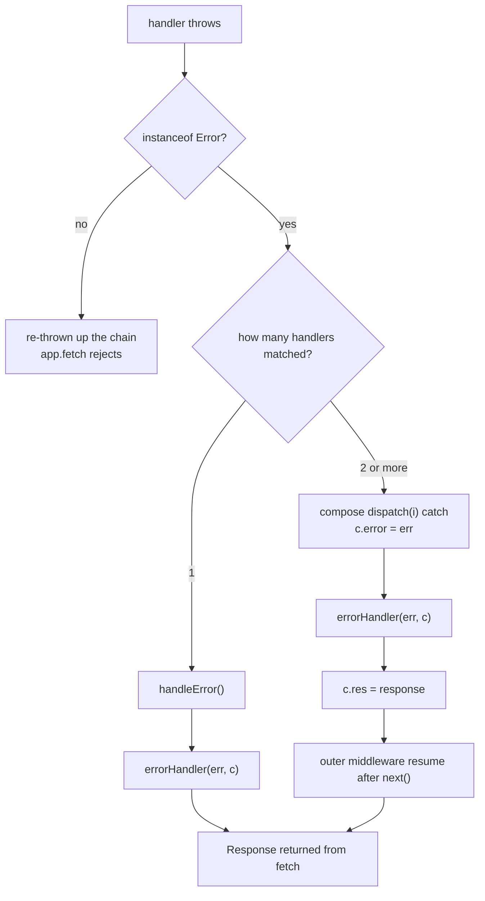

## Overview

Hono turns failures into responses in two places. `app.onError` receives every `Error` thrown by a handler or middleware. `app.notFound` produces the response when no handler answers a request. `HTTPException` in `src/http-exception.ts` connects the two: middleware throws it to stop a request with a specific status, and the error handler converts it into a `Response` through its `getResponse()` method.

Sources: [src/hono-base.ts:31-42](repo://src/hono-base.ts#L31-L42), [src/hono-base.ts:271-294](repo://src/hono-base.ts#L271-L294), [src/http-exception.ts:46-78](repo://src/http-exception.ts#L46-L78)

Errors are caught close to where they are thrown. `compose` catches them at the layer of the chain that threw. The single-handler fast path and the outer `#dispatch` catch the rest and send them to `#handleError`. Outer middleware therefore keep running after an error and can inspect `c.error`.

Sources: [src/compose.ts:49-60](repo://src/compose.ts#L49-L60), [src/hono-base.ts:399-466](repo://src/hono-base.ts#L399-L466)

## HTTPException

### Constructing one

`new HTTPException(status = 500, options?)` passes `options.message` and `options.cause` to the native `Error` constructor, so `err.message` and `err.cause` behave like any other error. It stores `res` and `status` as read-only fields. `status` is typed as `ContentfulStatusCode`, which excludes codes that cannot carry a body, such as 204 or 304.

Sources: [src/http-exception.ts:6-18](repo://src/http-exception.ts#L6-L18), [src/http-exception.ts:46-59](repo://src/http-exception.ts#L46-L59)

| Option | Type | Description |
| --- | --- | --- |
| `res` | `Response` | A ready-made response to send. Its body and headers are used, but its status is replaced by the exception's `status`. |
| `message` | `string` | The error message, and the plain-text response body when `res` is absent. |
| `cause` | `unknown` | The underlying error, available as `err.cause` in `onError`. |

Sources: [src/http-exception.ts:8-18](repo://src/http-exception.ts#L8-L18), [src/http-exception.ts:61-77](repo://src/http-exception.ts#L61-L77)

```ts
import { HTTPException } from 'hono/http-exception'

app.post('/auth', async (c, next) => {
  if (!(await isAuthorized(c))) {
    throw new HTTPException(401, { message: 'Custom error message' })
  }
  await next()
})

// Full control over the body and headers:
const res = new Response('Unauthorized', { headers: { 'WWW-Authenticate': 'Bearer' } })
throw new HTTPException(401, { res, cause: originalError })
```

Sources: [src/http-exception.ts:20-59](repo://src/http-exception.ts#L20-L59)

### getResponse

`getResponse()` builds a new `Response` on every call. With `res` set, it returns `new Response(res.body, { status: this.status, headers: res.headers })`. A `res` created with status 403 inside an `HTTPException(401, ...)` is sent as 401. Without `res`, the body is `this.message` (empty when no message was given) with `this.status`.

Sources: [src/http-exception.ts:61-77](repo://src/http-exception.ts#L61-L77)

Built-in middleware rely on this class. The validator throws 400 on malformed JSON or form data. `jwt` and `bearerAuth` throw 401 (and `bearerAuth` 400 for a malformed header) with a `WWW-Authenticate` response. `csrf` and `ipRestriction` throw 403, and `timeout` throws 504 `Gateway Timeout`. `cloneRawRequest` throws 500 when the body can no longer be rebuilt.

Sources: [src/validator/validator.ts:94-126](repo://src/validator/validator.ts#L94-L126), [src/middleware/jwt/jwt.ts:80-92](repo://src/middleware/jwt/jwt.ts#L80-L92), [src/middleware/bearer-auth/index.ts:122-153](repo://src/middleware/bearer-auth/index.ts#L122-L153), [src/middleware/csrf/index.ts:140-150](repo://src/middleware/csrf/index.ts#L140-L150), [src/middleware/ip-restriction/index.ts:231-236](repo://src/middleware/ip-restriction/index.ts#L231-L236), [src/middleware/timeout/index.ts:10-14](repo://src/middleware/timeout/index.ts#L10-L14), [src/request.ts:476-487](repo://src/request.ts#L476-L487)

## The error handler

### Default behavior

The default `errorHandler` checks with `'getResponse' in err`, not with `instanceof HTTPException`. Any error object that has a `getResponse()` method (the `HTTPResponseError` interface) is answered with its own response. That response goes through `c.newResponse(res.body, res)`, so headers set earlier with `c.header()` (CORS headers, for example) are merged into it. Every other error is logged with `console.error` and answered with `Internal Server Error` and status 500.

Sources: [src/hono-base.ts:35-42](repo://src/hono-base.ts#L35-L42), [src/types.ts:113-119](repo://src/types.ts#L113-L119), [src/context.ts:604-641](repo://src/context.ts#L604-L641)

### Custom onError

`app.onError(handler)` replaces the handler for the whole app. The `ErrorHandler` type receives `(err, c)` and must return a `Response` or a promise of one. A custom handler takes over everything, so call `err.getResponse()` yourself to keep `HTTPException` statuses.

Sources: [src/hono-base.ts:255-274](repo://src/hono-base.ts#L255-L274), [src/types.ts:116-119](repo://src/types.ts#L116-L119)

```ts
import { HTTPException } from 'hono/http-exception'

app.onError((err, c) => {
  if (err instanceof HTTPException) {
    return err.getResponse()
  }
  console.error(err, err.cause)
  return c.json({ message: 'Internal Server Error' }, 500)
})
```

Sources: [src/hono-base.ts:255-274](repo://src/hono-base.ts#L255-L274), [src/http-exception.ts:61-77](repo://src/http-exception.ts#L61-L77)

### Errors in sub-applications

When a sub-app with its own `onError` is attached with `app.route(path, subApp)`, each of its handlers is wrapped in `compose([], subApp.errorHandler)`. Errors from those routes reach the sub-app's handler first. Sub-apps that keep the default handler are copied unwrapped, and their errors reach the parent's `onError`.

Sources: [src/hono-base.ts:208-232](repo://src/hono-base.ts#L208-L232)

```ts
const api = new Hono()
api.onError((err, c) => c.json({ error: err.message }, 500))
api.get('/fail', () => { throw new Error('boom') })

const app = new Hono()
app.route('/api', api) // GET /api/fail -> {"error":"boom"} from api.onError
```

Sources: [src/hono-base.ts:219-229](repo://src/hono-base.ts#L219-L229)

## How errors flow

### Where an error is caught

The path an error takes depends on how many handlers matched and where it was thrown:

Sources: [src/compose.ts:49-69](repo://src/compose.ts#L49-L69), [src/hono-base.ts:399-466](repo://src/hono-base.ts#L399-L466)

1. With two or more matched handlers, `dispatch(i)` in `compose` catches an `Error` thrown by handler `i`. It sets `c.error = err`, awaits `onError(err, c)` and writes the result to `c.res`, even if the context was already finalized. It then resolves normally, so the middleware above continue after `await next()`.
2. With exactly one matched handler, `#dispatch` calls it directly. A synchronous throw is caught by `try`/`catch`, and a rejected promise by `.catch`. Both go to `#handleError`.
3. Errors that escape `compose`, such as the "Context is not finalized" error raised after the chain, are caught by the `try` around `composed(c)` and passed to `#handleError`.
4. `#handleError` calls the error handler for `Error` instances and re-throws anything else.

Sources: [src/compose.ts:49-69](repo://src/compose.ts#L49-L69), [src/hono-base.ts:399-466](repo://src/hono-base.ts#L399-L466)



Sources: [src/compose.ts:49-69](repo://src/compose.ts#L49-L69), [src/hono-base.ts:399-466](repo://src/hono-base.ts#L399-L466)

```ts
app.use(async (c, next) => {
  await next()
  if (c.error) {
    c.res.headers.set('X-Error', c.error.name) // the 500 (or HTTPException) response is already in c.res
  }
})
```

Sources: [src/compose.ts:49-60](repo://src/compose.ts#L49-L60), [src/context.ts:318-333](repo://src/context.ts#L318-L333)

### Pitfalls

> [!WARNING]
> An `onError` handler that throws is not protected. Inside `compose`, the new exception leaves `dispatch(i)` and is caught by the next outer layer, which calls `onError` again. At the top, `#handleError` calls it a final time, and then `app.fetch` rejects. With one middleware in front of a failing handler, `onError` runs three times.

Sources: [src/compose.ts:49-60](repo://src/compose.ts#L49-L60), [src/hono-base.ts:399-404](repo://src/hono-base.ts#L399-L404), [src/hono-base.ts:452-465](repo://src/hono-base.ts#L452-L465)

Throwing a value that is not an `Error`, such as `throw 'nope'` or a plain object, skips every error handler. `compose` re-throws it and `#handleError` throws it again, so the runtime sees a rejected `fetch`. Wrap such values in `HTTPException` or `Error`.

Sources: [src/compose.ts:53-58](repo://src/compose.ts#L53-L58), [src/hono-base.ts:399-404](repo://src/hono-base.ts#L399-L404)

## Not found handling

### When the not-found handler runs

The default `notFoundHandler` returns `c.text('404 Not Found', 404)`. `app.notFound(handler)` replaces it. The handler is passed into each request's `Context` at creation, so a change applies from the next request on. It runs in four cases:

Sources: [src/hono-base.ts:31-33](repo://src/hono-base.ts#L31-L33), [src/hono-base.ts:286-294](repo://src/hono-base.ts#L286-L294), [src/hono-base.ts:418-448](repo://src/hono-base.ts#L418-L448), [src/compose.ts:42-65](repo://src/compose.ts#L42-L65), [src/context.ts:764-779](repo://src/context.ts#L764-L779)

1. No route matched. `compose` gets an empty list and calls `onNotFound` at index 0.
2. Every matched handler called `await next()` and none returned a response. `dispatch` ran past the end of the list with the context still not finalized.
3. A single matched handler called `next()`. The `next` supplied by the fast path sets `c.res` to the not-found response, and a handler returning `undefined` also falls through to it.
4. A handler called `c.notFound()`.

Sources: [src/hono-base.ts:31-33](repo://src/hono-base.ts#L31-L33), [src/hono-base.ts:286-294](repo://src/hono-base.ts#L286-L294), [src/hono-base.ts:418-448](repo://src/hono-base.ts#L418-L448), [src/compose.ts:42-65](repo://src/compose.ts#L42-L65), [src/context.ts:764-779](repo://src/context.ts#L764-L779)

```ts
app.notFound((c) => c.json({ message: 'Not Found', path: c.req.path }, 404))

app.get('/users/:id', async (c) => {
  const user = await findUser(c.req.param('id'))
  return user ? c.json(user) : c.notFound()
})
```

Sources: [src/hono-base.ts:276-294](repo://src/hono-base.ts#L276-L294), [src/context.ts:764-779](repo://src/context.ts#L764-L779)

### Scope and typing

Only the application whose `fetch` is called provides the not-found handler. `app.route()` copies routes, but not the sub-app's `notFound` handler, so set it on the top-level app. To give `c.notFound()` a precise return type for the [[RPC Client]], augment the `NotFoundResponse` interface.

Sources: [src/hono-base.ts:208-232](repo://src/hono-base.ts#L208-L232), [src/types.ts:97-111](repo://src/types.ts#L97-L111)

```ts
declare module 'hono' {
  interface NotFoundResponse extends Response, TypedResponse<string, 404, 'text'> {}
}
```

Sources: [src/types.ts:97-111](repo://src/types.ts#L97-L111)
