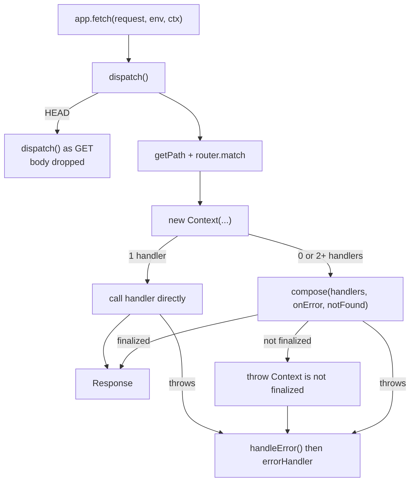

## Overview

Every Hono program starts from one object: the application. It keeps a list of routes, passes each one to a router, and exposes a single `fetch(request, env, executionCtx)` function that any Web-standard runtime can call. All of the behavior lives in `HonoBase` in `src/hono-base.ts`. That class has no router of its own. The exported `Hono` classes (the presets) extend it and only set `this.router` in their constructors.

Sources: [src/hono-base.ts:98-124](repo://src/hono-base.ts#L98-L124), [src/hono.ts:16-34](repo://src/hono.ts#L16-L34)

The class has four generic parameters: `E` (the `Env` with `Bindings` and `Variables`), `S` (the route `Schema` collected for the [[RPC Client]]), `BasePath` and `CurrentPath`. Each registration method returns `this` cast to a new type. A chain such as `new Hono().get(...).post(...)` therefore builds up the schema type at compile time, while at runtime it only appends routes. The default router and the alternatives are covered in [[Presets]].

Sources: [src/hono-base.ts:98-112](repo://src/hono-base.ts#L98-L112), [src/types.ts:26-35](repo://src/types.ts#L26-L35)

```ts
import { Hono } from 'hono'

type Env = { Bindings: { DB: D1Database }; Variables: { user: string } }

const app = new Hono<Env>()

app.get('/', (c) => c.text('Hello Hono!'))

export default app // runtimes call app.fetch(request, env, ctx)
```

Sources: [src/hono.ts:16-34](repo://src/hono.ts#L16-L34), [src/hono-base.ts:479-485](repo://src/hono-base.ts#L479-L485)

## Constructor options

`HonoOptions` has three fields. The constructor takes `strict` out and copies the remaining options onto the instance with `Object.assign`, so `router` and `getPath` become instance properties. It then picks the path extractor. With `strict` left at its default of `true`, the extractor is your `getPath` if you gave one, otherwise the built-in `getPath`. With `strict: false`, the extractor is always `getPathNoStrict`, and any custom `getPath` is ignored.

Sources: [src/hono-base.ts:46-87](repo://src/hono-base.ts#L46-L87), [src/hono-base.ts:170-173](repo://src/hono-base.ts#L170-L173)

| Option | Type | Default | Description |
| --- | --- | --- | --- |
| `strict` | `boolean` | `true` | When `false`, `/hello/` and `/hello` resolve to the same route because the trailing slash is removed before matching. |
| `router` | `Router<[H, RouterRoute]>` | `SmartRouter` of `RegExpRouter` + `TrieRouter` (in `hono`) | The router that stores and matches routes. Only the `hono` preset reads this option. |
| `getPath` | `(request, { env }) => string` | `getPath` from `utils/url` | Picks the string the router matches against. It also receives `env`, so you can route on the host header or on a binding. |

Sources: [src/hono-base.ts:46-87](repo://src/hono-base.ts#L46-L87), [src/hono.ts:26-33](repo://src/hono.ts#L26-L33)

The default `getPath` skips the scheme and host and scans the URL up to the first `?` or `#`. This avoids building a `URL` object for every request. If it finds a `%`, it switches to `indexOf` and decodes the path with `tryDecodeURI`, which leaves invalid escape sequences as written. `%25` is escaped first so that it does not decode twice. `getPathNoStrict` calls `getPath` and then removes one trailing `/` from any path longer than `/`.

Sources: [src/utils/url.ts:106-146](repo://src/utils/url.ts#L106-L146)

```ts
const app = new Hono({
  getPath: (req) =>
    '/' + req.headers.get('host') + req.url.replace(/^https?:\/\/[^/]+(\/[^?]*)/, '$1'),
})

app.get('/www1.example.com/hello', (c) => c.text('hello www1'))
```

Sources: [src/hono-base.ts:66-86](repo://src/hono-base.ts#L66-L86)

## Registering routes

### Method handlers

The constructor creates `get`, `post`, `put`, `delete`, `options`, `patch` and `all` in a loop over `METHODS` plus `'all'`. Each generated function checks its first argument. If it is a string, that string becomes the private current path `#path`. Otherwise the argument is a handler and is registered on the current `#path`. Every following argument is registered on the same path, in order. `#path` starts at `/` and keeps its value between calls. So `app.get('/x', h).post(h2)` registers `POST /x`.

Sources: [src/hono-base.ts:126-141](repo://src/hono-base.ts#L126-L141), [src/router.ts:9-17](repo://src/router.ts#L9-L17)

`app.on(method, path, ...handlers)` accepts a string or an array for both `method` and `path`. It registers every handler for every combination and upper-cases each method. This is the way to register methods that have no shortcut, such as `PURGE`, or several methods at once.

Sources: [src/hono-base.ts:143-154](repo://src/hono-base.ts#L143-L154)

`app.use(path?, ...middleware)` registers handlers under the method `ALL`. When the first argument is not a string, the path becomes `*` and the first argument joins the handler list. `use` also sets `#path`, so a later `app.get(handler)` with no path lands on `*`.

Sources: [src/hono-base.ts:156-168](repo://src/hono-base.ts#L156-L168)

```ts
app.use(logger())                       // ALL *
app.use('/admin/*', basicAuth(opts))    // ALL /admin/*
app.on(['PUT', 'DELETE'], '/post/:id', (c) => c.text('ok'))
app.on('PURGE', ['/cache', '/cdn'], (c) => c.text('purged'))
```

Sources: [src/hono-base.ts:143-168](repo://src/hono-base.ts#L143-L168)

### How a route is stored

All registration paths end in `#addRoute`. It upper-cases the method and prefixes the path with the instance's `_basePath` using `mergePath`. It then builds a `RouterRoute` record `{ basePath, path, method, handler }`. The router stores the tuple `[handler, route]`, so a match returns the handler together with its route metadata. The same record is also pushed onto `app.routes`, which `route()`, the dev helpers and `matchedRoutes` read later.

Sources: [src/hono-base.ts:385-397](repo://src/hono-base.ts#L385-L397), [src/types.ts:57-62](repo://src/types.ts#L57-L62)

`mergePath` joins path segments without doubling or dropping slashes. `mergePath('/api', '/users')` gives `/api/users`, and a sub-path of `/` adds nothing (`mergePath('/api', '/')` is `/api`).

Sources: [src/utils/url.ts:148-169](repo://src/utils/url.ts#L148-L169)

## Grouping routes

### basePath

`basePath(path)` returns a new instance from `#clone()`, with `_basePath` set to the merged path. The clone is a plain `HonoBase` that shares the original's `router`, `getPath`, error handler, not-found handler and the same `routes` array. A route added to the returned instance is therefore added to the original application, under the prefix.

Sources: [src/hono-base.ts:175-188](repo://src/hono-base.ts#L175-L188), [src/hono-base.ts:247-253](repo://src/hono-base.ts#L247-L253)

```ts
const api = new Hono().basePath('/api')
api.get('/book', (c) => c.text('List Books')) // GET /api/book
```

Sources: [src/hono-base.ts:247-253](repo://src/hono-base.ts#L247-L253)

### route

`route(path, subApp)` calls `this.basePath(path)` and then copies every entry of `subApp.routes` into the parent's router through `#addRoute`. It keeps the sub-app's own `basePath` in the stored record. The copy happens once, at call time. A route added to the sub-app after `app.route()` is never seen by the parent, so register the sub-app's routes first.

Sources: [src/hono-base.ts:208-232](repo://src/hono-base.ts#L208-L232)

When the sub-app has its own `onError` handler (not the default `errorHandler`), each copied handler is wrapped in `compose([], app.errorHandler)`. Errors thrown inside the sub-app's routes then reach the sub-app's handler and not the parent's. The wrapper stores the original handler under `COMPOSED_HANDLER`, so `findTargetHandler` in `utils/handler.ts` can unwrap it. The sub-app's `notFound` handler is not carried over. Unmatched paths always reach the not-found handler of the application whose `fetch` was called.

Sources: [src/hono-base.ts:219-229](repo://src/hono-base.ts#L219-L229), [src/utils/handler.ts:1-14](repo://src/utils/handler.ts#L1-L14)

```ts
const books = new Hono()
books.get('/', (c) => c.text('List Books'))
books.get('/:id', (c) => c.text('Get Book: ' + c.req.param('id')))

const app = new Hono()
app.route('/books', books) // GET /books, GET /books/:id
```

Sources: [src/hono-base.ts:190-232](repo://src/hono-base.ts#L190-L232)

### mount

`mount(path, applicationHandler, options?)` passes requests to a non-Hono `(request, ...args) => Response` function, for example another framework's fetch handler. It registers one `ALL` middleware on `mergePath(path, '*')`. The middleware calls the foreign handler with a rewritten request and extra arguments. If the handler returns a falsy value, the middleware calls `await next()`, so later Hono routes still get the request.

Sources: [src/hono-base.ts:328-383](repo://src/hono-base.ts#L328-L383)

| Option | Default | Effect |
| --- | --- | --- |
| `options` given as a function | none | Used as `optionHandler`. |
| `optionHandler(c)` | returns `[c.env, executionCtx]` | Its return value (wrapped in an array if it is not one) is spread after the request. `executionCtx` is `undefined` if reading `c.executionCtx` throws. |
| `replaceRequest` | strip the mount prefix | Builds a new `Request` whose pathname is `getPath(request)` without the merged base path and mount path (`/` if nothing is left). |
| `replaceRequest: false` | none | Passes the original request unchanged. |

Sources: [src/hono-base.ts:89-96](repo://src/hono-base.ts#L89-L96), [src/hono-base.ts:333-370](repo://src/hono-base.ts#L333-L370)

## Serving requests

### fetch, request and fire

`fetch(request, env?, executionCtx?)` is the entry point runtimes call. It forwards to `#dispatch(request, executionCtx, env, request.method)`. `request(input, init?, env?, ctx?)` is a test helper. A `Request` input is used as is, or re-created with `init` if `init` is given. A string or `URL` that starts with `http://` or `https://` is used unchanged. Anything else is treated as a path and prefixed with `http://localhost`. `fire()` registers a global `fetch` event listener for Service Worker style runtimes and is deprecated in favour of `fire` from `hono/service-worker`.

Sources: [src/hono-base.ts:479-542](repo://src/hono-base.ts#L479-L542)

```ts
const res = await app.request('/posts?page=2', { headers: { Accept: 'application/json' } })
const res2 = await app.request('/admin', {}, { SECRET: 'test' }) // third arg becomes c.env
```

Sources: [src/hono-base.ts:499-517](repo://src/hono-base.ts#L499-L517)

> [!NOTE]
> `env` is stored on the context exactly as passed. Calling `app.fetch(req)` or `app.request(path)` without the argument leaves `c.env` as `undefined`, not `{}`.

Sources: [src/hono-base.ts:418-427](repo://src/hono-base.ts#L418-L427), [src/context.ts:352-361](repo://src/context.ts#L352-L361)

### Dispatch flow

`#dispatch` handles a request in these steps:

Sources: [src/hono-base.ts:399-466](repo://src/hono-base.ts#L399-L466)

1. A `HEAD` request is dispatched again as `GET`, and the result is wrapped in `new Response(null, res)`, which keeps the status and headers and drops the body.
2. The path comes from `this.getPath(request, { env })`, and `this.router.match(method, path)` returns the matched `[handler, route]` pairs with their parameters.
3. A `Context` is built with the request, path, match result, `env`, `executionCtx` and the current not-found handler.
4. If exactly one handler matched, it is called directly, without `compose`, and its `next` sets `c.res` to the not-found response. A synchronous return of `undefined` falls through to `notFoundHandler`. A promise that resolves to nothing returns `c.res` if the context was finalized, and the not-found response otherwise.
5. Otherwise `compose(matchResult[0], errorHandler, notFoundHandler)` runs the chain (see [[Middleware and Composition]]). If the context still has no response at the end, dispatch throws an `Error` that starts with "Context is not finalized", which then reaches the error handler (a 500 response by default).
6. Every error from steps 4 and 5 goes to `#handleError`, which calls the error handler for `Error` instances and re-throws anything else.

Sources: [src/hono-base.ts:399-466](repo://src/hono-base.ts#L399-L466)



Sources: [src/hono-base.ts:406-485](repo://src/hono-base.ts#L406-L485)

When no route matches, `matchResult[0]` is empty and dispatch takes the `compose` branch. `compose` finds no handler at index 0 and calls the not-found handler. Error and not-found behavior is described in [[Error Handling]].

Sources: [src/hono-base.ts:429-450](repo://src/hono-base.ts#L429-L450), [src/compose.ts:43-65](repo://src/compose.ts#L43-L65)

## Not-found and error hooks

`app.notFound(handler)` and `app.onError(handler)` replace the private `#notFoundHandler` and `errorHandler` and return the app. The defaults are module-level functions. `notFoundHandler` returns `c.text('404 Not Found', 404)`. `errorHandler` returns `err.getResponse()` for errors that have that method (such as `HTTPException`), and otherwise logs with `console.error` and returns `Internal Server Error` with status 500.

Sources: [src/hono-base.ts:31-42](repo://src/hono-base.ts#L31-L42), [src/hono-base.ts:271-294](repo://src/hono-base.ts#L271-L294)

```ts
app.notFound((c) => c.json({ message: 'Not Found' }, 404))

app.onError((err, c) => {
  console.error(`${err}`)
  return c.text('Custom Error Message', 500)
})
```

Sources: [src/hono-base.ts:255-294](repo://src/hono-base.ts#L255-L294)
