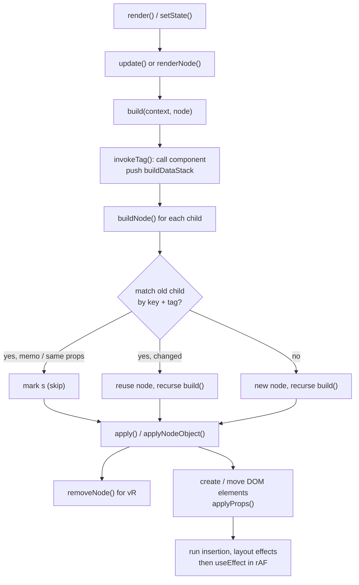
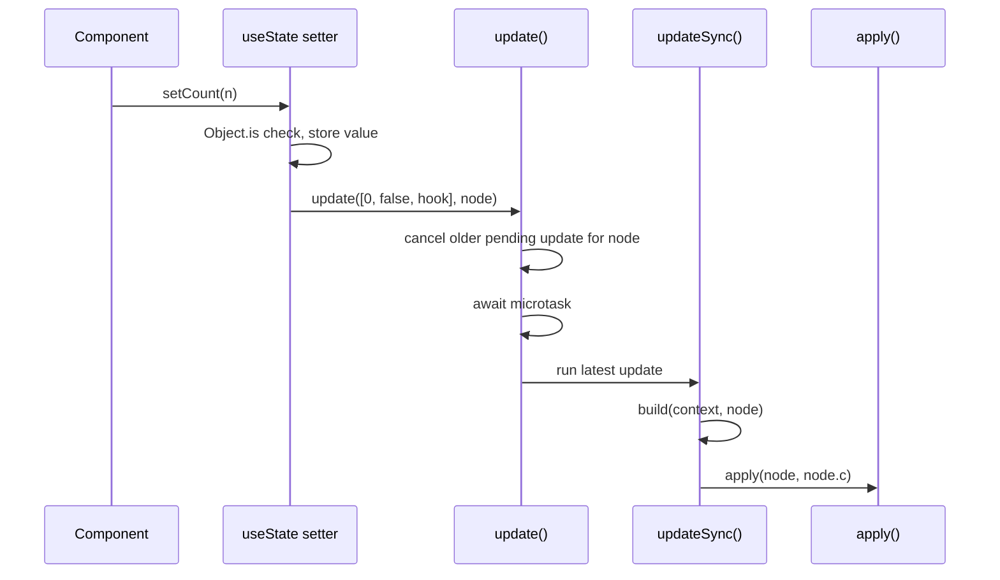

## Overview

`hono/jsx/dom` runs the same JSX syntax that Hono renders to strings on the server inside the browser. Instead of producing an `HtmlEscapedString`, it builds a lightweight virtual DOM, diffs it against the previous build and patches real DOM nodes. It ships a React-compatible API surface (`useState`, `useEffect`, `Suspense`, `ErrorBoundary`, `createPortal`, `memo`, `createRoot`...) so components and libraries written against React's API can often run unchanged, while keeping the runtime small.

Sources: [src/jsx/dom/index.ts:6-125](repo://src/jsx/dom/index.ts#L6-L125)

The package is split into several entry points: the main module with hooks and components, a JSX runtime for the compiler, a `react-dom/client`-style module, a `react-dom/server`-style module and a CSS-in-JS helper. Server-side rendering itself is covered in [[JSX Server Rendering]].

Sources: [package.json:179-208](repo://package.json#L179-L208)

## Entry points

### Module map

| Import path | Source | What it provides |
| --- | --- | --- |
| `hono/jsx/dom` | `src/jsx/dom/index.ts` | `render`, all hooks, `Suspense`, `ErrorBoundary`, `createContext`, `memo`, `createElement`, `cloneElement`, `Children`, `Fragment`/`StrictMode`, `flushSync`, `createPortal`, `version` |
| `hono/jsx/dom/jsx-runtime` | `src/jsx/dom/jsx-runtime.ts` | `jsx`, `jsxs`, `Fragment` for the automatic JSX transform |
| `hono/jsx/dom/jsx-dev-runtime` | `src/jsx/dom/jsx-dev-runtime.ts` | `jsxDEV`, `Fragment` |
| `hono/jsx/dom/client` | `src/jsx/dom/client.ts` | `createRoot`, `hydrateRoot` (mirrors `react-dom/client`) |
| `hono/jsx/dom/server` | `src/jsx/dom/server.ts` | `renderToString`, `renderToReadableStream` (mirrors `react-dom/server`) |
| `hono/jsx/dom/css` | `src/jsx/dom/css.ts` | `css`, `cx`, `keyframes`, `viewTransition`, `Style`, `createCssContext` |

Sources: [package.json:179-208](repo://package.json#L179-L208), [src/jsx/dom/index.ts:85-125](repo://src/jsx/dom/index.ts#L85-L125)

### Configuring the compiler

To compile `.tsx` files for the browser, point `jsxImportSource` at `hono/jsx/dom`. The runtime module re-exports `jsxDEV` as both `jsx` and `jsxs`, so production and development builds share one factory.

Sources: [src/jsx/dom/jsx-runtime.ts:1-8](repo://src/jsx/dom/jsx-runtime.ts#L1-L8)

```json
{
  "compilerOptions": {
    "jsx": "react-jsx",
    "jsxImportSource": "hono/jsx/dom"
  }
}
```

Sources: [src/jsx/dom/jsx-runtime.ts:1-8](repo://src/jsx/dom/jsx-runtime.ts#L1-L8)

### The JSX factory

`jsxDEV` returns a plain object (`tag`, `type`, `props`, `key`, `ref`) rather than the `JSXNode` class instances used for string rendering. Before building it, the factory checks whether the string tag has a DOM-specific replacement component (`title`, `script`, `style`, `link`, `meta`, `form`, `input`, `button`) and substitutes it, so those elements get their special behaviour automatically.

Sources: [src/jsx/dom/jsx-dev-runtime.ts:8-21](repo://src/jsx/dom/jsx-dev-runtime.ts#L8-L21)

```ts
export const jsxDEV = (tag: string | Function, props: Props, key?: string): JSXNode => {
  if (typeof tag === 'string' && intrinsicElementTags[tag as keyof typeof intrinsicElementTags]) {
    tag = intrinsicElementTags[tag as keyof typeof intrinsicElementTags]
  }
  return {
    tag,
    type: tag,
    props,
    key,
    ref: props.ref,
  } as JSXNode
}
```

Sources: [src/jsx/dom/jsx-dev-runtime.ts:10-23](repo://src/jsx/dom/jsx-dev-runtime.ts#L10-L23)

`createElement` (also exported as `jsx` from `hono/jsx/dom`) is the classic-runtime form: it copies `props`, folds rest arguments into `children` (a single child stays unwrapped), pulls `key` out of the props and delegates to the same factory. `cloneElement` merges new props over the element's props and keeps its children unless new ones are passed.

Sources: [src/jsx/dom/index.ts:41-74](repo://src/jsx/dom/index.ts#L41-L74)

## Mounting a tree

### render

`render(jsxNode, container)` wraps the child in a fragment node (`tag: ''`) and hands it to `renderNode`. That creates a fresh render context with an empty error-handler stack, flags it as a top-level render (used by `useSyncExternalStore`), builds the virtual tree, applies it into a detached `DocumentFragment`, rewrites every node's container reference from the fragment to the real container, and finally calls `container.replaceChildren(fragment)`. Any existing content in the container is therefore replaced in one operation.

Sources: [src/jsx/dom/render.ts:783-799](repo://src/jsx/dom/render.ts#L783-L799), [src/jsx/dom/render.ts:706-711](repo://src/jsx/dom/render.ts#L706-L711)

```tsx
import { render, useState } from 'hono/jsx/dom'

function Counter() {
  const [count, setCount] = useState(0)
  return <button onClick={() => setCount(count + 1)}>Count: {count}</button>
}

render(<Counter />, document.getElementById('root')!)
```

Sources: [src/jsx/dom/render.ts:796-799](repo://src/jsx/dom/render.ts#L796-L799), [src/jsx/hooks/index.ts:182-243](repo://src/jsx/hooks/index.ts#L182-L243)

### createRoot and hydrateRoot

`createRoot(element, options)` returns a `Root` with `render` and `unmount`. The first `render` call mounts a hidden wrapper component whose only job is to hold the current tree in `useState`; later `render` calls just call that state setter, so re-rendering a root reuses the existing virtual DOM instead of rebuilding it. `unmount` sets the state to `null` and marks the root dead, after which `render` throws `Cannot update an unmounted root`. Passing any `options` only logs `createRoot options are not supported yet`.

Sources: [src/jsx/dom/client.ts:11-66](repo://src/jsx/dom/client.ts#L11-L66)

`hydrateRoot(element, reactNode, options)` is `createRoot` followed by `root.render`: there is no attach-to-existing-markup hydration, the server HTML inside `element` is replaced by the client render.

Sources: [src/jsx/dom/client.ts:68-84](repo://src/jsx/dom/client.ts#L68-L84)

> [!NOTE]
> Because hydration re-renders, server-rendered markup is discarded on the client. Components that read browser-only state should use `useSyncExternalStore` with `getServerSnapshot`, which the first top-level render uses before switching to the live snapshot in an effect.

Sources: [src/jsx/hooks/index.ts:397-425](repo://src/jsx/hooks/index.ts#L397-L425)

## Virtual DOM and reconciliation

### Node objects

Every element in the virtual tree is either a `NodeString` (text: `t` content, `d` dirty flag) or a `NodeObject`, which extends the JSX node with short-named bookkeeping fields: `vC` (current virtual children), `pC` (previous children kept during a fallback), `vR` (children scheduled for removal), `pP` (previous props, used for prop diffing), `nN` (next sibling, used to find an insertion point), `e` (the real DOM element), `c` (its container), `n` (namespace URI), `f` (force rebuild), `s` (skip: reuse as-is) and `p` (preserve the element on unmount). Function components additionally carry a `DOM_STASH` tuple: the current hook index, the per-hook storage arrays, the captured context values and the nearest error handler.

Sources: [src/jsx/dom/render.ts:41-80](repo://src/jsx/dom/render.ts#L41-L80)

`buildNode` normalizes a child: `null`, `undefined` and booleans render nothing, strings and numbers become dirty text nodes, function tags get an empty stash, and `svg`/`math` tags wrap their children in a namespace context so descendants are created with `createElementNS`. A node object that was already built (has `vR`) is shallow-copied with `o` pointing at the original, which lets the reconciler recognise unchanged element instances.

Sources: [src/jsx/dom/render.ts:667-704](repo://src/jsx/dom/render.ts#L667-L704)

### Build phase

`build(context, node, children)` produces the new virtual children of a node. For function components it calls `invokeTag`, which resets the hook index, pushes `[context, node]` on `buildDataStack` (the stack every hook reads), merges `defaultProps`, and calls the component; if the tag has a `DOM_RENDERER` override it calls that instead. Intrinsic elements just take `props.children`.

Sources: [src/jsx/dom/render.ts:274-291](repo://src/jsx/dom/render.ts#L274-L291), [src/jsx/dom/render.ts:497-512](repo://src/jsx/dom/render.ts#L497-L512)

Each new child is then matched against the old children: text matches text, a keyed child matches the old child with the same `key` and `tag`, and an unkeyed child matches the first old child with the same `tag`. A match is reused in place (its props move to `pP`, new props are installed). A function component is marked `s` (skip) when nothing forces a rebuild and either the element object is the same original (`o`), as produced by the React compiler's memoization, or its `DOM_MEMO` comparator says the props are equal, and in both cases the captured context values are unchanged. Unmatched old children end up in `vR` for removal, and `nN` links are written so later insertion knows its next sibling.

Sources: [src/jsx/dom/render.ts:513-609](repo://src/jsx/dom/render.ts#L513-L609), [src/jsx/dom/render.ts:483-491](repo://src/jsx/dom/render.ts#L483-L491)



Sources: [src/jsx/dom/render.ts:387-481](repo://src/jsx/dom/render.ts#L387-L481), [src/jsx/dom/render.ts:497-609](repo://src/jsx/dom/render.ts#L497-L609), [src/jsx/dom/render.ts:713-799](repo://src/jsx/dom/render.ts#L713-L799)

### Apply phase

`applyNodeObject` flattens the virtual tree into the real children of a container with `getNextChildren` (function components and fragments contribute their children directly, since they own no DOM element) and collects effect data along the way. It first runs `removeNode` on everything in `vR`, which calls effect cleanups and ref cleanups and removes the element unless it is preserved. It then walks the next children, creating text nodes or elements as needed, calling `applyProps` with the old props, recursing, and moving each element to its target offset. When an element is found one slot ahead, the element in the way is moved to the back instead, which makes swaps cheap. Skipped subtrees keep their element untouched.

Sources: [src/jsx/dom/render.ts:293-362](repo://src/jsx/dom/render.ts#L293-L362), [src/jsx/dom/render.ts:387-458](repo://src/jsx/dom/render.ts#L387-L458)

After the DOM is patched, effects run in a fixed order: every `useInsertionEffect` callback inline while collecting, then all `useLayoutEffect` callbacks synchronously, then all `useEffect` callbacks in a single `requestAnimationFrame`.

Sources: [src/jsx/dom/render.ts:462-480](repo://src/jsx/dom/render.ts#L462-L480)

### Props, events and refs

`applyProps` diffs new props against old ones and handles each kind of key:

Sources: [src/jsx/dom/render.ts:164-272](repo://src/jsx/dom/render.ts#L164-L272)

| Prop | Behaviour |
| --- | --- |
| `onXxx` / `onXxxCapture` | Mapped to a lowercase event name with `addEventListener`; `Capture` suffix sets capture. `onChange` becomes `input` and `onDoubleClick` becomes `dblclick`. A non-function value throws `Event handler for "..." is not a function`. |
| `dangerouslySetInnerHTML` | Sets `innerHTML` from `__html`. |
| `ref` | A callback ref is called with the element; its return value (or a call with `null`) is the cleanup. An object ref gets `current` set and cleared. |
| `style` | A string sets `cssText`; an object is applied property by property after clearing. |
| `value` | Set as a property on `input`/`textarea` (`textarea` also sets `textContent`); on `select` it is deferred until children exist, then falls back to index 0 for single selects. `null`, `undefined` and `false` clear it. |
| `checked` / `selected` | Also assigned as a property on `input` / `option`. |
| other | `null`/`undefined`/`false` remove the attribute, `true` sets an empty attribute, anything else is stringified. Camel-case SVG presentation attributes are converted to kebab-case. |

Sources: [src/jsx/dom/render.ts:115-162](repo://src/jsx/dom/render.ts#L115-L162), [src/jsx/dom/render.ts:164-272](repo://src/jsx/dom/render.ts#L164-L272)

Invalid attribute names raise `InvalidCharacterError` from the DOM; the renderer catches and ignores exactly that error rather than validating every name with a regex as the server renderer does. Props that disappear between renders are removed, including detaching event listeners and running the ref cleanup.

Sources: [src/jsx/dom/render.ts:158-162](repo://src/jsx/dom/render.ts#L158-L162), [src/jsx/dom/render.ts:250-271](repo://src/jsx/dom/render.ts#L250-L271)

## Update scheduling

A state change calls `update(context, node)`, which re-renders only that component's subtree. Updates are coalesced per node: a newer `update` for the same node resolves the previous promise with `undefined`, and the actual work is deferred to a microtask so several `setState` calls in one tick produce one render. When the context carries an update hook (view transitions, deferred values) the hook wraps the synchronous re-render. `updateSync` restores the node's captured context values around `build`, then applies the result unless a low-priority render hit an error fallback.

Sources: [src/jsx/dom/render.ts:713-781](repo://src/jsx/dom/render.ts#L713-L781)

`flushSync(callback)` pushes a collection set, runs the callback (so every `update` inside registers its node instead of waiting for a microtask) and then runs those updates synchronously before returning.

Sources: [src/jsx/dom/render.ts:801-813](repo://src/jsx/dom/render.ts#L801-L813)



Sources: [src/jsx/hooks/index.ts:197-243](repo://src/jsx/hooks/index.ts#L197-L243), [src/jsx/dom/render.ts:713-781](repo://src/jsx/dom/render.ts#L713-L781)

## Hooks

### How hooks store state

Hooks live in `src/jsx/hooks/index.ts` and are shared by the DOM and string renderers. Each hook reads the component currently being built from the top of `buildDataStack`, takes the next slot from `node[DOM_STASH][0]++`, and stores its data in one of five per-kind arrays (state, effect, callback, memo, ref). Calling hooks in a stable order is therefore required, as in React. When no component is being built (the server's string rendering), each hook degrades to a static value: `useState` returns the initial state and a no-op setter, `useEffect` does nothing, `useMemo` just calls the factory.

Sources: [src/jsx/hooks/index.ts:1-34](repo://src/jsx/hooks/index.ts#L1-L34), [src/jsx/hooks/index.ts:182-196](repo://src/jsx/hooks/index.ts#L182-L196)

### State and memoization hooks

| Hook | Behaviour |
| --- | --- |
| `useState(initial)` | Lazy initializer supported; the setter accepts a value or updater, skips the update when `Object.is` equal, and schedules `update` for the owning node. |
| `useReducer(reducer, initialArg, init?)` | Built on `useState`; the dispatch function is memoized per `reducer`. |
| `useMemo(factory, deps)` / `useCallback(fn, deps)` | Recompute when deps change by identity or length, or when deps are missing. |
| `useRef(initial)` / `createRef()` | A stable `{ current }` object per hook slot / a fresh one per call. |
| `useId()` | A memoized `:r<n>:` id from a global counter (base 32). |
| `forwardRef(Component)` | Passes the `ref` prop as a second argument. |
| `useImperativeHandle(ref, create, deps)` | Assigns `ref.current` inside a `useEffect` and clears it on cleanup. |
| `useSyncExternalStore(subscribe, getSnapshot, getServerSnapshot?)` | Subscribes in an effect; on the server it requires `getServerSnapshot` and throws without it. |
| `useDebugValue` | A no-op kept for compatibility. |

Sources: [src/jsx/hooks/index.ts:182-258](repo://src/jsx/hooks/index.ts#L182-L258), [src/jsx/hooks/index.ts:299-395](repo://src/jsx/hooks/index.ts#L299-L395), [src/jsx/hooks/index.ts:397-425](repo://src/jsx/hooks/index.ts#L397-L425)

### Effects

`useEffect`, `useLayoutEffect` and `useInsertionEffect` share `useEffectCommon`, differing only in which slot of the `EffectData` tuple holds the runner (3, 1 and 4). When deps change, the previous cleanup runs immediately during render and a runner is stored; the apply phase later picks the runner up, runs it once and stores its return value as the new cleanup. Cleanups also run when the node is removed.

Sources: [src/jsx/hooks/index.ts:260-297](repo://src/jsx/hooks/index.ts#L260-L297), [src/jsx/dom/render.ts:341-344](repo://src/jsx/dom/render.ts#L341-L344)

### Transitions and deferred values

`startTransition` and the function returned by `useTransition` run their callback with a pending marker on `pendingStack`. A `setState` called inside sees the marker and renders at that priority: type 1 (global transition) is low priority, so an error fallback does not replace the visible UI, while type 2 (from `useTransition`) toggles a hidden state so the component re-renders with `isPending` true, and re-renders again after the callback's promise settles. A rejected async transition is stored and rethrown during the next render so an `ErrorBoundary` can catch it.

Sources: [src/jsx/hooks/index.ts:101-155](repo://src/jsx/hooks/index.ts#L101-L155), [src/jsx/hooks/index.ts:206-239](repo://src/jsx/hooks/index.ts#L206-L239)

`useDeferredValue(value, initialValue?)` returns the previous value first and schedules a background update (pending type 3) that switches to the new value afterwards.

Sources: [src/jsx/hooks/index.ts:157-176](repo://src/jsx/hooks/index.ts#L157-L176)

`startViewTransition(callback)` installs `viewTransitionHook` as the update hook for any state change in the callback, which runs the DOM update inside `document.startViewTransition` (or directly when the API is missing). `useViewTransition()` returns `[isUpdating, startViewTransition]`; if a component reads it during the transition, a second render runs after `finished` resolves with `isUpdating` false.

Sources: [src/jsx/hooks/index.ts:36-99](repo://src/jsx/hooks/index.ts#L36-L99)

### use and Suspense

`use(promise)` returns a resolved value cached in a `WeakMap`, rethrows a cached rejection, or registers handlers and throws the promise itself. The throw unwinds `build` until it reaches the nearest `Suspense`, whose error handler shows `fallback` and calls `retry` when the promise settles.

Sources: [src/jsx/hooks/index.ts:332-346](repo://src/jsx/hooks/index.ts#L332-L346), [src/jsx/dom/components.ts:25-38](repo://src/jsx/dom/components.ts#L25-L38)

### Form hooks

`src/jsx/dom/hooks/index.ts` adds hooks that only make sense in the browser. `useFormStatus()` reads `FormContext`, which the DOM `form` component provides with `pending`, `data`, `method` and `action` while an action runs. `useOptimistic(state, updateState)` applies optimistic updates and reverts to `state` once all registered async form actions settle. `useActionState(fn, initialState, permalink?)` returns `[state, action]`, where calling the action awaits `fn(state, formData)` and stores the result.

Sources: [src/jsx/dom/hooks/index.ts:11-91](repo://src/jsx/dom/hooks/index.ts#L11-L91)

## Error boundaries and Suspense

The DOM `ErrorBoundary` and `Suspense` are fragments tagged with a `DOM_ERROR_HANDLER` function. `ErrorBoundary` rethrows promises (so suspension passes through it), calls `onError`, and returns `fallbackRender(err)` or `fallback`. `Suspense` rethrows anything that is not a promise, attaches `retry` to the promise's `finally` and returns `fallback`.

Sources: [src/jsx/dom/components.ts:1-39](repo://src/jsx/dom/components.ts#L1-L39)

During `build`, a node whose first child carries a `DOM_ERROR_HANDLER` is pushed onto the context's handler stack, and every function component built beneath it records that handler in `DOM_STASH[3]`. When a build throws, the renderer looks up the recorded handler, renders the fallback into the boundary node (keeping the old children in `pC` so a retry can restore them), and applies it immediately when possible. It then throws an internal `cancelBuild` symbol that the boundary itself swallows. Retries go through `fallbackUpdateFnArrayMap`, so each failure retries at most once.

Sources: [src/jsx/dom/render.ts:497-512](repo://src/jsx/dom/render.ts#L497-L512), [src/jsx/dom/render.ts:610-665](repo://src/jsx/dom/render.ts#L610-L665)

```tsx
import { ErrorBoundary, Suspense, use } from 'hono/jsx/dom'

const User = ({ promise }: { promise: Promise<string> }) => <p>{use(promise)}</p>

const App = ({ promise }: { promise: Promise<string> }) => (
  <ErrorBoundary fallback={<p>Failed</p>}>
    <Suspense fallback={<p>Loading...</p>}>
      <User promise={promise} />
    </Suspense>
  </ErrorBoundary>
)
```

Sources: [src/jsx/dom/components.ts:6-38](repo://src/jsx/dom/components.ts#L6-L38), [src/jsx/hooks/index.ts:332-346](repo://src/jsx/hooks/index.ts#L332-L346)

## Context

The DOM `createContext` builds a provider function over a shared `values` stack and registers the context in the global `globalContexts` list. The provider returns a fragment whose children are bracketed by two internal function nodes: the first pushes `value` onto the stack, the last pops it. Because the build walks children in order, everything between them reads the provided value through `useContext`, which returns the top of the stack. A `DOM_ERROR_HANDLER` pops the value when a child throws so the stack stays balanced.

Sources: [src/jsx/dom/context.ts:1-52](repo://src/jsx/dom/context.ts#L1-L52), [src/jsx/context.ts:100-107](repo://src/jsx/context.ts#L100-L107)

When a component re-renders on its own (after `setState`), the surrounding providers are not rebuilt, so `build` snapshots the current top value of every global context into the child's `DOM_STASH[2]`, and `updateSync` pushes those values back before rebuilding. Comparing these snapshots is also how memoized components notice context changes.

Sources: [src/jsx/dom/render.ts:528-539](repo://src/jsx/dom/render.ts#L528-L539), [src/jsx/dom/render.ts:713-732](repo://src/jsx/dom/render.ts#L713-L732)

## Sharing components with the server

Components imported from `hono/jsx` (the server package) still work in the browser renderer. `invokeTag` prefers a function's `DOM_RENDERER` property, and the server modules attach DOM implementations there: `ErrorBoundary` and `Suspense` point at the DOM versions, a server `createContext` provider points at a DOM provider over the same values array, and server `memo` sets both `DOM_MEMO` and `DOM_RENDERER` to the raw component. The first call of the server `jsxFn` also copies the DOM intrinsic element overrides from `domRenderers` onto the server's intrinsic tags.

Sources: [src/jsx/dom/render.ts:274-291](repo://src/jsx/dom/render.ts#L274-L291), [src/jsx/components.ts:262-262](repo://src/jsx/components.ts#L262-L262), [src/jsx/streaming.ts:138-138](repo://src/jsx/streaming.ts#L138-L138), [src/jsx/context.ts:244-247](repo://src/jsx/context.ts#L244-L247), [src/jsx/base.ts:318-327](repo://src/jsx/base.ts#L318-L327), [src/jsx/base.ts:384-402](repo://src/jsx/base.ts#L384-L402)

The DOM `memo(component, propsAreEqual = shallowEqual)` returns a wrapper with `DOM_MEMO` set to the comparator; the reconciler skips the wrapper when the comparator returns true and context values are unchanged.

Sources: [src/jsx/dom/index.ts:76-83](repo://src/jsx/dom/index.ts#L76-L83), [src/jsx/dom/render.ts:568-581](repo://src/jsx/dom/render.ts#L568-L581)

## Intrinsic element overrides

### Document metadata

`title`, `meta`, `script`, `style` and `link` rendered anywhere in the tree are hoisted into `document.head` through `documentMetadataTag`, which returns a portal targeting the head. It deduplicates against existing head elements by their key attributes, caches created elements, orders `link rel="stylesheet"` and `style` elements by their `precedence` value, and wires `onLoad`/`onError` to a shared per-resource promise. With `blocking="render"` it suspends the component with `use()` until the resource loads.

Sources: [src/jsx/dom/intrinsic-element/components.ts:56-125](repo://src/jsx/dom/intrinsic-element/components.ts#L56-L125), [src/jsx/dom/intrinsic-element/components.ts:127-188](repo://src/jsx/dom/intrinsic-element/components.ts#L127-L188), [src/jsx/dom/intrinsic-element/components.ts:190-256](repo://src/jsx/dom/intrinsic-element/components.ts#L190-L256)

Each override falls back to an ordinary element when the hoisting rules do not apply:

Sources: [src/jsx/dom/intrinsic-element/components.ts:257-316](repo://src/jsx/dom/intrinsic-element/components.ts#L257-L316)

| Element | Hoisted when |
| --- | --- |
| `title` | Always, except inside an SVG namespace (rendered in place). |
| `meta` | Always, unless it has `itemProp`. |
| `script` | Both `src` and `async` are set. |
| `style` | Both `href` and `precedence` are present; `href` is moved to `data-href`. |
| `link` | No `onLoad`/`onError`, and a stylesheet link has `precedence` and no `disabled`. |

Sources: [src/jsx/dom/intrinsic-element/components.ts:257-316](repo://src/jsx/dom/intrinsic-element/components.ts#L257-L316), [src/jsx/dom/intrinsic-element/components.ts:65-72](repo://src/jsx/dom/intrinsic-element/components.ts#L65-L72)

### Forms and actions

The `form` override accepts a function `action`. On submit it prevents the default navigation, builds a `FormData`, marks the form pending through `FormContext`, registers a returned promise with `registerAction` (which `useOptimistic` waits on) and clears the pending state when done. `input` and `button` accept a function `formAction`; clicking dispatches a synthetic `submit` `CustomEvent` that carries that action, so one form can have several submit actions. String actions are left as plain attributes.

Sources: [src/jsx/dom/intrinsic-element/components.ts:319-438](repo://src/jsx/dom/intrinsic-element/components.ts#L319-L438)

```tsx
import { useFormStatus } from 'hono/jsx/dom'

const Submit = () => {
  const { pending } = useFormStatus()
  return <button disabled={pending}>Save</button>
}

const Form = () => (
  <form action={async (data: FormData) => { await fetch('/save', { method: 'POST', body: data }) }}>
    <input name="title" />
    <Submit />
  </form>
)
```

Sources: [src/jsx/dom/intrinsic-element/components.ts:319-386](repo://src/jsx/dom/intrinsic-element/components.ts#L319-L386), [src/jsx/dom/hooks/index.ts:37-43](repo://src/jsx/dom/hooks/index.ts#L37-L43)

## Portals

`createPortal(children, container, key?)` returns a node with the internal tag `_hp`, its `e` already set to the target container and `p: 1` so the container itself is never removed on unmount. The apply phase builds the portal's children into that container and does not count the portal toward sibling offsets in the parent.

Sources: [src/jsx/dom/render.ts:815-825](repo://src/jsx/dom/render.ts#L815-L825), [src/jsx/dom/render.ts:334-339](repo://src/jsx/dom/render.ts#L334-L339), [src/jsx/dom/render.ts:444-446](repo://src/jsx/dom/render.ts#L444-L446)

## CSS helper

`hono/jsx/dom/css` is the browser version of the CSS helper (see [[Other Helpers]]). Class name objects returned by `css` override `toString` so that the first time a class is rendered, its rules are inserted with `insertRule` into the sheet of the `<style id=...>` element that `Style` renders; already-inserted class names are tracked in a set. If the sheet is not in the document yet, insertion is retried in a microtask and throws `style sheet not found` if it is still missing. `createCssContext({ id, classNameSlug, onInvalidSlug })` creates an isolated set of `css`, `cx`, `keyframes`, `viewTransition` and `Style` bound to another style element id; the default exports use `DEFAULT_STYLE_ID`.

Sources: [src/jsx/dom/css.ts:77-143](repo://src/jsx/dom/css.ts#L77-L143), [src/jsx/dom/css.ts:180-263](repo://src/jsx/dom/css.ts#L180-L263)

> [!WARNING]
> `css`, `cx`, `keyframes`, `viewTransition`, `Style` and `createCssContext` are marked `@experimental` in the source; their API may change.

Sources: [src/jsx/dom/css.ts:171-263](repo://src/jsx/dom/css.ts#L171-L263)

## react-dom/server compatibility

`hono/jsx/dom/server` lets libraries that import `react-dom/server` run on Hono's string renderer. `renderToString(element)` calls `element.toString()` and throws `Async component is not supported in renderToString` if that yields a promise. `renderToReadableStream(element, options)` delegates to Hono's streaming `renderToReadableStream`, honouring only `onError`; other options log a warning.

Sources: [src/jsx/dom/server.ts:1-70](repo://src/jsx/dom/server.ts#L1-L70)

Streaming output and `Suspense` on the server are described in [[JSX Server Rendering]] and [[Streaming and Server-Sent Events]].

Sources: [src/jsx/dom/server.ts:44-62](repo://src/jsx/dom/server.ts#L44-L62)
