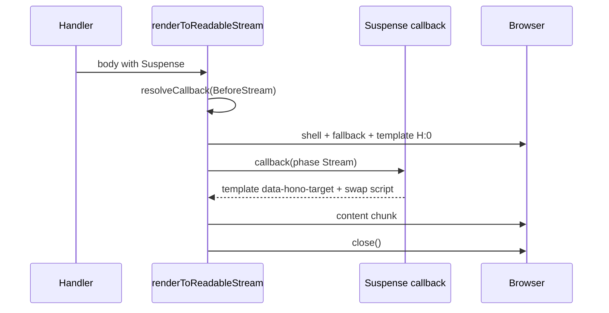

## Overview

`hono/jsx` is a JSX implementation built into Hono that renders on the server straight to HTML strings, with no virtual DOM and no React dependency. A JSX expression compiles to a `JSXNode`; calling `toString()` on it walks the tree and writes escaped HTML into a string buffer. The result is an `HtmlEscapedString` (or a `Promise` of one when async components are involved), which `c.html()` and `c.render()` accept directly. The same module exports a React-compatible API surface (`createElement`, `memo`, `Fragment`, hooks, `Suspense`, `ErrorBoundary`), so components written for the server can also run in the browser through [[Client-Side JSX (hono/jsx/dom)]].

Sources: [src/jsx/index.ts:1-114](repo://src/jsx/index.ts#L1-L114), [src/jsx/base.ts:140-177](repo://src/jsx/base.ts#L140-L177)

An `HtmlEscapedString` is a `String` object flagged with `isEscaped: true` and an optional list of `callbacks`. The flag tells the renderer not to escape the value again; the callbacks let components such as `Suspense`, `ErrorBoundary` and the `<title>`/`<meta>` hoisting logic patch the output after the main pass. `raw()` creates one from any value.

Sources: [src/utils/html.ts:6-46](repo://src/utils/html.ts#L6-L46)

## Configuring the JSX runtime

### tsconfig settings

TypeScript (or Bun, Deno, esbuild) must be told to import the JSX factory from Hono. The repository's own spec config uses the automatic runtime with `hono/jsx` as the import source; the Bun and Deno runtime tests do the same.

Sources: [tsconfig.spec.json:1-11](repo://tsconfig.spec.json#L1-L11), [runtime-tests/deno/deno.json:1-6](repo://runtime-tests/deno/deno.json#L1-L6)

```json
{
  "compilerOptions": {
    "jsx": "react-jsx",
    "jsxImportSource": "hono/jsx"
  }
}
```

Sources: [tsconfig.spec.json:1-11](repo://tsconfig.spec.json#L1-L11), [runtime-tests/bun/tsconfig.json:1-8](repo://runtime-tests/bun/tsconfig.json#L1-L8)

With `jsxImportSource: "hono/jsx"`, the compiler resolves `hono/jsx/jsx-runtime` (production) and `hono/jsx/jsx-dev-runtime` (development). Both are published entry points in `package.json` and `jsr.json`, alongside `hono/jsx/streaming` and `hono/jsx-renderer`.

Sources: [package.json:154-178](repo://package.json#L154-L178), [jsr.json:32-42](repo://jsr.json#L32-L42)

### The runtime functions

`jsx-runtime.ts` re-exports `jsxDEV` as both `jsx` and `jsxs`. `jsxDEV` receives props with `children` already inside them (automatic-runtime convention), normalises the children to an array, hands off to `jsxFn`, and stores the `key` on the node.

Sources: [src/jsx/jsx-runtime.ts:6-8](repo://src/jsx/jsx-runtime.ts#L6-L8)

```ts
export function jsxDEV(
  tag: string | Function,
  props: Record<string, unknown>,
  key?: string
): JSXNode {
  let node: JSXNode
  if (!props || !('children' in props)) {
    node = jsxFn(tag, props, [])
  } else {
    const children = props.children as string | HtmlEscapedString
    node = Array.isArray(children) ? jsxFn(tag, props, children) : jsxFn(tag, props, [children])
  }
  node.key = key
  return node
}
```

Sources: [src/jsx/jsx-dev-runtime.ts:12-26](repo://src/jsx/jsx-dev-runtime.ts#L12-L26), [src/jsx/jsx-runtime.ts:6-8](repo://src/jsx/jsx-runtime.ts#L6-L8)

The classic `createElement` form is `jsx(tag, props, ...children)` in `base.ts`, exported as both `jsx` and `createElement`. It folds the variadic children into `props.children` (a single child stays unwrapped), removes `key` from props and sets it on the node.

Sources: [src/jsx/base.ts:304-316](repo://src/jsx/base.ts#L304-L316), [src/jsx/index.ts:36-45](repo://src/jsx/index.ts#L36-L45)

### Deno precompile mode

Deno's `"jsx": "precompile"` mode turns static markup into template strings at compile time and calls three extra runtime exports: `jsxTemplate` (Hono's `html` tagged template), `jsxAttr` and `jsxEscape`. `jsxAttr` serialises one attribute: it drops invalid attribute names and `null`/`undefined` values, converts a style object with `styleObjectForEach`, escapes strings, and keeps a `Promise` value in a string buffer so it resolves later. `jsxEscape` is the identity function because escaping already happens inside the template helper.

Sources: [src/jsx/jsx-runtime.ts:9-51](repo://src/jsx/jsx-runtime.ts#L9-L51), [runtime-tests/deno-jsx/deno.precompile.json:1-12](repo://runtime-tests/deno-jsx/deno.precompile.json#L1-L12)

## Building the node tree

### jsxFn and node classes

`jsxFn` decides which `JSXNode` subclass to build. On its first call it also attaches the DOM renderers for special intrinsic elements (so the same components work under `hono/jsx/dom`).

Sources: [src/jsx/base.ts:318-327](repo://src/jsx/base.ts#L318-L327)

| Tag | Node built | Why |
| --- | --- | --- |
| a function (component) | `JSXFunctionNode` | the component is called during rendering |
| `title`, `script`, `style`, `link`, `meta`, `form`, `input`, `button` | `JSXFunctionNode` wrapping the intrinsic-element component | these tags get special handling (head hoisting, form actions) |
| `svg` or `head` | `JSXNode` whose child is a namespace context provider | children know they are inside SVG or `<head>` |
| any other string | `JSXNode` | plain element |

Sources: [src/jsx/base.ts:318-351](repo://src/jsx/base.ts#L318-L351), [src/jsx/intrinsic-element/components.ts:121-210](repo://src/jsx/intrinsic-element/components.ts#L121-L210)

The `JSXNode` constructor rejects a string tag that fails `isValidTagName`: an empty string is allowed (used by fragments), but a name starting with `!` or `?`, or containing whitespace, quotes, `<`, `>`, `/`, `=`, a backtick, a backslash or control characters, throws `Invalid JSX tag name`. Valid names are cached in a set capped at 256 entries.

Sources: [src/jsx/base.ts:147-154](repo://src/jsx/base.ts#L147-L154), [src/jsx/utils.ts:14-47](repo://src/jsx/utils.ts#L14-L47)

`JSXNode` also exposes `type` and `ref` getters for libraries that inspect React's element shape, and `reactAPICompatVersion` is `'19.0.0-hono-jsx'`, exported as `version`. `isValidElement` checks for an object with `tag` and `props`; `cloneElement` rebuilds a node through `jsx` with merged props and either the new or the original children.

Sources: [src/jsx/base.ts:156-164](repo://src/jsx/base.ts#L156-L164), [src/jsx/base.ts:421-444](repo://src/jsx/base.ts#L421-L444)

### Fragment, memo and Children

`Fragment` returns a `JSXFragmentNode`, which renders only its children. `StrictMode` is exported as an alias of `Fragment`. `memo(component, propsAreEqual = shallowEqual)` caches the last result and recomputes only when `propsAreEqual(prevProps, props)` returns false; it also tags the wrapper with `DOM_MEMO` and `DOM_RENDERER` so the client renderer can use the same memoisation. `Children` provides `map`, `forEach`, `count`, `only` (throws unless there is exactly one child) and `toArray`.

Sources: [src/jsx/base.ts:298-302](repo://src/jsx/base.ts#L298-L302), [src/jsx/base.ts:353-419](repo://src/jsx/base.ts#L353-L419), [src/jsx/children.ts:1-20](repo://src/jsx/children.ts#L1-L20)

## Rendering to HTML

### The rendering pass

`JSXNode.toString()` creates a buffer `['']`, calls `toStringToBuffer`, and wraps everything in `runWithRenderContext` so context values are isolated per render. If the buffer still holds a single string, the result is synchronous; if any callbacks were recorded it runs them once in the `Stringify` phase with `resolveCallbackSync`. If promises were pushed into the buffer, it returns `stringBufferToString(buffer, callbacks)`, a `Promise<HtmlEscapedString>`.

Sources: [src/jsx/base.ts:166-177](repo://src/jsx/base.ts#L166-L177), [src/utils/html.ts:129-140](repo://src/utils/html.ts#L129-L140)

```mermaid
flowchart TD
  toString["JSXNode.toString()"] --> rwc["runWithRenderContext()"]
  rwc --> tstb["toStringToBuffer(buffer)"]
  tstb --> attrs["serialise attributes"]
  tstb --> kids["childrenToStringToBuffer()"]
  kids -->|"JSXFunctionNode"| call["call component(props)"]
  call -->|"returns Promise"| unshift["buffer.unshift('', promise)"]
  call -->|"returns JSXNode"| tstb
  kids -->|"string"| esc["escapeToBuffer()"]
  rwc --> check{"buffer.length === 1?"}
  check -->|yes| sync["string, callbacks via resolveCallbackSync"]
  check -->|no| async["stringBufferToString() -> Promise"]
```

Sources: [src/jsx/base.ts:108-129](repo://src/jsx/base.ts#L108-L129), [src/jsx/base.ts:166-251](repo://src/jsx/base.ts#L166-L251), [src/jsx/base.ts:254-296](repo://src/jsx/base.ts#L254-L296), [src/utils/html.ts:53-88](repo://src/utils/html.ts#L53-L88)

The buffer is a `StringBuffer`: strings and promises alternate, with index 0 always the string being appended to. Async work is pushed to the front with `buffer.unshift('', promise)`, so `stringBufferToString` awaits all entries and concatenates from the tail. A resolved value that is not marked `isEscaped` is escaped at that point, so a plain string returned by an async component is still safe.

Sources: [src/utils/html.ts:23-38](repo://src/utils/html.ts#L23-L38), [src/utils/html.ts:53-88](repo://src/utils/html.ts#L53-L88)

### Children

`childrenToStringToBuffer` handles each child by type: strings are escaped, booleans, `null` and `undefined` render nothing, `JSXNode`s render recursively, numbers and already-escaped values are appended as-is, promises are queued in the buffer, and nested arrays are flattened recursively.

Sources: [src/jsx/base.ts:108-129](repo://src/jsx/base.ts#L108-L129)

`escapeToBuffer` replaces `"`, `'`, `&`, `<` and `>` with `&quot;`, `&#39;`, `&amp;`, `&lt;` and `&gt;`. It first checks the string with one regex search, so text with nothing to escape is appended without a scan.

Sources: [src/utils/html.ts:48-127](repo://src/utils/html.ts#L48-L127)

### Attributes

`toStringToBuffer` normalises each prop name and then serialises it according to its value. Names are mapped through `normalizeIntrinsicElementKey` (`className` to `class`, `htmlFor` to `for`, `httpEquiv` to `http-equiv`, and others). Inside `<svg>`, camelCase presentation attributes such as `strokeWidth` become kebab-case. Names failing `isValidAttributeName` are silently skipped.

Sources: [src/jsx/base.ts:179-194](repo://src/jsx/base.ts#L179-L194), [src/jsx/base.ts:52-60](repo://src/jsx/base.ts#L52-L60), [src/jsx/utils.ts:1-12](repo://src/jsx/utils.ts#L1-L12), [src/jsx/utils.ts:49-80](repo://src/jsx/utils.ts#L49-L80)

| Value | Output |
| --- | --- |
| `style` as an object | `style="..."`: camelCase keys become kebab-case, numbers get `px` except unitless properties, unsafe values are dropped |
| string | `key="escaped value"` |
| `null` / `undefined` | attribute omitted |
| number or escaped string | `key="value"` without escaping |
| boolean on a known boolean attribute (`checked`, `disabled`, `hidden`...) | `key=""` when true, omitted when false |
| `dangerouslySetInnerHTML` | children replaced by `raw(v.__html)`; throws if children are also given |
| `Promise` | queued in the buffer, written when it resolves |
| function | ignored if the name starts with `on` or is `ref`; otherwise throws `Invalid prop` |
| anything else | `v.toString()`, escaped |

Sources: [src/jsx/base.ts:195-239](repo://src/jsx/base.ts#L195-L239), [src/jsx/base.ts:79-106](repo://src/jsx/base.ts#L79-L106), [src/jsx/utils.ts:169-202](repo://src/jsx/utils.ts#L169-L202)

Void elements (`br`, `img`, `input`, `meta` and the rest of `emptyTags`) with no children render as self-closing `<tag/>`.

Sources: [src/jsx/base.ts:62-78](repo://src/jsx/base.ts#L62-L78), [src/jsx/base.ts:241-251](repo://src/jsx/base.ts#L241-L251)

### Function components

`JSXFunctionNode` calls the component with a copy of its props plus `children`. A `boolean` or `null` result renders nothing. A `Promise` (an `async` component) is queued in the buffer; if any context has been created it first captures the render context, so the subtree it resolves to renders with the same provided values. A returned `JSXNode` renders inline. An escaped string's `callbacks` are merged into the buffer's callbacks; any other value is escaped.

Sources: [src/jsx/base.ts:254-296](repo://src/jsx/base.ts#L254-L296)

```tsx
import type { FC } from 'hono/jsx'

const Item: FC<{ name: string }> = ({ name }) => <li>{name}</li>

const List: FC = async () => {
  const items = await fetchItems()
  return <ul>{items.map((i) => <Item name={i} />)}</ul>
}

app.get('/', (c) => c.html(<List />))
```

Sources: [src/jsx/base.ts:26-33](repo://src/jsx/base.ts#L26-L33), [src/context.ts:723-733](repo://src/context.ts#L723-L733)

`c.html()` accepts the `Promise<HtmlEscapedString>` an async tree produces: when given an object it runs `resolveCallback` in the `Stringify` phase, then builds a `text/html; charset=UTF-8` response.

Sources: [src/context.ts:723-733](repo://src/context.ts#L723-L733), [src/utils/html.ts:142-182](repo://src/utils/html.ts#L142-L182)

## Document metadata hoisting

`<title>`, `<meta>`, `<link>`, `<script async src>` and `<style href precedence>` written anywhere in the tree are moved into `<head>`. Each renders normally and attaches an `insertIntoHead` callback. When the callback runs against a buffer containing `</head>`, it removes the tag from where it was written and inserts it before `</head>`. Entries are tracked per render in a `WeakMap` keyed by the render's `context` object, and de-duplicated by the keys in `deDupeKeyMap` (`src` for scripts, `href` for links, `name`/`httpEquiv`/`charset`/`itemProp` for meta). Stylesheet links and styles with `precedence` are sorted by precedence and get a `data-precedence` attribute.

Sources: [src/jsx/intrinsic-element/components.ts:17-119](repo://src/jsx/intrinsic-element/components.ts#L17-L119), [src/jsx/intrinsic-element/common.ts:1-23](repo://src/jsx/intrinsic-element/common.ts#L1-L23)

Hoisting is skipped when it does not apply: inside `<svg>` or `<head>` (detected through the namespace context), for elements with `itemProp`, for scripts missing `src` or `async`, and for stylesheet links without `precedence`, with `disabled`, or with `onLoad`/`onError`. `<form action>`, `<input formAction>` and `<button formAction>` given a function replace it with the function's `PERMALINK` string, or drop it.

Sources: [src/jsx/intrinsic-element/components.ts:121-210](repo://src/jsx/intrinsic-element/components.ts#L121-L210)

## Context

### createContext and useContext

`createContext(defaultValue)` returns a component that is also its own `Provider`. While rendering its children, the provider pushes `props.value` onto the context's value stack and pops it afterwards (after the promise settles for async children). `useContext` reads the top of the stack, or the default when nothing is provided. Every context is registered in `globalContexts` so suspended subtrees can capture and restore all values.

Sources: [src/jsx/context.ts:8-13](repo://src/jsx/context.ts#L8-L13), [src/jsx/context.ts:202-261](repo://src/jsx/context.ts#L202-L261)

```tsx
import { createContext, useContext } from 'hono/jsx'

const ThemeContext = createContext('light')

const Button: FC = () => <button class={useContext(ThemeContext)}>Go</button>

app.get('/', (c) =>
  c.html(
    <ThemeContext.Provider value="dark">
      <Button />
    </ThemeContext.Provider>
  )
)
```

Sources: [src/jsx/context.ts:213-261](repo://src/jsx/context.ts#L213-L261)

### Per-request isolation

Context values live in a per-render `WeakMap` store, not on the context object, so concurrent requests never see each other's values. `runWithRenderContext` creates the store. When `AsyncLocalStorage` is available it runs the render inside `storage.run`, so the store follows the render across `await`. It finds `AsyncLocalStorage` through `process.getBuiltinModule('node:async_hooks')`, or `process.mainModule.require` on older Node.js.

Sources: [src/jsx/context.ts:15-71](repo://src/jsx/context.ts#L15-L71), [src/jsx/context.ts:149-189](repo://src/jsx/context.ts#L149-L189)

Without `AsyncLocalStorage`, the store is held in `fallbackStore` only during the synchronous part of the render. A `useContext` call after an `await` inside an async component then finds no store and returns the context's default value, never another request's value. The first time this happens while a fallback render is in flight, Hono logs a one-time `console.warn`. Synchronous components and `use()`-based suspension are unaffected.

Sources: [src/jsx/context.ts:25-32](repo://src/jsx/context.ts#L25-L32), [src/jsx/context.ts:73-107](repo://src/jsx/context.ts#L73-L107), [src/jsx/context.ts:174-189](repo://src/jsx/context.ts#L174-L189)

> [!NOTE]
> Provided context values survive `await` only on runtimes with `AsyncLocalStorage`: Node.js 20.16 or later, Deno, Bun, and Cloudflare Workers with the `nodejs_compat` flag.

Sources: [src/jsx/context.ts:202-212](repo://src/jsx/context.ts#L202-L212)

`captureRenderContext()` snapshots the current store and every context value in it, and returns a resumer. `Suspense`, `ErrorBoundary`, `childrenToString` and async function nodes call it before deferring, and the resumer pushes the captured values back around the continuation.

Sources: [src/jsx/context.ts:109-147](repo://src/jsx/context.ts#L109-L147), [src/jsx/context.ts:191-200](repo://src/jsx/context.ts#L191-L200)

## Streaming with Suspense

### Suspense

`Suspense` (from `hono/jsx/streaming`, marked experimental) renders its children with `toString()`. If every child is ready, it returns the joined HTML. If any child is a promise, or a child throws a promise through the `use()` hook, it returns the fallback wrapped in a placeholder: an empty `<template id="H:n">` before the fallback and a closing `/$` comment node after it. It attaches a callback that waits for the children and, during streaming, emits a `<template data-hono-target="H:n">` holding the real content plus an inline script that swaps it in place of the fallback. When rendered without streaming (a `buffer` is present), the callback replaces the placeholder in the buffer directly, so the response holds the final HTML.

Sources: [src/jsx/streaming.ts:36-137](repo://src/jsx/streaming.ts#L36-L137)

`StreamingContext` supplies a `scriptNonce` that `Suspense` and `ErrorBoundary` add to their inline scripts, for pages served with a Content Security Policy.

Sources: [src/jsx/streaming.ts:18-32](repo://src/jsx/streaming.ts#L18-L32)

### renderToReadableStream

`renderToReadableStream(content, onError = console.trace)` turns a node or `HtmlEscapedString` into a `ReadableStream<Uint8Array>`. It resolves the content in the `BeforeStream` phase and enqueues the first chunk (the page with fallbacks). It then invokes every callback in the `Stream` phase and enqueues each result as it settles, recursing into callbacks those results return, until all have resolved. A rejected callback is logged, passed to `onError`, and replaced with an empty string. `cancel()` stops further enqueues when the client disconnects.

Sources: [src/jsx/streaming.ts:140-220](repo://src/jsx/streaming.ts#L140-L220)



Sources: [src/jsx/streaming.ts:42-137](repo://src/jsx/streaming.ts#L42-L137), [src/jsx/streaming.ts:146-220](repo://src/jsx/streaming.ts#L146-L220)

```tsx
import { Suspense, renderToReadableStream } from 'hono/jsx/streaming'

app.get('/', (c) => {
  const stream = renderToReadableStream(
    <html>
      <body>
        <Suspense fallback={<div>loading...</div>}>
          <Component />
        </Suspense>
      </body>
    </html>
  )
  return c.body(stream, {
    headers: {
      'Content-Type': 'text/html; charset=UTF-8',
      'Transfer-Encoding': 'chunked',
    },
  })
})
```

Sources: [src/jsx/streaming.ts:42-50](repo://src/jsx/streaming.ts#L42-L50), [src/jsx/streaming.ts:146-150](repo://src/jsx/streaming.ts#L146-L150)

## ErrorBoundary

`ErrorBoundary` (experimental) takes `fallback`, `fallbackRender(error)` and `onError(error)`. It resolves its children early. A synchronous throw renders the fallback immediately; a thrown promise is awaited and the children are re-rendered with the captured context, falling back if that rejects. When some children are still pending it emits an empty `<template id="E:n">` followed by an `E:n` comment node as markers, plus a callback. When the content resolves, the callback inserts it after the marker (in a stream) or into the buffer. If the content or any nested callback rejects, `catchCallback` renders the fallback once (guarded by `caught`) and emits a script that removes everything between the markers and inserts the fallback.

Sources: [src/jsx/components.ts:47-135](repo://src/jsx/components.ts#L47-L135), [src/jsx/components.ts:136-200](repo://src/jsx/components.ts#L136-L200), [src/jsx/components.ts:201-261](repo://src/jsx/components.ts#L201-L261)

`fallback` is used when given; otherwise `fallbackRender(error)` is wrapped in a `Fragment`. Both are rendered inside the boundary's captured render context so they can read the same context values as the failed subtree.

Sources: [src/jsx/components.ts:75-111](repo://src/jsx/components.ts#L75-L111)

```tsx
<ErrorBoundary fallback={<p>Out of service</p>} onError={(e) => console.error(e)}>
  <Suspense fallback={<p>Loading...</p>}>
    <AsyncComponent />
  </Suspense>
</ErrorBoundary>
```

Sources: [src/jsx/components.ts:55-61](repo://src/jsx/components.ts#L55-L61), [src/jsx/streaming.ts:42-45](repo://src/jsx/streaming.ts#L42-L45)

## jsxRenderer middleware

### Setting a layout

`jsxRenderer(component?, options?)` from `hono/jsx-renderer` installs a layout so handlers can call `c.render(<Page />, props)`. On each request it reads any layout already set by an outer `jsxRenderer` (`c.getLayout()`, defaulting to `Fragment`), registers its own layout with `c.setLayout`, and sets the renderer with `c.setRenderer`. Because the previous layout is passed to the component as `Layout`, nested renderers can wrap each other.

Sources: [src/middleware/jsx-renderer/index.ts:116-129](repo://src/middleware/jsx-renderer/index.ts#L116-L129), [src/context.ts:437-497](repo://src/context.ts#L437-L497)

```tsx
import { jsxRenderer } from 'hono/jsx-renderer'

app.get(
  '/page/*',
  jsxRenderer(({ children }) => {
    return (
      <html>
        <body>
          <header>Menu</header>
          <div>{children}</div>
        </body>
      </html>
    )
  })
)

app.get('/page/about', (c) => {
  return c.render(<h1>About me!</h1>)
})
```

Sources: [src/middleware/jsx-renderer/index.ts:82-115](repo://src/middleware/jsx-renderer/index.ts#L82-L115)

### Options

| Option | Type | Default | Description |
| --- | --- | --- | --- |
| `docType` | `boolean` or `string` | `true` | `true` prepends `<!DOCTYPE html>`, `false` adds nothing, a string is used verbatim |
| `stream` | `boolean` or `Record<string, string>` | `false` | `true` streams with `Transfer-Encoding: chunked`, `Content-Type: text/html; charset=UTF-8` and `Content-Encoding: Identity`; a record sets those headers instead |

Sources: [src/middleware/jsx-renderer/index.ts:18-21](repo://src/middleware/jsx-renderer/index.ts#L18-L21), [src/middleware/jsx-renderer/index.ts:33-80](repo://src/middleware/jsx-renderer/index.ts#L33-L80)

`options` may also be a function of the context, evaluated per render. `createRenderer` builds the body as the doctype followed by `RequestContext.Provider` wrapping the layout. It returns `c.body(renderToReadableStream(body))` when streaming and `c.html(body)` otherwise.

Sources: [src/middleware/jsx-renderer/index.ts:33-80](repo://src/middleware/jsx-renderer/index.ts#L33-L80)

### Typing props and reading the request

The second argument of `c.render` is typed through `PropsForRenderer`, derived from the `ContextRenderer` interface. Augmenting that interface in your project declares props such as `title` that layouts receive. Without augmentation the default renderer takes only content and falls back to `c.html(content)`.

Sources: [src/context.ts:59-88](repo://src/context.ts#L59-L88), [src/context.ts:448-451](repo://src/context.ts#L448-L451)

```tsx
declare module 'hono' {
  interface ContextRenderer {
    (content: string | Promise<string>, props: { title: string }): Response | Promise<Response>
  }
}
```

Sources: [src/context.ts:59-88](repo://src/context.ts#L59-L88)

`useRequestContext()` returns the Hono [[Context]] from inside any component rendered by `jsxRenderer`, via `RequestContext`, and throws `RequestContext is not provided.` when used outside it.

Sources: [src/middleware/jsx-renderer/index.ts:15-16](repo://src/middleware/jsx-renderer/index.ts#L15-L16), [src/middleware/jsx-renderer/index.ts:131-165](repo://src/middleware/jsx-renderer/index.ts#L131-L165)
