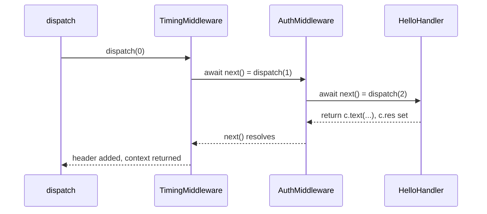
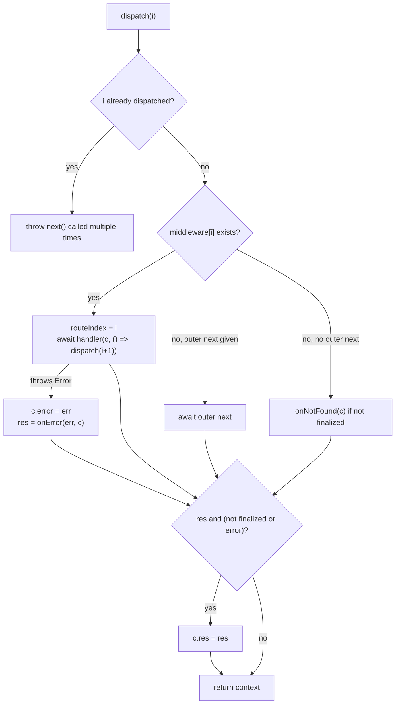

## Overview

In Hono a middleware is not a separate kind of object. It is a handler that receives `(c, next)` and may call `await next()` to run the rest of the chain. Routes registered with `app.use()`, `app.get()` and the other methods go into the same router. For each request the router returns every matching handler in registration order, and `compose()` in `src/compose.ts` runs that list as an onion: code before `await next()` runs on the way in, code after it runs on the way out.

Sources: [src/types.ts:70-95](repo://src/types.ts#L70-L95), [src/hono-base.ts:156-168](repo://src/hono-base.ts#L156-L168), [src/compose.ts:1-73](repo://src/compose.ts#L1-L73)

`compose` is adapted from `koa-compose`. On top of plain chaining, it handles errors, falls back to the not-found handler and decides which return value becomes `c.res`. Dispatch skips it entirely when only one handler matched (see [[The Hono Application]]).

Sources: [src/compose.ts:4-14](repo://src/compose.ts#L4-L14), [src/hono-base.ts:429-450](repo://src/hono-base.ts#L429-L450)

## Handler types

| Type | Signature | Used for |
| --- | --- | --- |
| `Next` | `() => Promise<void>` | The `next` argument. It resolves once everything downstream has finished. |
| `Handler` | `(c, next) => R` | A route handler that may return a `Response` synchronously. |
| `MiddlewareHandler` | `(c, next) => Promise<R>` or a promise of nothing | Async middleware that may return nothing after calling `next()`. |
| `H` | `Handler` or `MiddlewareHandler` | What the router stores and `compose` calls. |

Sources: [src/types.ts:35-35](repo://src/types.ts#L35-L35), [src/types.ts:70-95](repo://src/types.ts#L70-L95)

## The onion model

Each registered handler sits one layer deeper than the one before it. In the example below, a request to `/hello` passes through `logger`, `auth`, then the handler, and unwinds in reverse.

Sources: [src/compose.ts:32-71](repo://src/compose.ts#L32-L71)

```ts
app.use(async (c, next) => {
  const start = Date.now()
  await next()                                   // runs auth and the handler
  c.header('X-Response-Time', `${Date.now() - start}ms`)
})

app.use('/hello', async (c, next) => {
  if (!c.req.header('Authorization')) {
    return c.text('Unauthorized', 401)           // short-circuit: next() is never called
  }
  await next()
})

app.get('/hello', (c) => c.text('Hello!'))
```

Sources: [src/compose.ts:49-69](repo://src/compose.ts#L49-L69), [src/context.ts:515-527](repo://src/context.ts#L515-L527)



Sources: [src/compose.ts:32-71](repo://src/compose.ts#L32-L71)

## Inside compose

### dispatch step by step

`compose(middleware, onError?, onNotFound?)` returns `(context, next?) => Promise<Context>`. Each call keeps a counter `index` and runs the inner `dispatch(i)`:

Sources: [src/compose.ts:15-73](repo://src/compose.ts#L15-L73)

1. If `i <= index`, it throws `next() called multiple times`. A handler that calls `next()` twice fails here, and the error goes to `onError` like any other.
2. If `middleware[i]` exists, its handler is `middleware[i][0][0]` (the `[handler, route]` tuple from the router), and `context.req.routeIndex` is set to `i`. This is how `c.req.param()` and `routePath` know which route is running.
3. Past the end of the list, the handler is the outer `next` passed to the composed function, if there is one. That lets one composed chain run inside another.
4. The handler is awaited with `() => dispatch(i + 1)` as its `next`.
5. With no handler left and the context still not finalized, `onNotFound(context)` produces the response.
6. A non-empty result is written to `context.res` only if the context is not finalized yet, or if the result came from `onError`.

Sources: [src/compose.ts:15-73](repo://src/compose.ts#L15-L73)



Sources: [src/compose.ts:32-71](repo://src/compose.ts#L32-L71)

### Return values and c.res

Because of rule 6, the first response written wins. When the inner handler returns `c.text(...)`, the context becomes finalized. Any `Response` that an outer middleware returns after `await next()` is then ignored. To replace or wrap the response on the way out, assign `c.res = newResponse`. The `c.res` setter carries existing headers over to the new response (see [[Context]]).

Sources: [src/compose.ts:67-69](repo://src/compose.ts#L67-L69), [src/context.ts:409-434](repo://src/context.ts#L409-L434)

```ts
app.use(async (c, next) => {
  await next()
  if (c.res.headers.get('Content-Type')?.startsWith('application/json')) {
    const body = await c.res.json()
    c.res = c.json({ data: body })   // assign; `return c.json(...)` would be ignored here
  }
})
```

Sources: [src/compose.ts:67-69](repo://src/compose.ts#L67-L69), [src/context.ts:399-434](repo://src/context.ts#L399-L434)

A middleware that neither returns a response nor calls `next()` leaves the context unfinalized. `HonoBase#dispatch` detects this after `compose` resolves. It throws an `Error` whose message starts with "Context is not finalized" and asks whether you forgot to return a Response or await `next()`. The error handler turns it into a 500 by default.

Sources: [src/hono-base.ts:450-465](repo://src/hono-base.ts#L450-L465)

### Errors inside the chain

An `Error` thrown by the handler at position `i` is caught by `dispatch(i)` itself, not by the outermost caller. `compose` stores it on `c.error`, calls `onError(err, c)` (the app's error handler) and writes its response to `c.res`. Then `dispatch(i)` resolves normally. The middleware above it continue after `await next()` as if nothing had been thrown, and they can check `c.error` and the 500 status. A thrown value that is not an `Error`, such as a string, is re-thrown up the chain and finally makes `fetch` reject. See [[Error Handling]].

Sources: [src/compose.ts:49-60](repo://src/compose.ts#L49-L60), [src/hono-base.ts:399-404](repo://src/hono-base.ts#L399-L404)

```ts
app.use(async (c, next) => {
  await next()
  if (c.error) {
    console.log('handler failed:', c.error.message, 'status', c.res.status)
  }
})
```

Sources: [src/compose.ts:49-60](repo://src/compose.ts#L49-L60), [src/context.ts:318-333](repo://src/context.ts#L318-L333)

### Not found inside the chain

Global middleware registered with `app.use()` matches every path. A request for an unknown path therefore still runs that middleware. When the last middleware calls `await next()`, `dispatch` runs past the end of the list, and since dispatch passes no outer `next`, `onNotFound` sets the 404 response. Middleware still sees `c.res.status === 404` after `next()` and can add headers to it.

Sources: [src/compose.ts:42-65](repo://src/compose.ts#L42-L65), [src/hono-base.ts:450-454](repo://src/hono-base.ts#L450-L454)

### Nested composition

The outer `next` parameter makes `compose` reusable inside a handler. `app.route()` uses `compose([], subApp.errorHandler)` with `next` set to the original handler, so that a sub-application's errors reach its own `onError`. The `every` combinator in `hono/combine` composes its middleware list and passes the real `next`, so the rest of the app runs after all of them succeed.

Sources: [src/hono-base.ts:219-229](repo://src/hono-base.ts#L219-L229), [src/middleware/combine/index.ts:99-117](repo://src/middleware/combine/index.ts#L99-L117)

## Writing custom middleware

### Inline and factory functions

The common shape is a function that takes options and returns a `MiddlewareHandler`. A named inner function shows up by name in route listings and logs.

Sources: [src/types.ts:83-88](repo://src/types.ts#L83-L88)

```ts
import type { MiddlewareHandler } from 'hono'

export const poweredBy = (name = 'Hono'): MiddlewareHandler =>
  async function poweredBy(c, next) {
    await next()
    c.header('X-Powered-By', name)
  }

app.use(poweredBy())
```

Sources: [src/types.ts:83-88](repo://src/types.ts#L83-L88), [src/context.ts:515-527](repo://src/context.ts#L515-L527)

### createMiddleware

`createMiddleware` from `hono/factory` returns its argument unchanged. It exists for typing: its generics `E`, `P` and `I` let a middleware declare the `Variables` it sets. The app can then merge those types into the handlers that follow it. `createFactory<Env>()` returns a `Factory` whose `createMiddleware`, `createHandlers` and `createApp` all share one `Env`. `createHandlers` returns its handlers as a typed tuple (dropping `undefined`) for spreading into `app.get(path, ...handlers)`. See [[Factory Helper]].

Sources: [src/helper/factory/index.ts:332-375](repo://src/helper/factory/index.ts#L332-L375)

```ts
import { createMiddleware, createFactory } from 'hono/factory'

const auth = createMiddleware<{ Variables: { user: string } }>(async (c, next) => {
  c.set('user', 'alice')
  await next()
})

app.get('/me', auth, (c) => c.text(c.var.user)) // c.var.user is typed as string

const factory = createFactory<{ Bindings: { TOKEN: string } }>()
const handlers = factory.createHandlers(auth, (c) => c.text(c.env.TOKEN))
app.get('/token', ...handlers)
```

Sources: [src/helper/factory/index.ts:332-375](repo://src/helper/factory/index.ts#L332-L375)

> [!TIP]
> Order matters only by registration. `app.use()` added after a route still runs for that route if its path matches. It runs after the route's handler in the chain, though, so it only gets control when the handler calls `next()`.

Sources: [src/hono-base.ts:385-397](repo://src/hono-base.ts#L385-L397), [src/compose.ts:42-51](repo://src/compose.ts#L42-L51)
