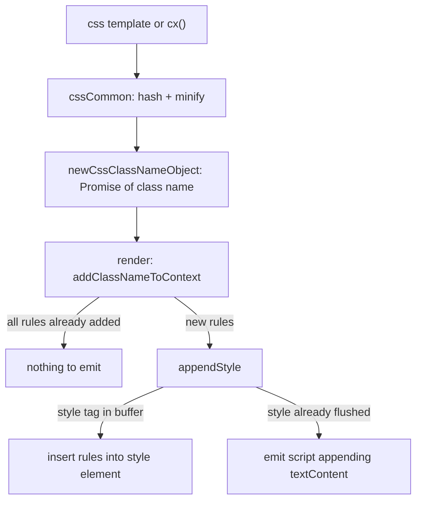

## Overview

Besides cookies, streaming, WebSockets, SSG and the factory, Hono ships a set of small helpers, each exported from its own subpath so an app only bundles what it imports. They cover content negotiation (`hono/accepts`), client address lookup (`hono/conninfo` plus each adapter's `getConnInfo`), runtime detection and environment variables (`hono/adapter`), HTML templating (`hono/html`), reverse proxying (`hono/proxy`), route introspection (`hono/route`, `hono/dev`), in-process testing (`hono/testing`) and CSS-in-JS (`hono/css`).

Sources: [jsr.json:21-31](repo://jsr.json#L21-L31), [jsr.json:65-65](repo://jsr.json#L65-L65), [jsr.json:77-81](repo://jsr.json#L77-L81)

Each helper is a plain function over the [[Context]] or the app, not middleware, so you call it inside a handler or a script when you need it.

Sources: [src/helper/accepts/accepts.ts:40-49](repo://src/helper/accepts/accepts.ts#L40-L49), [src/helper/dev/index.ts:39-79](repo://src/helper/dev/index.ts#L39-L79)

## Accepts helper

`accepts(c, options)` picks the best value of an `Accept*` request header among the values your app supports. It reads `c.req.header(options.header)`; when the header is missing it returns `options.default` without parsing. Otherwise it parses the header with `parseAccept` and passes the result to `options.match`, or to `defaultMatch` when no matcher is given.

Sources: [src/helper/accepts/accepts.ts:40-49](repo://src/helper/accepts/accepts.ts#L40-L49)

| Option | Type | Required | Description |
| --- | --- | --- | --- |
| `header` | `AcceptHeader` | yes | `'Accept'`, `'Accept-Charset'`, `'Accept-Encoding'`, `'Accept-Language'`, `'Accept-Patch'`, `'Accept-Post'` or `'Accept-Ranges'` |
| `supports` | `string[]` | yes | Values the app can serve |
| `default` | `string` | yes | Returned when nothing matches or the header is absent |
| `match` | `(accepts, config) => string` | no | Custom matcher replacing `defaultMatch` |

Sources: [src/helper/accepts/accepts.ts:5-19](repo://src/helper/accepts/accepts.ts#L5-L19), [src/utils/headers.ts:323-330](repo://src/utils/headers.ts#L323-L330)

`parseAccept` returns entries of `{ type, params, q }`. A missing or empty `q` counts as 1; values outside 0 to 1 or unparsable also become 1, `NaN` and `-Infinity` become 0. The list is sorted by descending `q` only when the header was not already in order. `defaultMatch` sorts by `q` again and returns the first type that appears literally in `supports`.

Sources: [src/utils/accept.ts:211-266](repo://src/utils/accept.ts#L211-L266), [src/helper/accepts/accepts.ts:21-25](repo://src/helper/accepts/accepts.ts#L21-L25)

> [!NOTE]
> `defaultMatch` compares strings exactly, so wildcards such as `*/*` or language ranges such as `en` versus `en-US` are not expanded. Supply a `match` function if you need that.

Sources: [src/helper/accepts/accepts.ts:21-25](repo://src/helper/accepts/accepts.ts#L21-L25)

```ts
import { accepts } from 'hono/accepts'

app.get('/', (c) => {
  const lang = accepts(c, {
    header: 'Accept-Language',
    supports: ['en', 'ja', 'zh'],
    default: 'en',
  })
  return c.text(lang === 'ja' ? 'こんにちは' : 'Hello')
})
```

Sources: [src/helper/accepts/accepts.ts:27-49](repo://src/helper/accepts/accepts.ts#L27-L49)

## Connection info helper

The client's IP address is not part of the Fetch `Request`, so `hono/conninfo` only defines the types and each adapter implements `getConnInfo(c)` for its runtime. The result is a `ConnInfo` with a `remote` object holding optional `address`, `addressType` (`'IPv4'`, `'IPv6'` or `undefined`), `port` and `transport` (`'tcp'` or `'udp'`).

Sources: [src/helper/conninfo/types.ts:1-45](repo://src/helper/conninfo/types.ts#L1-L45), [src/helper/conninfo/index.ts:1-6](repo://src/helper/conninfo/index.ts#L1-L6)

| Adapter | Source of the address | Fields filled |
| --- | --- | --- |
| `hono/bun` | `server.requestIP(c.req.raw)` from the server passed as `env` | `address`, `addressType`, `port` |
| `hono/deno` | `c.env.remoteAddr` (Deno's serve handler info) | `address`, `port`, `transport` |
| `hono/cloudflare-workers`, `hono/cloudflare-pages` | `cf-connecting-ip` header | `address` |
| `hono/vercel` | `x-real-ip` header | `address` |
| `hono/netlify` | `c.env.context.ip` | `address` |
| `hono/aws-lambda` | `requestContext.identity.sourceIp` (API Gateway v1), `requestContext.http.sourceIp` (v2), else the last `x-forwarded-for` entry (ALB) | `address` |
| `hono/lambda-edge` | `event.Records[0].cf.request.clientIp` | `address` |

Sources: [src/adapter/bun/conninfo.ts:10-43](repo://src/adapter/bun/conninfo.ts#L10-L43), [src/adapter/deno/conninfo.ts:8-17](repo://src/adapter/deno/conninfo.ts#L8-L17), [src/adapter/cloudflare-workers/conninfo.ts:1-7](repo://src/adapter/cloudflare-workers/conninfo.ts#L1-L7), [src/adapter/cloudflare-pages/conninfo.ts:22-26](repo://src/adapter/cloudflare-pages/conninfo.ts#L22-L26), [src/adapter/vercel/conninfo.ts:1-8](repo://src/adapter/vercel/conninfo.ts#L1-L8), [src/adapter/netlify/conninfo.ts:53-57](repo://src/adapter/netlify/conninfo.ts#L53-L57), [src/adapter/aws-lambda/conninfo.ts:45-73](repo://src/adapter/aws-lambda/conninfo.ts#L45-L73), [src/adapter/lambda-edge/conninfo.ts:11-15](repo://src/adapter/lambda-edge/conninfo.ts#L11-L15)

The Bun version throws `TypeError` when the server object is missing from `env` or lacks `requestIP`, and returns `{ remote: {} }` when Bun reports `null` (closed requests, Unix sockets). The header-based adapters trust headers set by the platform's edge; behind another proxy those headers can be forged by the client.

Sources: [src/adapter/bun/conninfo.ts:19-34](repo://src/adapter/bun/conninfo.ts#L19-L34)

```ts
import { getConnInfo } from 'hono/bun' // or 'hono/deno', 'hono/cloudflare-workers', ...

app.get('/ip', (c) => {
  const info = getConnInfo(c)
  return c.text(`You are ${info.remote.address} (${info.remote.addressType})`)
})
```

Sources: [src/adapter/bun/conninfo.ts:10-43](repo://src/adapter/bun/conninfo.ts#L10-L43), [src/helper/conninfo/types.ts:35-45](repo://src/helper/conninfo/types.ts#L35-L45)

## Adapter helper

`getRuntimeKey()` returns a `Runtime`: `'node'`, `'deno'`, `'bun'`, `'workerd'`, `'fastly'`, `'edge-light'` or `'other'`. Detection runs in this order:

Sources: [src/helper/adapter/index.ts:8-8](repo://src/helper/adapter/index.ts#L8-L8), [src/helper/adapter/index.ts:43-90](repo://src/helper/adapter/index.ts#L43-L90)

1. If `navigator.userAgent` is a string, match its prefix against `knownUserAgents` (`Deno`, `Bun`, `Cloudflare-Workers`, `Node.js`).
2. A string `globalThis.EdgeRuntime` means `'edge-light'` (Vercel Edge).
3. A defined `globalThis.fastly` means `'fastly'`.
4. `process.release.name === 'node'` means `'node'`, which covers Node versions before 21.1 that lack `navigator.userAgent`.
5. Otherwise `'other'`.

Sources: [src/helper/adapter/index.ts:8-8](repo://src/helper/adapter/index.ts#L8-L8), [src/helper/adapter/index.ts:43-90](repo://src/helper/adapter/index.ts#L43-L90)

`env(c, runtime?)` returns environment variables in a runtime-neutral way, so code can read configuration without knowing whether it lives in `process.env` or in Workers bindings. The runtime defaults to `getRuntimeKey()`:

Sources: [src/helper/adapter/index.ts:10-41](repo://src/helper/adapter/index.ts#L10-L41)

| Runtime | Returned object |
| --- | --- |
| `bun`, `node`, `edge-light` | `globalThis.process.env` |
| `deno` | `Deno.env.toObject()` |
| `workerd` | `c.env` (the bindings) |
| `fastly`, `other` | `{}` |

Sources: [src/helper/adapter/index.ts:10-41](repo://src/helper/adapter/index.ts#L10-L41)

```ts
import { env, getRuntimeKey } from 'hono/adapter'

app.get('/config', (c) => {
  const { API_URL } = env<{ API_URL: string }>(c)
  return c.json({ runtime: getRuntimeKey(), API_URL })
})
```

Sources: [src/helper/adapter/index.ts:10-18](repo://src/helper/adapter/index.ts#L10-L18), [src/helper/adapter/index.ts:50-84](repo://src/helper/adapter/index.ts#L50-L84)

## html helper

`html` is a tagged template for writing HTML without JSX. Interpolated values are handled by type: strings and other objects are HTML-escaped with `escapeToBuffer` (`&`, `<`, `>`, `'`, `"`), numbers are inserted as is, booleans, `null` and `undefined` are dropped, arrays are flattened, and values already marked `isEscaped` (the result of `raw`, another `html` call, or JSX) are inserted without escaping.

Sources: [src/helper/html/index.ts:11-49](repo://src/helper/html/index.ts#L11-L49), [src/utils/html.ts:92-128](repo://src/utils/html.ts#L92-L128)

Promises and values with render callbacks cannot be concatenated synchronously, so they are pushed onto a buffer instead. When none were found, `html` returns an `HtmlEscapedString` synchronously; otherwise it returns a `Promise` from `stringBufferToString`, which awaits the parts and escapes any resolved value that is not already escaped. `c.html()` accepts both.

Sources: [src/helper/html/index.ts:43-57](repo://src/helper/html/index.ts#L43-L57), [src/utils/html.ts:52-86](repo://src/utils/html.ts#L52-L86)

`raw(value)` wraps a string in a `String` object flagged `isEscaped`, telling `html` and JSX not to escape it. Only pass trusted content to it.

Sources: [src/utils/html.ts:39-45](repo://src/utils/html.ts#L39-L45), [src/helper/html/index.ts:9-9](repo://src/helper/html/index.ts#L9-L9)

```ts
import { html, raw } from 'hono/html'

app.get('/:name', (c) => {
  const name = c.req.param('name') // '<script>' becomes '&lt;script&gt;'
  return c.html(html`<!doctype html>
    <h1>Hello, ${name}!</h1>
    ${raw('<p>trusted markup</p>')}`)
})
```

Sources: [src/helper/html/index.ts:9-57](repo://src/helper/html/index.ts#L9-L57)

The SSG redirect plugin uses `html` the same way to build its redirect page, so the location URL is escaped (see [[Static Site Generation]]). For component-based rendering see [[JSX Server Rendering]].

Sources: [src/helper/ssg/plugins.ts:24-36](repo://src/helper/ssg/plugins.ts#L24-L36)

## Proxy helper

`proxy(input, init?)` is a `fetch` wrapper for forwarding a request to another server and returning its response from a handler. Its signature matches `fetch`, with extra options:

Sources: [src/helper/proxy/index.ts:24-48](repo://src/helper/proxy/index.ts#L24-L48), [src/helper/proxy/index.ts:93-113](repo://src/helper/proxy/index.ts#L93-L113)

| Option | Type | Default | Description |
| --- | --- | --- | --- |
| `raw` | `Request` | none | Original request to copy method, body, headers and signal from (set by spreading `...c.req`) |
| `headers` | `HeadersInit` or record | none | Headers to set; a record value of `undefined` or `null` drops that header |
| `customFetch` | `(request) => Promise<Response>` | global `fetch` | Function used to send the request |
| `strictConnectionProcessing` | `boolean` | `false` | Honor the `Connection` header's list of headers to drop (trusted clients only) |

Sources: [src/helper/proxy/index.ts:24-48](repo://src/helper/proxy/index.ts#L24-L48), [src/helper/proxy/index.ts:93-113](repo://src/helper/proxy/index.ts#L93-L113)

The request is built in steps:

Sources: [src/helper/proxy/index.ts:9-22](repo://src/helper/proxy/index.ts#L9-L22), [src/helper/proxy/index.ts:50-91](repo://src/helper/proxy/index.ts#L50-L91), [src/helper/proxy/index.ts:160-172](repo://src/helper/proxy/index.ts#L160-L172)

1. If `init` is a `Request` it is treated as `{ raw: init }`.
2. `buildRequestInitFromRequest(raw)` copies headers from `raw`, removes the RFC 2616 hop-by-hop headers (`connection`, `keep-alive`, `proxy-authenticate`, `proxy-authorization`, `te`, `trailer`, `transfer-encoding`, `upgrade`), and carries over method, body (with `duplex: 'half'` for streaming), and signal.
3. With `strictConnectionProcessing`, the names listed in `Connection` are validated against the RFC 9110 token pattern (an invalid one throws `HTTPException(400)`) and deleted.
4. The remaining init is merged on top, so explicit `headers` override the copied ones.
5. `accept-encoding` is deleted so the upstream answers with an encoding the runtime's `fetch` decodes itself.

Sources: [src/helper/proxy/index.ts:9-22](repo://src/helper/proxy/index.ts#L9-L22), [src/helper/proxy/index.ts:50-91](repo://src/helper/proxy/index.ts#L50-L91), [src/helper/proxy/index.ts:160-172](repo://src/helper/proxy/index.ts#L160-L172)

On the response, hop-by-hop headers are removed again, and if `content-encoding` is present it is deleted together with `content-length`, because `fetch` already decompressed the body and the original length no longer applies. Status and status text are preserved in a new mutable `Response`.

Sources: [src/helper/proxy/index.ts:174-190](repo://src/helper/proxy/index.ts#L174-L190)

> [!WARNING]
> The default ignores the `Connection` header on purpose: a client could list headers such as `Authorization` there to strip them before they reach the upstream (hop-by-hop header injection). Turn on `strictConnectionProcessing` only for trusted clients.

Sources: [src/helper/proxy/index.ts:32-43](repo://src/helper/proxy/index.ts#L32-L43)

```ts
import { proxy } from 'hono/proxy'

app.all('/api/:path{.+}', (c) =>
  proxy(`https://upstream.example.com/${c.req.param('path')}`, {
    ...c.req,
    headers: {
      ...c.req.header(),
      'X-Forwarded-Host': c.req.header('host'),
      Authorization: undefined,
    },
  })
)
```

Sources: [src/helper/proxy/index.ts:115-160](repo://src/helper/proxy/index.ts#L115-L160)

## Route helper

`hono/route` reads which routes matched the current request. It uses the router's match result that `HonoRequest` stores under the `GET_MATCH_RESULT` symbol, together with `c.req.routeIndex`, the index of the handler that is currently running.

Sources: [src/helper/route/index.ts:1-34](repo://src/helper/route/index.ts#L1-L34), [src/request.ts:55-55](repo://src/request.ts#L55-L55), [src/request.ts:389-392](repo://src/request.ts#L389-L392)

| Function | Returns |
| --- | --- |
| `matchedRoutes(c)` | Every `RouterRoute` (`method`, `path`, `basePath`, `handler`) matched for this request, middleware included, in execution order |
| `routePath(c, index?)` | The registered path of the route at `index` (default: the current one), for example `'/posts/:id'` |
| `baseRoutePath(c, index?)` | The `basePath` pattern of that route, as passed to `app.route()`, for example `'/:sub'` |
| `basePath(c, index?)` | That base path with parameters filled in from the actual request path |

Sources: [src/helper/route/index.ts:32-141](repo://src/helper/route/index.ts#L32-L141)

The `index` argument works like `Array.prototype.at`, so `routePath(c, -1)` returns the last matched route, which in a middleware is typically the final handler's path. `basePath` returns a static base path as is; for patterns containing `:` or `*` it walks the pattern segments with `getPattern`, measures each segment's match in `c.req.path`, and slices the request path to that length. Results are cached per context and index in a `WeakMap`.

Sources: [src/helper/route/index.ts:36-59](repo://src/helper/route/index.ts#L36-L59), [src/helper/route/index.ts:106-141](repo://src/helper/route/index.ts#L106-L141)

```ts
import { routePath, basePath } from 'hono/route'

const sub = new Hono()
sub.get('/posts/:id', (c) => c.json({ route: routePath(c), base: basePath(c) }))
app.route('/:tenant', sub)
// GET /acme/posts/1 -> { route: '/:tenant/posts/:id', base: '/acme' }
```

Sources: [src/helper/route/index.ts:58-141](repo://src/helper/route/index.ts#L58-L141)

## Dev helper

`hono/dev` inspects an app's registered routes, for logging at startup or for tooling:

Sources: [src/helper/dev/index.ts:27-79](repo://src/helper/dev/index.ts#L27-L79)

| Function | Description |
| --- | --- |
| `inspectRoutes(app)` | Returns `{ path, method, name, isMiddleware }` for every entry in `app.routes` |
| `showRoutes(app, opts?)` | Prints `METHOD path` lines to the console |
| `getRouterName(app)` | Returns the active router's `name`, for example `'SmartRouter + RegExpRouter'` |

Sources: [src/helper/dev/index.ts:27-79](repo://src/helper/dev/index.ts#L27-L79)

`inspectRoutes` unwraps composed handlers with `findTargetHandler`, uses the function name or `[middleware]` / `[handler]` when the function is anonymous, and marks a handler as middleware when it declares more than one parameter. `showRoutes` hides middleware unless `verbose` is set, prints each method/path pair once (with `verbose`, followed by the names of every handler on it), aligns the columns, and colors the method green unless `colorize` is `false` or `NO_COLOR` is set.

Sources: [src/helper/dev/index.ts:11-74](repo://src/helper/dev/index.ts#L11-L74), [src/utils/handler.ts:8-15](repo://src/utils/handler.ts#L8-L15), [src/utils/color.ts:14-27](repo://src/utils/color.ts#L14-L27)

`getRouterName` first calls `app.router.match('GET', '/')`, because a `SmartRouter` only settles on a concrete router, and therefore its final name, after its first match.

Sources: [src/helper/dev/index.ts:76-79](repo://src/helper/dev/index.ts#L76-L79)

```ts
import { showRoutes } from 'hono/dev'

showRoutes(app, { verbose: true })
// GET   /
//       [handler]
// POST  /posts
//       logger
//       createPost
```

Sources: [src/helper/dev/index.ts:39-74](repo://src/helper/dev/index.ts#L39-L74)

## Testing helper

`testClient(app, env?, executionCtx?, options?)` returns a typed [[RPC Client]] bound to the app without a network. It calls `hc` with the base URL `http://localhost` and a custom `fetch` that forwards each request to `app.request(input, init, env, executionCtx)`, so tests go through the full middleware stack and get the same type inference as `hc`. `options` accepts every client option except `fetch`.

Sources: [src/helper/testing/index.ts:1-27](repo://src/helper/testing/index.ts#L1-L27)

```ts
import { testClient } from 'hono/testing'

const app = new Hono().get('/search', (c) => c.json({ q: c.req.query('q') }))

it('searches', async () => {
  const res = await testClient(app).search.$get({ query: { q: 'hono' } })
  expect(await res.json()).toEqual({ q: 'hono' })
})
```

Sources: [src/helper/testing/index.ts:16-27](repo://src/helper/testing/index.ts#L16-L27)

> [!TIP]
> Type inference needs the routes chained on the app instance (as in `new Hono().get(...)`), the same requirement as for `hc`. Pass bindings as the second argument to test Workers-style apps.

Sources: [src/helper/testing/index.ts:13-21](repo://src/helper/testing/index.ts#L13-L21)

## CSS helper

### Writing styles

`hono/css` is a small CSS-in-JS library that works with Hono's JSX on the server and in `hono/jsx/dom`. `` css`...` `` returns a class name; `<Style />` renders the `<style id="hono-css">` element that the collected rules are written into. All of its exports are marked experimental.

Sources: [src/helper/css/index.ts:225-262](repo://src/helper/css/index.ts#L225-L262), [src/helper/css/common.ts:4-4](repo://src/helper/css/common.ts#L4-L4)

| Export | Description |
| --- | --- |
| `` css`...` `` | Define a rule set; returns a `Promise` of the class name, usable as `class` in JSX |
| `cx(...args)` | Combine `css` classes and plain class-name strings; falsy values are ignored |
| `` keyframes`...` `` | Define `@keyframes` and get its name for use in `animation` |
| `viewTransition(...)` | Generate a unique `view-transition-name` class, optionally with `::view-transition-*` rules |
| `Style` | Component rendering the `<style>` element; accepts `nonce` and optional `children` |
| `rawCssString(value)` | Insert a value into a template without escaping |
| `createCssContext({ id, classNameSlug?, onInvalidSlug? })` | Create an independent set of the functions above with its own style id |

Sources: [src/helper/css/index.ts:29-30](repo://src/helper/css/index.ts#L29-L30), [src/helper/css/index.ts:39-80](repo://src/helper/css/index.ts#L39-L80), [src/helper/css/common.ts:27-36](repo://src/helper/css/common.ts#L27-L36)

```tsx
import { css, cx, keyframes, Style } from 'hono/css'

const fadeIn = keyframes`
  from { opacity: 0; }
  to { opacity: 1; }
`
const card = css`
  /* card */
  padding: 1rem;
  animation: ${fadeIn} 0.3s;
  &:hover { background: #eee; }
`

app.get('/', (c) =>
  c.html(
    <html>
      <head>
        <Style />
      </head>
      <body>
        <div class={cx(card, 'shadow')}>Hello</div>
      </body>
    </html>
  )
)
```

Sources: [src/helper/css/index.ts:169-215](repo://src/helper/css/index.ts#L169-L215), [src/helper/css/common.ts:139-199](repo://src/helper/css/common.ts#L139-L199)

### Class names and interpolation

`buildStyleString` concatenates the template, then `minify` strips comments and redundant whitespace. The class name is `css-` plus a 32-bit hash (`toHash`, after goober) of the leading `/* label */` comment and the minified style, so identical styles share one class. Interpolated values are handled by type: strings have quotes and backslashes escaped, numbers are inserted as is, `rawCssString` values are inserted verbatim, a `keyframes` value inserts its name, a `css` value followed by `{` becomes a nested `.class` selector, and any other `css` value has its declarations inlined.

Sources: [src/helper/css/common.ts:38-56](repo://src/helper/css/common.ts#L38-L56), [src/helper/css/common.ts:79-106](repo://src/helper/css/common.ts#L79-L106), [src/helper/css/common.ts:139-238](repo://src/helper/css/common.ts#L139-L238)

`createCssContext` accepts `classNameSlug(hash, label, styleString)` to replace the hash with a readable name. The slug must be a valid identifier (and, for keyframes, not a CSS-wide keyword such as `none`); otherwise `onInvalidSlug` is called (default: `console.warn`) and the hash is kept.

Sources: [src/helper/css/common.ts:56-77](repo://src/helper/css/common.ts#L56-L77), [src/helper/css/common.ts:120-137](repo://src/helper/css/common.ts#L120-L137), [src/helper/css/common.ts:201-288](repo://src/helper/css/common.ts#L201-L288)

A template whose body is wrapped in `:-hono-global { ... }` produces global rules instead of a scoped class: the rules are emitted unwrapped and the returned class name is empty.

Sources: [src/helper/css/common.ts:2-3](repo://src/helper/css/common.ts#L2-L3), [src/helper/css/common.ts:207-229](repo://src/helper/css/common.ts#L207-L229), [src/helper/css/common.case.test.tsx:232-253](repo://src/helper/css/common.case.test.tsx#L232-L253)

### How styles reach the page

Each `css` result is a `Promise` of an escaped `String` carrying an `addClassNameToContext` render callback. During server rendering, the callback records the class and its nested selectors in a per-render `WeakMap`, skipping those already emitted, and queues `appendStyle`. `appendStyle` writes the pending rules into the existing `<style id="...">` element when it is in the buffer; when the element was already streamed out, it emits a `<script>` that appends the rules to the element's `textContent`, adding the `nonce` given to `Style`.

Sources: [src/helper/css/index.ts:81-167](repo://src/helper/css/index.ts#L81-L167), [src/helper/css/index.ts:192-203](repo://src/helper/css/index.ts#L192-L203)



Sources: [src/helper/css/index.ts:88-171](repo://src/helper/css/index.ts#L88-L171), [src/helper/css/common.ts:201-238](repo://src/helper/css/common.ts#L201-L238)

On the client, the `Style` component carries a `DOM_RENDERER` implementation and the class-name promise's `toString` comes from `createCssJsxDomObjects`, so the same styles work in `hono/jsx/dom`.

Sources: [src/helper/css/index.ts:6-8](repo://src/helper/css/index.ts#L6-L8), [src/helper/css/index.ts:165-165](repo://src/helper/css/index.ts#L165-L165), [src/helper/css/index.ts:205-206](repo://src/helper/css/index.ts#L205-L206)

> [!NOTE]
> Plain strings passed to `cx` are treated as untrusted: names containing `<`, `{` or `}` are dropped, and the final class attribute is HTML-escaped, so user input cannot break out of the `<style>` element or the attribute.

Sources: [src/helper/css/common.ts:58-60](repo://src/helper/css/common.ts#L58-L60), [src/helper/css/common.ts:240-258](repo://src/helper/css/common.ts#L240-L258), [src/helper/css/index.ts:149-157](repo://src/helper/css/index.ts#L149-L157)
