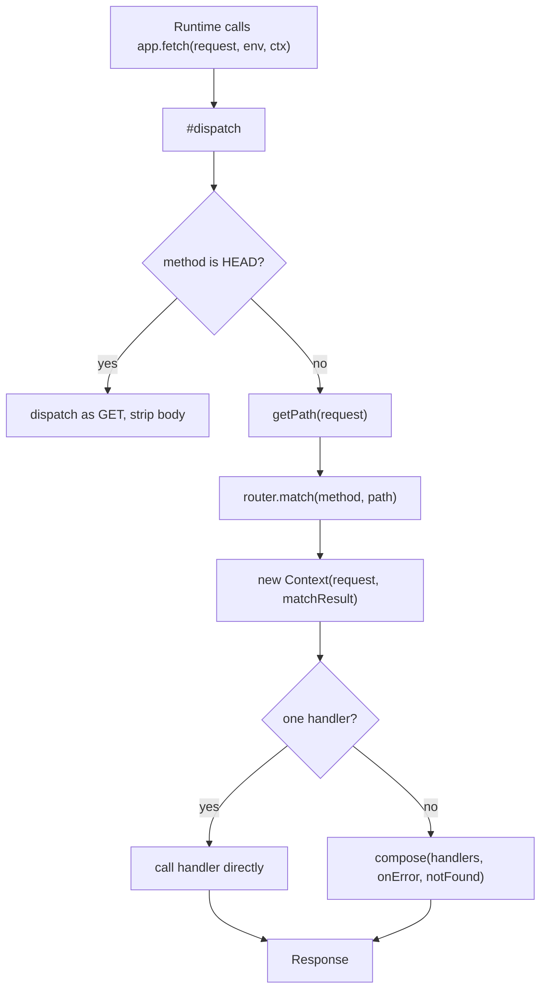

## Overview

Hono is a small web framework built only on Web Standard APIs (`Request`, `Response`, `fetch`). Because an application is just an object with a `fetch(request, env, executionCtx)` method, the same code runs on Cloudflare Workers, Fastly Compute, Deno, Bun, Vercel, AWS Lambda, Lambda@Edge and Node.js. The package has zero runtime dependencies, and the `hono/tiny` preset stays under 12kB.

Sources: [README.md:21-49](repo://README.md#L21-L49), [package.json:1-10](repo://package.json#L1-L10)

The smallest app creates a `Hono` instance, registers a handler and exports the app; the runtime calls its `fetch` for every request.

Sources: [src/hono-base.ts:479-485](repo://src/hono-base.ts#L479-L485)

```ts
import { Hono } from 'hono'
const app = new Hono()

app.get('/', (c) => c.text('Hono!'))

export default app
```

Sources: [src/index.ts:1-15](repo://src/index.ts#L1-L15)

New users should continue with [[Quickstart]]; the request lifecycle is explained in [[The Hono Application]] and [[Middleware and Composition]].

Sources: [src/hono-base.ts:406-465](repo://src/hono-base.ts#L406-L465)

## How a request flows

`fetch` hands the request to a private `#dispatch` method. `HEAD` requests are dispatched as `GET` with the body dropped. Otherwise `getPath` extracts the path, the router returns the matching handlers and their parameters, and a `Context` is created around the request. A single matching handler is called directly; several are chained with `compose`. A handler that returns nothing falls through to the not-found handler, and any thrown `Error` goes to the error handler.

Sources: [src/hono-base.ts:406-465](repo://src/hono-base.ts#L406-L465), [src/hono-base.ts:479-485](repo://src/hono-base.ts#L479-L485)



Sources: [src/hono-base.ts:406-465](repo://src/hono-base.ts#L406-L465)

## Building blocks

The source tree under `src/` maps directly to the features a reader imports. Each area has its own section in these docs.

Sources: [package.json:38-60](repo://package.json#L38-L60)

| Area | Folder | What it provides | Docs |
| --- | --- | --- | --- |
| Core | `src/hono-base.ts`, `src/context.ts`, `src/request.ts`, `src/compose.ts` | App class, `Context`, `HonoRequest`, middleware chaining | [[The Hono Application]], [[Context]], [[HonoRequest]] |
| Errors | `src/http-exception.ts` | `HTTPException` | [[Error Handling]] |
| Presets | `src/hono.ts`, `src/preset/` | `hono`, `hono/quick`, `hono/tiny` | [[Presets]] |
| Routers | `src/router/` | SmartRouter, RegExpRouter, TrieRouter, LinearRouter, PatternRouter | [[Router Implementations]] |
| Validation and RPC | `src/validator/`, `src/client/` | `validator()`, typed `hc` client | [[Validator]], [[RPC Client]] |
| Middleware | `src/middleware/` | auth, CORS, CSRF, cache, compress, logger and more | [[Authentication Middleware]], [[Security Middleware]], [[Utility Middleware]] |
| Helpers | `src/helper/` | cookies, streaming, WebSockets, SSG, factory | [[Cookie Helper]], [[Streaming and Server-Sent Events]], [[Other Helpers]] |
| JSX | `src/jsx/` | server rendering and a client DOM renderer | [[JSX Server Rendering]], [[Client-Side JSX (hono/jsx/dom)]] |
| Adapters | `src/adapter/` | per-runtime entry points, static files, WebSockets, conninfo | [[Runtime Adapters]], [[AWS Lambda and Lambda@Edge]] |

Sources: [src/hono.ts:1-34](repo://src/hono.ts#L1-L34), [package.json:38-120](repo://package.json#L38-L120)

## Default router

The `Hono` class exported from `hono` extends `HonoBase` and only chooses a router: unless `options.router` is given, it uses a `SmartRouter` that tries `RegExpRouter` first and falls back to `TrieRouter`. The `hono/quick` and `hono/tiny` presets make other choices, described in [[Presets]].

Sources: [src/hono.ts:16-34](repo://src/hono.ts#L16-L34)

## Package entry points

Every feature is a separate subpath export so bundlers only include what an app imports. The npm package publishes ESM, CommonJS and type declarations from `dist/`; the JSR package `@hono/hono` maps the same subpaths straight to the TypeScript sources.

Sources: [package.json:38-120](repo://package.json#L38-L120), [jsr.json:1-30](repo://jsr.json#L1-L30)

| Import | Contents |
| --- | --- |
| `hono` | `Hono`, `Context` and the core types (`Env`, `Handler`, `MiddlewareHandler`, `Schema`, `TypedResponse`, ...) |
| `hono/tiny`, `hono/quick` | presets with a different router |
| `hono/http-exception` | `HTTPException` |
| `hono/validator` | `validator()` |
| `hono/client` | `hc` RPC client |
| `hono/cors`, `hono/jwt`, `hono/logger`, ... | one subpath per middleware |
| `hono/cookie`, `hono/streaming`, `hono/ssg`, ... | one subpath per helper |
| `hono/jsx`, `hono/jsx/dom` | JSX runtimes |
| `hono/cloudflare-workers`, `hono/bun`, `hono/deno`, `hono/aws-lambda`, ... | runtime adapters |

Sources: [src/index.ts:17-53](repo://src/index.ts#L17-L53), [package.json:69-120](repo://package.json#L69-L120)

## Requirements

On Node.js the package declares `node >=16.9.0`; serving Node.js itself goes through the separate `@hono/node-server` package, which this repository uses only as a development dependency. The repository is developed with Bun as its package manager.

Sources: [package.json:665-699](repo://package.json#L665-L699)
